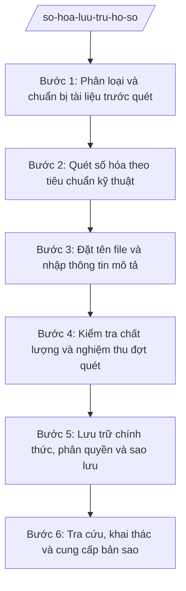

# Skill: Số hóa, lưu trữ hồ sơ

## Khi nào dùng

- Triển khai số hóa hồ sơ, tài liệu giấy đang lưu tại Văn phòng HĐND&UBND, các phòng, Trung tâm PVHCC.
- Xây dựng hoặc chuẩn hóa quy tắc đặt tên file, cây thư mục lưu trữ dùng chung toàn xã.
- Tổ chức lưu trữ hồ sơ điện tử, thay thế dần việc tra cứu hồ sơ giấy.
- Tra cứu, khai thác, cung cấp bản sao hồ sơ lưu trữ cho cá nhân, tổ chức có yêu cầu hợp lệ.
- Rà soát an toàn kho dữ liệu: phân quyền truy cập, sao lưu dự phòng, nhật ký tra cứu.

## Đầu vào (Input)

| Trường | Mô tả | Bắt buộc |
|--------|-------|----------|
| `Danh mục hồ sơ số hóa` | Liệt kê nhóm hồ sơ, loại tài liệu, số lượng ước tính cần số hóa | Có |
| `Thời gian thực hiện` | Kế hoạch đợt số hóa (bắt đầu, kết thúc) | Có |
| `Thiết bị, phần mềm` | Máy quét, phần mềm quản lý tài liệu hiện có của xã | Không |
| `Quy ước đặt tên` | Quy tắc đặt tên file/thư mục (nếu chưa có, AI đề xuất dự thảo) | Không |
| `Vị trí lưu trữ` | Máy chủ hoặc thư mục dùng chung lưu trữ hồ sơ điện tử | Có |
| `Phân quyền truy cập` | Danh sách ai được xem/sửa từng nhóm hồ sơ | Có |
| `Chế độ sao lưu` | Tần suất sao lưu, nơi lưu bản sao dự phòng | Không |

## Quy trình

**Bước 1. Phân loại và chuẩn bị tài liệu trước quét**

- Làm gì: Thu gom hồ sơ theo danh mục; phân loại theo nhóm (văn bản đi/đến, hồ sơ TTHC, hồ sơ địa chính, hồ sơ cán bộ...); gỡ ghim kẹp, làm phẳng tài liệu, đánh số trang, loại bỏ bản trùng lặp, lập danh mục kiểm đếm.
- Dùng input: `Danh mục hồ sơ số hóa`.
- Vai trò: Công chức văn thư – lưu trữ thực hiện (AI hỗ trợ lập danh mục kiểm đếm, gợi ý nhóm phân loại theo loại tài liệu). ⏱ ~theo khối lượng hồ sơ (ước tính).
- Lưu ý nghiệp vụ: Tài liệu rách, mờ phải được ghi chú/phục hồi trước khi quét; giữ nguyên thứ tự sắp xếp của hồ sơ gốc; không làm mất, làm lẫn tài liệu trong quá trình chuẩn bị.
- → Kết quả bước: Hồ sơ đã phân loại, đánh số trang, kèm danh mục kiểm đếm.

**Bước 2. Quét số hóa theo tiêu chuẩn kỹ thuật**

- Làm gì: Quét từng tập hồ sơ với độ phân giải tối thiểu 300 dpi, định dạng PDF; tài liệu màu có giá trị (bản đồ, ảnh) quét màu; kiểm tra ngay số trang của file quét khớp với số trang bản giấy.
- Dùng input: Danh mục kiểm đếm (bước 1), `Thiết bị, phần mềm`.
- Vai trò: Công chức văn thư vận hành máy quét (AI hỗ trợ kiểm tra đếm trang tự động, cảnh báo file thiếu trang hoặc chất lượng mờ) ⏱ ~theo khối lượng hồ sơ (ước tính).
- Lưu ý nghiệp vụ: Không nén file làm giảm chất lượng đến mức không đọc được nội dung; tài liệu khổ lớn, bản đồ dùng thiết bị quét phù hợp; quét xong đối chiếu ngay, không để dồn cuối đợt.
- → Kết quả bước: File quét đầy đủ số trang, nội dung đọc rõ.

**Bước 3. Đặt tên file và nhập thông tin mô tả**

- Làm gì: Đặt tên file theo quy ước thống nhất toàn xã (VD: [Mã loại]-[Số hiệu văn bản]-[Ngày]-[Trích yếu rút gọn]); nhập thông tin mô tả tối thiểu cho mỗi hồ sơ: số hiệu, ngày văn bản, tên loại, trích yếu, đơn vị ban hành/lưu giữ.
- Dùng input: `Quy ước đặt tên`, file quét (bước 2).
- Vai trò: Công chức văn thư đặt tên và nhập liệu (AI hỗ trợ đề xuất tên file từ nội dung trích yếu, kiểm tra tên trùng lặp trong kho lưu trữ). Thời gian ước tính: 5 phút/hồ sơ.
- Lưu ý nghiệp vụ: `Quy ước đặt tên` (có dấu hay không dấu, ký tự phân cách) phải thống nhất toàn xã và được phê duyệt; tuyệt đối không đặt tên chung chung kiểu "scan001.pdf".
- → Kết quả bước: File đã đặt tên đúng quy ước, có đầy đủ thông tin mô tả.

**Bước 4. Kiểm tra chất lượng và nghiệm thu đợt quét**

- Làm gì: Kiểm tra mẫu tối thiểu 10% số hồ sơ đã số hóa theo các tiêu chí: đủ trang, rõ nét, đúng tên file, đúng thư mục; lập biên bản nghiệm thu chất lượng đợt số hóa.
- Dùng input: File đã đặt tên (bước 3), danh mục kiểm đếm (bước 1).
- Vai trò: Công chức văn thư tự kiểm tra (AI hỗ trợ đối chiếu số lượng file với danh mục kiểm đếm, phát hiện tên file sai quy ước); Chánh Văn phòng nghiệm thu, ký biên bản. Thời gian ước tính: 0,5 ngày làm việc/đợt.
- Lưu ý nghiệp vụ: Lô hồ sơ không đạt chất lượng phải quét lại, không "châm chước" đưa vào lưu trữ chính thức; biên bản nghiệm thu được lưu cùng hồ sơ đợt số hóa.
- → Kết quả bước: Biên bản nghiệm thu chất lượng số hóa của đợt.

**Bước 5. Lưu trữ chính thức, phân quyền và sao lưu**

- Làm gì: Chuyển file đạt nghiệm thu vào kho lưu trữ chính thức theo cây thư mục đã quy định; thiết lập phân quyền xem/sửa theo từng nhóm hồ sơ; thực hiện sao lưu định kỳ ra thiết bị lưu trữ độc lập; ghi nhật ký sao lưu.
- Dùng input: `Vị trí lưu trữ`, `Phân quyền truy cập`, `Chế độ sao lưu`.
- Vai trò: Công chức văn thư (phối hợp công chức phụ trách công nghệ thông tin nếu có) thực hiện (AI hỗ trợ kiểm tra phân quyền đúng danh sách được duyệt, nhắc lịch sao lưu định kỳ). ⏱ ~định kỳ theo chế độ sao lưu (ước tính).
- Lưu ý nghiệp vụ: Hồ sơ mật thực hiện theo quy định về bảo vệ bí mật nhà nước; duy trì ít nhất 02 bản sao lưu ở vị trí vật lý khác nhau; kiểm tra khả năng phục hồi từ bản sao lưu định kỳ.
- → Kết quả bước: Kho lưu trữ hồ sơ điện tử có phân quyền đúng quy định và có sao lưu dự phòng.

**Bước 6. Tra cứu, khai thác và cung cấp bản sao**

- Làm gì: Tiếp nhận yêu cầu tra cứu (người yêu cầu, mục đích, phạm vi); tìm kiếm theo tên file, thông tin mô tả, từ khóa; cung cấp bản xem/bản sao khi được phê duyệt; ghi nhật ký tra cứu, cung cấp.
- Dùng input: Yêu cầu tra cứu của cá nhân, tổ chức; kho lưu trữ hồ sơ điện tử.
- Vai trò: Công chức văn thư tra cứu (AI hỗ trợ tìm kiếm nhanh theo từ khóa, trích xuất nội dung liên quan); Chánh Văn phòng phê duyệt việc cung cấp bản sao. ⏱ ~theo từng yêu cầu (ước tính).
- Lưu ý nghiệp vụ: Mọi lượt cung cấp bản sao hồ sơ phải được phê duyệt và ghi nhật ký; không cung cấp hồ sơ mật, hồ sơ hạn chế tiếp cận trái quy định; bản sao từ hồ sơ số hóa phải ghi rõ nguồn trích xuất.
- → Kết quả bước: Kết quả tra cứu/bản sao đã cung cấp kèm nhật ký tra cứu.

## Luồng quy trình (Workflow)

## Đầu ra (Output)

- Quy ước đặt tên file và tổ chức cây thư mục lưu trữ (được phê duyệt).
- Danh mục hồ sơ đã số hóa.
- Biên bản nghiệm thu chất lượng số hóa (sản phẩm chính của mỗi đợt).
- Sơ đồ phân quyền truy cập kho lưu trữ.
- Nhật ký sao lưu dự phòng.
- Nhật ký tra cứu, cung cấp bản sao hồ sơ.

### Cấu trúc output chuẩn

**BIÊN BẢN NGHIỆM THU CHẤT LƯỢNG SỐ HÓA HỒ SƠ** — các phần bắt buộc theo đúng thứ tự, đúng thể thức văn bản hành chính theo NĐ 30/2020/NĐ-CP:

1. Quốc hiệu "CỘNG HÒA XÃ HỘI CHỦ NGHĨA VIỆT NAM" – Tiêu ngữ "Độc lập – Tự do – Hạnh phúc".
2. Tên biên bản: BIÊN BẢN NGHIỆM THU CHẤT LƯỢNG SỐ HÓA HỒ SƠ; đợt số hóa; ngày nghiệm thu.
3. Thành phần nghiệm thu: trưởng đoàn, các thành viên (họ tên, chức vụ).
4. Phạm vi nghiệm thu: danh mục hồ sơ số hóa trong đợt (nhóm hồ sơ, số lượng).
5. Tiêu chí kiểm tra và kết quả: tỷ lệ mẫu kiểm tra; số đạt/không đạt của từng tiêu chí (đủ trang, rõ nét, đúng tên file, đúng thư mục lưu trữ).
6. Kết luận: đạt yêu cầu / không đạt; yêu cầu khắc phục (nếu có) và thời hạn khắc phục.
7. Chữ ký của các thành viên đoàn nghiệm thu.
8. Nơi nhận: đơn vị thực hiện số hóa; đơn vị quản lý công tác văn thư, lưu trữ; Lưu: VT.

## Checklist nghiệm thu

1. 100% hồ sơ trong danh mục đợt số hóa đã được quét, không sót tập nào.
2. File quét đủ số trang so với bản giấy, nội dung đọc rõ (độ phân giải đạt chuẩn).
3. Tên file tuân thủ đúng quy ước đã phê duyệt, không có tên chung chung, không trùng tên.
4. Mỗi hồ sơ có đầy đủ thông tin mô tả tối thiểu (số hiệu, ngày, tên loại, trích yếu).
5. Mẫu kiểm tra đạt tối thiểu 10% số hồ sơ, có biên bản nghiệm thu được ký.
6. Hồ sơ không đạt chất lượng đã được quét lại và nghiệm thu lại trước khi lưu chính thức.
7. Phân quyền truy cập đúng danh sách được duyệt; hồ sơ mật được cách ly theo quy định.
8. Có ít nhất 02 bản sao lưu ở vị trí khác nhau; nhật ký sao lưu được ghi đầy đủ.
9. Mọi lượt cung cấp bản sao đều có phê duyệt và được ghi nhật ký.

## Ví dụ mô phỏng

*Dữ liệu dưới đây là giả lập 100% phục vụ minh họa.*

**Input mẫu:**

| Trường | Giá trị mẫu |
|--------|-------------|
| Danh mục hồ sơ số hóa | Văn bản đi/đến năm 2026 của Văn phòng HĐND&UBND xã A: 500 văn bản |
| Thời gian thực hiện | Đợt 1: từ 01/10/2026 đến 31/10/2026 |
| Thiết bị, phần mềm | 01 máy quét A4/A3; thư mục dùng chung của xã |
| Quy ước đặt tên | [DI/DEN]-[Số hiệu]-[Ngày VB]-[Trích yếu rút gọn].pdf (dự thảo AI đề xuất) |
| Vị trí lưu trữ | Thư mục dùng chung: /luu-tru-xa-A/van-ban/2026/ |
| Phân quyền truy cập | Cán bộ Văn phòng: xem/sửa; các phòng: chỉ xem văn bản liên quan; khách: không truy cập |
| Chế độ sao lưu | Sao lưu hằng tuần ra ổ cứng ngoài, lưu tại kho văn thư |

**Output mẫu (Biên bản nghiệm thu chất lượng số hóa):**

CỘNG HÒA XÃ HỘI CHỦ NGHĨA VIỆT NAM
Độc lập – Tự do – Hạnh phúc

**BIÊN BẢN NGHIỆM THU CHẤT LƯỢNG SỐ HÓA HỒ SƠ**
Đợt 1/2026 · Xã A, ngày 31 tháng 10 năm 2026

1. Thành phần nghiệm thu:
   - Trưởng đoàn: Ông Phạm Văn C — Chánh Văn phòng HĐND&UBND xã A.
   - Thành viên: công chức văn thư – lưu trữ xã A.
2. Phạm vi nghiệm thu: 500 văn bản đi/đến năm 2026 của Văn phòng HĐND&UBND xã A (300 văn bản đi, 200 văn bản đến).
3. Tiêu chí kiểm tra và kết quả (mẫu kiểm tra: 50 văn bản, đạt 10%):
   - Đủ số trang so với bản giấy: 50/50 đạt.
   - Nội dung rõ nét, đọc được: 50/50 đạt.
   - Đúng quy ước đặt tên file: 48/50 đạt; 02 file sai định dạng ngày, đã sửa lại và kiểm tra lại đạt.
   - Đúng thư mục lưu trữ: 50/50 đạt.
4. Kết luận: Đợt số hóa đạt yêu cầu chất lượng; 02 file sai tên đã được khắc phục xong trong ngày. Đồng ý đưa 500 văn bản vào lưu trữ chính thức.
5. Các thành viên cùng ký tên.

TRƯỞNG ĐOÀN · THÀNH VIÊN
(Ký, ghi rõ họ tên) · (Ký, ghi rõ họ tên)

## Human gate

- Công chức văn thư – lưu trữ thực hiện quét, đặt tên, nhập liệu → Chánh Văn phòng HĐND&UBND nghiệm thu chất lượng, phê duyệt quy ước đặt tên và danh sách phân quyền.
- Kế hoạch số hóa đợt lớn, quy chế khai thác kho lưu trữ (nếu ban hành) do Chủ tịch UBND xã phê duyệt.

## Giới hạn

- AI không tự quyết định tiêu hủy bản giấy sau khi số hóa; việc xử lý bản giấy thực hiện theo quy định lưu trữ.
- AI không chỉnh sửa, thay đổi nội dung file quét; không tự ý đổi tên file trái quy ước đã phê duyệt.
- AI không cấp quyền truy cập hồ sơ mật, hồ sơ hạn chế tiếp cận; không cung cấp bản sao khi chưa được phê duyệt.
- AI không bịa đặt tiêu chuẩn kỹ thuật số hóa; chỉ áp dụng tiêu chuẩn đã được phê duyệt.

## Căn cứ & lưu ý

- TT 06/2026/TT-BNV: khung nhiệm vụ ngành Nội vụ ở cấp xã, trong đó có công tác văn thư – lưu trữ (quản lý tài liệu lưu trữ, Kho lưu trữ số, cơ sở dữ liệu tài liệu lưu trữ).
- NĐ 30/2020/NĐ-CP: công tác văn thư; thể thức và kỹ thuật trình bày văn bản hành chính.
- NĐ 150/2025/NĐ-CP: tổ chức UBND cấp xã và các phòng chuyên môn (đầu mối văn thư, lưu trữ: Văn phòng HĐND&UBND).
- Việc bảo quản bản chính, bảo vệ bí mật nhà nước trong số hóa thực hiện theo quy định pháp luật về lưu trữ, bảo vệ bí mật nhà nước (không gắn số hiệu cụ thể do chưa xác thực trong tài liệu).
