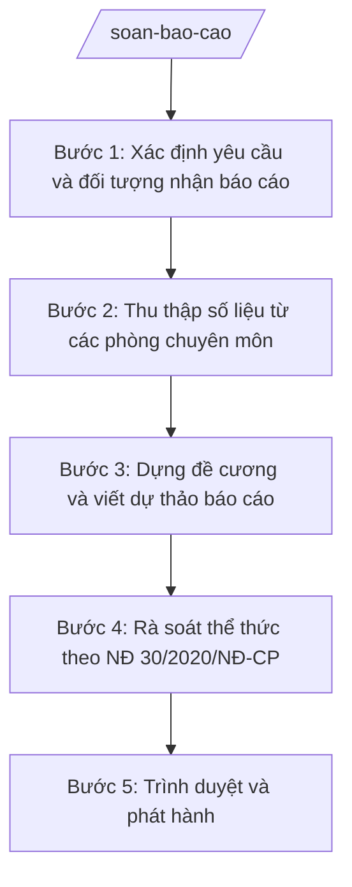

# Skill: Soạn báo cáo

## Khi nào dùng

- Lập báo cáo tình hình kinh tế – xã hội tháng, quý, 6 tháng, năm của cơ quan A gửi cấp trên.
- Soạn báo cáo đột xuất khi có yêu cầu của cấp trên, cơ quan chuyên môn (thiên tai, dịch bệnh, vụ việc phát sinh).
- Soạn báo cáo chuyên đề theo lĩnh vực (nông nghiệp, xây dựng, an sinh xã hội, cải cách hành chính...).
- Tổng hợp báo cáo gửi Đảng ủy xã phục vụ họp Ban Thường vụ, hội nghị sơ kết, tổng kết.
- Soạn báo cáo kết quả thực hiện nghị quyết, kết luận của HĐND cùng cấp, của cấp trên.

## Đầu vào (Input)

| Trường | Mô tả | Bắt buộc |
|--------|-------|----------|
| `loai_bao_cao` | Định kỳ (tháng/quý/6 tháng/năm) hoặc đột xuất hoặc chuyên đề | Có |
| `ky_bao_cao` | Kỳ báo cáo (vd: "tháng 9/2026", "quý III/2026", "năm 2026") | Có |
| `noi_nhan` | Đơn vị nhận báo cáo (vd: UBND tỉnh A, Đảng ủy xã A, Sở Nội vụ tỉnh A) | Có |
| `so_lieu_linh_vuc` | Số liệu kết quả theo từng lĩnh vực (KT-XH, văn hóa – xã hội, quốc phòng – an ninh, CCHC...) | Có |
| `so_lieu_ky_truoc` | Số liệu cùng kỳ năm trước hoặc kỳ trước để so sánh (nếu có) | Không |
| `ton_tai_han_che` | Các tồn tại, hạn chế, khó khăn đã ghi nhận | Không |
| `nhiem_vu_tiep_theo` | Phương hướng, nhiệm vụ kỳ tới | Không |
| `kien_nghi` | Kiến nghị, đề xuất với cấp trên (nếu có) | Không |
| `nguoi_ky` | Chức danh người ký (mặc định: Chủ tịch UBND xã) | Không |

## Quy trình

**Bước 1. Xác định yêu cầu và đối tượng nhận báo cáo**

- Làm gì: Xác định loại báo cáo, kỳ báo cáo, đơn vị nhận và yêu cầu cụ thể của văn bản chỉ đạo (nếu báo cáo đột xuất/chuyên đề thì ghi rõ nội dung được yêu cầu).
- Dùng input: `loai_bao_cao`, `ky_bao_cao`, `noi_nhan`.
- Vai trò: Công chức Văn phòng tiếp nhận yêu cầu, AI hỗ trợ tóm tắt yêu cầu thành 3–5 gạch đầu dòng cần trả lời (⏱ 5 phút).
- Lưu ý nghiệp vụ: Báo cáo gửi cấp trên phải bám đúng đề cương/yêu cầu của văn bản chỉ đạo; không tự ý bỏ mục được yêu cầu.
- → Kết quả bước: Phiếu yêu cầu báo cáo ghi rõ loại, kỳ, nơi nhận, các nội dung bắt buộc phải có.

**Bước 2. Thu thập số liệu từ các phòng chuyên môn**

- Làm gì: Gửi đề nghị cung cấp số liệu đến Phòng Kinh tế, Phòng Văn hóa – Xã hội, Trung tâm PVHCC theo lĩnh vực; đối chiếu số liệu kỳ này với kỳ trước để phát hiện số liệu bất thường.
- Dùng input: `so_lieu_linh_vuc`, `so_lieu_ky_truoc`.
- Vai trò: Công chức Văn phòng làm đầu mối thu thập, AI hỗ trợ lập bảng tổng hợp số liệu và đánh dấu các số liệu chênh lệch bất thường cần xác minh lại (⏱ 20 phút).
- Lưu ý nghiệp vụ: Số liệu phải có nguồn gốc rõ ràng (đơn vị cung cấp, thời điểm chốt số liệu); số liệu chênh lệch quá lớn so với kỳ trước phải yêu cầu đơn vị giải trình trước khi đưa vào báo cáo.
- → Kết quả bước: Bảng tổng hợp số liệu các lĩnh vực đã được xác minh, có cột so sánh kỳ trước.

**Bước 3. Dựng đề cương và viết dự thảo báo cáo**

- Làm gì: Dựng đề cương theo cấu trúc chuẩn (kết quả – đánh giá – phương hướng – kiến nghị), sau đó viết dự thảo đầy đủ, đưa số liệu vào đúng mục, diễn đạt trang trọng, khách quan.
- Dùng input: `loai_bao_cao`, `ky_bao_cao`, `so_lieu_linh_vuc`, `ton_tai_han_che`, `nhiem_vu_tiep_theo`, `kien_nghi`.
- Vai trò: Công chức Văn phòng soạn thảo, AI hỗ trợ viết dự thảo hoàn chỉnh từ đề cương và số liệu, kiểm tra tính nhất quán giữa số liệu trong văn bản và bảng tổng hợp (⏱ 40 phút).
- Lưu ý nghiệp vụ: Không bịa số liệu; phần đánh giá phải phản ánh đúng tồn tại, không tô hồng; kiến nghị phải cụ thể, có địa chỉ (kiến nghị ai, việc gì).
- → Kết quả bước: Dự thảo báo cáo đầy đủ nội dung, số liệu khớp với bảng tổng hợp.

**Bước 4. Rà soát thể thức theo NĐ 30/2020/NĐ-CP**

- Làm gì: Kiểm tra thể thức dự thảo theo 9 yếu tố của NĐ 30/2020/NĐ-CP (quốc hiệu – tiêu ngữ; tên cơ quan; số, ký hiệu; địa danh và thời gian; tên loại và trích yếu; nội dung; chức vụ, họ tên, chữ ký; dấu; nơi nhận).
- Dùng input: Dự thảo báo cáo từ Bước 3.
- Vai trò: Công chức Văn phòng rà soát, AI hỗ trợ chạy checklist thể thức và liệt kê lỗi cần sửa (⏱ 10 phút).
- Lưu ý nghiệp vụ: Số văn bản lấy theo sổ đăng ký văn bản đi của Văn phòng; ký hiệu loại văn bản "BC-UBND"; người ký là người đứng đầu cơ quan (hoặc cấp phó được ủy quyền).
- → Kết quả bước: Dự thảo báo cáo đã sửa sạch lỗi thể thức.

**Bước 5. Trình duyệt và phát hành**

- Làm gì: Lập phiếu trình ký kèm dự thảo báo cáo; trình Chánh Văn phòng kiểm tra, sau đó trình người đứng đầu cơ quan ký duyệt; phát hành văn bản đến nơi nhận, lưu hồ sơ.
- Dùng input: `nguoi_ky`, `noi_nhan`.
- Vai trò: Chánh Văn phòng kiểm tra nội dung và thể thức lần cuối (⏱ 15 phút); người đứng đầu cơ quan ký duyệt; công chức văn thư phát hành và lưu hồ sơ; AI hỗ trợ: kiểm tra thể thức lần cuối, đối chiếu nơi nhận đầy đủ.
- Lưu ý nghiệp vụ: Chỉ phát hành sau khi có chữ ký của người có thẩm quyền; nơi nhận phải bao gồm đầy đủ các đơn vị theo quy định và đơn vị được yêu cầu.
- → Kết quả bước: Báo cáo chính thức đã ký, đã phát hành, hồ sơ lưu trữ đầy đủ.

## Luồng quy trình (Workflow)

## 5. Đầu ra (Output)

- Dự thảo báo cáo (file .docx) đúng thể thức NĐ 30/2020/NĐ-CP.
- Bảng tổng hợp số liệu các lĩnh vực kèm so sánh kỳ trước.
- Phiếu trình ký (nếu trình qua nhiều cấp).
- Báo cáo chính thức đã ký và danh sách nơi nhận đã phát hành.

### Cấu trúc output chuẩn

Thứ tự các phần bắt buộc của một báo cáo:

1. **Quốc hiệu – tiêu ngữ**: "CỘNG HÒA XÃ HỘI CHỦ NGHĨA VIỆT NAM" / "Độc lập – Tự do – Hạnh phúc" (căn giữa, chữ in hoa/in thường theo thể thức).
2. **Tên cơ quan ban hành**: "ỦY BAN NHÂN DÂN / XÃ A" (bên trái).
3. **Số, ký hiệu văn bản**: "Số: …/BC-UBND" (bên trái, dưới tên cơ quan).
4. **Địa danh và thời gian ban hành**: "Xã A, ngày … tháng … năm …" (bên phải).
5. **Tên loại và trích yếu nội dung**: "BÁO CÁO" + trích yếu (vd: "Tình hình kinh tế – xã hội tháng 9 năm 2026") (căn giữa).
6. **Kính gửi**: đơn vị nhận báo cáo.
7. **Nội dung báo cáo**:
   - **I. Kết quả thực hiện**: theo từng lĩnh vực, có số liệu cụ thể;
   - **II. Đánh giá chung**: thuận lợi, khó khăn, tồn tại, hạn chế và nguyên nhân;
   - **III. Phương hướng, nhiệm vụ thời gian tới**: nhiệm vụ trọng tâm, giải pháp;
   - **IV. Kiến nghị, đề xuất** (nếu có).
8. **Nơi nhận**: liệt kê đầy đủ (đơn vị nhận chính; lưu VT).
9. **Chữ ký**: "TM. ỦY BAN NHÂN DÂN" / "CHỦ TỊCH" (hoặc "KT. CHỦ TỊCH / PHÓ CHỦ TỊCH"), họ tên người ký, dấu.

## 6. Checklist nghiệm thu

1. Đủ 9 phần theo Cấu trúc output chuẩn, đúng thứ tự, đúng thể thức NĐ 30/2020/NĐ-CP.
2. Loại báo cáo, kỳ báo cáo, nơi nhận khớp với yêu cầu ban đầu.
3. Mọi số liệu trong báo cáo khớp với bảng tổng hợp số liệu và có nguồn gốc rõ ràng.
4. Không có số liệu, căn cứ pháp lý bị bịa đặt; số liệu so sánh kỳ trước chính xác.
5. Phần đánh giá nêu được tồn tại, hạn chế và nguyên nhân, không tô hồng.
6. Kiến nghị cụ thể, có địa chỉ (gửi ai, việc gì).
7. Số, ký hiệu văn bản đúng sổ đăng ký văn bản đi; người ký đúng thẩm quyền.
8. Đã qua đủ các nấc human gate (Chánh Văn phòng kiểm tra, người đứng đầu cơ quan ký duyệt).
9. Nơi nhận đầy đủ, đã phát hành và lưu hồ sơ đúng quy định.

## 7. Ví dụ mô phỏng

*Dữ liệu dưới đây là giả lập 100% phục vụ minh họa.*

**Input mẫu:**

- loai_bao_cao: Định kỳ tháng
- ky_bao_cao: tháng 9/2026
- noi_nhan: UBND tỉnh A
- so_lieu_linh_vuc: Thu ngân sách 10 tỷ đồng (đạt 90% dự toán tháng); gieo trồng 500 ha lúa vụ mùa; 100% trẻ 6 tuổi vào lớp 1; giải quyết 200 hồ sơ một cửa, không có hồ sơ trễ hạn
- ton_tai_han_che: 02 dự án giao thông nông thôn chậm tiến độ do vướng giải phóng mặt bằng
- nhiem_vu_tiep_theo: Đẩy nhanh giải phóng mặt bằng; chuẩn bị vụ đông xuân
- kien_nghi: Đề nghị UBND tỉnh A hỗ trợ 5 tỷ đồng sửa chữa đê bao nội đồng

**Output mẫu:**

> CỘNG HÒA XÃ HỘI CHỦ NGHĨA VIỆT NAM
> Độc lập – Tự do – Hạnh phúc
>
> ỦY BAN NHÂN DÂN
> XÃ A
>
> Số: 100/BC-UBND
>
> Xã A, ngày 30 tháng 9 năm 2026
>
> **BÁO CÁO**
> **Tình hình kinh tế – xã hội tháng 9 năm 2026**
>
> Kính gửi: Ủy ban nhân dân tỉnh A
>
> **I. KẾT QUẢ THỰC HIỆN**
>
> 1. Kinh tế: Thu ngân sách nhà nước trên địa bàn đạt 10 tỷ đồng, bằng 90% dự toán tháng; gieo trồng 500 ha lúa vụ mùa, đạt 100% kế hoạch.
> 2. Văn hóa – xã hội: 100% trẻ 6 tuổi vào lớp 1; các hoạt động văn hóa, thể thao diễn ra theo kế hoạch.
> 3. Cải cách hành chính: Trung tâm Phục vụ hành chính công tiếp nhận và giải quyết 200 hồ sơ, không có hồ sơ trễ hạn.
>
> **II. ĐÁNH GIÁ CHUNG**
>
> 1. Thuận lợi: ...
> 2. Khó khăn, tồn tại: 02 dự án giao thông nông thôn chậm tiến độ do vướng giải phóng mặt bằng.
>
> **III. PHƯƠNG HƯỚNG, NHIỆM VỤ THÁNG 10/2026**
>
> 1. Đẩy nhanh công tác giải phóng mặt bằng các dự án giao thông nông thôn.
> 2. Chuẩn bị các điều kiện cho sản xuất vụ đông xuân.
>
> **IV. KIẾN NGHỊ, ĐỀ XUẤT**
>
> Đề nghị Ủy ban nhân dân tỉnh A hỗ trợ 05 tỷ đồng để sửa chữa đê bao nội đồng.
>
> Nơi nhận:
> - Như trên;
> - Lưu: VT.
>
> TM. ỦY BAN NHÂN DÂN
> CHỦ TỊCH
>
> Nguyễn Văn A

## 8. Human gate

- Công chức Văn phòng soạn dự thảo → Chánh Văn phòng kiểm tra nội dung, số liệu, thể thức → người đứng đầu cơ quan ký duyệt → văn thư phát hành.
- Báo cáo gửi cấp tỉnh: người đứng đầu cơ quan duyệt và ký; không ủy quyền ký báo cáo định kỳ quan trọng (báo cáo năm, báo cáo chuyên đề lớn).

## 9. Giới hạn

- AI KHÔNG tự quyết định nội dung đánh giá, kiến nghị thay lãnh đạo cơ quan.
- AI KHÔNG tự ký, tự phát hành báo cáo; chỉ chuẩn bị dự thảo.
- AI KHÔNG bịa số liệu, không tự suy diễn số liệu khi input thiếu — phải yêu cầu bổ sung.
- AI KHÔNG trích dẫn văn bản pháp lý không có trong input hoặc không được xác thực; không dùng văn bản đã hết hiệu lực (vd: NĐ 45/2025/NĐ-CP đã bị thay thế bởi NĐ 150/2025/NĐ-CP).
- AI KHÔNG đưa thông tin mật, thông tin cá nhân của người dân vào báo cáo gửi cấp trên khi không cần thiết.

## 10. Căn cứ & lưu ý

- NĐ 30/2020/NĐ-CP về công tác văn thư (thể thức văn bản hành chính: áp dụng cho toàn bộ cấu trúc báo cáo).
- NĐ 150/2025/NĐ-CP (hiệu lực 16/6/2025): tổ chức cơ quan chuyên môn thuộc UBND cấp xã — Văn phòng HĐND và UBND, Phòng Kinh tế, Phòng Văn hóa – Xã hội, bộ phận một cửa; là đầu mối cung cấp số liệu báo cáo.
- NĐ 370/2025/NĐ-CP (hiệu lực 01/01/2026): sửa đổi, bổ sung NĐ 150/2025/NĐ-CP — xã tự quyết định thành lập phòng chuyên môn; khi xã tổ chức khác khung chuẩn, tra bảng mapping lĩnh vực → đầu mối.
- Các nghị định trong chuỗi 120–152/2025/NĐ-CP: phân định thẩm quyền, phân cấp, phân quyền giữa cấp tỉnh và cấp xã theo từng lĩnh vực — dùng làm căn cứ xác định nội dung báo cáo thuộc thẩm quyền cấp xã.
- Chế độ báo cáo định kỳ của từng lĩnh vực: thực hiện theo quy định pháp luật về chế độ báo cáo của ngành, lĩnh vực đó và yêu cầu cụ thể của văn bản chỉ đạo (không tự gắn số hiệu văn bản khi chưa xác thực).
