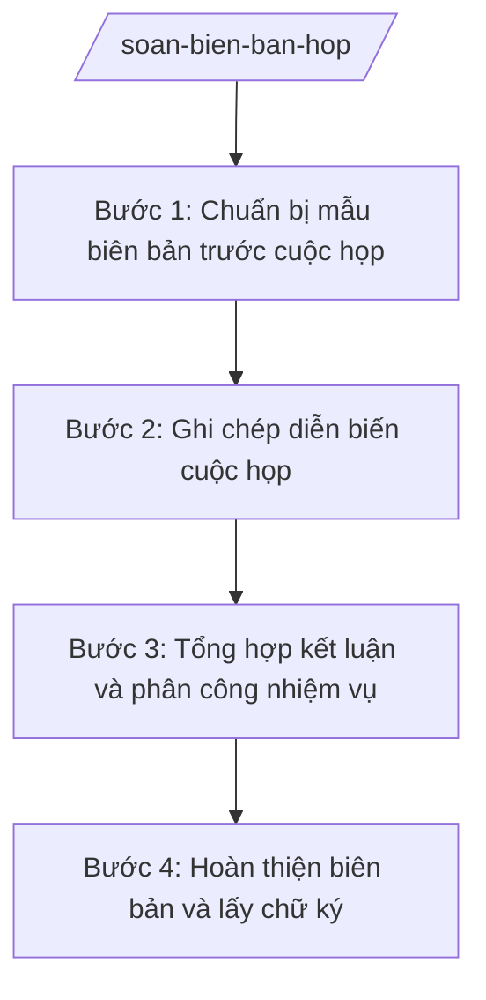

# Skill: Soạn biên bản họp

## Khi nào dùng

- Ghi biên bản họp giao ban UBND xã hằng tuần/tháng (Chủ tịch chủ trì).
- Ghi biên bản họp chuyên đề (giải phóng mặt bằng, phòng chống thiên tai, thu ngân sách...).
- Ghi biên bản hội nghị sơ kết, tổng kết, triển khai nhiệm vụ của UBND xã.
- Ghi biên bản họp giải quyết đơn thư, vụ việc phức tạp có nhiều thành phần tham dự.
- Ghi biên bản họp liên tịch giữa UBND xã với các đoàn thể, thôn/tổ dân phố.

## Đầu vào (Input)

| Trường | Mô tả | Bắt buộc |
|--------|-------|----------|
| `ten_cuoc_hop` | Tên cuộc họp (vd: "Họp giao ban UBND xã A tháng 9/2026") | Có |
| `thoi_gian` | Ngày, giờ bắt đầu – kết thúc cuộc họp | Có |
| `dia_diem` | Địa điểm họp (vd: "Phòng họp UBND xã A") | Có |
| `chu_tri` | Họ tên, chức vụ người chủ trì | Có |
| `thu_ky` | Họ tên, chức vụ thư ký ghi biên bản | Có |
| `thanh_phan` | Danh sách thành phần tham dự (họ tên, chức vụ, đơn vị) | Có |
| `noi_dung_thao_luan` | Diễn biến, ý kiến phát biểu của các thành phần | Có |
| `ket_luan` | Kết luận, chỉ đạo của người chủ trì; phân công nhiệm vụ (đầu mối, thời hạn) | Có |
| `tai_lieu_kem_theo` | Danh mục tài liệu họp đính kèm (nếu có) | Không |

## Quy trình

**Bước 1. Chuẩn bị mẫu biên bản trước cuộc họp**

- Làm gì: Lập mẫu biên bản với đầy đủ các mục cố định (tên cuộc họp, thời gian, địa điểm, chủ trì, thư ký, thành phần dự kiến) để chỉ việc ghi diễn biến trong lúc họp.
- Dùng input: `ten_cuoc_hop`, `thoi_gian`, `dia_diem`, `chu_tri`, `thu_ky`, `thanh_phan`
- Vai trò: Công chức Văn phòng HĐND&UBND chuẩn bị mẫu, AI hỗ trợ tạo mẫu biên bản đúng thể thức, điền sẵn thông tin cố định (10 phút).
- Lưu ý nghiệp vụ: Ghi đúng chức danh người chủ trì và thư ký; thành phần tham dự ghi đầy đủ họ tên, chức vụ — đây là căn cứ xác định tính hợp lệ của cuộc họp.
- → Kết quả bước: Mẫu biên bản đã điền sẵn thông tin cố định, sẵn sàng ghi chép.

**Bước 2. Ghi chép diễn biến cuộc họp**

- Làm gì: Ghi lại trung thực, đầy đủ diễn biến: nội dung báo cáo, ý kiến phát biểu của từng thành phần (ghi rõ ai nói, ý chính), các vấn đề còn ý kiến khác nhau.
- Dùng input: `noi_dung_thao_luan`
- Vai trò: Thư ký cuộc họp (công chức Văn phòng HĐND&UBND) ghi chép trực tiếp; AI hỗ trợ sắp xếp lại ghi chép thô thành các ý rõ ràng, gắn đúng người phát biểu (15 phút sau họp).
- Lưu ý nghiệp vụ: Ghi đúng ý người phát biểu, không thêm bớt, không suy diễn; các ý kiến khác nhau phải được ghi đầy đủ, không lược bỏ ý kiến thiểu số.
- → Kết quả bước: Bản ghi diễn biến đầy đủ, trung thực, có gắn tên người phát biểu.

**Bước 3. Tổng hợp kết luận và phân công nhiệm vụ**

- Làm gì: Trích kết luận, chỉ đạo của người chủ trì; lập bảng phân công: nội dung việc – đơn vị/cá nhân đầu mối – đơn vị phối hợp – thời hạn hoàn thành.
- Dùng input: `ket_luan`
- Vai trò: Công chức Văn phòng HĐND&UBND tổng hợp, AI hỗ trợ trích kết luận thành bảng phân công rõ đầu mối và thời hạn, kiểm tra không sót việc đã được kết luận (15 phút).
- Lưu ý nghiệp vụ: Mỗi kết luận phải có đầu mối chịu trách nhiệm và thời hạn cụ thể; không ghi kết luận chung chung không kiểm tra được.
- → Kết quả bước: Phần kết luận biên bản + bảng phân công nhiệm vụ rõ đầu mối, thời hạn.

**Bước 4. Hoàn thiện biên bản và lấy chữ ký**

- Làm gì: Ghép các phần thành biên bản hoàn chỉnh đúng thể thức; in trình thư ký ký, người chủ trì ký duyệt; phát hành đến các thành phần liên quan, lưu hồ sơ.
- Dùng input: `thu_ky`, `chu_tri`, `tai_lieu_kem_theo`
- Vai trò: Công chức Văn phòng HĐND&UBND hoàn thiện, AI hỗ trợ rà soát thể thức và tính đầy đủ các phần bắt buộc (10 phút); thư ký và chủ trì ký tay (hoặc ký số).
- Lưu ý nghiệp vụ: Biên bản phải có chữ ký của thư ký và người chủ trì mới có giá trị; phát hành chậm nhất 02 ngày làm việc sau cuộc họp (trừ trường hợp đặc biệt).
- → Kết quả bước: Biên bản họp đã ký, đã phát hành, lưu hồ sơ đầy đủ.

## Luồng quy trình (Workflow)

## Đầu ra (Output)

- Biên bản họp hoàn chỉnh (file .docx) có chữ ký thư ký và người chủ trì.
- Bảng phân công nhiệm vụ trích từ kết luận cuộc họp (đầu mối, thời hạn).
- Danh sách phát hành biên bản.

### Cấu trúc output chuẩn

Thứ tự các phần bắt buộc của biên bản họp, đúng thể thức NĐ 30/2020/NĐ-CP:

1. **Quốc hiệu – tiêu ngữ**: "CỘNG HÒA XÃ HỘI CHỦ NGHĨA VIỆT NAM" / "Độc lập – Tự do – Hạnh phúc".
2. **Tên cơ quan**: "ỦY BAN NHÂN DÂN / XÃ A" (bên trái).
3. **Tên loại**: "BIÊN BẢN" + tên cuộc họp (căn giữa, vd: "BIÊN BẢN / Họp giao ban UBND xã A tháng 9/2026").
4. **Thời gian**: ngày, giờ bắt đầu – kết thúc.
5. **Địa điểm**: địa điểm họp cụ thể.
6. **Thành phần tham dự**:
   - Chủ trì: họ tên, chức vụ;
   - Thư ký: họ tên, chức vụ;
   - Các thành phần khác: họ tên, chức vụ, đơn vị (liệt kê đầy đủ).
7. **Diễn biến cuộc họp**: nội dung báo cáo, ý kiến phát biểu của từng thành phần (ghi rõ người phát biểu – ý chính).
8. **Kết luận của người chủ trì**: các kết luận, chỉ đạo; bảng phân công nhiệm vụ (nội dung – đầu mối – phối hợp – thời hạn).
9. **Chữ ký**: "THƯ KÝ" (ký, ghi rõ họ tên) và "CHỦ TRÌ" (ký, ghi rõ họ tên, đóng dấu nếu cần).
10. **Nơi nhận** (nếu phát hành rộng): liệt kê đơn vị nhận; lưu hồ sơ.

## Checklist nghiệm thu

1. Đủ 10 phần theo Cấu trúc output chuẩn, đúng thứ tự.
2. Thời gian, địa điểm, chủ trì, thư ký, thành phần tham dự ghi đầy đủ, chính xác.
3. Diễn biến phản ánh trung thực ý kiến phát biểu, ghi rõ người phát biểu, không thêm bớt ý.
4. Kết luận trích đúng ý chỉ đạo của người chủ trì; mỗi việc có đầu mối và thời hạn cụ thể.
5. Có chữ ký của thư ký và người chủ trì (ký tay hoặc ký số hợp lệ).
6. Không bịa thêm nội dung không được thảo luận tại cuộc họp.
7. Phát hành đúng đối tượng, đúng thời hạn; lưu hồ sơ đầy đủ.
8. Ngôn ngữ trang trọng, khách quan, đúng văn phong hành chính.

## Ví dụ mô phỏng

*Dữ liệu dưới đây là giả lập 100% phục vụ minh họa.*

**Input mẫu:**

- ten_cuoc_hop: Họp giao ban UBND xã A tháng 9/2026
- thoi_gian: 08 giờ 00, ngày 25/9/2026 – 10 giờ 00 cùng ngày
- dia_diem: Phòng họp UBND xã A, số 123 đường B, xã A, tỉnh A
- chu_tri: Ông Nguyễn Văn A – Chủ tịch UBND xã A
- thu_ky: Ông Phạm Văn C – Chánh Văn phòng HĐND&UBND xã A
- thanh_phan: Bà Trần Thị B – Phó Chủ tịch UBND xã; Bà Hoàng Thị D – Trưởng phòng Kinh tế; Ông Vũ Văn E – Trưởng phòng Văn hóa – Xã hội
- noi_dung_thao_luan: Bà Hoàng Thị D báo cáo tiến độ 02 dự án giao thông nông thôn chậm do vướng giải phóng mặt bằng; Ông Vũ Văn E báo cáo 100% trẻ 6 tuổi vào lớp 1
- ket_luan: Giao Phòng Kinh tế phối hợp các thôn hoàn thành giải phóng mặt bằng trước 30/10/2026; giao Phòng Văn hóa – Xã hội chuẩn bị lễ khai giảng

**Output mẫu:**

> CỘNG HÒA XÃ HỘI CHỦ NGHĨA VIỆT NAM
> Độc lập – Tự do – Hạnh phúc
>
> ỦY BAN NHÂN DÂN
> XÃ A
>
> **BIÊN BẢN**
> **Họp giao ban UBND xã A tháng 9/2026**
>
> Thời gian: Từ 08 giờ 00 đến 10 giờ 00, ngày 25 tháng 9 năm 2026.
>
> Địa điểm: Phòng họp UBND xã A, số 123 đường B, xã A, tỉnh A.
>
> **I. THÀNH PHẦN THAM DỰ**
>
> - Chủ trì: Ông Nguyễn Văn A – Chủ tịch UBND xã A.
> - Thư ký: Ông Phạm Văn C – Chánh Văn phòng HĐND&UBND xã A.
> - Các thành phần khác:
>   + Bà Trần Thị B – Phó Chủ tịch UBND xã A;
>   + Bà Hoàng Thị D – Trưởng phòng Kinh tế xã A;
>   + Ông Vũ Văn E – Trưởng phòng Văn hóa – Xã hội xã A.
>
> **II. DIỄN BIẾN CUỘC HỌP**
>
> 1. Bà Hoàng Thị D báo cáo: 02 dự án giao thông nông thôn đang chậm tiến độ do vướng công tác giải phóng mặt bằng tại 10 hộ dân.
> 2. Ông Vũ Văn E báo cáo: 100% trẻ 6 tuổi trên địa bàn đã vào lớp 1, đạt kế hoạch năm học.
>
> **III. KẾT LUẬN CỦA NGƯỜI CHỦ TRÌ**
>
> Ông Nguyễn Văn A kết luận:
>
> 1. Giao Phòng Kinh tế chủ trì, phối hợp các thôn liên quan hoàn thành công tác giải phóng mặt bằng 02 dự án giao thông nông thôn trước ngày 30/10/2026.
> 2. Giao Phòng Văn hóa – Xã hội chuẩn bị các điều kiện tổ chức lễ khai giảng năm học mới.
>
> Cuộc họp kết thúc lúc 10 giờ 00 cùng ngày.
>
> | THƯ KÝ | CHỦ TRÌ |
> |---|---|
> | *(Ký, ghi rõ họ tên)* | *(Ký, ghi rõ họ tên)* |
> | Phạm Văn C | Nguyễn Văn A |
>
> Nơi nhận:
> - Các thành phần dự họp;
> - Lưu: VT.

## Human gate

- Thư ký cuộc họp (công chức Văn phòng HĐND&UBND) ghi và ký xác nhận nội dung diễn biến → người chủ trì cuộc họp đọc lại, ký duyệt biên bản → phát hành.
- Trường hợp biên bản ghi kết luận chỉ đạo quan trọng (phân công nhiệm vụ lớn, liên quan nhiều đơn vị): Chánh Văn phòng kiểm tra lại trước khi chủ trì ký.

## Giới hạn

- AI KHÔNG tự ý thêm, bớt, suy diễn ý kiến phát biểu của người tham dự.
- AI KHÔNG tự đặt ra kết luận, chỉ đạo thay người chủ trì cuộc họp.
- AI KHÔNG ký thay thư ký hoặc người chủ trì; biên bản chỉ có giá trị khi có chữ ký hợp lệ.
- AI KHÔNG bịa thành phần tham dự, thời gian, địa điểm không có trong input.
- AI KHÔNG ghi vào biên bản những nội dung mật, thông tin cá nhân nhạy cảm vượt quá phạm vi cần thiết của cuộc họp.

## Căn cứ & lưu ý

- NĐ 30/2020/NĐ-CP về công tác văn thư (thể thức biên bản là một loại văn bản hành chính).
- NĐ 150/2025/NĐ-CP (hiệu lực 16/6/2025): Văn phòng HĐND và UBND là đơn vị tham mưu lĩnh vực văn phòng — đầu mối tổ chức ghi biên bản các cuộc họp của UBND xã.
- NĐ 370/2025/NĐ-CP (hiệu lực 01/01/2026): xã tự quyết định thành lập phòng chuyên môn — thành phần tham dự họp xác định theo tổ chức thực tế của xã.
- Chế độ họp giao ban, họp chuyên đề của UBND xã: thực hiện theo quy chế làm việc của UBND xã và quy định pháp luật về tổ chức chính quyền địa phương (không tự gắn số hiệu văn bản khi chưa xác thực).
