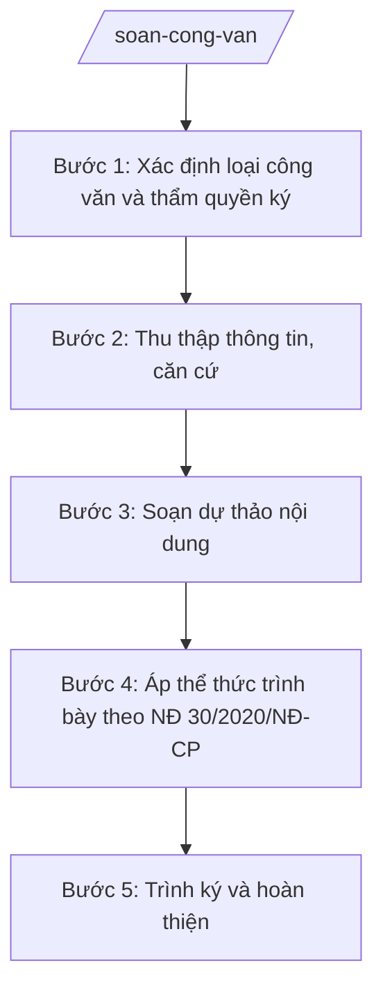

# Skill: Soạn công văn

> **Ghi chú áp dụng đa cấp:** Skill dùng chung cho mọi cấp hành chính. Các chức danh, đơn vị nêu trong quy trình (ví dụ: "Chủ tịch UBND xã", "Chánh Văn phòng", "Sở Tài chính") được viết theo mẫu minh họa — khi áp dụng ở cấp khác, thay bằng chức danh/đơn vị tương ứng của cấp đó (cấp tỉnh: Chủ tịch UBND tỉnh, Giám đốc Sở; cấp trung ương: Bộ trưởng, Vụ trưởng/Cục trưởng).

## Khi nào dùng

- Soạn công văn đôn đốc các phòng/ban báo cáo tiến độ nhiệm vụ được giao.
- Soạn công văn phúc đáp công văn đến của cấp trên, của đơn vị bạn hoặc của người dân/doanh nghiệp.
- Soạn công văn đề nghị phối hợp với xã/phường lân cận trong công việc liên quan (PCTT, ANTT, vệ sinh môi trường...).
- Soạn công văn báo cáo, xin ý kiến cấp trên khi vụ việc vượt thẩm quyền của xã.
- Soạn công văn trả lời kiến nghị, phản ánh của người dân sau khi tiếp công dân hoặc giải quyết đơn thư.
- Soạn công văn nội bộ truyền đạt ý kiến chỉ đạo của Chủ tịch UBND xã tới các đơn vị trực thuộc.

## Đầu vào (Input)

| Trường | Mô tả | Bắt buộc |
|--------|-------|----------|
| `loai_cong_van` | Loại công văn: đôn đốc / phúc đáp / đề nghị phối hợp / xin ý kiến / trả lời kiến nghị | Có |
| `nguoi_nhan` | Tên đơn vị hoặc cá nhân nhận (ví dụ: Phòng Kinh tế xã A, UBND xã B, Sở Nội vụ tỉnh A) | Có |
| `trich_yeu` | Tóm tắt nội dung chính (1–2 câu) để đặt sau "V/v" | Có |
| `noi_dung_chinh` | Các ý chính cần truyền đạt, diễn đạt bằng ý tưởng (không cần câu chữ hoàn chỉnh) | Có |
| `van_ban_lien_quan` | Số, ký hiệu, ngày tháng của văn bản đến/văn bản được phúc đáp (nếu có) | Không |
| `han_thoi_gian` | Thời hạn yêu cầu trả lời/thực hiện (nếu có) | Không |
| `don_vi_soan_thao` | Phòng/ban soạn thảo dự thảo (ví dụ: Văn phòng HĐND&UBND) | Có |
| `nguoi_ky_du_kien` | Chức vụ người ký dự kiến (Chủ tịch / Phó Chủ tịch / Chánh Văn phòng theo thẩm quyền) | Có |
| `noi_nhan` | Danh sách nơi nhận (ngoài người nhận chính) | Không |
| `ngay_ban_hanh` | Ngày dự kiến ban hành văn bản | Không |

## Quy trình

**Bước 1. Xác định loại công văn và thẩm quyền ký**

- Làm gì: Đọc input `loai_cong_van`, `nguoi_nhan`, `noi_dung_chinh` để xác định loại công văn (đôn đốc/phúc đáp/phối hợp/xin ý kiến/trả lời kiến nghị); đối chiếu với phân cấp, phân quyền hiện hành để đề xuất chức vụ người ký phù hợp.
- Dùng input: `loai_cong_van`, `nguoi_nhan`, `noi_dung_chinh`, `nguoi_ky_du_kien`.
- Vai trò: Công chức Văn phòng HĐND&UBND thực hiện; AI hỗ trợ: đề xuất loại công văn và người ký phù hợp (ví dụ: công văn đôn đốc nội bộ có thể do Chánh Văn phòng ký "TL. Chủ tịch"; công văn gửi cấp trên do Chủ tịch ký) ⏱ ~10 phút (ước tính).
- Lưu ý nghiệp vụ: Công văn gửi cấp trên, đơn vị ngoài xã phải do Chủ tịch hoặc Phó Chủ tịch ký; không để công chức ký thay. Công văn phúc đáp phải ghi rõ số, ký hiệu văn bản được phúc đáp.
- → Kết quả bước: Xác định được loại công văn + dự kiến người ký.

**Bước 2. Thu thập thông tin, căn cứ**

- Làm gì: Thu thập các văn bản liên quan (`van_ban_lien_quan`), số liệu, thời hạn (`han_thoi_gian`) phục vụ nội dung; kiểm tra xem nội dung có thuộc thẩm quyền giải quyết của xã hay không.
- Dùng input: `van_ban_lien_quan`, `han_thoi_gian`, `noi_dung_chinh`, `don_vi_soan_thao`.
- Vai trò: Công chức Văn phòng HĐND&UBND (hoặc phòng chuyên môn được giao) thu thập; AI hỗ trợ tổng hợp ý chính từ các văn bản liên quan thành dàn ý ⏱ ~15–20 phút (ước tính).
- Lưu ý nghiệp vụ: Nếu vụ việc vượt thẩm quyền xã, phải chuyển sang loại công văn "xin ý kiến/báo cáo cấp trên" thay vì tự trả lời. Chỉ dùng căn cứ pháp lý còn hiệu lực; số liệu phải có nguồn rõ ràng.
- → Kết quả bước: Dàn ý nội dung kèm căn cứ, số liệu, thời hạn đã được xác minh.

**Bước 3. Soạn dự thảo nội dung**

- Làm gì: Viết dự thảo công văn đầy đủ: phần mở đầu (nêu lý do/văn bản căn cứ), phần nội dung (các ý theo `noi_dung_chinh`, sắp xếp logic), phần kết (đề nghị/yêu cầu cụ thể, thời hạn nếu có).
- Dùng input: `trich_yeu`, `noi_dung_chinh`, `van_ban_lien_quan`, `han_thoi_gian`, `nguoi_nhan`.
- Vai trò: Công chức soạn thảo thực hiện; AI hỗ trợ diễn đạt câu chữ trang trọng, đúng văn phong hành chính, kiểm tra ngữ pháp và tính logic ⏱ ~20–30 phút (ước tính).
- Lưu ý nghiệp vụ: Một công văn chỉ giải quyết một nội dung chính. Câu chữ rõ ràng, không mơ hồ; yêu cầu đề nghị phải cụ thể (ai làm gì, hạn khi nào). Trích yếu sau "V/v" ngắn gọn, phản ánh đúng nội dung.
- → Kết quả bước: Dự thảo nội dung công văn hoàn chỉnh.

**Bước 4. Áp thể thức trình bày theo NĐ 30/2020/NĐ-CP**

- Làm gì: Dựng khung thể thức đầy đủ: quốc hiệu–tiêu ngữ; tên cơ quan ban hành; số, ký hiệu văn bản; địa danh, ngày tháng năm; tên loại và trích yếu; nội dung; nơi nhận; chữ ký, chức vụ người ký, con dấu.
- Dùng input: `don_vi_soan_thao`, `nguoi_ky_du_kien`, `noi_nhan`, `ngay_ban_hanh`, `nguoi_nhan`.
- Vai trò: Công chức văn thư/văn phòng thực hiện; AI hỗ trợ: kiểm tra đầy đủ các thành phần thể thức, số ký hiệu đúng quy ước (ví dụ: "..../CV-UBND"), canh lề và vị trí các khối ⏱ ~10 phút (ước tính).
- Lưu ý nghiệp vụ: Tên cơ quan ban hành ghi đầy đủ "ỦY BAN NHÂN DÂN XÃ A"; địa danh ghi "Xã A, ngày ... tháng ... năm ..."; nơi nhận liệt kê theo thứ tự: người nhận chính, cấp trên (để báo cáo), các đơn vị liên quan, lưu hồ sơ. Văn bản điện tử có chữ ký số hợp lệ có giá trị pháp lý như bản giấy (không cần dấu đỏ); chỉ dùng chữ ký tay kèm dấu đỏ khi phát hành bản giấy theo yêu cầu.
- → Kết quả bước: Bản dự thảo công văn đúng thể thức, sẵn sàng trình.

**Bước 5. Trình ký và hoàn thiện**

- Làm gì: Lập phiếu trình kèm dự thảo công văn; trình Chánh Văn phòng kiểm tra thể thức, trình lãnh đạo (Chủ tịch/Phó Chủ tịch theo phân công) duyệt nội dung và ký ban hành; đóng dấu, đánh số, phát hành theo nơi nhận.
- Dùng input: `nguoi_ky_du_kien`, `noi_nhan`.
- Vai trò: Công chức soạn thảo lập phiếu trình; Chánh Văn phòng HĐND&UBND kiểm tra thể thức (⏱ 5 phút); Chủ tịch/Phó Chủ tịch UBND xã duyệt và ký (⏱ 10 phút); văn thư phát hành, lưu hồ sơ; AI hỗ trợ: kiểm tra thể thức lần cuối, tổng hợp đầy đủ hồ sơ trình ký — tổng ước tính 20 phút (chưa tính thời gian chờ lãnh đạo).
- Lưu ý nghiệp vụ: Mọi sửa đổi của lãnh đạo trên dự thảo phải được cập nhật vào bản chính trước khi phát hành. Số văn bản lấy theo sổ đăng ký văn bản đi; lưu 01 bản có chữ ký tươi tại văn thư.
- → Kết quả bước: Công văn đã ký, đóng dấu, phát hành đúng nơi nhận; hồ sơ lưu đầy đủ.

## Luồng quy trình (Workflow)

## 5. Đầu ra (Output)

- Dự thảo công văn hoàn chỉnh, đúng thể thức NĐ 30/2020/NĐ-CP.
- Phiếu trình ký kèm theo (khi cần).
- Hồ sơ lưu: bản ký tươi + phiếu trình + văn bản liên quan.

### Cấu trúc output chuẩn

Khung cố định của một công văn, các phần bắt buộc theo đúng thứ tự:

1. **Quốc hiệu – tiêu ngữ** (canh giữa, phía trên cùng):
   CỘNG HÒA XÃ HỘI CHỦ NGHĨA VIỆT NAM / Độc lập – Tự do – Hạnh phúc
2. **Tên cơ quan ban hành** (canh trái): ỦY BAN NHÂN DÂN XÃ A
3. **Số, ký hiệu văn bản** (dưới tên cơ quan, canh trái): Số: .../CV-UBND
4. **Địa danh, ngày tháng năm ban hành** (canh phải): Xã A, ngày ... tháng ... năm ...
5. **Tên loại và trích yếu nội dung** (canh giữa): V/v ...
6. **Nội dung**: "Kính gửi: ..." → phần mở đầu (nêu lý do/văn bản căn cứ) → các ý chính → phần kết (đề nghị/yêu cầu, thời hạn).
7. **Nơi nhận** (cuối văn bản, canh trái): liệt kê theo thứ tự ưu tiên.
8. **Chữ ký, chức vụ người ký** (canh phải): "TM. ỦY BAN NHÂN DÂN" / chức vụ (CHỦ TỊCH / KT. CHỦ TỊCH – PHÓ CHỦ TỊCH / TL. CHỦ TỊCH – CHÁNH VĂN PHÒNG) / họ tên người ký, đóng dấu.

## 6. Checklist nghiệm thu

1. Có đủ 8 thành phần thể thức theo đúng thứ tự mục 5, không thiếu mục nào.
2. Tên cơ quan, quốc hiệu–tiêu ngữ, địa danh ghi đúng quy ước, không viết tắt sai.
3. Số, ký hiệu văn bản đúng định dạng ".../CV-UBND", không trùng số trong sổ đăng ký văn bản đi.
4. Trích yếu sau "V/v" ngắn gọn, phản ánh đúng nội dung chính của công văn.
5. Nội dung: một công văn một nội dung chính; yêu cầu/đề nghị cụ thể (ai – làm gì – hạn nào).
6. Công văn phúc đáp có ghi rõ số, ký hiệu, ngày tháng văn bản được phúc đáp.
7. Người ký đúng thẩm quyền (cấp trên/đơn vị ngoài: Chủ tịch hoặc Phó Chủ tịch ký).
8. Nơi nhận liệt kê đầy đủ, đúng thứ tự; có "Lưu: VT, ..." cuối danh sách.
9. Không bịa số liệu, căn cứ pháp lý; mọi con số đều có nguồn từ input hoặc văn bản liên quan.
10. Đã qua human gate: Chánh Văn phòng kiểm tra thể thức, lãnh đạo duyệt nội dung trước khi ký phát hành.

## 7. Ví dụ mô phỏng

*Dữ liệu dưới đây là giả lập 100% phục vụ minh họa.*

**Input mẫu:**

| Trường | Giá trị |
|--------|---------|
| loai_cong_van | đôn đốc |
| nguoi_nhan | Phòng Kinh tế xã A; Phòng Văn hóa – Xã hội xã A |
| trich_yeu | đôn đốc báo cáo tiến độ thực hiện nhiệm vụ quý III năm 2026 |
| noi_dung_chinh | Các phòng chưa gửi báo cáo quý III theo yêu cầu tại Công văn số 100/CV-UBND ngày 01/10/2026; yêu cầu gửi báo cáo về Văn phòng HĐND&UBND trước ngày 15/10/2026 để tổng hợp trình Chủ tịch UBND xã |
| van_ban_lien_quan | Công văn số 100/CV-UBND ngày 01/10/2026 của UBND xã A |
| han_thoi_gian | Trước ngày 15/10/2026 |
| don_vi_soan_thao | Văn phòng HĐND&UBND xã A |
| nguoi_ky_du_kien | Chánh Văn phòng (ký thay lãnh đạo) |
| noi_nhan | Chủ tịch UBND xã (để báo cáo); Lưu: VT, TH (2b) |

**Output mẫu:**

CỘNG HÒA XÃ HỘI CHỦ NGHĨA VIỆT NAM
Độc lập – Tự do – Hạnh phúc

ỦY BAN NHÂN DÂN XÃ A			Số: 105/CV-UBND

						Xã A, ngày 10 tháng 10 năm 2026

V/v đôn đốc báo cáo tiến độ thực hiện nhiệm vụ quý III năm 2026

Kính gửi:
- Phòng Kinh tế xã A;
- Phòng Văn hóa – Xã hội xã A.

Thực hiện Công văn số 100/CV-UBND ngày 01/10/2026 của UBND xã A về việc báo cáo tiến độ thực hiện nhiệm vụ quý III năm 2026, đến nay Văn phòng HĐND&UBND xã chưa nhận được báo cáo của các đơn vị.

UBND xã A yêu cầu Trưởng các phòng: Phòng Kinh tế, Phòng Văn hóa – Xã hội khẩn trương hoàn thành và gửi báo cáo tiến độ thực hiện nhiệm vụ quý III năm 2026 về Văn phòng HĐND&UBND (qua đồng chí Nguyễn Văn G, điện thoại 0900 000 001, email vanphong@xa-a.gov.vn) trước ngày 15/10/2026 để tổng hợp, trình Chủ tịch UBND xã.

Đề nghị các đơn vị nghiêm túc thực hiện./.

Nơi nhận:
- Như trên;
- Chủ tịch UBND xã (để báo cáo);
- Lưu: VT, TH (2b).

TL. CHỦ TỊCH
CHÁNH VĂN PHÒNG

Phạm Văn C

## 8. Human gate

- **Công chức soạn thảo** → soạn dự thảo, chịu trách nhiệm về nội dung, số liệu.
- **Chánh Văn phòng HĐND&UBND** → kiểm tra thể thức, câu chữ, tính thống nhất với các văn bản liên quan.
- **Chủ tịch / Phó Chủ tịch UBND xã** (theo phân công phụ trách lĩnh vực) → duyệt nội dung, ký ban hành.
- Không phát hành công văn khi chưa có chữ ký của người có thẩm quyền.

## 9. Giới hạn

- AI KHÔNG ra quyết định hành chính thay người có thẩm quyền; chỉ hỗ trợ soạn thảo dự thảo.
- AI KHÔNG tự ký, tự đóng dấu, tự phát hành văn bản dưới bất kỳ hình thức nào.
- AI KHÔNG bịa số liệu, căn cứ pháp lý; mọi con số phải có nguồn từ input hoặc văn bản liên quan do người dùng cung cấp.
- AI KHÔNG viện dẫn văn bản đã hết hiệu lực (ví dụ: không dùng NĐ 45/2025/NĐ-CP khi đã bị NĐ 150/2025/NĐ-CP thay thế).
- AI KHÔNG tư vấn nội dung vượt thẩm quyền của cấp xã; khi phát hiện vượt thẩm quyền phải đề xuất chuyển sang công văn xin ý kiến/báo cáo cấp trên.

## 10. Căn cứ & lưu ý

- NĐ 30/2020/NĐ-CP về công tác văn thư: thể thức, kỹ thuật trình bày văn bản hành chính (áp dụng cho công văn).
- NĐ 150/2025/NĐ-CP: tổ chức cơ quan chuyên môn thuộc UBND cấp xã (Văn phòng HĐND&UBND, các phòng chuyên môn) — căn cứ xác định đơn vị soạn thảo, đơn vị nhận.
- NĐ 370/2025/NĐ-CP (hiệu lực 01/01/2026): xã tự quyết định thành lập các phòng chuyên môn — khi xã tổ chức khác khung chuẩn, đối chiếu bảng mapping lĩnh vực → đầu mối trong khung-phong-ban-cap-xa.md.
- Theo quy định pháp luật về phân cấp, phân quyền, phân định thẩm quyền giữa cấp tỉnh và cấp xã: xác định đúng thẩm quyền ký công văn (chuỗi 28 NĐ 120–152/2025/NĐ-CP).
- Lưu ý: công văn là văn bản hành chính thông thường, không phải văn bản quy phạm pháp luật; không dùng công văn để đặt ra quy định bắt buộc chung.
