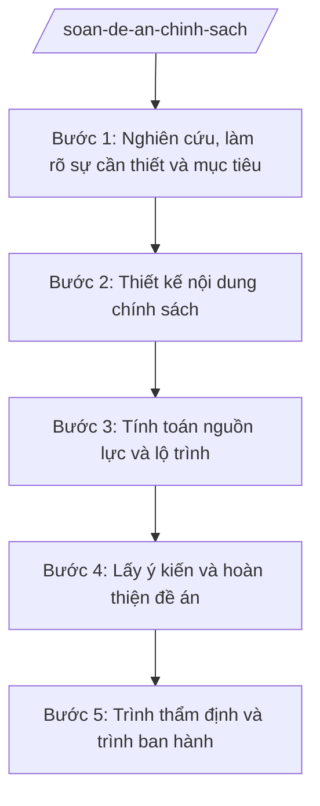

# Skill: Soạn đề án chính sách

## 2. Khi nào dùng
- UBND tỉnh giao sở, ngành xây dựng đề án chính sách mới (hỗ trợ doanh nghiệp, an sinh xã hội, phát triển ngành...).
- Chuẩn bị hồ sơ trình HĐND tỉnh ban hành nghị quyết về chính sách.
- Sơ kết, tổng kết để đề xuất điều chỉnh, bổ sung chính sách hiện hành.

## 3. Đầu vào (Input)
| Trường | Mô tả | Bắt buộc |
|--------|-------|----------|
| `ten_de_an` | Tên đề án chính sách | Có |
| `co_quan_chu_tri` | Sở, ngành chủ trì xây dựng đề án | Có |
| `su_can_thiet` | Sự cần thiết ban hành chính sách (vấn đề thực tiễn, yêu cầu) | Có |
| `muc_tieu` | Mục tiêu tổng quát và mục tiêu cụ thể | Có |
| `noi_dung_chinh_sach` | Nội dung chính sách: đối tượng, điều kiện, mức hỗ trợ/ưu đãi, trình tự thực hiện | Có |
| `nguon_luc` | Nguồn lực thực hiện (ngân sách, nhân lực, cơ sở vật chất) | Có |
| `lo_trinh` | Lộ trình, thời gian thực hiện | Có |
| `bao_cao_danh_gia_td` | Báo cáo đánh giá tác động chính sách (nếu có) | Không |

## 4. Quy trình

**Bước 1. Nghiên cứu, làm rõ sự cần thiết và mục tiêu**
- Làm gì: Thu thập số liệu thực trạng, phân tích vấn đề cần giải quyết; xác định mục tiêu tổng quát và mục tiêu cụ thể, có chỉ tiêu đo được.
- Dùng input: `su_can_thiet`, `muc_tieu`
- Vai trò: Chuyên viên nghiên cứu; AI hỗ trợ hệ thống hóa số liệu, gợi ý khung mục tiêu — 2 ngày làm việc
- Lưu ý nghiệp vụ: Sự cần thiết phải gắn với chủ trương của Đảng, quy hoạch, kế hoạch phát triển của tỉnh; mục tiêu phải đo được.
- → Kết quả bước: Bản phân tích sự cần thiết và mục tiêu đề án.

**Bước 2. Thiết kế nội dung chính sách**
- Làm gì: Xây dựng nội dung chi tiết: đối tượng thụ hưởng, điều kiện, mức hỗ trợ/ưu đãi, trình tự thủ tục thực hiện, trách nhiệm các cơ quan.
- Dùng input: `noi_dung_chinh_sach`, `bao_cao_danh_gia_td`
- Vai trò: Chuyên viên thiết kế; Trưởng phòng chuyên môn góp ý; AI hỗ trợ rà soát tính đầy đủ, logic của các nội dung — 3 ngày làm việc
- Lưu ý nghiệp vụ: Nội dung phải khả thi, không trái văn bản cấp trên; phân định rõ trách nhiệm từng cơ quan; tránh quy định chung chung, khó thực hiện.
- → Kết quả bước: Dự thảo nội dung chính sách chi tiết.

**Bước 3. Tính toán nguồn lực và lộ trình**
- Làm gì: Dự toán kinh phí thực hiện theo năm; xác định nguồn ngân sách; lập lộ trình, tiến độ thực hiện theo giai đoạn.
- Dùng input: `nguon_luc`, `lo_trinh`, `noi_dung_chinh_sach`
- Vai trò: Chuyên viên phối hợp Sở Tài chính tỉnh A thẩm tra khả năng cân đối ngân sách; AI hỗ trợ lập bảng dự toán — 2 ngày làm việc
- Lưu ý nghiệp vụ: Dự toán phải có căn cứ tính; nguồn lực phải trong khả năng cân đối của ngân sách địa phương.
- → Kết quả bước: Bảng dự toán kinh phí và lộ trình thực hiện.

**Bước 4. Lấy ý kiến và hoàn thiện đề án**
- Làm gì: Gửi lấy ý kiến các sở, ngành liên quan và đối tượng chịu tác động; tổng hợp, tiếp thu, giải trình; hoàn thiện đề án.
- Dùng input: Dự thảo đề án
- Vai trò: Chuyên viên tổng hợp; AI hỗ trợ lập bảng tổng hợp ý kiến góp ý — 5 ngày làm việc
- Lưu ý nghiệp vụ: Lấy ý kiến phải thực chất, đủ thành phần liên quan; ý kiến không tiếp thu phải giải trình rõ lý do.
- → Kết quả bước: Đề án hoàn thiện kèm bảng tổng hợp tiếp thu ý kiến.

**Bước 5. Trình thẩm định và trình ban hành**
- Làm gì: Trình Sở Tư pháp thẩm định (nếu ban hành VBQPPL); trình UBND tỉnh xem xét, trình HĐND tỉnh quyết nghị (nếu thuộc thẩm quyền HĐND).
- Dùng input: Đề án hoàn thiện
- Vai trò: Giám đốc Sở ký tờ trình; AI hỗ trợ soạn tờ trình theo thể thức — 1 ngày làm việc
- Lưu ý nghiệp vụ: Đúng thẩm quyền quyết định (HĐND/UBND tỉnh); hồ sơ trình đầy đủ theo quy định.
- → Kết quả bước: Tờ trình + đề án trình cấp có thẩm quyền.

## Luồng quy trình (Workflow)

## 5. Đầu ra (Output)
- Đề án chính sách.
- Tờ trình đề nghị phê duyệt đề án.
- Bảng tổng hợp, tiếp thu ý kiến góp ý.

### Cấu trúc output chuẩn
Khung đề án chính sách trình HĐND/UBND tỉnh:
1. Tờ trình (đúng thể thức NĐ 30/2020/NĐ-CP): Quốc hiệu "CỘNG HÒA XÃ HỘI CHỦ NGHĨA VIỆT NAM" – Tiêu ngữ "Độc lập – Tự do – Hạnh phúc"; tên cơ quan ban hành; số, ký hiệu; địa danh, ngày tháng năm; tên loại + trích yếu; nội dung (sự cần thiết, mục đích, nội dung chính, kiến nghị); nơi nhận; chữ ký người có thẩm quyền.
2. Đề án:
   - Phần I: Sự cần thiết ban hành chính sách.
   - Phần II: Mục tiêu (tổng quát, cụ thể, chỉ tiêu).
   - Phần III: Nội dung chính sách (đối tượng, điều kiện, mức hỗ trợ, trình tự, trách nhiệm).
   - Phần IV: Nguồn lực thực hiện (dự toán chi tiết theo năm).
   - Phần V: Lộ trình, tiến độ thực hiện.
   - Phần VI: Hiệu quả dự kiến; rủi ro và giải pháp.
   - Phần VII: Tổ chức thực hiện.
3. Dự thảo văn bản QPPL kèm theo (nếu có).
4. Nơi nhận (tờ trình + đề án): HĐND/UBND tỉnh; các đại biểu (khi trình kỳ họp); Lưu: VT, cơ quan soạn thảo.

## 6. Checklist nghiệm thu
- [ ] Sự cần thiết có bằng chứng số liệu, gắn với chủ trương, quy hoạch của tỉnh.
- [ ] Mục tiêu cụ thể, có chỉ tiêu đo được.
- [ ] Nội dung chính sách đầy đủ: đối tượng, điều kiện, mức, trình tự, trách nhiệm.
- [ ] Dự toán có căn cứ tính, nguồn lực trong khả năng cân đối ngân sách.
- [ ] Đã lấy ý kiến đầy đủ thành phần; tiếp thu/giải trình rõ ràng.
- [ ] Đúng thẩm quyền quyết định của HĐND/UBND tỉnh.
- [ ] Đúng thể thức văn bản theo NĐ 30/2020/NĐ-CP.
- [ ] Đã qua thẩm định của Sở Tư pháp (nếu ban hành VBQPPL).

## 7. Ví dụ mô phỏng
*Dữ liệu dưới đây là giả lập 100% phục vụ minh họa.*

**Input mẫu:**
- ten_de_an: Đề án hỗ trợ phát triển hợp tác xã nông nghiệp trên địa bàn tỉnh A giai đoạn 2026–2030
- co_quan_chu_tri: Sở Nông nghiệp và Môi trường tỉnh A
- muc_tieu: Đến 2030, 70% hợp tác xã nông nghiệp hoạt động hiệu quả (số liệu giả lập)
- nguon_luc: Ngân sách tỉnh 50 tỷ đồng/giai đoạn (số liệu giả lập)

**Output mẫu (trích đề án):**
> **TỜ TRÌNH**
> Về việc đề nghị phê duyệt Đề án hỗ trợ phát triển hợp tác xã nông nghiệp trên địa bàn tỉnh A giai đoạn 2026–2030
>
> Kính gửi: Ủy ban nhân dân tỉnh A
>
> I. Sự cần thiết: ... (phân tích thực trạng giả lập)
> II. Mục tiêu: ...
> III. Nội dung chính sách: hỗ trợ 50% chi phí ... (mức giả lập)
> IV. Nguồn lực: 50 tỷ đồng từ ngân sách tỉnh (giả lập)
> ...
> **ĐỀ ÁN** (kèm theo): gồm 7 phần theo cấu trúc chuẩn.

## 8. Human gate
- Trưởng phòng chuyên môn thuộc Sở: kiểm tra nội dung đề án (Bước 2–3).
- Giám đốc Sở: ký tờ trình đề án (Bước 5).
- Sở Tư pháp: thẩm định (nếu ban hành VBQPPL).
- UBND tỉnh / HĐND tỉnh: xem xét, quyết định.

## 9. Giới hạn
- AI không thay lãnh đạo quyết định nội dung chính sách.
- Không bịa số liệu thực trạng, dự toán; mọi con số phải có căn cứ tính.
- Không đề xuất chính sách trái văn bản cấp trên hoặc vượt khả năng ngân sách.
- Không viện dẫn văn bản hết hiệu lực.

## 10. Căn cứ & lưu ý
- NĐ 150/2025/NĐ-CP (chức năng tham mưu của sở).
- Luật Tổ chức chính quyền địa phương 72/2025/QH15 (thẩm quyền HĐND, UBND tỉnh) — dẫn tên.
- NĐ 30/2020/NĐ-CP về công tác văn thư (thể thức).
