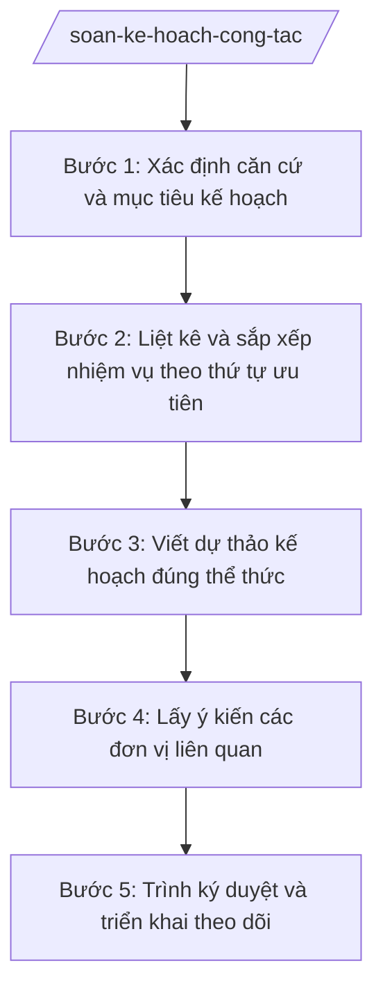

# Skill: Lập kế hoạch công tác

## Khi nào dùng

- Lập kế hoạch công tác tuần/tháng của UBND xã (phân công nhiệm vụ cho các phòng, đơn vị).
- Lập kế hoạch công tác quý/năm của từng phòng chuyên môn (Văn phòng HĐND&UBND, Phòng Kinh tế, Phòng Văn hóa – Xã hội).
- Lập kế hoạch công tác của Trung tâm Phục vụ hành chính công (tiếp nhận, giải quyết TTHC).
- Lập kế hoạch triển khai nhiệm vụ đột xuất, chuyên đề (phòng chống thiên tai, tổng điều tra, chiến dịch...).
- Rà soát, điều chỉnh kế hoạch khi có chỉ đạo mới của cấp trên hoặc phát sinh nhiệm vụ.

## Đầu vào (Input)

| Trường | Mô tả | Bắt buộc |
|--------|-------|----------|
| `don_vi` | Đơn vị lập kế hoạch (UBND xã / tên phòng / Trung tâm PVHCC) | Có |
| `ky_ke_hoach` | Kỳ kế hoạch (tuần / tháng / quý / năm + mốc thời gian cụ thể) | Có |
| `muc_tieu` | Mục tiêu, yêu cầu chung của kỳ kế hoạch | Có |
| `nhiem_vu` | Danh sách nhiệm vụ: nội dung, đầu mối, đơn vị phối hợp, thời hạn, sản phẩm | Có |
| `can_cu` | Căn cứ lập kế hoạch (nghị quyết, chỉ đạo của cấp trên, kế hoạch kỳ trước) | Không |
| `nguon_luc` | Nhân lực, kinh phí dự kiến (nếu có) | Không |
| `nguoi_ky` | Chức danh người ký (Chủ tịch UBND xã / Trưởng phòng) | Không |

## Quy trình

**Bước 1. Xác định căn cứ và mục tiêu kế hoạch**

- Làm gì: Liệt kê các căn cứ lập kế hoạch (nghị quyết của Đảng ủy/HĐND, chỉ đạo của UBND tỉnh, kết quả kỳ trước); xác định 3–5 mục tiêu trọng tâm của kỳ kế hoạch.
- Dùng input: `can_cu`, `muc_tieu`, `ky_ke_hoach`, `don_vi`
- Vai trò: Công chức phụ trách (Văn phòng HĐND&UBND hoặc phòng chuyên môn) xác định căn cứ, AI hỗ trợ tóm tắt căn cứ và đề xuất mục tiêu trọng tâm bám sát chỉ đạo cấp trên (15 phút).
- Lưu ý nghiệp vụ: Kế hoạch của phòng phải bám kế hoạch chung của UBND xã; kế hoạch của UBND xã phải bám chỉ đạo của cấp trên. Căn cứ ghi rõ tên văn bản, không bịa số hiệu.
- → Kết quả bước: Phần căn cứ và mục tiêu, yêu cầu của kế hoạch.

**Bước 2. Liệt kê và sắp xếp nhiệm vụ theo thứ tự ưu tiên**

- Làm gì: Liệt kê toàn bộ nhiệm vụ của kỳ kế hoạch; sắp xếp theo thứ tự ưu tiên (nhiệm vụ cấp trên giao có thời hạn → nhiệm vụ thường xuyên → nhiệm vụ phát sinh); gán đầu mối, đơn vị phối hợp, thời hạn cho từng nhiệm vụ.
- Dùng input: `nhiem_vu`, `nguon_luc`
- Vai trò: Công chức phụ trách liệt kê nhiệm vụ, AI hỗ trợ sắp xếp ưu tiên, phát hiện nhiệm vụ trùng lặp hoặc thiếu đầu mối/thời hạn (20 phút).
- Lưu ý nghiệp vụ: Mỗi nhiệm vụ phải có một đầu mối chịu trách nhiệm chính và thời hạn hoàn thành cụ thể; nhiệm vụ không có thời hạn thì ghi "thường xuyên".
- → Kết quả bước: Bảng nhiệm vụ hoàn chỉnh (STT – nội dung – đầu mối – phối hợp – thời hạn – sản phẩm).

**Bước 3. Viết dự thảo kế hoạch đúng thể thức**

- Làm gì: Viết dự thảo kế hoạch gồm: căn cứ; mục đích, yêu cầu; nội dung công việc (bảng nhiệm vụ); tổ chức thực hiện; theo đúng thể thức văn bản hành chính.
- Dùng input: `don_vi`, `ky_ke_hoach`, `muc_tieu`, `nhiem_vu` (đã sắp xếp ở Bước 2), `can_cu`
- Vai trò: Công chức phụ trách soạn thảo, AI hỗ trợ viết dự thảo hoàn chỉnh, kiểm tra tính nhất quán giữa bảng nhiệm vụ và phần tổ chức thực hiện (30 phút).
- Lưu ý nghiệp vụ: Ký hiệu loại văn bản "KH-UBND" (kế hoạch của UBND xã) hoặc "KH-[tên phòng]" (kế hoạch của phòng); không bịa số hiệu văn bản căn cứ.
- → Kết quả bước: Dự thảo kế hoạch đầy đủ nội dung, đúng thể thức.

**Bước 4. Lấy ý kiến các đơn vị liên quan**

- Làm gì: Gửi dự thảo lấy ý kiến các phòng, đơn vị được phân công nhiệm vụ; tổng hợp ý kiến, điều chỉnh (bổ sung nhiệm vụ, điều chỉnh thời hạn, phân công lại đầu mối).
- Dùng input: Dự thảo kế hoạch từ Bước 3
- Vai trò: Công chức phụ trách gửi và tổng hợp ý kiến, AI hỗ trợ tổng hợp ý kiến góp ý thành bảng và đề xuất phương án điều chỉnh (20 phút).
- Lưu ý nghiệp vụ: Ý kiến về phân công đầu mối, thời hạn phải được đơn vị liên quan xác nhận; không áp đặt nhiệm vụ mà đơn vị không đủ nguồn lực thực hiện.
- → Kết quả bước: Dự thảo kế hoạch đã tiếp thu ý kiến, có bảng tổng hợp ý kiến góp ý.

**Bước 5. Trình ký duyệt và triển khai theo dõi**

- Làm gì: Trình lãnh đạo ký duyệt (Chủ tịch UBND xã đối với kế hoạch của UBND xã; Trưởng phòng đối với kế hoạch của phòng); phát hành kế hoạch; lập bảng theo dõi tiến độ thực hiện.
- Dùng input: `nguoi_ky`, `don_vi`
- Vai trò: Lãnh đạo đơn vị ký duyệt; công chức phụ trách phát hành và lập bảng theo dõi (AI hỗ trợ tạo bảng theo dõi từ bảng nhiệm vụ: nhiệm vụ – đầu mối – thời hạn – tình trạng) (15 phút).
- Lưu ý nghiệp vụ: Kế hoạch tuần/tháng của UBND xã nên ban hành trước kỳ kế hoạch ít nhất 02 ngày làm việc; bảng theo dõi được cập nhật trong các cuộc họp giao ban.
- → Kết quả bước: Kế hoạch đã ký, đã phát hành + bảng theo dõi tiến độ.

## Luồng quy trình (Workflow)

## Đầu ra (Output)

- Kế hoạch công tác (file .docx) đúng thể thức NĐ 30/2020/NĐ-CP.
- Bảng nhiệm vụ chi tiết (đầu mối, phối hợp, thời hạn, sản phẩm).
- Bảng tổng hợp ý kiến góp ý (nếu có lấy ý kiến).
- Bảng theo dõi tiến độ thực hiện kế hoạch.

### Cấu trúc output chuẩn

Thứ tự các phần bắt buộc của kế hoạch công tác:

1. **Quốc hiệu – tiêu ngữ**: "CỘNG HÒA XÃ HỘI CHỦ NGHĨA VIỆT NAM" / "Độc lập – Tự do – Hạnh phúc".
2. **Tên cơ quan ban hành**: "ỦY BAN NHÂN DÂN / XÃ A" (hoặc tên phòng chuyên môn).
3. **Số, ký hiệu văn bản**: "Số: …/KH-UBND" (kế hoạch của UBND xã) hoặc "Số: …/KH-[tên phòng]".
4. **Địa danh và thời gian ban hành**: "Xã A, ngày … tháng … năm …".
5. **Tên loại và trích yếu**: "KẾ HOẠCH" + trích yếu (vd: "Công tác tháng 10 năm 2026 của UBND xã A").
6. **Căn cứ lập kế hoạch**: liệt kê nghị quyết, chỉ đạo của cấp trên, kế hoạch kỳ trước (ghi tên văn bản; chỉ ghi số hiệu khi đã xác thực).
7. **Mục đích, yêu cầu**.
8. **Nội dung công việc**: bảng gồm các cột STT | Nội dung nhiệm vụ | Đơn vị/cá nhân đầu mối | Đơn vị phối hợp | Thời hạn hoàn thành | Sản phẩm.
9. **Tổ chức thực hiện**: trách nhiệm của từng đơn vị, cá nhân; chế độ báo cáo, kiểm tra.
10. **Nơi nhận**: liệt kê đầy đủ; lưu hồ sơ.
11. **Chữ ký**: người đứng đầu đơn vị lập kế hoạch ký (Chủ tịch UBND xã / Trưởng phòng), họ tên, dấu.

## Checklist nghiệm thu

1. Đủ 11 phần theo Cấu trúc output chuẩn, đúng thứ tự, đúng thể thức NĐ 30/2020/NĐ-CP.
2. Căn cứ lập kế hoạch rõ ràng, bám chỉ đạo cấp trên và kế hoạch kỳ trước; không bịa số hiệu văn bản.
3. Bảng nhiệm vụ đầy đủ các cột; mỗi nhiệm vụ có đầu mối và thời hạn cụ thể.
4. Nhiệm vụ được sắp xếp theo thứ tự ưu tiên hợp lý; không trùng lặp, không bỏ sót nhiệm vụ cấp trên giao.
5. Phần tổ chức thực hiện phân công rõ trách nhiệm từng đơn vị, cá nhân.
6. Đã lấy ý kiến các đơn vị liên quan (đối với kế hoạch có phân công nhiều đơn vị).
7. Người ký đúng thẩm quyền theo đơn vị lập kế hoạch.
8. Kèm bảng theo dõi tiến độ để cập nhật trong họp giao ban.
9. Đã qua human gate trước khi phát hành.

## Ví dụ mô phỏng

*Dữ liệu dưới đây là giả lập 100% phục vụ minh họa.*

**Input mẫu:**

- don_vi: UBND xã A
- ky_ke_hoach: tháng 10/2026
- muc_tieu: Hoàn thành 100% nhiệm vụ cấp trên giao; đẩy nhanh giải phóng mặt bằng 02 dự án giao thông nông thôn
- nhiem_vu: (1) Hoàn thành giải phóng mặt bằng 02 dự án giao thông nông thôn — đầu mối: Phòng Kinh tế — thời hạn: 30/10/2026; (2) Tổ chức tiêm chủng mở rộng đợt 2 — đầu mối: Phòng Văn hóa – Xã hội — thời hạn: 20/10/2026; (3) Họp giao ban tháng — đầu mối: Văn phòng HĐND&UBND — thời hạn: 25/10/2026
- nguoi_ky: Chủ tịch UBND xã

**Output mẫu:**

> CỘNG HÒA XÃ HỘI CHỦ NGHĨA VIỆT NAM
> Độc lập – Tự do – Hạnh phúc
>
> ỦY BAN NHÂN DÂN
> XÃ A
>
> Số: 50/KH-UBND
>
> Xã A, ngày 28 tháng 9 năm 2026
>
> **KẾ HOẠCH**
> **Công tác tháng 10 năm 2026 của Ủy ban nhân dân xã A**
>
> Căn cứ chỉ đạo của Ủy ban nhân dân tỉnh A về nhiệm vụ phát triển kinh tế – xã hội quý IV năm 2026;
> Căn cứ kết quả thực hiện kế hoạch công tác tháng 9/2026 của UBND xã A;
>
> Ủy ban nhân dân xã A ban hành Kế hoạch công tác tháng 10 năm 2026 như sau:
>
> **I. MỤC ĐÍCH, YÊU CẦU**
>
> 1. Hoàn thành 100% nhiệm vụ cấp trên giao trong tháng.
> 2. Đẩy nhanh tiến độ giải phóng mặt bằng 02 dự án giao thông nông thôn.
>
> **II. NỘI DUNG CÔNG VIỆC**
>
> | STT | Nội dung nhiệm vụ | Đơn vị đầu mối | Đơn vị phối hợp | Thời hạn | Sản phẩm |
> |-----|-------------------|----------------|-----------------|----------|----------|
> | 1 | Hoàn thành giải phóng mặt bằng 02 dự án giao thông nông thôn | Phòng Kinh tế | Các thôn liên quan | 30/10/2026 | Biên bản bàn giao mặt bằng |
> | 2 | Tổ chức tiêm chủng mở rộng đợt 2 | Phòng Văn hóa – Xã hội | Trạm Y tế xã | 20/10/2026 | Báo cáo kết quả tiêm chủng |
> | 3 | Họp giao ban UBND xã tháng 10/2026 | Văn phòng HĐND&UBND | Các phòng, đơn vị | 25/10/2026 | Biên bản họp |
>
> **III. TỔ CHỨC THỰC HIỆN**
>
> 1. Các phòng chuyên môn, đơn vị căn cứ nhiệm vụ được giao xây dựng kế hoạch chi tiết, báo cáo kết quả về Văn phòng HĐND&UBND trước ngày 02/11/2026.
> 2. Văn phòng HĐND&UBND tổng hợp, theo dõi tiến độ, báo cáo Chủ tịch UBND xã tại cuộc họp giao ban tháng 11/2026.
>
> Nơi nhận:
> - Các phòng chuyên môn, đơn vị;
> - Lưu: VT.
>
> TM. ỦY BAN NHÂN DÂN
> CHỦ TỊCH
>
> Nguyễn Văn A

## Human gate

- Công chức phụ trách soạn dự thảo → Trưởng phòng (đối với kế hoạch của phòng) hoặc Chánh Văn phòng HĐND&UBND (đối với kế hoạch của UBND xã) kiểm tra → Chủ tịch UBND xã (hoặc Trưởng phòng) ký duyệt → phát hành.
- Kế hoạch có phân công nhiều đơn vị: phải lấy ý kiến các đơn vị liên quan trước khi trình ký.

## Giới hạn

- AI KHÔNG tự quyết định mục tiêu, nhiệm vụ, phân công đầu mối thay lãnh đạo.
- AI KHÔNG tự ký, tự phát hành kế hoạch.
- AI KHÔNG bịa căn cứ pháp lý, số hiệu văn bản; căn cứ nào chưa xác thực thì ghi tên văn bản, không gắn số hiệu.
- AI KHÔNG áp đặt thời hạn, đầu mối mà đơn vị liên quan chưa xác nhận khả năng thực hiện.
- Kế hoạch của phòng chuyên môn không được trái với kế hoạch chung của UBND xã — AI phải cảnh báo khi phát hiện mâu thuẫn.

## Căn cứ & lưu ý

- NĐ 30/2020/NĐ-CP về công tác văn thư (thể thức văn bản hành chính: áp dụng cho kế hoạch).
- NĐ 150/2025/NĐ-CP (hiệu lực 16/6/2025): tổ chức cơ quan chuyên môn thuộc UBND cấp xã — xác định các đơn vị đầu mối trong bảng nhiệm vụ.
- NĐ 370/2025/NĐ-CP (hiệu lực 01/01/2026): xã tự quyết định thành lập phòng chuyên môn — đơn vị đầu mối xác định theo tổ chức thực tế của xã.
- NĐ 118/2025/NĐ-CP (09/6/2025): cơ chế một cửa, một cửa liên thông — căn cứ lập kế hoạch công tác của Trung tâm Phục vụ hành chính công.
- Kế hoạch năm của UBND xã: bám nghị quyết của Đảng ủy xã, HĐND xã và chỉ đạo của UBND tỉnh (diễn đạt chung, không tự gắn số hiệu văn bản khi chưa xác thực).
