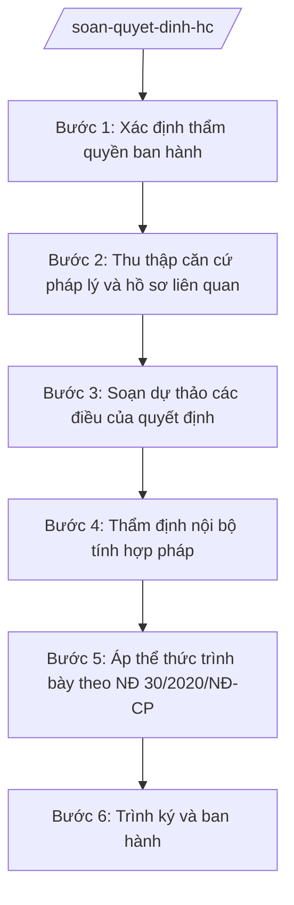

# Skill: Soạn quyết định hành chính

> **Ghi chú áp dụng đa cấp:** Skill dùng chung cho mọi cấp hành chính. Các chức danh, đơn vị nêu trong quy trình (ví dụ: "Chủ tịch UBND xã", "Chánh Văn phòng", "Sở Tài chính") được viết theo mẫu minh họa — khi áp dụng ở cấp khác, thay bằng chức danh/đơn vị tương ứng của cấp đó (cấp tỉnh: Chủ tịch UBND tỉnh, Giám đốc Sở; cấp trung ương: Bộ trưởng, Vụ trưởng/Cục trưởng).

## Khi nào dùng

- Soạn quyết định khen thưởng tập thể, cá nhân có thành tích (theo đề nghị của Hội đồng Thi đua – Khen thưởng xã).
- Soạn quyết định xử phạt vi phạm hành chính thuộc thẩm quyền của Chủ tịch UBND xã.
- Soạn quyết định thành lập tổ công tác, ban chỉ đạo, đoàn kiểm tra liên ngành của xã.
- Soạn quyết định giao nhiệm vụ, phân công phụ trách cho công chức, đơn vị trực thuộc.
- Soạn quyết định công nhận kết quả (kết quả bình xét thi đua, kết quả hòa giải thành...).
- Soạn quyết định phê duyệt phương án, kế hoạch cụ thể thuộc thẩm quyền của Chủ tịch UBND xã.

## Đầu vào (Input)

| Trường | Mô tả | Bắt buộc |
|--------|-------|----------|
| `loai_quyet_dinh` | Loại quyết định: khen thưởng / xử phạt VPHC / thành lập tổ công tác / giao nhiệm vụ / công nhận kết quả / phê duyệt phương án | Có |
| `doi_tuong` | Tên tập thể/cá nhân là đối tượng của quyết định (hư cấu 100% theo quy ước) | Có |
| `trich_yeu` | Tóm tắt nội dung quyết định (1–2 câu) để đặt sau "Về việc" | Có |
| `can_cu` | Danh sách căn cứ pháp lý (luật, nghị định còn hiệu lực, có số hiệu xác thực) | Có |
| `noi_dung_quyet_dinh` | Nội dung từng điều của quyết định (Điều 1: nội dung chính; Điều 2: trách nhiệm thi hành; Điều 3: hiệu lực...) | Có |
| `de_nghi_cua` | Đơn vị/cá nhân đề nghị ban hành (ví dụ: Hội đồng Thi đua – Khen thưởng xã, Trưởng phòng Kinh tế) | Có |
| `muc_phat_chi_tiet` | Đối với xử phạt VPHC: hành vi vi phạm, mức phạt tiền, biện pháp khắc phục hậu quả | Không |
| `hieu_luc` | Thời điểm hiệu lực của quyết định | Không |
| `don_vi_soan_thao` | Phòng/ban soạn thảo dự thảo | Có |
| `noi_nhan` | Danh sách nơi nhận | Không |
| `ngay_ban_hanh` | Ngày dự kiến ban hành | Không |

## Quy trình

**Bước 1. Xác định thẩm quyền ban hành**

- Làm gì: Đọc `loai_quyet_dinh`, `noi_dung_quyet_dinh` để xác định nội dung có thuộc thẩm quyền quyết định của Chủ tịch UBND xã hay không; đối chiếu phân cấp, phân quyền hiện hành.
- Dùng input: `loai_quyet_dinh`, `noi_dung_quyet_dinh`.
- Vai trò: Lãnh đạo đơn vị soạn thảo xác định; AI hỗ trợ đối chiếu thẩm quyền (ví dụ: khen thưởng cấp xã theo NĐ 152/2025/NĐ-CP; xử phạt VPHC theo thẩm quyền Chủ tịch UBND cấp xã quy định tại pháp luật về xử lý vi phạm hành chính) ⏱ ~10 phút (ước tính).
- Lưu ý nghiệp vụ: Tuyệt đối không soạn quyết định vượt thẩm quyền. Quyết định xử phạt VPHC phải bảo đảm đúng trình tự, thủ tục, thời hiệu theo quy định pháp luật; sai thẩm quyền dẫn đến quyết định bị hủy.
- → Kết quả bước: Xác định được thẩm quyền ban hành là Chủ tịch UBND xã; loại quyết định phù hợp.

**Bước 2. Thu thập căn cứ pháp lý và hồ sơ liên quan**

- Làm gì: Tập hợp `can_cu` (chỉ văn bản còn hiệu lực, số hiệu xác thực), hồ sơ đề nghị (`de_nghi_cua`), tài liệu chứng minh (biên bản vi phạm, tờ trình đề nghị khen thưởng, danh sách thành viên tổ công tác...).
- Dùng input: `can_cu`, `de_nghi_cua`, `loai_quyet_dinh`, `muc_phat_chi_tiet`, `doi_tuong`.
- Vai trò: Công chức phòng chuyên môn thu thập, kiểm tra tính đầy đủ, hợp lệ của hồ sơ; AI hỗ trợ kiểm tra hiệu lực văn bản viện dẫn, rà soát hồ sơ còn thiếu ⏱ ~20–30 phút (ước tính).
- Lưu ý nghiệp vụ: Quyết định khen thưởng phải có tờ trình/hồ sơ đề nghị của Hội đồng Thi đua – Khen thưởng; quyết định xử phạt VPHC phải có biên bản vi phạm hành chính và hồ sơ xác minh đầy đủ. Không viện dẫn văn bản hết hiệu lực.
- → Kết quả bước: Bộ hồ sơ, căn cứ pháp lý đầy đủ, hợp lệ.

**Bước 3. Soạn dự thảo các điều của quyết định**

- Làm gì: Viết dự thảo theo bố cục: phần "Căn cứ" → "Theo đề nghị của ..." → "QUYẾT ĐỊNH:" → các điều (Điều 1: nội dung chính; Điều 2: trách nhiệm tổ chức thực hiện; Điều 3: hiệu lực thi hành).
- Dùng input: `trich_yeu`, `can_cu`, `noi_dung_quyet_dinh`, `de_nghi_cua`, `doi_tuong`, `muc_phat_chi_tiet`, `hieu_luc`.
- Vai trò: Công chức soạn thảo thực hiện; AI hỗ trợ diễn đạt chặt chẽ từng điều, kiểm tra tính thống nhất giữa các điều và với căn cứ pháp lý ⏱ ~25–35 phút (ước tính).
- Lưu ý nghiệp vụ: Điều 1 phải ghi rõ đối tượng, nội dung quyết định (mức khen thưởng/mức phạt/thành phần tổ công tác...). Quyết định xử phạt VPHC phải ghi đúng hành vi vi phạm, điều khoản áp dụng, mức phạt trong khung quy định, biện pháp khắc phục hậu quả, quyền khiếu nại. Không dùng từ ngữ mơ hồ có thể hiểu nhiều nghĩa.
- → Kết quả bước: Dự thảo các điều của quyết định hoàn chỉnh, chặt chẽ.

**Bước 4. Thẩm định nội bộ tính hợp pháp**

- Làm gì: Đơn vị soạn thảo tự thẩm định tính hợp pháp, hợp lý của dự thảo (bắt buộc xin ý kiến công chức tư pháp của Văn phòng đối với quyết định xử phạt VPHC: rà soát thẩm quyền, trình tự, thời hiệu).
- Dùng input: Dự thảo các điều (Bước 3), `don_vi_soan_thao`, `loai_quyet_dinh`.
- Vai trò: Công chức soạn thảo + công chức tư pháp (Văn phòng) thẩm định ⏱ 15–20 phút (ước tính); AI hỗ trợ đối chiếu thẩm quyền ban hành, cảnh báo điểm trái pháp luật.
- Lưu ý nghiệp vụ: Quyết định xử phạt VPHC bắt buộc phải được rà soát kỹ về thẩm quyền, trình tự, thời hiệu trước khi ký — sai sót dẫn đến bị hủy/khiếu nại. Thẩm định trước khi áp thể thức để tránh làm lại.
- → Kết quả bước: Dự thảo đã thẩm định, đủ điều kiện trình.

**Bước 5. Áp thể thức trình bày theo NĐ 30/2020/NĐ-CP**

- Làm gì: Dựng khung thể thức đầy đủ: quốc hiệu–tiêu ngữ; tên cơ quan ban hành; số, ký hiệu "..../QĐ-UBND"; địa danh, ngày tháng năm; tên loại "QUYẾT ĐỊNH" và trích yếu; nội dung; nơi nhận; chữ ký người đứng đầu.
- Dùng input: Dự thảo đã thẩm định (Bước 4), `don_vi_soan_thao`, `noi_nhan`, `ngay_ban_hanh`.
- Vai trò: Công chức văn thư/văn phòng thực hiện; AI hỗ trợ: kiểm tra đầy đủ thành phần thể thức, số ký hiệu, vị trí các khối ⏱ ~10 phút (ước tính).
- Lưu ý nghiệp vụ: Quyết định cá biệt do người đứng đầu ký, ghi "TM. ỦY BAN NHÂN DÂN" – "CHỦ TỊCH". Nơi nhận phải bao gồm đối tượng của quyết định (để thi hành/nhận), đơn vị liên quan và lưu hồ sơ.
- → Kết quả bước: Bản dự thảo quyết định đúng thể thức, sẵn sàng trình ký.

**Bước 6. Trình ký và ban hành**

- Làm gì: Trình Chánh Văn phòng kiểm tra thể thức; trình người đứng đầu quyết định, ký ban hành; giao văn thư đánh số, đóng dấu, gửi nơi nhận, lưu hồ sơ.
- Dùng input: Bản dự thảo đúng thể thức (Bước 5), `noi_nhan`.
- Vai trò: Chánh Văn phòng kiểm tra thể thức (⏱ 5 phút); người đứng đầu quyết định và ký ban hành (⏱ 15 phút); văn thư phát hành, lưu; AI hỗ trợ: kiểm tra thể thức lần cuối, đối chiếu thẩm quyền ký — tổng ước tính 40 phút (chưa tính thời gian chờ).
- Lưu ý nghiệp vụ: Đánh số, đóng dấu đúng quy định; gửi nơi nhận đầy đủ, lưu hồ sơ.
- → Kết quả bước: Quyết định đã ký, ban hành.

## Luồng quy trình (Workflow)

## 5. Đầu ra (Output)

- Dự thảo quyết định hoàn chỉnh, đúng thể thức NĐ 30/2020/NĐ-CP.
- Hồ sơ kèm theo: tờ trình/hồ sơ đề nghị, biên bản liên quan (đối với xử phạt VPHC).
- Hồ sơ lưu: bản ký tươi + hồ sơ đề nghị + phiếu trình.

### Cấu trúc output chuẩn

Khung cố định của một quyết định cá biệt, các phần bắt buộc theo đúng thứ tự:

1. **Quốc hiệu – tiêu ngữ** (canh giữa, phía trên cùng):
   CỘNG HÒA XÃ HỘI CHỦ NGHĨA VIỆT NAM / Độc lập – Tự do – Hạnh phúc
2. **Tên cơ quan ban hành** (canh trái): ỦY BAN NHÂN DÂN XÃ A
3. **Số, ký hiệu văn bản** (dưới tên cơ quan, canh trái): Số: .../QĐ-UBND
4. **Địa danh, ngày tháng năm ban hành** (canh phải): Xã A, ngày ... tháng ... năm ...
5. **Tên loại và trích yếu nội dung** (canh giữa): QUYẾT ĐỊNH / Về việc ...
6. **Nội dung**:
   - "Căn cứ ..." (liệt kê văn bản pháp lý còn hiệu lực);
   - "Theo đề nghị của ..." (đơn vị/cá nhân đề nghị);
   - "QUYẾT ĐỊNH:";
   - "Điều 1." (nội dung chính: đối tượng, mức khen thưởng/mức phạt/thành phần tổ công tác...);
   - "Điều 2." (trách nhiệm tổ chức thực hiện: giao đơn vị/cá nhân thi hành);
   - "Điều 3." (hiệu lực thi hành; trách nhiệm của các đơn vị, cá nhân liên quan).
7. **Nơi nhận** (cuối văn bản, canh trái): đối tượng quyết định, đơn vị liên quan, lưu hồ sơ.
8. **Chữ ký, chức vụ người ký** (canh phải): "TM. ỦY BAN NHÂN DÂN" / "CHỦ TỊCH" / họ tên người ký, đóng dấu.

## 6. Checklist nghiệm thu

1. Có đủ 8 thành phần thể thức theo đúng thứ tự mục 5.
2. Nội dung thuộc thẩm quyền quyết định của Chủ tịch UBND xã — không vượt thẩm quyền.
3. Số, ký hiệu đúng định dạng ".../QĐ-UBND"; tên cơ quan, quốc hiệu–tiêu ngữ, địa danh ghi đúng quy ước.
4. Phần "Căn cứ" chỉ viện dẫn văn bản còn hiệu lực, có số hiệu xác thực, liên quan trực tiếp.
5. Có dòng "Theo đề nghị của ..." ghi đúng đơn vị/cá nhân đề nghị, phù hợp loại quyết định.
6. Các điều rõ ràng, chặt chẽ: Điều 1 nêu đủ đối tượng + nội dung; Điều 2 giao trách nhiệm thi hành cụ thể; Điều 3 quy định hiệu lực.
7. Quyết định xử phạt VPHC: ghi đúng hành vi vi phạm, điều khoản áp dụng, mức phạt trong khung quy định, biện pháp khắc phục hậu quả (nếu có), quyền khiếu nại/khởi kiện của đối tượng.
8. Quyết định khen thưởng: có hồ sơ đề nghị của Hội đồng Thi đua – Khen thưởng kèm theo; mức khen thưởng đúng quy định.
9. Nơi nhận bao gồm đối tượng của quyết định; có "Lưu: VT, ..." cuối danh sách.
10. Không bịa số liệu, căn cứ pháp lý; đã qua human gate: thẩm định nội bộ (công chức tư pháp đối với xử phạt VPHC), Chánh Văn phòng kiểm tra thể thức, Chủ tịch UBND xã ký ban hành.

## 7. Ví dụ mô phỏng

*Dữ liệu dưới đây là giả lập 100% phục vụ minh họa.*

**Input mẫu:**

| Trường | Giá trị |
|--------|---------|
| loai_quyet_dinh | thành lập tổ công tác |
| doi_tuong | Tổ công tác kiểm tra an toàn thực phẩm dịp Tết Nguyên đán (gồm 5 thành viên) |
| trich_yeu | thành lập Tổ công tác kiểm tra an toàn thực phẩm dịp Tết Nguyên đán năm 2027 trên địa bàn xã A |
| can_cu | Luật Tổ chức chính quyền địa phương 72/2025/QH15; Nghị định số 150/2025/NĐ-CP về tổ chức cơ quan chuyên môn thuộc UBND cấp tỉnh, cấp xã |
| noi_dung_quyet_dinh | Điều 1: Thành lập Tổ công tác gồm 5 thành viên: Tổ trưởng là bà Trần Thị B – Phó Chủ tịch UBND xã; Tổ phó là ông Vũ Văn E – Trưởng phòng Văn hóa – Xã hội; 03 thành viên là công chức Phòng Văn hóa – Xã hội và Trạm Y tế xã. Điều 2: Tổ công tác có nhiệm vụ kiểm tra an toàn thực phẩm tại các cơ sở kinh doanh trên địa bàn xã từ ngày 01/02/2027 đến ngày 28/02/2027; tự giải thể sau khi hoàn thành nhiệm vụ và báo cáo kết quả. Điều 3: Quyết định có hiệu lực kể từ ngày ký |
| de_nghi_cua | Trưởng phòng Văn hóa – Xã hội xã A |
| don_vi_soan_thao | Phòng Văn hóa – Xã hội xã A |
| noi_nhan | Các thành viên Tổ công tác (để thực hiện); Phòng Văn hóa – Xã hội; Lưu: VT, VHXH |
| ngay_ban_hanh | 25/01/2027 |

**Output mẫu:**

CỘNG HÒA XÃ HỘI CHỦ NGHĨA VIỆT NAM
Độc lập – Tự do – Hạnh phúc

ỦY BAN NHÂN DÂN XÃ A			Số: 123/QĐ-UBND

						Xã A, ngày 25 tháng 01 năm 2027

QUYẾT ĐỊNH
Về việc thành lập Tổ công tác kiểm tra an toàn thực phẩm dịp Tết Nguyên đán năm 2027 trên địa bàn xã A

CHỦ TỊCH ỦY BAN NHÂN DÂN XÃ A

Căn cứ Luật Tổ chức chính quyền địa phương 72/2025/QH15;
Căn cứ Nghị định số 150/2025/NĐ-CP về tổ chức cơ quan chuyên môn thuộc Ủy ban nhân dân cấp tỉnh, cấp xã;

Theo đề nghị của Trưởng phòng Văn hóa – Xã hội xã A,

QUYẾT ĐỊNH:

Điều 1. Thành lập Tổ công tác kiểm tra an toàn thực phẩm dịp Tết Nguyên đán năm 2027 trên địa bàn xã A, gồm 05 thành viên:
1. Bà Trần Thị B – Phó Chủ tịch UBND xã – Tổ trưởng;
2. Ông Vũ Văn E – Trưởng phòng Văn hóa – Xã hội – Tổ phó;
3. Ông Nguyễn Văn G – Công chức Phòng Văn hóa – Xã hội – Thành viên;
4. Bà Trần Thị H – Công chức Phòng Văn hóa – Xã hội – Thành viên;
5. Ông Phạm Văn K – Viên chức Trạm Y tế xã – Thành viên.

Điều 2. Tổ công tác có nhiệm vụ kiểm tra an toàn thực phẩm tại các cơ sở sản xuất, kinh doanh thực phẩm trên địa bàn xã từ ngày 01/02/2027 đến ngày 28/02/2027; báo cáo kết quả về Chủ tịch UBND xã. Tổ công tác tự giải thể sau khi hoàn thành nhiệm vụ.

Điều 3. Quyết định này có hiệu lực kể từ ngày ký. Chánh Văn phòng HĐND&UBND, Trưởng phòng Văn hóa – Xã hội, các thành viên có tên tại Điều 1 và các đơn vị, cá nhân liên quan chịu trách nhiệm thi hành Quyết định này./.

Nơi nhận:
- Như Điều 3;
- Lưu: VT, VHXH.

TM. ỦY BAN NHÂN DÂN
CHỦ TỊCH

Nguyễn Văn A

## 8. Human gate

- **Công chức phòng chuyên môn** → soạn dự thảo, chịu trách nhiệm về nội dung, căn cứ pháp lý.
- **Trưởng phòng chuyên môn** → kiểm tra tính đúng đắn nghiệp vụ của dự thảo.
- **Công chức tư pháp (Văn phòng HĐND&UBND)** → thẩm định tính hợp pháp đối với quyết định xử phạt VPHC và các quyết định có nguy cơ khiếu nại cao.
- **Chánh Văn phòng HĐND&UBND** → kiểm tra thể thức.
- **Chủ tịch UBND xã** → quyết định, ký ban hành. Quyết định chỉ có hiệu lực sau khi Chủ tịch ký.

## 9. Giới hạn

- AI KHÔNG ra quyết định hành chính thay người có thẩm quyền; quyết định do Chủ tịch UBND xã ký mới có hiệu lực.
- AI KHÔNG tự ký, tự đóng dấu, tự ban hành quyết định dưới bất kỳ hình thức nào.
- AI KHÔNG bịa số liệu, căn cứ pháp lý; không viện dẫn văn bản hết hiệu lực.
- AI KHÔNG soạn quyết định xử phạt VPHC khi hồ sơ chưa đủ (thiếu biên bản vi phạm, hết thời hiệu, sai thẩm quyền) — phải cảnh báo và yêu cầu bổ sung.
- AI KHÔNG tư vấn cách "lách" quy định để xử phạt nặng/nhẹ hơn khung pháp luật cho phép.

## 10. Căn cứ & lưu ý

- NĐ 30/2020/NĐ-CP về công tác văn thư: thể thức, kỹ thuật trình bày văn bản hành chính (áp dụng cho quyết định cá biệt).
- Luật Tổ chức chính quyền địa phương 72/2025/QH15: thẩm quyền của Chủ tịch UBND cấp xã trong ban hành quyết định cá biệt.
- NĐ 150/2025/NĐ-CP: tổ chức cơ quan chuyên môn thuộc UBND cấp xã — căn cứ quyết định thành lập tổ công tác, giao nhiệm vụ.
- NĐ 152/2025/NĐ-CP: phân cấp, phân quyền trong lĩnh vực thi đua, khen thưởng — căn cứ quyết định khen thưởng cấp xã.
- Theo quy định pháp luật về xử lý vi phạm hành chính: thẩm quyền, trình tự, thủ tục xử phạt VPHC của Chủ tịch UBND cấp xã (diễn đạt chung, không gắn số hiệu cụ thể khi chưa xác thực).
- Lưu ý: quyết định cá biệt chỉ áp dụng một lần đối với đối tượng cụ thể, khác với văn bản quy phạm pháp luật; cấp xã hiện không ban hành văn bản quy phạm pháp luật.
