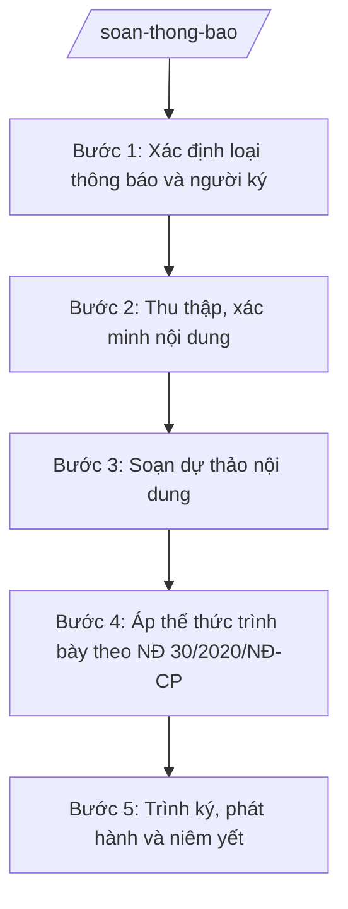

# Skill: Soạn thông báo

> **Ghi chú áp dụng đa cấp:** Skill dùng chung cho mọi cấp hành chính. Các chức danh, đơn vị nêu trong quy trình (ví dụ: "Chủ tịch UBND xã", "Chánh Văn phòng", "Sở Tài chính") được viết theo mẫu minh họa — khi áp dụng ở cấp khác, thay bằng chức danh/đơn vị tương ứng của cấp đó (cấp tỉnh: Chủ tịch UBND tỉnh, Giám đốc Sở; cấp trung ương: Bộ trưởng, Vụ trưởng/Cục trưởng).

## Khi nào dùng

- Soạn thông báo kết luận của Chủ tịch UBND xã tại cuộc họp giao ban, họp chuyên đề.
- Soạn thông báo lịch tiếp công dân định kỳ của lãnh đạo UBND xã.
- Soạn thông báo kết quả giải quyết công việc, kiến nghị của người dân, doanh nghiệp.
- Soạn thông báo về thời gian, địa điểm tổ chức hội nghị, sự kiện của xã.
- Soạn thông báo phân công nhiệm vụ, lịch trực của cơ quan trong dịp lễ, Tết.
- Soạn thông báo kết quả xét duyệt các chế độ, chính sách (hộ nghèo, người có công...) để niêm yết công khai.

## Đầu vào (Input)

| Trường | Mô tả | Bắt buộc |
|--------|-------|----------|
| `loai_thong_bao` | Loại thông báo: kết luận cuộc họp / lịch tiếp công dân / kết quả giải quyết / lịch sự kiện / phân công trực / niêm yết công khai | Có |
| `trich_yeu` | Tóm tắt nội dung thông báo (1–2 câu) để đặt sau "Về việc" | Có |
| `noi_dung_chinh` | Các ý chính cần thông báo, diễn đạt bằng ý tưởng | Có |
| `doi_tuong_nhan` | Đối tượng nhận thông báo (các phòng/ban, thôn/tổ dân phố, người dân, doanh nghiệp...) | Có |
| `thoi_gian_dia_diem` | Thời gian, địa điểm liên quan (cuộc họp, lịch tiếp dân, sự kiện...) | Không |
| `van_ban_lien_quan` | Số, ký hiệu văn bản, cuộc họp làm căn cứ của thông báo (nếu có) | Không |
| `don_vi_soan_thao` | Phòng/ban soạn thảo dự thảo | Có |
| `nguoi_ky_du_kien` | Chức vụ người ký dự kiến (Chủ tịch / Phó Chủ tịch / Chánh Văn phòng theo nội dung) | Có |
| `kenh_phat_hanh` | Kênh phát hành: gửi văn bản / niêm yết trụ sở / loa truyền thanh / cổng thông tin | Không |
| `noi_nhan` | Danh sách nơi nhận | Không |
| `ngay_ban_hanh` | Ngày dự kiến ban hành | Không |

## Quy trình

**Bước 1. Xác định loại thông báo và người ký**

- Làm gì: Đọc `loai_thong_bao`, `noi_dung_chinh` để xác định loại thông báo; đề xuất người ký phù hợp với tính chất nội dung (kết luận cuộc họp do người chủ trì ký; thông báo hành chính thông thường do Chánh Văn phòng ký "TL. Chủ tịch").
- Dùng input: `loai_thong_bao`, `noi_dung_chinh`, `nguoi_ky_du_kien`.
- Vai trò: Công chức Văn phòng HĐND&UBND thực hiện; AI hỗ trợ: đề xuất loại thông báo và người ký phù hợp ⏱ ~5–10 phút (ước tính).
- Lưu ý nghiệp vụ: Thông báo kết luận cuộc họp phải do người chủ trì cuộc họp ký (hoặc ủy quyền). Thông báo không được đặt ra quy định mới có tính bắt buộc chung — nếu cần quy định thì phải dùng hình thức văn bản phù hợp.
- → Kết quả bước: Xác định loại thông báo + dự kiến người ký.

**Bước 2. Thu thập, xác minh nội dung**

- Làm gì: Thu thập nội dung từ biên bản cuộc họp, kết quả giải quyết công việc, lịch đã được phê duyệt (`van_ban_lien_quan`); xác minh thời gian, địa điểm (`thoi_gian_dia_diem`), đối tượng nhận (`doi_tuong_nhan`).
- Dùng input: `noi_dung_chinh`, `van_ban_lien_quan`, `thoi_gian_dia_diem`, `doi_tuong_nhan`.
- Vai trò: Công chức soạn thảo thu thập; AI hỗ trợ trích xuất các ý kết luận chính từ biên bản cuộc họp, kiểm tra tính đầy đủ của thời gian/địa điểm/đối tượng ⏱ ~15 phút (ước tính).
- Lưu ý nghiệp vụ: Thông báo kết luận cuộc họp phải trung thành với biên bản họp đã được thông qua — không thêm, bớt ý kiến chỉ đạo. Thời gian, địa điểm phải chính xác tuyệt đối; sai sót gây nhỡ việc của nhiều người.
- → Kết quả bước: Nội dung thông báo đã được xác minh, đầy đủ chi tiết.

**Bước 3. Soạn dự thảo nội dung**

- Làm gì: Viết dự thảo: phần mở đầu (nêu căn cứ: cuộc họp ngày.., văn bản số...), phần nội dung (các ý thông báo, sắp xếp theo thứ tự ưu tiên), phần kết (yêu cầu thực hiện nếu có).
- Dùng input: `trich_yeu`, `noi_dung_chinh`, `van_ban_lien_quan`, `thoi_gian_dia_diem`, `doi_tuong_nhan`.
- Vai trò: Công chức soạn thảo thực hiện; AI hỗ trợ diễn đạt ngắn gọn, rõ ràng, dễ hiểu (đặc biệt khi đối tượng là người dân) ⏱ ~15–20 phút (ước tính).
- Lưu ý nghiệp vụ: Thông báo viết ngắn gọn, đi thẳng vào nội dung; mỗi ý một đoạn. Tránh câu chữ hành chính khó hiểu khi thông báo gửi đến người dân. Ghi rõ đầu mối liên hệ khi người dân cần hỏi thêm.
- → Kết quả bước: Dự thảo nội dung thông báo hoàn chỉnh.

**Bước 4. Áp thể thức trình bày theo NĐ 30/2020/NĐ-CP**

- Làm gì: Dựng khung thể thức đầy đủ: quốc hiệu–tiêu ngữ; tên cơ quan ban hành; số, ký hiệu "..../TB-UBND"; địa danh, ngày tháng năm; tên loại "THÔNG BÁO" và trích yếu; nội dung; nơi nhận; chữ ký người ký.
- Dùng input: `don_vi_soan_thao`, `nguoi_ky_du_kien`, `noi_nhan`, `ngay_ban_hanh`, `doi_tuong_nhan`.
- Vai trò: Công chức văn thư/văn phòng thực hiện; AI hỗ trợ: kiểm tra đầy đủ thành phần thể thức, số ký hiệu, vị trí các khối ⏱ ~10 phút (ước tính).
- Lưu ý nghiệp vụ: Tên cơ quan ban hành là "ỦY BAN NHÂN DÂN XÃ A". Nơi nhận của thông báo thường rộng (các phòng, thôn/tổ dân phố, niêm yết...). Ghi rõ kênh phát hành ở phần nơi nhận khi cần (niêm yết tại trụ sở, phát trên loa truyền thanh).
- → Kết quả bước: Bản dự thảo thông báo đúng thể thức, sẵn sàng trình.

**Bước 5. Trình ký, phát hành và niêm yết**

- Làm gì: Trình Chánh Văn phòng kiểm tra thể thức, trình người có thẩm quyền duyệt và ký; văn thư đánh số, đóng dấu; phát hành theo `kenh_phat_hanh` (gửi văn bản, niêm yết trụ sở, loa truyền thanh, cổng thông tin); lưu hồ sơ.
- Dùng input: `nguoi_ky_du_kien`, `kenh_phat_hanh`, `noi_nhan`, `doi_tuong_nhan`.
- Vai trò: Chánh Văn phòng HĐND&UBND kiểm tra thể thức (⏱ 5 phút); Chủ tịch/Phó Chủ tịch hoặc Chánh Văn phòng (theo phân cấp ký) duyệt và ký (⏱ 10 phút); văn thư + công chức phụ trách truyền thanh/cổng thông tin phát hành; AI hỗ trợ: kiểm tra thể thức lần cuối, tổng hợp danh sách phát hành — tổng ước tính 20 phút (chưa tính thời gian chờ).
- Lưu ý nghiệp vụ: Thông báo niêm yết công khai (kết quả xét duyệt chính sách...) phải niêm yết đủ thời gian theo quy định và lập biên bản niêm yết. Thông báo lịch tiếp công dân, lịch sự kiện phải phát hành trước đủ thời gian để đối tượng chuẩn bị.
- → Kết quả bước: Thông báo đã ký, phát hành đúng kênh, đúng đối tượng; hồ sơ lưu đầy đủ (kèm biên bản niêm yết nếu có).

## Luồng quy trình (Workflow)

## 5. Đầu ra (Output)

- Dự thảo thông báo hoàn chỉnh, đúng thể thức NĐ 30/2020/NĐ-CP.
- Biên bản niêm yết (đối với thông báo công khai).
- Hồ sơ lưu: bản ký tươi + biên bản cuộc họp/biên bản niêm yết kèm theo.

### Cấu trúc output chuẩn

Khung cố định của một thông báo, các phần bắt buộc theo đúng thứ tự:

1. **Quốc hiệu – tiêu ngữ** (canh giữa, phía trên cùng):
   CỘNG HÒA XÃ HỘI CHỦ NGHĨA VIỆT NAM / Độc lập – Tự do – Hạnh phúc
2. **Tên cơ quan ban hành** (canh trái): ỦY BAN NHÂN DÂN XÃ A
3. **Số, ký hiệu văn bản** (dưới tên cơ quan, canh trái): Số: .../TB-UBND
4. **Địa danh, ngày tháng năm ban hành** (canh phải): Xã A, ngày ... tháng ... năm ...
5. **Tên loại và trích yếu nội dung** (canh giữa): THÔNG BÁO / Về việc ...
6. **Nội dung**: phần mở đầu (căn cứ: cuộc họp/văn bản...) → các ý thông báo (thời gian, địa điểm, nội dung, yêu cầu thực hiện, đầu mối liên hệ).
7. **Nơi nhận** (cuối văn bản, canh trái): đối tượng nhận, kênh phát hành (niêm yết, loa truyền thanh...), lưu hồ sơ.
8. **Chữ ký, chức vụ người ký** (canh phải): "TM. ỦY BAN NHÂN DÂN" / chức vụ (CHỦ TỊCH / KT. CHỦ TỊCH – PHÓ CHỦ TỊCH / TL. CHỦ TỊCH – CHÁNH VĂN PHÒNG) / họ tên người ký, đóng dấu.

## 6. Checklist nghiệm thu

1. Có đủ 8 thành phần thể thức theo đúng thứ tự mục 5.
2. Số, ký hiệu đúng định dạng ".../TB-UBND"; tên cơ quan, quốc hiệu–tiêu ngữ, địa danh ghi đúng quy ước.
3. Người ký phù hợp tính chất nội dung (kết luận họp: người chủ trì ký; thông báo thường: Chánh Văn phòng có thể ký thay).
4. Thông báo kết luận cuộc họp trung thành với biên bản họp đã thông qua — không thêm, bớt ý chỉ đạo.
5. Thời gian, địa điểm, đối tượng chính xác, đầy đủ; có đầu mối liên hệ khi thông báo gửi đến người dân.
6. Câu chữ ngắn gọn, rõ ràng, dễ hiểu; mỗi ý một đoạn, sắp xếp theo thứ tự ưu tiên.
7. Nơi nhận đầy đủ đối tượng; ghi rõ kênh phát hành (gửi văn bản/niêm yết/loa truyền thanh/cổng thông tin).
8. Thông báo niêm yết công khai có biên bản niêm yết kèm hồ sơ, bảo đảm thời gian niêm yết theo quy định.
9. Không đặt ra quy định mới có tính bắt buộc chung trong thông báo; không bịa số liệu, căn cứ.
10. Đã qua human gate: Chánh Văn phòng kiểm tra thể thức, người có thẩm quyền duyệt nội dung và ký trước khi phát hành.

## 7. Ví dụ mô phỏng

*Dữ liệu dưới đây là giả lập 100% phục vụ minh họa.*

**Input mẫu:**

| Trường | Giá trị |
|--------|---------|
| loai_thong_bao | lịch tiếp công dân |
| trich_yeu | lịch tiếp công dân định kỳ tháng 11 năm 2026 của lãnh đạo UBND xã A |
| noi_dung_chinh | Chủ tịch UBND xã tiếp công dân định kỳ vào ngày 05 và 20 hằng tháng; buổi sáng từ 8h00 đến 11h00, buổi chiều từ 14h00 đến 16h30; địa điểm: Phòng Tiếp công dân, trụ sở UBND xã A, số 123 đường B, xã A, tỉnh A; công dân đăng ký trước qua Văn phòng HĐND&UBND, điện thoại 0900 000 001 |
| doi_tuong_nhan | Nhân dân trên địa bàn xã A; các phòng, ban thuộc UBND xã |
| thoi_gian_dia_diem | Ngày 05 và 20 hằng tháng; Phòng Tiếp công dân, trụ sở UBND xã A |
| don_vi_soan_thao | Văn phòng HĐND&UBND xã A |
| nguoi_ky_du_kien | Chánh Văn phòng (ký thay lãnh đạo) |
| kenh_phat_hanh | Niêm yết tại trụ sở UBND xã và nhà văn hóa các thôn; phát trên loa truyền thanh xã |
| noi_nhan | Nhân dân xã A (niêm yết); các phòng, ban thuộc UBND xã; Lưu: VT, TCD |

**Output mẫu:**

CỘNG HÒA XÃ HỘI CHỦ NGHĨA VIỆT NAM
Độc lập – Tự do – Hạnh phúc

ỦY BAN NHÂN DÂN XÃ A			Số: 45/TB-UBND

						Xã A, ngày 28 tháng 10 năm 2026

THÔNG BÁO
Về việc lịch tiếp công dân định kỳ tháng 11 năm 2026 của lãnh đạo UBND xã A

UBND xã A thông báo lịch tiếp công dân định kỳ của lãnh đạo UBND xã như sau:

1. Thời gian tiếp: ngày 05 và ngày 20 hằng tháng; buổi sáng từ 8 giờ 00 đến 11 giờ 00, buổi chiều từ 14 giờ 00 đến 16 giờ 30. Trường hợp trùng ngày nghỉ, ngày lễ thì chuyển sang ngày làm việc tiếp theo.
2. Địa điểm: Phòng Tiếp công dân, trụ sở UBND xã A, số 123 đường B, xã A, tỉnh A.
3. Thành phần: Chủ tịch UBND xã chủ trì; lãnh đạo Văn phòng HĐND&UBND và công chức có liên quan cùng tham dự.
4. Công dân có nhu cầu được tiếp đề nghị đăng ký trước với Văn phòng HĐND&UBND xã (đồng chí Nguyễn Văn G, điện thoại 0900 000 001) để được sắp xếp.

UBND xã A thông báo để Nhân dân trên địa bàn biết, thực hiện./.

Nơi nhận:
- Nhân dân xã A (niêm yết tại trụ sở UBND xã và nhà văn hóa các thôn; phát trên loa truyền thanh xã);
- Các phòng, ban thuộc UBND xã;
- Lưu: VT, TCD.

TL. CHỦ TỊCH
CHÁNH VĂN PHÒNG

Phạm Văn C

## 8. Human gate

- **Công chức soạn thảo** → soạn dự thảo, chịu trách nhiệm về tính chính xác của nội dung (thời gian, địa điểm, kết luận).
- **Chánh Văn phòng HĐND&UBND** → kiểm tra thể thức, câu chữ; ký ban hành đối với thông báo hành chính thông thường (ký "TL. Chủ tịch").
- **Chủ tịch / Phó Chủ tịch UBND xã** → duyệt và ký đối với thông báo kết luận cuộc họp (người chủ trì ký) và các thông báo quan trọng.
- Không phát hành thông báo khi chưa có chữ ký của người có thẩm quyền.

## 9. Giới hạn

- AI KHÔNG ra quyết định hành chính thay người có thẩm quyền; chỉ hỗ trợ soạn thảo dự thảo.
- AI KHÔNG tự ký, tự đóng dấu, tự phát hành thông báo dưới bất kỳ hình thức nào.
- AI KHÔNG bịa số liệu, thời gian, địa điểm, căn cứ; mọi chi tiết phải từ input hoặc văn bản liên quan do người dùng cung cấp.
- AI KHÔNG thêm, bớt ý kiến chỉ đạo khi soạn thông báo kết luận cuộc họp — phải trung thành với biên bản họp.
- AI KHÔNG dùng thông báo để đặt ra quy định mới có tính bắt buộc chung.

## 10. Căn cứ & lưu ý

- NĐ 30/2020/NĐ-CP về công tác văn thư: thể thức, kỹ thuật trình bày văn bản hành chính (áp dụng cho thông báo).
- Luật Tổ chức chính quyền địa phương 72/2025/QH15: thẩm quyền, trách nhiệm của UBND, Chủ tịch UBND cấp xã trong chỉ đạo, điều hành.
- Theo quy định pháp luật về tiếp công dân: lịch tiếp công dân định kỳ của người đứng đầu cơ quan hành chính (diễn đạt chung, không gắn số hiệu cụ thể khi chưa xác thực).
- NĐ 150/2025/NĐ-CP: tổ chức cơ quan chuyên môn thuộc UBND cấp xã — căn cứ xác định đơn vị soạn thảo, đơn vị nhận.
- Lưu ý: thông báo kết luận cuộc họp phải ban hành kịp thời sau cuộc họp để các đơn vị triển khai; thông báo lịch tiếp công dân, lịch sự kiện phải phát hành trước đủ thời gian chuẩn bị.
