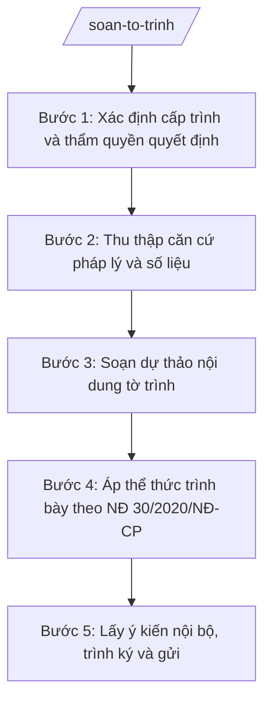

# Skill: Soạn tờ trình

## Khi nào dùng

- Soạn tờ trình Đảng ủy xã xin chủ trương về các vấn đề quan trọng (dự án đầu tư công, sắp xếp tổ chức, công tác cán bộ...).
- Soạn tờ trình HĐND xã xin phê duyệt kế hoạch phát triển kinh tế – xã hội, dự toán ngân sách, chương trình giám sát.
- Soạn tờ trình UBND cấp tỉnh (qua sở chuyên ngành) xin phê duyệt, xin ý kiến đối với nội dung vượt thẩm quyền của xã.
- Soạn tờ trình xin chủ trương sử dụng ngân sách, nguồn lực cho nhiệm vụ phát sinh ngoài kế hoạch.
- Soạn tờ trình đề nghị cấp trên ban hành văn bản hướng dẫn, giải quyết vướng mắc trong thực thi nhiệm vụ.
- Soạn tờ trình xin phê duyệt phương án tổ chức bộ máy, biên chế, vị trí việc làm của xã.

## Đầu vào (Input)

| Trường | Mô tả | Bắt buộc |
|--------|-------|----------|
| `cap_trinh` | Cấp được trình: Đảng ủy xã / HĐND xã / UBND cấp tỉnh (ghi rõ đơn vị) | Có |
| `trich_yeu` | Tóm tắt nội dung xin chủ trương/phê duyệt (1–2 câu) | Có |
| `can_cu` | Danh sách căn cứ pháp lý, văn bản chỉ đạo liên quan (số hiệu, ngày ban hành còn hiệu lực) | Có |
| `thuc_trang` | Mô tả thực trạng, sự cần thiết phải xin chủ trương/phê duyệt | Có |
| `noi_dung_de_nghi` | Nội dung cụ thể đề nghị (phương án, số liệu, kinh phí, tiến độ...) | Có |
| `phuong_an_lua_chon` | Các phương án so sánh (nếu có) kèm ưu/nhược điểm và phương án đề xuất | Không |
| `kien_nghi` | Kiến nghị cụ thể gửi cấp có thẩm quyền | Có |
| `don_vi_soan_thao` | Phòng/ban soạn thảo dự thảo | Có |
| `nguoi_ky_du_kien` | Chức vụ người ký dự kiến (thường là Chủ tịch UBND xã) | Có |
| `noi_nhan` | Danh sách nơi nhận | Không |
| `ngay_ban_hanh` | Ngày dự kiến ban hành | Không |

## Quy trình

**Bước 1. Xác định cấp trình và thẩm quyền quyết định**

- Làm gì: Đọc `cap_trinh`, `noi_dung_de_nghi` để xác định đúng cấp có thẩm quyền quyết định nội dung xin trình (Đảng ủy xã cho chủ trương, HĐND xã cho kế hoạch/ngân sách, UBND cấp tỉnh cho nội dung vượt thẩm quyền xã); đối chiếu phân cấp, phân quyền hiện hành.
- Dùng input: `cap_trinh`, `noi_dung_de_nghi`.
- Vai trò: Lãnh đạo đơn vị soạn thảo xác định; AI hỗ trợ đối chiếu thẩm quyền theo chuỗi 28 NĐ 120–152/2025/NĐ-CP và đề xuất cấp trình đúng ⏱ ~10 phút (ước tính).
- Lưu ý nghiệp vụ: Trình sai cấp là lỗi nghiêm trọng — phải xác định đúng trước khi soạn. Nội dung thuộc thẩm quyền quyết định của HĐND phải trình HĐND, không trình Đảng ủy thay thế.
- → Kết quả bước: Xác định đúng cấp trình, hình thức văn bản là tờ trình.

**Bước 2. Thu thập căn cứ pháp lý và số liệu**

- Làm gì: Tập hợp đầy đủ `can_cu` (văn bản QPPL, nghị quyết, chỉ thị còn hiệu lực), số liệu thực trạng (`thuc_trang`), số liệu của các phương án (`phuong_an_lua_chon`).
- Dùng input: `can_cu`, `thuc_trang`, `noi_dung_de_nghi`, `phuong_an_lua_chon`.
- Vai trò: Công chức phòng chuyên môn thu thập; AI hỗ trợ kiểm tra tính hiệu lực của văn bản viện dẫn, tổng hợp số liệu thành bảng so sánh các phương án ⏱ ~20–30 phút (ước tính).
- Lưu ý nghiệp vụ: Chỉ viện dẫn văn bản còn hiệu lực, có số hiệu xác thực; số liệu là số tròn, có nguồn rõ ràng. Tờ trình xin kinh phí phải có dự toán chi tiết kèm theo.
- → Kết quả bước: Bộ căn cứ pháp lý + số liệu đã kiểm chứng, sẵn sàng đưa vào tờ trình.

**Bước 3. Soạn dự thảo nội dung tờ trình**

- Làm gì: Viết dự thảo theo bố cục: (1) căn cứ; (2) thực trạng, sự cần thiết; (3) nội dung đề nghị cụ thể (kèm phương án so sánh nếu có); (4) kiến nghị.
- Dùng input: `trich_yeu`, `can_cu`, `thuc_trang`, `noi_dung_de_nghi`, `phuong_an_lua_chon`, `kien_nghi`, `cap_trinh`.
- Vai trò: Công chức soạn thảo thực hiện; AI hỗ trợ diễn đạt chặt chẽ, đúng văn phong hành chính, bảo đảm logic "căn cứ → thực trạng → đề nghị → kiến nghị" ⏱ ~30–40 phút (ước tính).
- Lưu ý nghiệp vụ: Nội dung đề nghị phải cụ thể, định lượng được (kinh phí bao nhiêu, thời gian nào, ai thực hiện). Kiến nghị phải rõ: đề nghị cấp trình xem xét, quyết định/phê duyệt nội dung gì. Không đưa nội dung mập mờ, không thể kiểm chứng.
- → Kết quả bước: Dự thảo nội dung tờ trình hoàn chỉnh, logic chặt chẽ.

**Bước 4. Áp thể thức trình bày theo NĐ 30/2020/NĐ-CP**

- Làm gì: Dựng khung thể thức đầy đủ: quốc hiệu–tiêu ngữ; tên cơ quan ban hành; số, ký hiệu "..../TTr-UBND"; địa danh, ngày tháng năm; tên loại "TỜ TRÌNH" và trích yếu; nội dung; nơi nhận; chữ ký người ký.
- Dùng input: `don_vi_soan_thao`, `nguoi_ky_du_kien`, `noi_nhan`, `ngay_ban_hanh`, `cap_trinh`.
- Vai trò: Công chức văn thư/văn phòng thực hiện; AI hỗ trợ: kiểm tra đầy đủ thành phần thể thức và vị trí các khối ⏱ ~10 phút (ước tính).
- Lưu ý nghiệp vụ: Dòng "Kính gửi:" ghi đúng tên cấp trình (ví dụ: "Kính gửi: Đảng ủy xã A", "Kính gửi: Hội đồng nhân dân xã A", "Kính gửi: Ủy ban nhân dân tỉnh A"). Tờ trình của UBND xã do Chủ tịch UBND xã ký ("TM. ỦY BAN NHÂN DÂN" – "CHỦ TỊCH").
- → Kết quả bước: Bản dự thảo tờ trình đúng thể thức, sẵn sàng trình.

**Bước 5. Lấy ý kiến nội bộ, trình ký và gửi**

- Làm gì: Gửi dự thảo lấy ý kiến các phòng liên quan (nếu nội dung liên ngành); tổng hợp, tiếp thu ý kiến; trình Chánh Văn phòng kiểm tra, trình Chủ tịch UBND xã duyệt và ký; gửi đến cấp trình, theo dõi phản hồi.
- Dùng input: `don_vi_soan_thao`, `nguoi_ky_du_kien`, `noi_nhan`, `cap_trinh`.
- Vai trò: Công chức soạn thảo tổng hợp ý kiến; Chánh Văn phòng HĐND&UBND kiểm tra thể thức (5 phút); Chủ tịch UBND xã duyệt nội dung, ký ban hành (15 phút); văn thư gửi và theo dõi; AI hỗ trợ: kiểm tra thể thức lần cuối, tổng hợp đầy đủ hồ sơ trình ký — tổng ước tính 30 phút (chưa tính thời gian chờ ý kiến các phòng).
- Lưu ý nghiệp vụ: Ý kiến khác nhau giữa các phòng phải được ghi nhận đầy đủ trong hồ sơ trình, không giấu ý kiến trái chiều. Sau khi cấp trình có ý kiến, phải ban hành văn bản triển khai kịp thời.
- → Kết quả bước: Tờ trình đã ký, gửi đúng cấp trình; hồ sơ lưu đầy đủ ý kiến tham gia.

## Luồng quy trình (Workflow)

## Đầu ra (Output)

- Dự thảo tờ trình hoàn chỉnh, đúng thể thức NĐ 30/2020/NĐ-CP.
- Bảng tổng hợp ý kiến các phòng liên quan (nếu có).
- Hồ sơ lưu: bản ký tươi + phiếu trình + ý kiến tham gia + văn bản căn cứ.

### Cấu trúc output chuẩn

Khung cố định của một tờ trình, các phần bắt buộc theo đúng thứ tự:

1. **Quốc hiệu – tiêu ngữ** (canh giữa, phía trên cùng):
   CỘNG HÒA XÃ HỘI CHỦ NGHĨA VIỆT NAM / Độc lập – Tự do – Hạnh phúc
2. **Tên cơ quan ban hành** (canh trái): ỦY BAN NHÂN DÂN XÃ A
3. **Số, ký hiệu văn bản** (dưới tên cơ quan, canh trái): Số: .../TTr-UBND
4. **Địa danh, ngày tháng năm ban hành** (canh phải): Xã A, ngày ... tháng ... năm ...
5. **Tên loại và trích yếu nội dung** (canh giữa): TỜ TRÌNH / Về việc ...
6. **Nội dung**:
   - "Kính gửi: ..." (tên cấp trình);
   - "Căn cứ ..." (liệt kê văn bản pháp lý, văn bản chỉ đạo);
   - "Thực trạng và sự cần thiết" (nêu vấn đề, lý do);
   - "Nội dung đề nghị" (phương án cụ thể, số liệu, kinh phí, tiến độ; bảng so sánh phương án nếu có);
   - "Kiến nghị" (đề nghị cấp trình xem xét, quyết định/phê duyệt).
7. **Nơi nhận** (cuối văn bản, canh trái): cấp trình (để trình), các đơn vị liên quan, lưu hồ sơ.
8. **Chữ ký, chức vụ người ký** (canh phải): "TM. ỦY BAN NHÂN DÂN" / "CHỦ TỊCH" / họ tên người ký, đóng dấu.

## Checklist nghiệm thu

1. Có đủ 8 thành phần thể thức theo đúng thứ tự mục 5.
2. Trình đúng cấp có thẩm quyền quyết định nội dung (Đảng ủy/HĐND/cấp tỉnh) — không trình sai cấp.
3. Số, ký hiệu đúng định dạng ".../TTr-UBND"; tên cơ quan, quốc hiệu–tiêu ngữ, địa danh ghi đúng quy ước.
4. Phần "Căn cứ" chỉ viện dẫn văn bản còn hiệu lực, có số hiệu xác thực, liên quan trực tiếp đến nội dung.
5. Nội dung đề nghị cụ thể, định lượng được (kinh phí, tiến độ, trách nhiệm thực hiện rõ ràng).
6. Có phân tích thực trạng, sự cần thiết thuyết phục; logic "căn cứ → thực trạng → đề nghị → kiến nghị" chặt chẽ.
7. Kiến nghị rõ ràng: đề nghị cấp trình xem xét, quyết định/phê duyệt nội dung gì.
8. Ý kiến các phòng liên quan (nếu có) được tổng hợp đầy đủ, kể cả ý kiến trái chiều.
9. Không bịa số liệu, căn cứ pháp lý; số liệu là số tròn, có nguồn rõ ràng.
10. Đã qua human gate: Chánh Văn phòng kiểm tra thể thức, Chủ tịch UBND xã duyệt nội dung và ký trước khi gửi.

## Ví dụ mô phỏng

*Dữ liệu dưới đây là giả lập 100% phục vụ minh họa.*

**Input mẫu:**

| Trường | Giá trị |
|--------|---------|
| cap_trinh | Đảng ủy xã A |
| trich_yeu | xin chủ trương đầu tư xây dựng nhà văn hóa thôn 3 |
| can_cu | Nghị quyết Đại hội Đảng bộ xã A nhiệm kỳ 2025–2030; Kế hoạch phát triển kinh tế – xã hội xã A năm 2026 |
| thuc_trang | Thôn 3 có 500 hộ dân nhưng chưa có nhà văn hóa; các hoạt động sinh hoạt cộng đồng phải mượn tạm hội trường trường học, ảnh hưởng việc dạy và học |
| noi_dung_de_nghi | Xây mới nhà văn hóa thôn 3, diện tích 300 m², tổng mức đầu tư 2 tỷ đồng từ ngân sách xã, thời gian thực hiện năm 2026–2027; Phòng Kinh tế xã A làm chủ đầu tư |
| phuong_an_lua_chon | Phương án 1: xây mới (2 tỷ đồng, đáp ứng đủ nhu cầu) — đề xuất. Phương án 2: cải tạo hội trường cũ (800 triệu đồng, diện tích chỉ 120 m², không đáp ứng nhu cầu) |
| kien_nghi | Đề nghị Đảng ủy xã A xem xét, cho chủ trương để UBND xã triển khai các bước tiếp theo theo quy định |
| don_vi_soan_thao | Phòng Kinh tế xã A |
| nguoi_ky_du_kien | Chủ tịch UBND xã |
| noi_nhan | Đảng ủy xã A (để trình); Lưu: VT, KT (2b) |

**Output mẫu:**

CỘNG HÒA XÃ HỘI CHỦ NGHĨA VIỆT NAM
Độc lập – Tự do – Hạnh phúc

ỦY BAN NHÂN DÂN XÃ A			Số: 20/TTr-UBND

						Xã A, ngày 10 tháng 10 năm 2026

TỜ TRÌNH
Về việc xin chủ trương đầu tư xây dựng nhà văn hóa thôn 3

Kính gửi: Đảng ủy xã A.

Căn cứ Nghị quyết Đại hội Đảng bộ xã A nhiệm kỳ 2025–2030;
Căn cứ Kế hoạch phát triển kinh tế – xã hội xã A năm 2026;

UBND xã A báo cáo Đảng ủy xã A như sau:

1. Thực trạng và sự cần thiết
Thôn 3 hiện có 500 hộ dân nhưng chưa có nhà văn hóa. Các hoạt động sinh hoạt cộng đồng, hội họp của thôn phải mượn tạm hội trường của trường học trên địa bàn, ảnh hưởng đến việc dạy và học. Việc đầu tư xây dựng nhà văn hóa thôn 3 là cần thiết, phù hợp với Nghị quyết Đại hội Đảng bộ xã và nhu cầu thực tế của Nhân dân.

2. Nội dung đề nghị
Xây mới nhà văn hóa thôn 3 với quy mô: diện tích xây dựng 300 m²; tổng mức đầu tư 2 tỷ đồng từ nguồn ngân sách xã; thời gian thực hiện năm 2026–2027; Phòng Kinh tế xã A làm chủ đầu tư, tổ chức triển khai các bước tiếp theo theo quy định.

UBND xã A đã xem xét 02 phương án: (1) xây mới với tổng mức đầu tư 2 tỷ đồng, đáp ứng đủ nhu cầu sinh hoạt cộng đồng; (2) cải tạo hội trường cũ với kinh phí 800 triệu đồng nhưng diện tích chỉ 120 m², không đáp ứng nhu cầu. UBND xã A đề xuất thực hiện theo phương án 1.

3. Kiến nghị
Kính đề nghị Đảng ủy xã A xem xét, cho chủ trương để UBND xã triển khai các bước tiếp theo theo quy định./.

Nơi nhận:
- Như trên (để trình);
- Lưu: VT, KT (2b).

TM. ỦY BAN NHÂN DÂN
CHỦ TỊCH

Nguyễn Văn A

## Human gate

- **Công chức phòng chuyên môn** → soạn dự thảo, chịu trách nhiệm về nội dung, số liệu, căn cứ pháp lý.
- **Trưởng phòng chuyên môn** → kiểm tra tính đúng đắn nghiệp vụ, sự cần thiết của nội dung trình.
- **Chánh Văn phòng HĐND&UBND** → kiểm tra thể thức, tính thống nhất với các văn bản liên quan.
- **Chủ tịch UBND xã** → duyệt nội dung, ký ban hành tờ trình.
- Tờ trình chỉ được gửi đi sau khi Chủ tịch UBND xã ký; nội dung xin chủ trương quan trọng nên báo cáo tập thể lãnh đạo UBND xã trước khi trình.

## Giới hạn

- AI KHÔNG ra quyết định hành chính thay người có thẩm quyền; chỉ hỗ trợ soạn thảo dự thảo.
- AI KHÔNG tự ký, tự đóng dấu, tự gửi tờ trình dưới bất kỳ hình thức nào.
- AI KHÔNG bịa số liệu, căn cứ pháp lý; không viện dẫn văn bản đã hết hiệu lực hoặc không có số hiệu xác thực.
- AI KHÔNG đề xuất trình sai cấp thẩm quyền; khi nội dung vượt thẩm quyền xã phải hướng dẫn trình cấp có thẩm quyền.
- AI KHÔNG thay thế việc thảo luận, thống nhất trong tập thể lãnh đạo đối với nội dung quan trọng.

## Căn cứ & lưu ý

- NĐ 30/2020/NĐ-CP về công tác văn thư: thể thức, kỹ thuật trình bày văn bản hành chính (áp dụng cho tờ trình).
- Luật Tổ chức chính quyền địa phương 72/2025/QH15: thẩm quyền của Đảng ủy, HĐND, UBND cấp xã — căn cứ xác định đúng cấp trình.
- NĐ 150/2025/NĐ-CP: tổ chức cơ quan chuyên môn thuộc UBND cấp xã — căn cứ xác định đơn vị soạn thảo.
- Theo quy định pháp luật về phân cấp, phân quyền, phân định thẩm quyền giữa cấp tỉnh và cấp xã (chuỗi 28 NĐ 120–152/2025/NĐ-CP): xác định nội dung nào thuộc thẩm quyền xã, nội dung nào phải trình cấp tỉnh.
- Theo quy định pháp luật về đầu tư công, ngân sách nhà nước: đối với tờ trình liên quan đến dự án, kinh phí (diễn đạt chung, không gắn số hiệu cụ thể khi chưa xác thực).
- Lưu ý: tờ trình chỉ có giá trị khi được cấp có thẩm quyền xem xét, cho ý kiến/quyết định; bản thân tờ trình không phải là quyết định phê duyệt.
