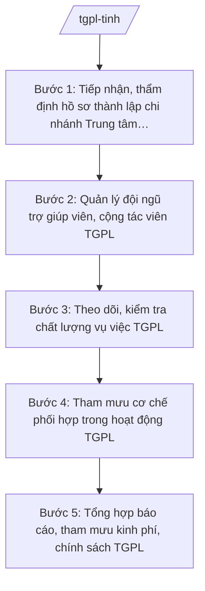

# Skill: Quản lý hoạt động trợ giúp pháp lý

## 2. Khi nào dùng
- Cần tham mưu thành lập, tổ chức lại chi nhánh của Trung tâm Trợ giúp pháp lý nhà nước tỉnh.
- Cần quản lý đội ngũ trợ giúp viên pháp lý, cộng tác viên trợ giúp pháp lý: danh sách, điều kiện, chế độ.
- Cần theo dõi, kiểm tra chất lượng vụ việc trợ giúp pháp lý do Trung tâm và chi nhánh thực hiện.
- Cần tham mưu cơ chế phối hợp giữa Trung tâm với cơ quan tố tụng, đoàn thể, UBND cấp xã trong hoạt động trợ giúp pháp lý.
- Cần tổng hợp, báo cáo hoạt động trợ giúp pháp lý định kỳ và đề xuất kinh phí, chính sách.

## 3. Đầu vào (Input)

| Trường | Mô tả | Bắt buộc |
|--------|-------|----------|
| `ho_so_thanh_lap_cn` | Hồ sơ đề nghị thành lập chi nhánh Trung tâm TGPL nhà nước tỉnh (đề án, nhân sự, trụ sở) | Không |
| `danh_sach_tgv` | Danh sách trợ giúp viên pháp lý, cộng tác viên TGPL (họ tên, trình độ, lĩnh vực) | Không |
| `bao_cao_hoat_dong` | Báo cáo hoạt động của Trung tâm và các chi nhánh (số vụ việc, đối tượng, kết quả) | Không |
| `ke_hoach_kiem_tra` | Kế hoạch kiểm tra hoạt động TGPL trong năm | Không |
| `nhu_cau_kinh_phi` | Nhu cầu kinh phí hoạt động TGPL năm tới | Không |
| `don_vi_phoi_hop` | Cơ quan tố tụng, đoàn thể, UBND cấp xã phối hợp | Không |

## 4. Quy trình

**Bước 1. Tiếp nhận, thẩm định hồ sơ thành lập chi nhánh Trung tâm TGPL**
- Làm gì: Tiếp nhận hồ sơ đề nghị thành lập chi nhánh; thẩm định sự cần thiết, điều kiện về trụ sở, nhân sự (trợ giúp viên), phạm vi hoạt động; dự thảo quyết định thành lập.
- Dùng input: `ho_so_thanh_lap_cn`
- Vai trò: Chuyên viên Phòng Trợ giúp pháp lý (Sở Tư pháp tỉnh A) thẩm định hồ sơ. AI hỗ trợ lập checklist điều kiện thành lập chi nhánh, soạn dự thảo quyết định thành lập đúng thể thức ⏱ ~03 ngày làm việc (ước tính).
- Lưu ý nghiệp vụ: Chi nhánh chỉ thành lập khi có nhu cầu thực tế tại địa bàn; nhân sự chủ chốt phải đáp ứng tiêu chuẩn trợ giúp viên pháp lý theo quy định.
- → Kết quả bước: Kết quả thẩm định + dự thảo quyết định thành lập chi nhánh trình Giám đốc Sở ký.

**Bước 2. Quản lý đội ngũ trợ giúp viên, cộng tác viên TGPL**
- Làm gì: Rà soát, cập nhật danh sách trợ giúp viên pháp lý, cộng tác viên TGPL trên địa bàn; theo dõi điều kiện hành nghề, việc cấp đổi, thu hồi thẻ; tham mưu kế hoạch đào tạo, bồi dưỡng nâng cao năng lực.
- Dùng input: `danh_sach_tgv`
- Vai trò: Trưởng phòng Trợ giúp pháp lý quản lý danh sách, theo dõi. AI hỗ trợ lập và cập nhật cơ sở dữ liệu trợ giúp viên, cảnh báo trường hợp không còn đáp ứng điều kiện ⏱ ~02 ngày làm việc (ước tính).
- Lưu ý nghiệp vụ: Danh sách trợ giúp viên phải công khai để người dân tiếp cận; bảo đảm mỗi chi nhánh có đủ trợ giúp viên theo quy định.
- → Kết quả bước: Danh sách trợ giúp viên, cộng tác viên TGPL toàn tỉnh đã cập nhật, công khai.

**Bước 3. Theo dõi, kiểm tra chất lượng vụ việc TGPL**
- Làm gì: Xây dựng kế hoạch kiểm tra hoạt động TGPL; kiểm tra hồ sơ vụ việc tại Trung tâm và chi nhánh (tính đúng đối tượng, trình tự, chất lượng tư vấn, tham gia tố tụng); lập biên bản, kết luận kiểm tra.
- Dùng input: `ke_hoach_kiem_tra`, `bao_cao_hoat_dong`
- Vai trò: Trưởng phòng Trợ giúp pháp lý chủ trì đoàn kiểm tra. AI hỗ trợ soạn kế hoạch kiểm tra, mẫu phiếu kiểm tra hồ sơ vụ việc và dự thảo kết luận kiểm tra ⏱ ~05 ngày làm việc/đợt (ước tính).
- Lưu ý nghiệp vụ: Kiểm tra thực chất hồ sơ vụ việc, không hình thức; chú trọng vụ việc liên quan người nghèo, người dân tộc thiểu số, trẻ em, người khuyết tật; kiến nghị chấn chỉnh kịp thời tồn tại.
- → Kết quả bước: Biên bản, kết luận kiểm tra hoạt động TGPL; văn bản kiến nghị chấn chỉnh (nếu có).

**Bước 4. Tham mưu cơ chế phối hợp trong hoạt động TGPL**
- Làm gì: Rà soát việc phối hợp giữa Trung tâm TGPL với cơ quan công an, viện kiểm sát, tòa án, đoàn luật sư, đoàn thể, UBND cấp xã; tham mưu ký kết, sửa đổi quy chế phối hợp; hướng dẫn UBND cấp xã giới thiệu người thuộc diện được TGPL.
- Dùng input: `don_vi_phoi_hop`, kết quả phối hợp năm trước
- Vai trò: Phó Giám đốc Sở phụ trách điều phối ký kết phối hợp. AI hỗ trợ soạn dự thảo quy chế phối hợp, văn bản hướng dẫn UBND cấp xã về giới thiệu đối tượng TGPL ⏱ ~03 ngày làm việc (ước tính).
- Lưu ý nghiệp vụ: Cơ chế phối hợp phải cụ thể đầu mối, trách nhiệm, thời hạn chuyển gửi thông tin; tránh để người thuộc diện TGPL không tiếp cận được dịch vụ.
- → Kết quả bước: Quy chế phối hợp (ký mới/sửa đổi) + văn bản hướng dẫn UBND cấp xã.

**Bước 5. Tổng hợp báo cáo, tham mưu kinh phí, chính sách TGPL**
- Làm gì: Tổng hợp báo cáo hoạt động TGPL toàn tỉnh (số vụ việc theo đối tượng, lĩnh vực, kết quả); đánh giá khó khăn, vướng mắc; tham mưu nhu cầu kinh phí năm tới; đề xuất chính sách hỗ trợ của tỉnh.
- Dùng input: `bao_cao_hoat_dong`, `nhu_cau_kinh_phi`
- Vai trò: Chuyên viên Phòng Trợ giúp pháp lý tổng hợp, soạn báo cáo; Giám đốc Sở ký báo cáo. AI hỗ trợ tổng hợp số liệu, phân tích theo đối tượng/lĩnh vực và soạn dự thảo báo cáo ⏱ ~03 ngày làm việc (ước tính).
- Lưu ý nghiệp vụ: Số liệu trung thực, có minh chứng hồ sơ vụ việc; kiến nghị kinh phí phải gắn với khối lượng công việc thực tế.
- → Kết quả bước: Báo cáo hoạt động TGPL năm của tỉnh đã ký, gửi Bộ Tư pháp; tờ trình nhu cầu kinh phí gửi Sở Tài chính, UBND tỉnh.

## Luồng quy trình (Workflow)

## 5. Đầu ra (Output)

Sản phẩm:
- Quyết định thành lập chi nhánh Trung tâm TGPL nhà nước tỉnh (đã ký) — gửi chi nhánh, lưu hồ sơ
- Danh sách trợ giúp viên pháp lý, cộng tác viên TGPL toàn tỉnh (đã cập nhật, công khai) — đăng Cổng thông tin điện tử tỉnh
- Kế hoạch kiểm tra + biên bản, kết luận kiểm tra hoạt động TGPL — lưu hồ sơ, gửi đơn vị được kiểm tra
- Quy chế phối hợp trong hoạt động TGPL — gửi các cơ quan phối hợp
- Báo cáo hoạt động TGPL năm của tỉnh — gửi Bộ Tư pháp, lưu hồ sơ

**Cấu trúc output chuẩn:**

Khung Báo cáo hoạt động trợ giúp pháp lý năm của tỉnh gồm các phần theo đúng thứ tự, đúng thể thức NĐ 30/2020/NĐ-CP:
1. Quốc hiệu "CỘNG HÒA XÃ HỘI CHỦ NGHĨA VIỆT NAM" — Tiêu ngữ "Độc lập – Tự do – Hạnh phúc"
2. Tên cơ quan: "SỞ TƯ PHÁP TỈNH A"; số, ký hiệu: số.../BC-STP; địa danh, ngày, tháng, năm
3. Tên văn bản: "BÁO CÁO" + tên gọi: "Hoạt động trợ giúp pháp lý năm ..."
4. Nội dung: I. Tình hình tổ chức (Trung tâm, chi nhánh, đội ngũ trợ giúp viên); II. Kết quả hoạt động (số vụ việc theo đối tượng: người nghèo, người dân tộc thiểu số, trẻ em...; theo lĩnh vực; theo hình thức: tư vấn, tham gia tố tụng, đại diện); III. Công tác phối hợp; IV. Kinh phí; V. Tồn tại, khó khăn; VI. Phương hướng, kiến nghị
5. Nơi nhận: Bộ Tư pháp, UBND tỉnh A, lưu Sở
6. Chữ ký: "GIÁM ĐỐC" + chữ ký + họ tên Giám đốc Sở Tư pháp tỉnh A, đóng dấu Sở

> **Checklist thể thức văn bản theo NĐ 30/2020/NĐ-CP** — đối chiếu trước khi trình ký:
> 1. Quốc hiệu và Tiêu ngữ.
> 2. Tên cơ quan, tổ chức ban hành văn bản.
> 3. Số, ký hiệu của văn bản.
> 4. Địa danh và thời gian ban hành văn bản.
> 5. Tên loại và trích yếu nội dung văn bản.
> 6. Nội dung văn bản.
> 7. Chức vụ, họ tên và chữ ký của người có thẩm quyền.
> 8. Dấu, chữ ký số của cơ quan, tổ chức.
> 9. Nơi nhận (kèm Phụ lục nếu có).

## 6. Checklist nghiệm thu
- [ ] Hồ sơ thành lập chi nhánh được thẩm định đầy đủ điều kiện về trụ sở, nhân sự, nhu cầu thực tế
- [ ] Danh sách trợ giúp viên, cộng tác viên được cập nhật, công khai đầy đủ
- [ ] Kế hoạch kiểm tra hoạt động TGPL được thực hiện; có biên bản, kết luận kiểm tra
- [ ] Hồ sơ vụ việc được kiểm tra thực chất (đúng đối tượng, trình tự, chất lượng)
- [ ] Cơ chế phối hợp với cơ quan tố tụng, đoàn thể, UBND cấp xã rõ đầu mối, trách nhiệm
- [ ] Báo cáo hoạt động TGPL có số liệu minh chứng theo đối tượng, lĩnh vực; gửi Bộ Tư pháp đúng hạn
- [ ] Thể thức văn bản đúng NĐ 30/2020/NĐ-CP
- [ ] Không có số liệu, căn cứ pháp lý nào do AI bịa ra
- [ ] Đã qua human gate: chuyên viên soạn → Trưởng phòng kiểm tra → Phó Giám đốc Sở duyệt → Giám đốc Sở ký ban hành/văn bản trình

## 7. Ví dụ mô phỏng

*Dữ liệu dưới đây là giả lập 100% phục vụ minh họa.*

### Input mẫu
- bao_cao_hoat_dong: Trung tâm TGPL nhà nước tỉnh A và 02 chi nhánh (giả lập) thực hiện 500 vụ việc trong năm, trong đó: 300 vụ tư vấn pháp luật, 150 vụ tham gia tố tụng, 50 vụ đại diện ngoài tố tụng; đối tượng chủ yếu: người nghèo (200), người dân tộc thiểu số (150), trẻ em (50)
- danh_sach_tgv: 10 trợ giúp viên pháp lý, 20 cộng tác viên TGPL (giả lập)
- nhu_cau_kinh_phi: 2.000.000.000 đồng cho năm tới

### Output mẫu (trích)

**BÁO CÁO HOẠT ĐỘNG TRỢ GIÚP PHÁP LÝ TỈNH A NĂM 2026**

CỘNG HÒA XÃ HỘI CHỦ NGHĨA VIỆT NAM
Độc lập – Tự do – Hạnh phúc

SỞ TƯ PHÁP TỈNH A

Số: 45/BC-STP

Tỉnh A, ngày 10 tháng 01 năm 2027

**BÁO CÁO**
**Hoạt động trợ giúp pháp lý tỉnh A năm 2026**

I. Tình hình tổ chức
Trung tâm Trợ giúp pháp lý nhà nước tỉnh A có 02 chi nhánh; đội ngũ gồm 10 trợ giúp viên pháp lý và 20 cộng tác viên trợ giúp pháp lý.

II. Kết quả hoạt động
Tổng số vụ việc thực hiện: 500 vụ việc, trong đó: tư vấn pháp luật 300 vụ việc; tham gia tố tụng 150 vụ việc; đại diện ngoài tố tụng 50 vụ việc. Đối tượng: người nghèo 200 vụ việc; người dân tộc thiểu số 150 vụ việc; trẻ em 50 vụ việc; đối tượng khác 100 vụ việc.

III. Công tác phối hợp
Đã ký quy chế phối hợp với Công an tỉnh A, Tòa án nhân dân tỉnh A, Đoàn Luật sư tỉnh A (giả lập); 100% UBND cấp xã có đầu mối giới thiệu đối tượng TGPL.

IV. Kinh phí: Ngân sách tỉnh A cấp 1.800.000.000 đồng, giải ngân đạt 95%.

V. Tồn tại, khó khăn
Một số địa bàn vùng cao người dân chưa biết đến dịch vụ TGPL miễn phí; thiếu trợ giúp viên am hiểu tiếng dân tộc.

VI. Phương hướng, kiến nghị
Kiến nghị bố trí 2.000.000.000 đồng cho năm 2027; tăng cường truyền thông TGPL tại vùng cao.

Nơi nhận:
- Bộ Tư pháp;
- UBND tỉnh A;
- Lưu: Sở.

GIÁM ĐỐC
(ký, đóng dấu)
Hoàng Văn S

## 8. Human gate
Chuyên viên Phòng Trợ giúp pháp lý soạn, tổng hợp → Trưởng phòng kiểm tra → Phó Giám đốc Sở phụ trách duyệt → Giám đốc Sở Tư pháp ký quyết định thành lập chi nhánh, ký báo cáo. AI chỉ hỗ trợ thẩm định hồ sơ, tổng hợp số liệu, soạn dự thảo; quyết định thành lập, kết luận kiểm tra do con người thực hiện.

## 9. Giới hạn
AI tuyệt đối KHÔNG: quyết định thành lập chi nhánh thay Giám đốc Sở; kết luận chất lượng vụ việc TGPL thay đoàn kiểm tra; tự ký văn bản; bịa số liệu vụ việc, danh sách trợ giúp viên; dùng văn bản hết hiệu lực làm căn cứ.

## 10. Căn cứ & lưu ý
- TT 09/2025/TT-BTP (Sở Tư pháp tham mưu quản lý nhà nước về trợ giúp pháp lý; hiệu lực 01/7/2025)
- NĐ 121/2025/NĐ-CP (phân quyền, phân cấp trong lĩnh vực quản lý nhà nước của Bộ Tư pháp)
- NĐ 150/2025/NĐ-CP; NĐ 370/2025/NĐ-CP (tổ chức cơ quan chuyên môn thuộc UBND cấp tỉnh)
- NĐ 30/2020/NĐ-CP (thể thức văn bản hành chính)
- Lưu ý: hoạt động TGPL miễn phí cho người thuộc diện được trợ giúp theo quy định pháp luật hiện hành; danh sách trợ giúp viên phải công khai để người dân tiếp cận; số liệu báo cáo phải có hồ sơ vụ việc minh chứng.
