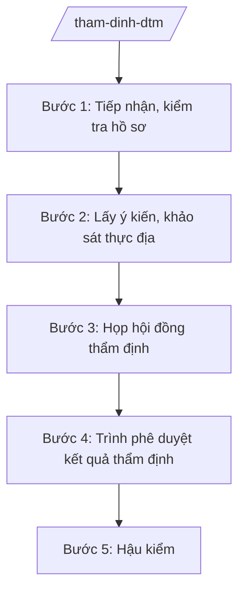

# Skill: Thẩm định báo cáo đánh giá tác động môi trường

## 2. Khi nào dùng

- Khi chủ dự án nộp hồ sơ đề nghị thẩm định báo cáo ĐTM thuộc thẩm quyền UBND tỉnh.
- Khi tổ chức họp hội đồng thẩm định ĐTM, khảo sát thực địa.
- Khi trình phê duyệt kết quả thẩm định báo cáo ĐTM.
- Khi kiểm tra việc thực hiện nội dung ĐTM đã phê duyệt (hậu kiểm).

## 3. Đầu vào (Input)

| Trường | Mô tả | Bắt buộc |
|--------|-------|----------|
| `du_an` | Tên dự án | Có |
| `chu_du_an` | Tên chủ dự án | Có |
| `loai_du_an` | Loại hình (công nghiệp, giao thông, đô thị...) | Có |
| `dia_diem` | Vị trí dự án | Có |
| `bao_cao_dtm` | Báo cáo ĐTM (file) | Có |

## 4. Quy trình

**Bước 1. Tiếp nhận, kiểm tra hồ sơ**
- Làm gì: Tiếp nhận hồ sơ đề nghị thẩm định; kiểm tra tính đầy đủ (báo cáo ĐTM, văn bản đề nghị, tài liệu pháp lý dự án...).
- Dùng input: `du_an`, `chu_du_an`, `bao_cao_dtm`.
- Vai trò: Chuyên viên Phòng Quản lý môi trường tiếp nhận; AI hỗ trợ checklist hồ sơ — ⏱ 3 ngày.
- Lưu ý nghiệp vụ: Dự án thuộc đối tượng phải lập ĐTM theo quy định mới tiếp nhận; trả hồ sơ nếu không thuộc thẩm quyền tỉnh.
- → Kết quả bước: Phiếu kiểm tra hồ sơ.

**Bước 2. Lấy ý kiến, khảo sát thực địa**
- Làm gì: Gửi hồ sơ lấy ý kiến các sở, UBND cấp xã nơi thực hiện dự án; tổ chức khảo sát thực địa khu vực dự án.
- Dùng input: `dia_diem`, `loai_du_an`.
- Vai trò: Chuyên viên chủ trì; AI hỗ trợ tổng hợp ý kiến — ⏱ 7 ngày.
- Lưu ý nghiệp vụ: Ý kiến cộng đồng dân cư bị ảnh hưởng là nội dung bắt buộc của ĐTM — kiểm tra kỹ tính trung thực.
- → Kết quả bước: Văn bản ý kiến các đơn vị + biên bản khảo sát thực địa.

**Bước 3. Họp hội đồng thẩm định**
- Làm gì: Thành lập hội đồng thẩm định; tổ chức họp: chủ dự án trình bày, phản biện, hội đồng thảo luận, bỏ phiếu/kết luận.
- Dùng input: `bao_cao_dtm`.
- Vai trò: Phó Giám đốc Sở (Chủ tịch hội đồng) chủ trì; AI hỗ trợ soạn biên bản họp — ⏱ 10–15 ngày sau khi hồ sơ hợp lệ.
- Lưu ý nghiệp vụ: Thành viên hội đồng phải độc lập, không có lợi ích liên quan dự án; kết luận rõ: thông qua / thông qua có chỉnh sửa / không thông qua.
- → Kết quả bước: Biên bản họp hội đồng thẩm định.

**Bước 4. Trình phê duyệt kết quả thẩm định**
- Làm gì: Chủ dự án chỉnh sửa, bổ sung theo kết luận hội đồng; Sở kiểm tra việc tiếp thu; trình UBND tỉnh phê duyệt kết quả thẩm định.
- Dùng input: Kết quả bước 3.
- Vai trò: Giám đốc Sở ký tờ trình; AI hỗ trợ soạn thảo — ⏱ 5 ngày.
- Lưu ý nghiệp vụ: Không trình phê duyệt khi chủ dự án chưa tiếp thu đầy đủ ý kiến hội đồng.
- → Kết quả bước: Quyết định phê duyệt kết quả thẩm định báo cáo ĐTM của UBND tỉnh.

**Bước 5. Hậu kiểm**
- Làm gì: Kiểm tra việc thực hiện các nội dung bảo vệ môi trường trong ĐTM đã phê duyệt (quan trắc, xử lý chất thải...).
- Dùng input: `du_an`.
- Vai trò: Đoàn kiểm tra; AI hỗ trợ lập kế hoạch — ⏱ định kỳ + đột xuất.
- Lưu ý nghiệp vụ: Dự án không thực hiện đúng ĐTM bị xử phạt, đình chỉ; công khai vi phạm.
- → Kết quả bước: Biên bản hậu kiểm + kiến nghị xử lý.

## Luồng quy trình (Workflow)

## 5. Đầu ra (Output)

- Biên bản họp hội đồng thẩm định ĐTM.
- Tờ trình + quyết định phê duyệt kết quả thẩm định báo cáo ĐTM.
- Biên bản hậu kiểm.

**Cấu trúc output chuẩn (Quyết định phê duyệt kết quả thẩm định ĐTM):**
- Thể thức: tuân thủ Nghị định 30/2020/NĐ-CP về công tác văn thư.

1. Quốc hiệu "CỘNG HÒA XÃ HỘI CHỦ NGHĨA VIỆT NAM", Tiêu ngữ "Độc lập – Tự do – Hạnh phúc"; tên cơ quan (UBND tỉnh A); số, ký hiệu.
2. Tên loại: **QUYẾT ĐỊNH** — về việc phê duyệt kết quả thẩm định báo cáo đánh giá tác động môi trường của dự án [tên].
3. Căn cứ pháp lý; đề nghị của Sở NN&MT.
4. **Điều 1.** Phê duyệt kết quả thẩm định báo cáo ĐTM của dự án [tên], chủ dự án [tên] (kèm phụ lục các yêu cầu về bảo vệ môi trường).
5. **Điều 2.** Trách nhiệm của chủ dự án trong thực hiện các nội dung BVMT.
6. **Điều 3.** Trách nhiệm giám sát của Sở NN&MT, UBND cấp xã.
7. **Điều 4.** Hiệu lực; trách nhiệm thi hành.
8. Nơi nhận; chữ ký Chủ tịch UBND tỉnh.

## 6. Checklist nghiệm thu

- [ ] Dự án thuộc đối tượng phải lập ĐTM và thuộc thẩm quyền tỉnh.
- [ ] Có ý kiến cộng đồng dân cư bị ảnh hưởng trong hồ sơ.
- [ ] Hội đồng thẩm định độc lập, đủ thành phần theo quy định.
- [ ] Chủ dự án tiếp thu đầy đủ kết luận hội đồng trước khi trình phê duyệt.
- [ ] Hậu kiểm định kỳ việc thực hiện ĐTM đã phê duyệt.
- [ ] Văn bản đúng thể thức NĐ 30/2020/NĐ-CP.

## 7. Ví dụ mô phỏng

*Dữ liệu dưới đây là giả lập 100% phục vụ minh họa.*

**Input mẫu:** du_an = "Nhà máy chế biến nông sản AB"; chu_du_an = "Công ty TNHH AB"; loai_du_an = "công nghiệp chế biến"; dia_diem = "Cụm công nghiệp An Bình, xã A".

**Output mẫu (trích Quyết định):**

> **ỦY BAN NHÂN DÂN TỈNH A**
> Số: 1234/QĐ-UBND
>
> **QUYẾT ĐỊNH**
> Về việc phê duyệt kết quả thẩm định báo cáo đánh giá tác động môi trường của dự án Nhà máy chế biến nông sản AB
>
> *Căn cứ* đề nghị của Sở Nông nghiệp và Môi trường tại Tờ trình số 123/TTr-SNNMT; kết quả họp Hội đồng thẩm định ngày 10/9/2026...
>
> **Điều 1.** Phê duyệt kết quả thẩm định báo cáo ĐTM của dự án Nhà máy chế biến nông sản AB, chủ dự án Công ty TNHH AB, với các yêu cầu về BVMT tại phụ lục kèm theo (xử lý nước thải đạt cột A, khí thải, chất thải rắn, quan trắc định kỳ...).
> **Điều 2.** Công ty TNHH AB chịu trách nhiệm thực hiện đầy đủ các nội dung BVMT đã cam kết./.
>
> *Nơi nhận:* ... — **CHỦ TỊCH** *(ký, đóng dấu)* — Phạm Văn P

## 8. Human gate

- Chuyên viên soạn → Trưởng phòng kiểm tra → Phó Giám đốc Sở (Chủ tịch hội đồng) duyệt → Giám đốc Sở ký tờ trình → **UBND tỉnh phê duyệt** kết quả thẩm định.
- Kết luận hội đồng thẩm định do tập thể hội đồng quyết định.

## 9. Giới hạn

- AI không thay hội đồng thẩm định đánh giá báo cáo ĐTM.
- Không bịa kết luận hội đồng, ý kiến cộng đồng.
- Không dùng văn bản hết hiệu lực làm căn cứ.

## 10. Căn cứ & lưu ý

- Thông tư 19/2025/TT-BNNMT của Bộ Nông nghiệp và Môi trường hướng dẫn chức năng, nhiệm vụ của cơ quan chuyên môn về nông nghiệp và môi trường.
- Luật Bảo vệ môi trường và các văn bản hướng dẫn (dẫn tên, áp dụng bản hiện hành).
- Nghị định 150/2025/NĐ-CP về tổ chức cơ quan chuyên môn thuộc UBND cấp tỉnh.
- Nghị định 30/2020/NĐ-CP về công tác văn thư (thể thức văn bản).
- Lưu ý: ĐTM là "giấy phép môi trường" quan trọng nhất của dự án — thẩm định phải thực chất, không hợp thức hóa.
