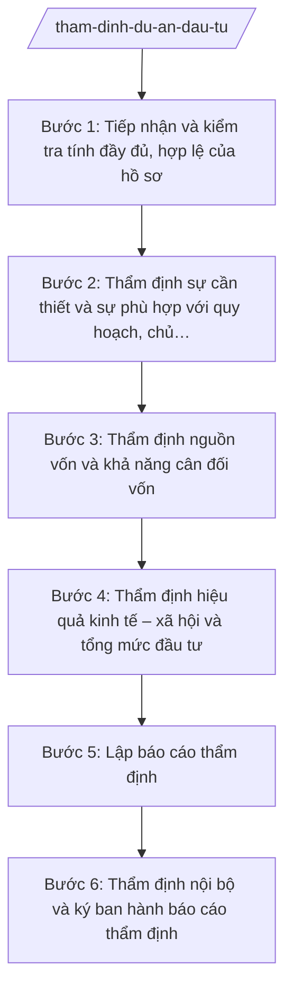

# Skill: Thẩm định dự án đầu tư

## 2. Khi nào dùng

- Chủ đầu tư hoặc sở quản lý ngành gửi hồ sơ đề nghị thẩm định chủ trương đầu tư dự án thuộc thẩm quyền quyết định của UBND tỉnh, Chủ tịch UBND tỉnh;
- Cần thẩm định nguồn vốn, khả năng cân đối vốn và hiệu quả kinh tế – xã hội của dự án trước khi trình phê duyệt;
- Cần thẩm định điều chỉnh dự án (điều chỉnh chủ trương đầu tư, điều chỉnh tổng mức đầu tư);
- Cần lấy ý kiến thẩm định của Sở Tài chính đối với dự án do cấp khác làm chủ đầu tư nhưng sử dụng vốn ngân sách của tỉnh.

## 3. Đầu vào (Input)

| Trường | Mô tả | Bắt buộc |
|--------|-------|----------|
| `ho_so_du_an` | Hồ sơ dự án: báo cáo đề xuất chủ trương đầu tư/báo cáo nghiên cứu khả thi, tờ trình của chủ đầu tư | Có |
| `ten_chu_dau_tu` | Tên chủ đầu tư đề xuất dự án | Có |
| `tong_muc_dau_tu` | Tổng mức đầu tư dự kiến và cơ cấu nguồn vốn | Có |
| `nguon_von_de_xuat` | Nguồn vốn đề xuất: NSĐP, NSTW hỗ trợ, vốn khác | Có |
| `can_cu_quy_hoach` | Sự phù hợp với quy hoạch tỉnh, quy hoạch ngành đã được phê duyệt | Có |
| `y_kien_lien_nganh` | Ý kiến của các sở, ngành liên quan (nếu đã có) | Không |
| `loai_tham_dinh` | Loại thẩm định: chủ trương đầu tư / điều chỉnh dự án / thẩm định nguồn vốn | Có |

## 4. Quy trình

**Bước 1. Tiếp nhận và kiểm tra tính đầy đủ, hợp lệ của hồ sơ**
- Làm gì: Tiếp nhận hồ sơ đề nghị thẩm định; kiểm tra thành phần hồ sơ theo quy định (báo cáo đề xuất, tờ trình, tài liệu chứng minh nguồn vốn, văn bản về quy hoạch...); lập phiếu tiếp nhận, yêu cầu bổ sung nếu thiếu.
- Dùng input: `ho_so_du_an`, `loai_tham_dinh`, `ten_chu_dau_tu`.
- Vai trò: Chuyên viên Phòng Đầu tư (Sở Tài chính) tiếp nhận, AI hỗ trợ lập danh mục kiểm tra thành phần hồ sơ (checklist) và phiếu tiếp nhận; ⏱ ~1–2 ngày làm việc (ước tính).
- Lưu ý nghiệp vụ: Không thụ lý hồ sơ thiếu thành phần bắt buộc; thời hạn thẩm định được tính từ ngày nhận đủ hồ sơ hợp lệ.
- → Kết quả bước: Phiếu tiếp nhận hồ sơ hợp lệ (hoặc văn bản yêu cầu bổ sung).

**Bước 2. Thẩm định sự cần thiết và sự phù hợp với quy hoạch, chủ trương**
- Làm gì: Đánh giá sự cần thiết đầu tư của dự án; đối chiếu mục tiêu, quy mô dự án với quy hoạch tỉnh, quy hoạch ngành, định hướng phát triển KT-XH của tỉnh; kiểm tra sự trùng lặp với các dự án đã và đang triển khai.
- Dùng input: `ho_so_du_an`, `can_cu_quy_hoach`.
- Vai trò: Chuyên viên Phòng Đầu tư thẩm định, AI hỗ trợ đối chiếu nội dung dự án với quy hoạch, định hướng và liệt kê các điểm chưa phù hợp; ⏱ ~2–3 ngày làm việc (ước tính).
- Lưu ý nghiệp vụ: Dự án không phù hợp quy hoạch hoặc trùng lặp thì kiến nghị không thẩm định thông qua; ghi rõ căn cứ trong báo cáo thẩm định.
- → Kết quả bước: Nhận xét về sự cần thiết và tính phù hợp với quy hoạch của dự án.

**Bước 3. Thẩm định nguồn vốn và khả năng cân đối vốn**
- Làm gì: Kiểm tra cơ cấu nguồn vốn đề xuất; đánh giá khả năng cân đối vốn NSĐP trong kế hoạch đầu tư công trung hạn và hằng năm; kiểm tra vốn NSTW hỗ trợ đã có trong dự kiến phân bổ; xác định mức vốn có thể bố trí theo tiến độ dự án.
- Dùng input: `tong_muc_dau_tu`, `nguon_von_de_xuat`.
- Vai trò: Chuyên viên Phòng Đầu tư phối hợp Phòng Ngân sách thẩm định, AI hỗ trợ tính toán khả năng cân đối vốn theo năm, cảnh báo vượt trần vốn; ⏱ ~2–3 ngày làm việc (ước tính).
- Lưu ý nghiệp vụ: Không thẩm định thông qua dự án khi nguồn vốn chưa xác định rõ hoặc vượt khả năng cân đối; vốn bố trí phải phù hợp tiến độ thực hiện, tránh dở dang kéo dài.
- → Kết quả bước: Nhận xét về nguồn vốn và khả năng cân đối vốn của dự án.

**Bước 4. Thẩm định hiệu quả kinh tế – xã hội và tổng mức đầu tư**
- Làm gì: Đánh giá hiệu quả kinh tế – xã hội của dự án (đối với dự án có thu: khả năng hoàn vốn; đối với dự án hạ tầng xã hội: hiệu quả phục vụ dân sinh); rà soát tính hợp lý của tổng mức đầu tư, suất đầu tư so với định mức, đơn giá hiện hành.
- Dùng input: `ho_so_du_an`, `tong_muc_dau_tu`, `y_kien_lien_nganh`.
- Vai trò: Chuyên viên Phòng Đầu tư thẩm định, lấy ý kiến sở quản lý ngành khi cần; AI hỗ trợ so sánh suất đầu tư với các dự án tương tự, cảnh báo tổng mức bất hợp lý; ⏱ ~2–4 ngày làm việc (ước tính).
- Lưu ý nghiệp vụ: Tổng mức đầu tư phải được tính đúng, tính đủ theo quy định; mọi ý kiến khác nhau giữa các ngành phải được tổng hợp, làm rõ trong báo cáo thẩm định.
- → Kết quả bước: Nhận xét về hiệu quả và tính hợp lý của tổng mức đầu tư.

**Bước 5. Lập báo cáo thẩm định**
- Làm gì: Tổng hợp kết quả các bước thẩm định thành Báo cáo thẩm định của Sở Tài chính: nêu rõ nội dung thẩm định, nhận xét từng nội dung, kết luận (đủ điều kiện trình phê duyệt / cần hoàn thiện / không đủ điều kiện) và kiến nghị cụ thể.
- Dùng input: Kết quả Bước 2, 3, 4.
- Vai trò: Chuyên viên Phòng Đầu tư soạn thảo, AI hỗ trợ dựng khung báo cáo, rà soát tính nhất quán giữa các nhận xét và kết luận; ⏱ ~1–2 ngày làm việc (ước tính).
- Lưu ý nghiệp vụ: Kết luận thẩm định phải rõ ràng, có kiến nghị cụ thể cho từng nội dung chưa đạt; báo cáo thẩm định là căn cứ để cấp có thẩm quyền quyết định, không thay thế quyết định phê duyệt.
- → Kết quả bước: Dự thảo Báo cáo thẩm định dự án của Sở Tài chính.

**Bước 6. Thẩm định nội bộ và ký ban hành báo cáo thẩm định**
- Làm gì: Trưởng phòng Đầu tư và Phó Giám đốc Sở phụ trách rà soát báo cáo thẩm định; Giám đốc Sở Tài chính (ông Hoàng Văn S) xem xét, ký ban hành Báo cáo thẩm định; gửi báo cáo đến chủ đầu tư và cơ quan trình phê duyệt.
- Dùng input: Dự thảo Báo cáo thẩm định ở Bước 5.
- Vai trò: Trưởng phòng, Phó Giám đốc, Giám đốc Sở kiểm tra và quyết định; AI hỗ trợ rà soát lỗi kỹ thuật, thể thức; ⏱ ~1–2 ngày làm việc (ước tính).
- Lưu ý nghiệp vụ: Báo cáo thẩm định chỉ có giá trị tham mưu; quyết định phê duyệt chủ trương đầu tư thuộc thẩm quyền của UBND tỉnh/Chủ tịch UBND tỉnh theo phân cấp.
- → Kết quả bước: Báo cáo thẩm định dự án của Sở Tài chính đã ký, gửi các bên liên quan.

## Luồng quy trình (Workflow)

## 5. Đầu ra (Output)

- Phiếu tiếp nhận hồ sơ thẩm định (hoặc văn bản yêu cầu bổ sung hồ sơ);
- Phiếu thẩm tra từng nội dung (sự cần thiết, quy hoạch, nguồn vốn, hiệu quả, tổng mức đầu tư);
- Báo cáo thẩm định dự án đầu tư của Sở Tài chính (đã ký);
- Văn bản thông báo kết quả thẩm định gửi chủ đầu tư.

**Cấu trúc output chuẩn (Báo cáo thẩm định dự án đầu tư):**
- Thể thức: tuân thủ Nghị định 30/2020/NĐ-CP về công tác văn thư.

1. Quốc hiệu "CỘNG HÒA XÃ HỘI CHỦ NGHĨA VIỆT NAM", Tiêu ngữ "Độc lập – Tự do – Hạnh phúc";
2. Tên cơ quan ban hành: SỞ TÀI CHÍNH TỈNH A; số, ký hiệu văn bản; địa danh và ngày, tháng, năm ban hành;
3. Tên loại và trích yếu: BÁO CÁO — Thẩm định (chủ trương đầu tư/dự án đầu tư/điều chỉnh dự án)... (tên dự án);
4. Phần "Kính gửi": cơ quan trình phê duyệt (UBND tỉnh A...);
5. Căn cứ thẩm định (quy định pháp luật về đầu tư, văn bản đề nghị thẩm định...);
6. Nội dung thẩm định theo từng nội dung: sự cần thiết đầu tư; sự phù hợp với quy hoạch, chủ trương; nguồn vốn và khả năng cân đối vốn; hiệu quả kinh tế – xã hội; tổng mức đầu tư; ý kiến của các ngành liên quan;
7. Kết luận và kiến nghị (đủ điều kiện trình phê duyệt / cần hoàn thiện nội dung... / không đủ điều kiện);
8. Nơi nhận;
9. Thẩm quyền, chức vụ, họ tên người ký: GIÁM ĐỐC — (chữ ký, họ tên), dấu của cơ quan.

## 6. Checklist nghiệm thu

- [ ] Hồ sơ thẩm định đầy đủ thành phần theo quy định, có phiếu tiếp nhận;
- [ ] Đã thẩm định đủ 5 nội dung: sự cần thiết, quy hoạch, nguồn vốn, hiệu quả, tổng mức đầu tư;
- [ ] Nguồn vốn được xác định rõ, trong khả năng cân đối của kế hoạch đầu tư công;
- [ ] Kết luận thẩm định rõ ràng, kiến nghị cụ thể cho từng nội dung chưa đạt;
- [ ] Báo cáo thẩm định đúng thể thức văn bản hành chính, đã được lãnh đạo Sở ký;
- [ ] Đã gửi báo cáo thẩm định đến chủ đầu tư và cơ quan trình phê duyệt đúng thời hạn;
- [ ] Căn cứ pháp lý đầy đủ, đúng văn bản còn hiệu lực, không bịa số hiệu;
- [ ] Nội dung thẩm định dựa trên hồ sơ thật của dự án, AI không tự bịa số liệu dự án.

## 7. Ví dụ mô phỏng

*Dữ liệu dưới đây là giả lập 100% phục vụ minh họa.*

### Input mẫu

| Trường | Giá trị giả lập |
|--------|-----------------|
| ho_so_du_an | Báo cáo đề xuất chủ trương đầu tư + Tờ trình của Ban Quản lý dự án tỉnh A |
| ten_chu_dau_tu | Ban Quản lý dự án đầu tư xây dựng tỉnh A (giả lập) |
| tong_muc_dau_tu | 500 tỷ đồng |
| nguon_von_de_xuat | Vốn ngân sách địa phương: 500 tỷ đồng |
| can_cu_quy_hoach | Phù hợp quy hoạch tỉnh A thời kỳ 2021–2030 (giả lập) |
| y_kien_lien_nganh | Ý kiến Sở Xây dựng tỉnh A: thống nhất (giả lập) |
| loai_tham_dinh | Thẩm định chủ trương đầu tư |

### Output mẫu (Báo cáo thẩm định — trích)

> **CỘNG HÒA XÃ HỘI CHỦ NGHĨA VIỆT NAM**
> **Độc lập – Tự do – Hạnh phúc**
>
> **SỞ TÀI CHÍNH TỈNH A**
> Số: 1234/BC-STC
> Tỉnh A, ngày 15 tháng 3 năm 2027
>
> **BÁO CÁO**
> **Thẩm định chủ trương đầu tư dự án đường giao thông liên xã (giả lập)**
>
> Kính gửi: Ủy ban nhân dân tỉnh A.
>
> Căn cứ quy định pháp luật về đầu tư;
> Căn cứ Tờ trình số... của Ban Quản lý dự án đầu tư xây dựng tỉnh A đề nghị thẩm định chủ trương đầu tư;
> Sở Tài chính tỉnh A báo cáo kết quả thẩm định như sau:
>
> 1. Sự cần thiết đầu tư: dự án cần thiết, phục vụ nhu cầu đi lại của nhân dân...
> 2. Sự phù hợp với quy hoạch: phù hợp quy hoạch tỉnh A thời kỳ 2021–2030...
> 3. Nguồn vốn và khả năng cân đối: tổng mức 500 tỷ đồng từ vốn NSĐP, trong khả năng cân đối của kế hoạch đầu tư công trung hạn...
> 4. Hiệu quả kinh tế – xã hội: ...
> 5. Kết luận: dự án đủ điều kiện trình UBND tỉnh phê duyệt chủ trương đầu tư; kiến nghị...
>
> ***Nơi nhận:*** ...
>
> **GIÁM ĐỐC**
> *(ký, đóng dấu)*
> **Hoàng Văn S**

## 8. Human gate

1. Chuyên viên Phòng Đầu tư tiếp nhận, thẩm định và soạn thảo báo cáo (Bước 1–5);
2. Trưởng phòng Đầu tư và Phó Giám đốc Sở phụ trách rà soát báo cáo thẩm định (Bước 6);
3. Giám đốc Sở Tài chính xem xét, ký ban hành Báo cáo thẩm định (Bước 6);
4. UBND tỉnh/Chủ tịch UBND tỉnh quyết định phê duyệt chủ trương đầu tư trên cơ sở báo cáo thẩm định — quyết định cuối cùng thuộc thẩm quyền cấp phê duyệt, không thuộc Sở Tài chính.

## 9. Giới hạn

- AI KHÔNG ra quyết định thẩm định thông qua hay không thông qua dự án thay người có thẩm quyền;
- AI KHÔNG tự ký, tự phát hành báo cáo thẩm định hay bất kỳ văn bản nào;
- AI KHÔNG bịa số liệu dự án, nguồn vốn, kết quả thẩm định;
- AI KHÔNG bịa căn cứ pháp lý, không trích dẫn văn bản đã hết hiệu lực;
- AI KHÔNG thay UBND tỉnh/Chủ tịch UBND tỉnh phê duyệt chủ trương đầu tư.

## 10. Căn cứ & lưu ý

- Thông tư 57/2025/TT-BTC hướng dẫn chức năng, nhiệm vụ, quyền hạn của Sở Tài chính và lĩnh vực tài chính – kế hoạch của phòng chuyên môn thuộc UBND cấp xã;
- Luật Đầu tư công; Luật Ngân sách nhà nước (chỉ nêu tên luật, không kèm số hiệu);
- Nghị định 150/2025/NĐ-CP về tổ chức cơ quan chuyên môn thuộc UBND cấp tỉnh, cấp xã;
- Nghị định 30/2020/NĐ-CP về công tác văn thư (chỉ dùng cho thể thức văn bản);
- Lưu ý: báo cáo thẩm định của Sở Tài chính chỉ có giá trị tham mưu; quyết định phê duyệt thuộc thẩm quyền của cấp có thẩm quyền theo phân cấp; thời hạn thẩm định được tính từ ngày nhận đủ hồ sơ hợp lệ.
