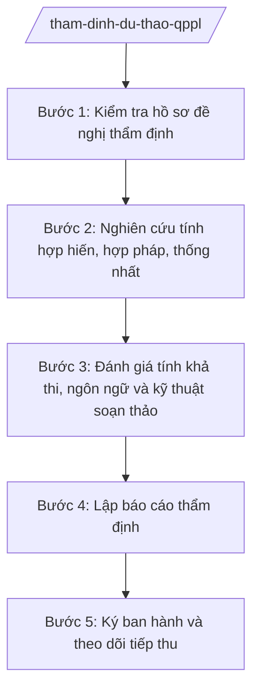

# Skill: Thẩm định dự thảo văn bản QPPL

## 2. Khi nào dùng
- Sở, ban, ngành chủ trì soạn thảo nghị quyết của HĐND tỉnh hoặc quyết định của UBND tỉnh gửi hồ sơ đề nghị thẩm định.
- UBND tỉnh giao Sở Tư pháp thẩm định dự thảo trước khi trình kỳ họp HĐND hoặc phiên họp UBND.
- Rà soát lại dự thảo sau khi tiếp thu ý kiến góp ý, trước khi trình ký ban hành.

## 3. Đầu vào (Input)
| Trường | Mô tả | Bắt buộc |
|--------|-------|----------|
| `ten_du_thao` | Tên dự thảo VBQPPL (nghị quyết/quyết định, lĩnh vực điều chỉnh) | Có |
| `co_quan_chu_tri` | Sở, ban, ngành chủ trì soạn thảo | Có |
| `du_thao_van_ban` | Toàn văn dự thảo (kèm các phương án nếu có) | Có |
| `to_trinh_du_thao` | Tờ trình đề nghị ban hành của cơ quan chủ trì | Có |
| `bao_cao_danh_gia_td` | Báo cáo đánh giá tác động chính sách (nếu thuộc diện phải đánh giá) | Không |
| `bang_tong_hop_gop_y` | Bảng tổng hợp, tiếp thu, giải trình ý kiến góp ý | Có |
| `can_cu_phap_ly` | Danh mục văn bản pháp luật được viện dẫn trong dự thảo | Có |
| `thoi_han_tham_dinh` | Thời hạn hoàn thành thẩm định | Có |

## 4. Quy trình

**Bước 1. Kiểm tra hồ sơ đề nghị thẩm định**
- Làm gì: Tiếp nhận hồ sơ; đối chiếu thành phần hồ sơ theo quy định (tờ trình, dự thảo, báo cáo đánh giá tác động, bảng tổng hợp góp ý); yêu cầu bổ sung nếu thiếu.
- Dùng input: `to_trinh_du_thao`, `du_thao_van_ban`, `bang_tong_hop_gop_y`, `bao_cao_danh_gia_td`
- Vai trò: Chuyên viên Phòng Xây dựng và kiểm tra văn bản QPPL (Sở Tư pháp) kiểm tra; AI hỗ trợ lập checklist thành phần hồ sơ, đối chiếu nhanh — 0,5 ngày làm việc
- Lưu ý nghiệp vụ: Không thẩm định khi hồ sơ thiếu tờ trình hoặc dự thảo; thời hạn thẩm định tính từ ngày nhận đủ hồ sơ hợp lệ.
- → Kết quả bước: Biên bản tiếp nhận / văn bản yêu cầu bổ sung hồ sơ.

**Bước 2. Nghiên cứu tính hợp hiến, hợp pháp, thống nhất**
- Làm gì: Đối chiếu từng điều khoản dự thảo với Hiến pháp, luật, nghị quyết của Quốc hội, văn bản của cơ quan nhà nước cấp trên; kiểm tra thẩm quyền ban hành của HĐND/UBND tỉnh và trình tự, thủ tục.
- Dùng input: `du_thao_van_ban`, `can_cu_phap_ly`
- Vai trò: Chuyên viên nghiên cứu; AI hỗ trợ tra cứu văn bản liên quan, lập bảng đối chiếu điều khoản — 3 ngày làm việc
- Lưu ý nghiệp vụ: Phát hiện nội dung trái/vượt thẩm quyền, mâu thuẫn với văn bản cấp trên; ghi rõ căn cứ pháp lý của từng nhận xét; không thẩm định thay nội dung chính sách thuộc trách nhiệm cơ quan chủ trì.
- → Kết quả bước: Bảng nhận xét chi tiết từng điều khoản (đạt / cần sửa / vi phạm).

**Bước 3. Đánh giá tính khả thi, ngôn ngữ và kỹ thuật soạn thảo**
- Làm gì: Đánh giá tính khả thi, tính minh bạch, ngôn ngữ, kỹ thuật trình bày văn bản; kiểm tra thể thức theo quy định.
- Dùng input: `du_thao_van_ban`, `bao_cao_danh_gia_td`
- Vai trò: Chuyên viên thực hiện; AI hỗ trợ rà soát lỗi kỹ thuật trình bày, thuật ngữ không thống nhất — 1 ngày làm việc
- Lưu ý nghiệp vụ: Ngôn ngữ phải chính xác, rõ ràng, không đa nghĩa; thể thức đúng quy định về công tác văn thư.
- → Kết quả bước: Danh mục lỗi kỹ thuật và kiến nghị chỉnh sửa cụ thể.

**Bước 4. Lập báo cáo thẩm định**
- Làm gì: Tổng hợp kết quả các bước thành báo cáo thẩm định: nhận xét chung, nhận xét cụ thể, kết luận (đủ điều kiện trình / cần chỉnh sửa, bổ sung / chưa đủ điều kiện).
- Dùng input: Kết quả Bước 2, Bước 3
- Vai trò: Trưởng phòng Xây dựng và kiểm tra văn bản QPPL kiểm tra; AI hỗ trợ soạn thảo báo cáo theo khung chuẩn — 1 ngày làm việc
- Lưu ý nghiệp vụ: Kết luận thẩm định phải rõ ràng, có cơ sở; kiến nghị sửa đổi phải cụ thể đến từng điều, khoản, điểm.
- → Kết quả bước: Dự thảo báo cáo thẩm định.

**Bước 5. Ký ban hành và theo dõi tiếp thu**
- Làm gì: Trình Giám đốc Sở Tư pháp ký báo cáo thẩm định; gửi cơ quan chủ trì và UBND tỉnh; theo dõi việc tiếp thu, giải trình.
- Dùng input: Dự thảo báo cáo thẩm định, `thoi_han_tham_dinh`
- Vai trò: Giám đốc Sở Tư pháp ký; chuyên viên theo dõi tiếp thu; AI hỗ trợ lập bảng theo dõi tiếp thu/ giải trình — 0,5 ngày làm việc
- Lưu ý nghiệp vụ: Báo cáo thẩm định là căn cứ bắt buộc trước khi trình ban hành; cơ quan chủ trì phải tiếp thu hoặc giải trình bằng văn bản các ý kiến thẩm định.
- → Kết quả bước: Báo cáo thẩm định đã ký, đã gửi; bảng theo dõi tiếp thu.

## Luồng quy trình (Workflow)

## 5. Đầu ra (Output)
- Báo cáo thẩm định dự thảo VBQPPL.
- Bảng nhận xét chi tiết từng điều khoản.
- Bảng theo dõi tiếp thu, giải trình ý kiến thẩm định.

### Cấu trúc output chuẩn
Khung báo cáo thẩm định (Sở Tư pháp), đúng thể thức NĐ 30/2020/NĐ-CP:
1. Quốc hiệu "CỘNG HÒA XÃ HỘI CHỦ NGHĨA VIỆT NAM" – Tiêu ngữ "Độc lập – Tự do – Hạnh phúc".
2. Số, ký hiệu văn bản; địa danh, ngày tháng năm; tên báo cáo: "BÁO CÁO thẩm định dự thảo ...".
3. Cơ quan nhận báo cáo: UBND tỉnh A (cơ quan chủ trì soạn thảo...).
4. Phần mở đầu: căn cứ đề nghị thẩm định, hồ sơ đã nhận.
5. Nhận xét chung: sự cần thiết ban hành; sự phù hợp với đường lối, chính sách.
6. Nhận xét cụ thể: tính hợp hiến, hợp pháp, thống nhất; thẩm quyền ban hành; trình tự thủ tục; ngôn ngữ, kỹ thuật soạn thảo (nêu rõ điều, khoản, điểm cần sửa và lý do).
7. Kết luận: đủ điều kiện trình / cần chỉnh sửa, bổ sung / chưa đủ điều kiện trình.
8. Chữ ký: Giám đốc Sở Tư pháp tỉnh A; đóng dấu.
9. Nơi nhận: UBND tỉnh (cơ quan đề nghị thẩm định); cơ quan chủ trì soạn thảo dự thảo; Lưu: VT, Sở Tư pháp.

## 6. Checklist nghiệm thu
- [ ] Hồ sơ đề nghị thẩm định đầy đủ thành phần trước khi thẩm định.
- [ ] Mọi điều khoản đã được đối chiếu với văn bản cấp trên, có căn cứ pháp lý rõ ràng.
- [ ] Phát hiện đầy đủ nội dung trái/vượt thẩm quyền (nếu có).
- [ ] Kiến nghị sửa đổi cụ thể đến từng điều, khoản, điểm.
- [ ] Kết luận thẩm định rõ ràng, dứt khoát.
- [ ] Đúng thể thức văn bản hành chính theo NĐ 30/2020/NĐ-CP.
- [ ] Ban hành trong thời hạn; đã gửi cơ quan chủ trì và UBND tỉnh.
- [ ] Có bảng theo dõi tiếp thu, giải trình.

## 7. Ví dụ mô phỏng
*Dữ liệu dưới đây là giả lập 100% phục vụ minh họa.*

**Input mẫu:**
- ten_du_thao: Dự thảo Quyết định quy định mức hỗ trợ phát triển sản xuất nông nghiệp trên địa bàn tỉnh A
- co_quan_chu_tri: Sở Nông nghiệp và Môi trường tỉnh A
- thoi_han_tham_dinh: 15 ngày làm việc
- Hồ sơ kèm: tờ trình, dự thảo 3 chương 12 điều, bảng tổng hợp góp ý của 8 sở ngành

**Output mẫu (trích báo cáo thẩm định):**
> CỘNG HÒA XÃ HỘI CHỦ NGHĨA VIỆT NAM
> Độc lập – Tự do – Hạnh phúc
>
> Số: 1234/BC-STP
> Tỉnh A, ngày 15 tháng 3 năm 2026
>
> **BÁO CÁO**
> **Thẩm định dự thảo Quyết định quy định mức hỗ trợ phát triển sản xuất nông nghiệp trên địa bàn tỉnh A**
>
> Kính gửi: Ủy ban nhân dân tỉnh A
>
> 1. Căn cứ đề nghị thẩm định: Công văn số 56/STP-TTr ngày ... của Sở Nông nghiệp và Môi trường tỉnh A; hồ sơ đã nhận đủ ngày ...
> 2. Nhận xét chung: Dự thảo cần thiết, phù hợp chủ trương phát triển nông nghiệp của tỉnh; cơ bản đúng thẩm quyền của UBND tỉnh.
> 3. Nhận xét cụ thể:
> - Điều 4, khoản 2: mức hỗ trợ vượt khung quy định tại văn bản cấp trên ... — đề nghị điều chỉnh cho phù hợp.
> - Điều 7: chưa quy định rõ trình tự, thủ tục xét hỗ trợ — đề nghị bổ sung.
> - Thể thức: thiếu số, ký hiệu dự thảo tại trang 1 — đề nghị bổ sung.
> 4. Kết luận: Dự thảo cần chỉnh sửa, bổ sung theo các ý kiến tại mục 3 trước khi trình UBND tỉnh.
>
> **GIÁM ĐỐC**
> (ký, đóng dấu)
> Hoàng Văn S

## 8. Human gate
- Trưởng phòng Xây dựng và kiểm tra văn bản QPPL: kiểm tra dự thảo báo cáo thẩm định (Bước 4).
- Giám đốc Sở Tư pháp: ký ban hành báo cáo thẩm định (Bước 5).
- UBND tỉnh: xem xét kết luận thẩm định trước khi quyết định trình ban hành.

## 9. Giới hạn
- AI không thay Sở Tư pháp đưa ra kết luận thẩm định cuối cùng; không tự ban hành báo cáo thẩm định.
- AI không đánh giá tính đúng đắn của chủ trương chính sách thuộc thẩm quyền cơ quan chủ trì và cấp có thẩm quyền.
- Không viện dẫn văn bản hết hiệu lực; không bịa căn cứ pháp lý.
- Không bỏ qua bước kiểm tra hồ sơ để "thẩm định nhanh".

## 10. Căn cứ & lưu ý
- TT 09/2025/TT-BTP hướng dẫn chức năng, nhiệm vụ của Sở Tư pháp (thẩm định dự thảo VBQPPL).
- NĐ 30/2020/NĐ-CP về công tác văn thư (thể thức văn bản).
- Luật Ban hành văn bản quy phạm pháp luật (quy định về thẩm định, trình tự ban hành) — dẫn tên, tra cứu bản hiện hành khi áp dụng.
