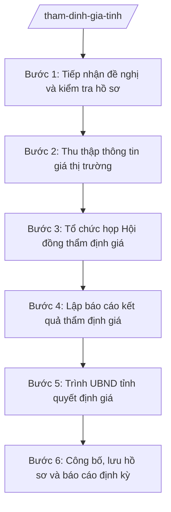

# Skill: Thẩm định giá

## 2. Khi nào dùng

- Cần thẩm định giá đất cụ thể để tính tiền sử dụng đất, tiền thuê đất, bồi thường khi Nhà nước thu hồi đất;
- Cần thẩm định giá tài sản nhà nước khi bán, cho thuê, liên doanh, liên kết;
- Cơ quan, đơn vị đề nghị Hội đồng thẩm định giá tỉnh thẩm định giá hàng hóa, dịch vụ theo yêu cầu quản lý;
- Cần rà soát, tham mưu điều chỉnh bảng giá đất, hệ số điều chỉnh giá đất của tỉnh theo định kỳ;
- Cần tổng hợp, báo cáo công tác thẩm định giá, quản lý giá trên địa bàn tỉnh.

## 3. Đầu vào (Input)

| Trường | Mô tả | Bắt buộc |
|--------|-------|----------|
| `loai_tham_dinh_gia` | Loại: giá đất cụ thể / giá tài sản nhà nước / giá hàng hóa, dịch vụ | Có |
| `ho_so_de_nghi` | Văn bản đề nghị thẩm định giá của cơ quan, đơn vị (kèm hồ sơ tài sản, thửa đất) | Có |
| `thong_tin_tai_san` | Thông tin tài sản/thửa đất cần thẩm định: vị trí, diện tích, hiện trạng, mục đích sử dụng | Có |
| `gia_tham_khao` | Giá thị trường tham khảo, giá giao dịch tương tự (nếu có) | Không |
| `bang_gia_dat` | Bảng giá đất, hệ số điều chỉnh giá đất của tỉnh đang áp dụng | Không |
| `chung_thu_dinh_gia` | Chứng thư thẩm định giá của đơn vị tư vấn (nếu đã thuê tư vấn) | Không |

## 4. Quy trình

**Bước 1. Tiếp nhận đề nghị và kiểm tra hồ sơ**
- Làm gì: Tiếp nhận văn bản đề nghị thẩm định giá; kiểm tra thành phần hồ sơ (thông tin tài sản/thửa đất, mục đích thẩm định, tài liệu pháp lý); lập phiếu tiếp nhận, yêu cầu bổ sung nếu thiếu.
- Dùng input: `ho_so_de_nghi`, `thong_tin_tai_san`, `loai_tham_dinh_gia`.
- Vai trò: Chuyên viên Phòng Quản lý giá (Sở Tài chính) tiếp nhận, AI hỗ trợ lập checklist hồ sơ theo loại thẩm định giá; ⏱ ~1–2 ngày làm việc (ước tính).
- Lưu ý nghiệp vụ: Xác định đúng loại thẩm định giá để áp dụng đúng trình tự; không thụ lý khi hồ sơ pháp lý về tài sản chưa rõ ràng.
- → Kết quả bước: Phiếu tiếp nhận hồ sơ hợp lệ (hoặc văn bản yêu cầu bổ sung).

**Bước 2. Thu thập thông tin giá thị trường**
- Làm gì: Thu thập thông tin giá giao dịch thực tế của tài sản/thửa đất tương tự trên thị trường; tra cứu bảng giá đất, hệ số điều chỉnh giá đất của tỉnh; tổng hợp các yếu tố ảnh hưởng đến giá (vị trí, hạ tầng, quy hoạch...).
- Dùng input: `thong_tin_tai_san`, `gia_tham_khao`, `bang_gia_dat`.
- Vai trò: Chuyên viên Phòng Quản lý giá thu thập, AI hỗ trợ tổng hợp, so sánh các mức giá tham khảo, cảnh báo mức giá bất thường; ⏱ ~3–5 ngày làm việc (ước tính).
- Lưu ý nghiệp vụ: Thông tin giá phải có nguồn rõ ràng, đáng tin cậy; không sử dụng giá "tin đồn", giá không kiểm chứng được.
- → Kết quả bước: Bảng tổng hợp thông tin giá thị trường tham khảo.

**Bước 3. Tổ chức họp Hội đồng thẩm định giá**
- Làm gì: Tham mưu thành lập/kiện toàn Hội đồng thẩm định giá tỉnh (nếu chưa có); chuẩn bị tài liệu họp Hội đồng (hồ sơ thẩm định, bảng giá tham khảo, dự kiến mức giá); tổ chức họp Hội đồng thảo luận, thống nhất mức giá thẩm định; lập biên bản họp Hội đồng.
- Dùng input: Kết quả Bước 2, `ho_so_de_nghi`.
- Vai trò: Chuyên viên Phòng Quản lý giá chuẩn bị tài liệu, thư ký Hội đồng; Hội đồng thẩm định giá thảo luận, biểu quyết; AI hỗ trợ soạn tài liệu họp, dự thảo biên bản; ⏱ ~3–5 ngày làm việc (ước tính).
- Lưu ý nghiệp vụ: Hội đồng hoạt động theo nguyên tắc tập thể, biểu quyết theo đa số; mọi ý kiến khác nhau phải được ghi vào biên bản.
- → Kết quả bước: Biên bản họp Hội đồng thẩm định giá với mức giá được thống nhất.

**Bước 4. Lập báo cáo kết quả thẩm định giá**
- Làm gì: Soạn Báo cáo kết quả thẩm định giá của Sở Tài chính (thường trực Hội đồng): nêu căn cứ, phương pháp thẩm định, thông tin giá tham khảo, mức giá Hội đồng thống nhất và kiến nghị; trình lãnh đạo Sở ký ban hành.
- Dùng input: Biên bản họp Hội đồng ở Bước 3.
- Vai trò: Chuyên viên Phòng Quản lý giá soạn thảo; Trưởng phòng, Phó Giám đốc rà soát; Giám đốc Sở Tài chính (ông Hoàng Văn S) ký ban hành; AI hỗ trợ dựng khung báo cáo, rà soát nhất quán; ⏱ ~1–2 ngày làm việc (ước tính).
- Lưu ý nghiệp vụ: Mức giá trong báo cáo phải đúng mức giá Hội đồng đã thống nhất; báo cáo chỉ có giá trị tham mưu, không thay thế quyết định phê duyệt giá.
- → Kết quả bước: Báo cáo kết quả thẩm định giá của Sở Tài chính đã ký.

**Bước 5. Trình UBND tỉnh quyết định giá**
- Làm gì: Đối với các trường hợp phải do UBND tỉnh/Chủ tịch UBND tỉnh quyết định giá (giá đất cụ thể...): Giám đốc Sở ký Tờ trình của Sở trình UBND tỉnh; hoàn thiện hồ sơ theo ý kiến chỉ đạo; theo dõi quyết định phê duyệt giá của cấp có thẩm quyền.
- Dùng input: Báo cáo kết quả thẩm định giá ở Bước 4.
- Vai trò: Giám đốc Sở Tài chính quyết định trình; chuyên viên hoàn thiện hồ sơ, AI hỗ trợ cập nhật chỉnh sửa; ⏱ ~2–3 ngày làm việc (ước tính).
- Lưu ý nghiệp vụ: AI chỉ hỗ trợ kỹ thuật; quyết định giá thuộc thẩm quyền của cấp có thẩm quyền theo quy định, không thuộc Sở Tài chính hay Hội đồng thẩm định giá.
- → Kết quả bước: Tờ trình của Sở đã ký + quyết định phê duyệt giá của cấp có thẩm quyền.

**Bước 6. Công bố, lưu hồ sơ và báo cáo định kỳ**
- Làm gì: Công bố giá đã được phê duyệt theo quy định; lưu hồ sơ thẩm định giá đầy đủ; tổng hợp, báo cáo công tác quản lý giá, thẩm định giá trên địa bàn tỉnh gửi UBND tỉnh, Bộ Tài chính theo định kỳ.
- Dùng input: Quyết định phê duyệt giá; số liệu thẩm định giá trong kỳ.
- Vai trò: Chuyên viên Phòng Quản lý giá thực hiện, AI hỗ trợ tổng hợp số liệu, soạn báo cáo định kỳ; ⏱ ~theo kỳ báo cáo. (ước tính)
- Lưu ý nghiệp vụ: Hồ sơ thẩm định giá phải lưu đầy đủ để phục vụ thanh tra, kiểm tra; số liệu báo cáo phải trung thực.
- → Kết quả bước: Giá đã công bố + hồ sơ lưu + báo cáo định kỳ công tác giá.

## Luồng quy trình (Workflow)

## 5. Đầu ra (Output)

- Phiếu tiếp nhận hồ sơ đề nghị thẩm định giá;
- Bảng tổng hợp thông tin giá thị trường tham khảo;
- Biên bản họp Hội đồng thẩm định giá tỉnh;
- Báo cáo kết quả thẩm định giá của Sở Tài chính (đã ký);
- Tờ trình của Sở Tài chính trình UBND tỉnh quyết định giá (đối với trường hợp thuộc thẩm quyền UBND tỉnh);
- Quyết định phê duyệt giá của cấp có thẩm quyền (do cấp có thẩm quyền ban hành, Sở lưu hồ sơ);
- Báo cáo định kỳ công tác quản lý giá, thẩm định giá.

**Cấu trúc output chuẩn (Báo cáo kết quả thẩm định giá):**
- Thể thức: tuân thủ Nghị định 30/2020/NĐ-CP về công tác văn thư.

1. Quốc hiệu "CỘNG HÒA XÃ HỘI CHỦ NGHĨA VIỆT NAM", Tiêu ngữ "Độc lập – Tự do – Hạnh phúc";
2. Tên cơ quan ban hành: SỞ TÀI CHÍNH TỈNH A (Thường trực Hội đồng thẩm định giá tỉnh A); số, ký hiệu văn bản; địa danh và ngày, tháng, năm ban hành;
3. Tên loại và trích yếu: BÁO CÁO — Kết quả thẩm định giá... (tên tài sản/thửa đất);
4. Phần "Kính gửi": cơ quan có thẩm quyền quyết định giá (UBND tỉnh A...);
5. Căn cứ thẩm định (quy định pháp luật về giá; văn bản đề nghị thẩm định...);
6. Nội dung: thông tin tài sản/thửa đất; phương pháp thẩm định áp dụng; thông tin giá thị trường tham khảo; mức giá Hội đồng thẩm định giá thống nhất; kiến nghị;
7. Nơi nhận;
8. Thẩm quyền, chức vụ, họ tên người ký: GIÁM ĐỐC — (chữ ký, họ tên), dấu của cơ quan.

## 6. Checklist nghiệm thu

- [ ] Hồ sơ đề nghị thẩm định giá đầy đủ, tài sản có hồ sơ pháp lý rõ ràng;
- [ ] Đã thu thập thông tin giá thị trường có nguồn rõ ràng, đáng tin cậy;
- [ ] Hội đồng thẩm định giá họp đúng thành phần, có biên bản với mức giá thống nhất;
- [ ] Mức giá trong báo cáo đúng mức giá Hội đồng đã thống nhất;
- [ ] Báo cáo kết quả thẩm định giá đúng thể thức, đã được lãnh đạo Sở ký;
- [ ] Trường hợp thuộc thẩm quyền UBND tỉnh đã có Tờ trình và quyết định phê duyệt giá;
- [ ] Hồ sơ thẩm định giá lưu đầy đủ phục vụ thanh tra, kiểm tra;
- [ ] Căn cứ pháp lý đầy đủ, đúng văn bản còn hiệu lực, không bịa số hiệu;
- [ ] Mức giá dựa trên thông tin thị trường và quyết định của Hội đồng, AI không tự bịa giá.

## 7. Ví dụ mô phỏng

*Dữ liệu dưới đây là giả lập 100% phục vụ minh họa.*

### Input mẫu

| Trường | Giá trị giả lập |
|--------|-----------------|
| loai_tham_dinh_gia | Giá đất cụ thể |
| ho_so_de_nghi | Văn bản đề nghị thẩm định giá đất của Sở Nông nghiệp và Môi trường tỉnh A (giả lập) |
| thong_tin_tai_san | Thửa đất 1.000 m² tại xã A, mục đích sử dụng: đất ở (giả lập) |
| gia_tham_khao | 3 giao dịch tương tự quanh khu vực: 10–12 triệu đồng/m² (giả lập) |
| bang_gia_dat | Bảng giá đất tỉnh A đang áp dụng (giả lập) |

### Output mẫu (Báo cáo kết quả thẩm định giá — trích)

> **CỘNG HÒA XÃ HỘI CHỦ NGHĨA VIỆT NAM**
> **Độc lập – Tự do – Hạnh phúc**
>
> **SỞ TÀI CHÍNH TỈNH A**
> *(Thường trực Hội đồng thẩm định giá tỉnh A)*
> Số: 1234/BC-STC
> Tỉnh A, ngày 18 tháng 4 năm 2027
>
> **BÁO CÁO**
> **Kết quả thẩm định giá đất cụ thể thửa đất tại xã A (giả lập)**
>
> Kính gửi: Ủy ban nhân dân tỉnh A.
>
> Căn cứ quy định pháp luật về giá;
> Căn cứ văn bản đề nghị của Sở Nông nghiệp và Môi trường tỉnh A;
> Sở Tài chính (Thường trực Hội đồng thẩm định giá tỉnh A) báo cáo như sau:
>
> 1. Thông tin thửa đất: diện tích 1.000 m² tại xã A, mục đích sử dụng đất ở...
> 2. Phương pháp thẩm định: phương pháp so sánh...
> 3. Mức giá Hội đồng thống nhất: 11 triệu đồng/m² (giả lập)...
> 4. Kiến nghị: UBND tỉnh xem xét, quyết định giá đất cụ thể theo thẩm quyền.
>
> ***Nơi nhận:*** ...
>
> **GIÁM ĐỐC**
> *(ký, đóng dấu)*
> **Hoàng Văn S**

## 8. Human gate

1. Chuyên viên Phòng Quản lý giá tiếp nhận, thu thập thông tin, chuẩn bị tài liệu (Bước 1–2);
2. Hội đồng thẩm định giá tỉnh họp, thảo luận, biểu quyết mức giá (Bước 3) — quyết định chuyên môn thuộc Hội đồng;
3. Trưởng phòng, Phó Giám đốc rà soát; Giám đốc Sở Tài chính ký ban hành Báo cáo kết quả thẩm định giá (Bước 4);
4. UBND tỉnh/Chủ tịch UBND tỉnh quyết định giá đối với trường hợp thuộc thẩm quyền (Bước 5).

## 9. Giới hạn

- AI KHÔNG quyết định mức giá thẩm định thay Hội đồng thẩm định giá;
- AI KHÔNG tự ký, tự phát hành báo cáo thẩm định giá hay bất kỳ văn bản nào;
- AI KHÔNG bịa thông tin giá thị trường, mức giá thẩm định;
- AI KHÔNG bịa căn cứ pháp lý, không trích dẫn văn bản đã hết hiệu lực;
- AI KHÔNG thay cấp có thẩm quyền quyết định giá.

## 10. Căn cứ & lưu ý

- Thông tư 57/2025/TT-BTC hướng dẫn chức năng, nhiệm vụ, quyền hạn của Sở Tài chính và lĩnh vực tài chính – kế hoạch của phòng chuyên môn thuộc UBND cấp xã;
- Luật Giá (chỉ nêu tên luật, không kèm số hiệu);
- Nghị định 150/2025/NĐ-CP về tổ chức cơ quan chuyên môn thuộc UBND cấp tỉnh, cấp xã;
- Nghị định 30/2020/NĐ-CP về công tác văn thư (chỉ dùng cho thể thức văn bản);
- Lưu ý: Hội đồng thẩm định giá hoạt động theo nguyên tắc tập thể; báo cáo của Sở Tài chính chỉ có giá trị tham mưu; quyết định giá thuộc thẩm quyền của cấp có thẩm quyền theo quy định.
