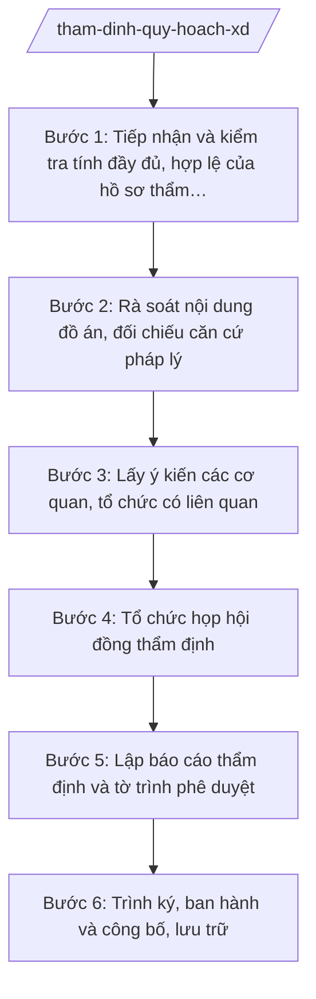

# Skill: Thẩm định quy hoạch xây dựng, quy hoạch đô thị

## 2. Khi nào dùng

- Tổ chức lập quy hoạch / UBND xã A nộp hồ sơ đề nghị thẩm định đồ án quy hoạch chung đô thị, quy hoạch phân khu, quy hoạch chi tiết, quy hoạch nông thôn thuộc thẩm quyền phê duyệt của UBND tỉnh A;
- Sở Xây dựng tỉnh A được giao làm cơ quan thẩm định theo phân định thẩm quyền lĩnh vực quy hoạch đô thị và nông thôn (mô hình chính quyền địa phương 2 cấp);
- Cần rà soát tính phù hợp của đồ án với quy hoạch cấp trên, quy chuẩn kỹ thuật quốc gia về quy hoạch, quy định pháp luật về đất đai, xây dựng;
- Cần tổng hợp ý kiến các sở, ngành liên quan và kết luận hội đồng thẩm định trước khi trình UBND tỉnh phê duyệt.

## 3. Đầu vào (Input)

| Trường | Mô tả | Bắt buộc |
|--------|-------|----------|
| `ten_do_an` | Tên đồ án quy hoạch đề nghị thẩm định | Có |
| `cap_quy_hoach` | Cấp quy hoạch: quy hoạch chung / phân khu / chi tiết / nông thôn | Có |
| `don_vi_lap` | Tổ chức lập quy hoạch / cơ quan đề nghị thẩm định (tên, tư cách pháp nhân) | Có |
| `ho_so_thiet_ke` | Bản vẽ, thuyết minh, phụ lục, mô hình minh họa của đồ án | Có |
| `van_ban_de_nghi` | Văn bản đề nghị thẩm định của cơ quan tổ chức lập quy hoạch | Có |
| `y_kien_cong_dong` | Kết quả lấy ý kiến cộng đồng dân cư (nếu pháp luật yêu cầu). Lưu ý: khi thuộc trường hợp bắt buộc.| Có |
| `y_kien_co_quan_lien_quan` | Ý kiến của các sở, ngành, UBND xã có liên quan | Không |
| `quy_hoach_cap_tren` | Quy hoạch cấp trên, quy hoạch tỉnh làm căn cứ đối chiếu | Có |

## 4. Quy trình

**Bước 1. Tiếp nhận và kiểm tra tính đầy đủ, hợp lệ của hồ sơ thẩm định**
- Làm gì: Tiếp nhận hồ sơ đề nghị thẩm định (trực tiếp hoặc qua Trung tâm Phục vụ hành chính công); kiểm tra thành phần hồ sơ theo danh mục quy định (văn bản đề nghị, bản vẽ, thuyết minh, phụ lục, kết quả lấy ý kiến cộng đồng); lập biên bản nhận hồ sơ, thông báo bổ sung nếu hồ sơ thiếu.
- Dùng input: `ten_do_an`, `cap_quy_hoach`, `don_vi_lap`, `ho_so_thiet_ke`, `van_ban_de_nghi`, `y_kien_cong_dong`.
- Vai trò: Chuyên viên Phòng Quy hoạch — Kiến trúc tiếp nhận, AI hỗ trợ đối chiếu danh mục hồ sơ theo checklist, soạn biên bản nhận hồ sơ và văn bản yêu cầu bổ sung; ⏱ ~2–3 ngày làm việc (ước tính).
- Lưu ý nghiệp vụ: Không tiếp nhận hồ sơ khi thiếu kết quả lấy ý kiến cộng đồng trong trường hợp bắt buộc; thời hạn thẩm định được tính từ ngày nhận đủ hồ sơ hợp lệ.
- → Kết quả bước: Biên bản nhận hồ sơ thẩm định (hoặc văn bản yêu cầu bổ sung, hoàn thiện hồ sơ).

**Bước 2. Rà soát nội dung đồ án, đối chiếu căn cứ pháp lý**
- Làm gì: Đọc, phân tích thuyết minh và bản vẽ đồ án; đối chiếu với quy hoạch cấp trên, quy chuẩn kỹ thuật quốc gia về quy hoạch xây dựng, quy định về phân định thẩm quyền; lập danh mục các nội dung cần làm rõ, các điểm chưa phù hợp.
- Dùng input: `ho_so_thiet_ke`, `quy_hoach_cap_tren`, `y_kien_co_quan_lien_quan`.
- Vai trò: Chuyên viên Phòng Quy hoạch — Kiến trúc chủ trì rà soát, AI hỗ trợ lập bảng đối chiếu nội dung đồ án với căn cứ pháp lý, trích xuất các điểm chưa phù hợp thành danh mục có mã hóa; ⏱ ~5–7 ngày làm việc (ước tính).
- Lưu ý nghiệp vụ: Mọi nhận xét phải viện dẫn cụ thể điều/khoản của văn bản căn cứ, không nhận xét chung chung; đặc biệt kiểm tra thẩm quyền phê duyệt của UBND tỉnh A theo phân định thẩm quyền lĩnh vực quy hoạch đô thị và nông thôn.
- → Kết quả bước: Bảng rà soát nội dung đồ án + danh mục vấn đề cần làm rõ/yêu cầu chỉnh sửa.

**Bước 3. Lấy ý kiến các cơ quan, tổ chức có liên quan**
- Làm gì: Soạn công văn lấy ý kiến các sở, ngành liên quan (Tài chính, Nông nghiệp và Môi trường, Văn hóa — Thể thao và Du lịch...), UBND xã nơi có quy hoạch; tập hợp, tổng hợp ý kiến góp ý; yêu cầu tổ chức lập quy hoạch giải trình, tiếp thu.
- Dùng input: Kết quả Bước 2, `y_kien_co_quan_lien_quan`.
- Vai trò: Chuyên viên Phòng Quy hoạch — Kiến trúc soạn công văn, AI hỗ trợ tổng hợp ý kiến góp ý thành bảng (ý kiến — cơ quan — tiếp thu/không tiếp thu — lý do), soạn dự thảo văn bản yêu cầu giải trình; ⏱ ~7–10 ngày làm việc (ước tính).
- Lưu ý nghiệp vụ: Đặt thời hạn trả lời rõ ràng cho các cơ quan được lấy ý kiến; quá thời hạn không có ý kiến được coi là đồng ý (nếu pháp luật quy định).
- → Kết quả bước: Bảng tổng hợp ý kiến cơ quan liên quan + văn bản giải trình, tiếp thu của tổ chức lập quy hoạch.

**Bước 4. Tổ chức họp hội đồng thẩm định**
- Làm gì: Tham mưu thành lập Hội đồng thẩm định (thành phần: lãnh đạo Sở chủ trì, chuyên gia, đại diện sở ngành); chuẩn bị tài liệu họp; ghi biên bản họp; tổng hợp ý kiến thành viên hội đồng, kết luận của chủ tịch hội đồng (thông qua có điều kiện / chưa thông qua).
- Dùng input: Kết quả Bước 2–3, toàn bộ hồ sơ đồ án.
- Vai trò: Trưởng phòng Quy hoạch — Kiến trúc chuẩn bị nội dung, AI hỗ trợ soạn dự thảo quyết định thành lập hội đồng, chương trình họp, mẫu phiếu ý kiến và biên bản họp; ⏱ ~5–7 ngày làm việc (ước tính).
- Lưu ý nghiệp vụ: Hội đồng làm việc theo nguyên tắc tập thể, kết luận theo đa số; biên bản họp là căn cứ pháp lý quan trọng của báo cáo thẩm định.
- → Kết quả bước: Biên bản họp hội đồng thẩm định + kết luận thẩm định (có điều kiện/chưa đạt).

**Bước 5. Lập báo cáo thẩm định và tờ trình phê duyệt**
- Làm gì: Soạn báo cáo thẩm định (đánh giá tính đầy đủ hồ sơ, tính phù hợp với quy hoạch cấp trên, quy chuẩn kỹ thuật, ý kiến hội đồng); soạn Tờ trình của Sở Xây dựng trình UBND tỉnh; soạn dự thảo quyết định phê duyệt đồ án quy hoạch.
- Dùng input: Kết quả Bước 1–4.
- Vai trò: Trưởng phòng Quy hoạch — Kiến trúc soạn thảo, AI hỗ trợ soạn báo cáo thẩm định theo khung chuẩn, rà soát thể thức dự thảo quyết định theo NĐ 30/2020/NĐ-CP, kiểm tra tính thống nhất số liệu giữa báo cáo và đồ án; ⏱ ~3–5 ngày làm việc (ước tính).
- Lưu ý nghiệp vụ: Báo cáo thẩm định phải nêu rõ từng nội dung đạt/chưa đạt và yêu cầu hoàn thiện (nếu thông qua có điều kiện); không trình phê duyệt đồ án chưa đạt kết luận hội đồng.
- → Kết quả bước: Báo cáo thẩm định + Tờ trình + dự thảo quyết định phê duyệt đồ án quy hoạch.

**Bước 6. Trình ký, ban hành và công bố, lưu trữ**
- Làm gì: Trình hồ sơ qua các cấp (Phó Giám đốc Sở → Giám đốc Sở → Chủ tịch UBND tỉnh ký quyết định phê duyệt); sau khi ban hành, tổ chức công bố quy hoạch, gửi lưu trữ hồ sơ thẩm định theo quy định.
- Dùng input: Toàn bộ hồ sơ trình phê duyệt ở Bước 5.
- Vai trò: Phó Giám đốc Sở, Giám đốc Sở kiểm tra, Chủ tịch UBND tỉnh A ký quyết định phê duyệt; AI hỗ trợ theo dõi tiến độ trình ký, lập danh mục hồ sơ lưu trữ; ⏱ ~5–7 ngày làm việc (ước tính).
- Lưu ý nghiệp vụ: AI tuyệt đối không thay người ký quyết định phê duyệt; quyết định phê duyệt phải được công bố công khai để tổ chức, cá nhân biết, thực hiện.
- → Kết quả bước: Quyết định phê duyệt đồ án quy hoạch đã ký + hồ sơ thẩm định lưu trữ đầy đủ.

## Luồng quy trình (Workflow)

## 5. Đầu ra (Output)

- Biên bản nhận hồ sơ thẩm định (hoặc văn bản yêu cầu bổ sung hồ sơ);
- Bảng rà soát, đối chiếu nội dung đồ án với căn cứ pháp lý;
- Bảng tổng hợp ý kiến cơ quan liên quan và giải trình của tổ chức lập quy hoạch;
- Biên bản họp hội đồng thẩm định;
- Báo cáo thẩm định đồ án quy hoạch;
- Tờ trình của Sở Xây dựng trình UBND tỉnh phê duyệt đồ án;
- Dự thảo/Quyết định phê duyệt đồ án quy hoạch (Chủ tịch UBND tỉnh ký).

**Cấu trúc output chuẩn (Báo cáo thẩm định):**
- Thể thức: tuân thủ Nghị định 30/2020/NĐ-CP về công tác văn thư.

1. Quốc hiệu "CỘNG HÒA XÃ HỘI CHỦ NGHĨA VIỆT NAM", Tiêu ngữ "Độc lập – Tự do – Hạnh phúc";
2. Tên cơ quan: SỞ XÂY DỰNG TỈNH A; số, ký hiệu văn bản; địa danh và ngày, tháng, năm;
3. Tên loại và trích yếu: BÁO CÁO THẨM ĐỊNH — Về việc thẩm định đồ án...;
4. Phần "Kính gửi": UBND tỉnh A (hoặc cơ quan có thẩm quyền phê duyệt);
5. Căn cứ (Luật Xây dựng; văn bản về phân định thẩm quyền lĩnh vực quy hoạch đô thị và nông thôn; văn bản về phân quyền, phân cấp lĩnh vực xây dựng; quy chuẩn kỹ thuật quốc gia; văn bản giao nhiệm vụ...);
6. Nội dung: thông tin chung về đồ án (tên, cấp quy hoạch, đơn vị lập, phạm vi, quy mô); kết quả kiểm tra tính đầy đủ hồ sơ; đánh giá tính phù hợp với quy hoạch cấp trên, quy chuẩn kỹ thuật; tổng hợp ý kiến cơ quan liên quan; kết luận hội đồng thẩm định; kiến nghị (đủ điều kiện trình phê duyệt / cần hoàn thiện các nội dung...);
7. Nơi nhận;
8. Thẩm quyền, chức vụ, họ tên người ký: TM. SỞ XÂY DỰNG — GIÁM ĐỐC (hoặc PHÓ GIÁM ĐỐC ký thay) — (chữ ký, họ tên), dấu của cơ quan.

## 6. Checklist nghiệm thu

- [ ] Hồ sơ thẩm định đầy đủ thành phần, có biên bản nhận hồ sơ, đúng thời hạn thẩm định;
- [ ] Đã đối chiếu đồ án với quy hoạch cấp trên và quy chuẩn kỹ thuật quốc gia, viện dẫn căn cứ cụ thể;
- [ ] Đã lấy ý kiến đầy đủ các cơ quan liên quan, có bảng tổng hợp và giải trình tiếp thu;
- [ ] Hội đồng thẩm định thành lập đúng thành phần, có biên bản họp và kết luận rõ ràng;
- [ ] Báo cáo thẩm định nêu rõ đạt/chưa đạt từng nội dung, kiến nghị cụ thể;
- [ ] Tờ trình và dự thảo quyết định đúng thể thức theo NĐ 30/2020/NĐ-CP;
- [ ] Quyết định phê duyệt do Chủ tịch UBND tỉnh ký (đúng thẩm quyền);
- [ ] Đã công bố công khai đồ án được phê duyệt; hồ sơ thẩm định lưu trữ đầy đủ.

## 7. Ví dụ mô phỏng

*Dữ liệu dưới đây là giả lập 100% phục vụ minh họa.*

### Input mẫu

| Trường | Giá trị giả lập |
|--------|-----------------|
| ten_do_an | Đồ án quy hoạch chi tiết Khu dân cư phía Đông, xã A |
| cap_quy_hoach | Quy hoạch chi tiết |
| don_vi_lap | Công ty TNHH Tư vấn Quy hoạch A (đủ tư cách pháp nhân) |
| ho_so_thiet_ke | Bản vẽ 12 tờ, thuyết minh 100 trang, phụ lục, mô hình 3D |
| van_ban_de_nghi | Văn bản số 10/VB-CT ngày 01/02/2027 của Công ty TNHH Tư vấn Quy hoạch A |
| y_kien_cong_dong | Biên bản lấy ý kiến cộng đồng dân cư xã A (200 hộ, 95% đồng ý) |
| quy_hoach_cap_tren | Quy hoạch chung đô thị loại IV vùng Đông tỉnh A (đã phê duyệt) |

### Output mẫu (Báo cáo thẩm định — trích)

> **CỘNG HÒA XÃ HỘI CHỦ NGHĨA VIỆT NAM**
> **Độc lập – Tự do – Hạnh phúc**
>
> Số: 123/TTr-SXD
> *Tỉnh A, ngày 10 tháng 3 năm 2027*
>
> **BÁO CÁO THẨM ĐỊNH**
> **Về việc thẩm định Đồ án quy hoạch chi tiết Khu dân cư phía Đông, xã A**
>
> Kính gửi: Ủy ban nhân dân tỉnh A.
>
> Căn cứ Luật Xây dựng; văn bản quy định về phân định thẩm quyền chính quyền địa phương 2 cấp, phân quyền, phân cấp trong lĩnh vực quy hoạch đô thị và nông thôn; Thông tư 10/2025/TT-BXD ngày 14/6/2025 của Bộ Xây dựng; ...
>
> Sở Xây dựng tỉnh A báo cáo kết quả thẩm định Đồ án quy hoạch chi tiết Khu dân cư phía Đông, xã A như sau:
>
> 1. Thông tin chung: Đồ án do Công ty TNHH Tư vấn Quy hoạch A lập theo đề nghị của UBND xã A; quy mô 50 ha, dân số dự kiến 5.000 người...
> 2. Kết quả kiểm tra hồ sơ: đầy đủ thành phần theo quy định...
> 3. Đánh giá: phù hợp với Quy hoạch chung đô thị loại IV vùng Đông tỉnh A; tuân thủ quy chuẩn kỹ thuật quốc gia về quy hoạch xây dựng; đã tiếp thu 12/14 ý kiến góp ý...
> 4. Kết luận hội đồng thẩm định: thông qua có điều kiện (bổ sung giải pháp thoát nước mưa khu vực trũng phía Nam)...
> 5. Kiến nghị: đủ điều kiện trình UBND tỉnh xem xét, phê duyệt sau khi tổ chức lập hoàn thiện các nội dung theo kết luận hội đồng...
>
> *Nơi nhận:* ...
>
> **TM. SỞ XÂY DỰNG**
> **GIÁM ĐỐC**
> *(Chữ ký, dấu)*
> **Hoàng Văn S**

## 8. Human gate

- Chuyên viên Phòng Quy hoạch — Kiến trúc soạn hồ sơ, báo cáo thẩm định;
- Trưởng phòng Quy hoạch — Kiến trúc kiểm tra nội dung chuyên môn;
- Phó Giám đốc Sở phụ trách lĩnh vực rà soát, Giám đốc Sở ký báo cáo thẩm định, Tờ trình;
- Chủ tịch UBND tỉnh A ký quyết định phê duyệt đồ án quy hoạch (AI không thay người ký ở bất kỳ bước nào).

## 9. Giới hạn

- AI KHÔNG ra quyết định thẩm định hay phê duyệt thay người có thẩm quyền; không tự ký, phát hành báo cáo thẩm định, quyết định phê duyệt;
- Không bịa số liệu quy hoạch, căn cứ pháp lý; mọi viện dẫn phải từ văn bản còn hiệu lực, có thật trong `tai-lieu-moi-nhat.md`;
- Không dùng văn bản đã hết hiệu lực (vd: NĐ 45/2025/NĐ-CP đã bị NĐ 150/2025/NĐ-CP thay thế);
- Kết luận hội đồng thẩm định là kết luận tập thể của con người — AI chỉ tổng hợp, không tự kết luận thay hội đồng.

## 10. Căn cứ & lưu ý

- NĐ 145/2025/NĐ-CP ngày 12/6/2025 — phân định thẩm quyền CQĐP 2 cấp, phân quyền, phân cấp trong lĩnh vực quy hoạch đô thị và nông thôn;
- NĐ 144/2025/NĐ-CP ngày 12/6/2025 — phân quyền, phân cấp trong lĩnh vực quản lý nhà nước của Bộ Xây dựng;
- TT 10/2025/TT-BXD ngày 14/6/2025 — hướng dẫn chức năng, nhiệm vụ, quyền hạn của Sở Xây dựng, Sở Quy hoạch – Kiến trúc và lĩnh vực xây dựng cấp xã;
- NĐ 150/2025/NĐ-CP (hiệu lực 16/6/2025) — tổ chức cơ quan chuyên môn thuộc UBND cấp tỉnh, cấp xã; NĐ 370/2025/NĐ-CP sửa đổi, bổ sung;
- NĐ 30/2020/NĐ-CP — thể thức, kỹ thuật trình bày văn bản hành chính (áp dụng cho báo cáo thẩm định, tờ trình, quyết định);
- Luật Xây dựng, pháp luật về đất đai: chỉ nêu tên, không bịa số hiệu.
