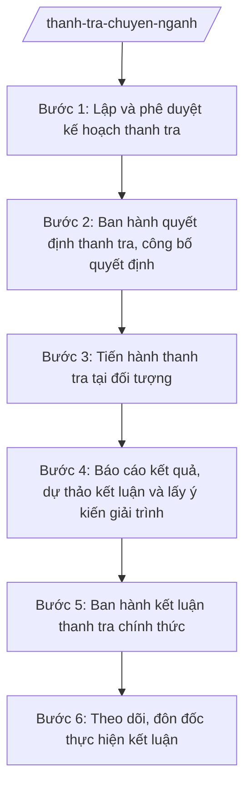

# Skill: Thanh tra chuyên ngành (mẫu chung)

## 2. Khi nào dùng
- Lập kế hoạch thanh tra hằng năm của cơ quan chuyên môn, cơ quan thanh tra cùng cấp, Thanh tra bộ.
- Tiến hành cuộc thanh tra chuyên ngành theo kế hoạch hoặc thanh tra đột xuất khi có dấu hiệu vi phạm.
- Ban hành kết luận thanh tra và theo dõi, đôn đốc thực hiện kết luận, kiến nghị.

## 3. Đầu vào (Input)
| Trường | Mô tả | Bắt buộc |
|--------|-------|----------|
| `ten_cuoc_thanh_tra` | Tên cuộc thanh tra (đối tượng, nội dung, thời kỳ) | Có |
| `doi_tuong_thanh_tra` | Cơ quan, tổ chức, cá nhân là đối tượng thanh tra | Có |
| `noi_dung_thanh_tra` | Nội dung, phạm vi thanh tra | Có |
| `thoi_ky_thanh_tra` | Thời kỳ thanh tra | Có |
| `can_cu_phap_ly` | Văn bản pháp luật điều chỉnh lĩnh vực thanh tra | Có |
| `doan_thanh_tra` | Danh sách thành viên đoàn thanh tra | Có |
| `thoi_gian_tien_hanh` | Thời gian tiến hành (ngày bắt đầu – kết thúc) | Có |

## 4. Quy trình

**Bước 1. Lập và phê duyệt kế hoạch thanh tra**
- Làm gì: Xây dựng kế hoạch thanh tra năm (hoặc kế hoạch cuộc thanh tra đột xuất): đối tượng, nội dung, thời gian, lực lượng; trình người có thẩm quyền phê duyệt.
- Dùng input: `ten_cuoc_thanh_tra`, `doi_tuong_thanh_tra`, `noi_dung_thanh_tra`.
- Vai trò: Chánh Thanh tra cùng cấp chủ trì; AI hỗ trợ lập kế hoạch theo khung, tránh trùng lắp với kế hoạch của cơ quan khác ⏱ 2 ngày (ước tính) làm việc
- Lưu ý nghiệp vụ: Kế hoạch phải tránh thanh tra trùng, chồng chéo; thanh tra đột xuất phải có căn cứ (dấu hiệu vi phạm, chỉ đạo của cấp trên, đơn tố cáo có cơ sở).
- → Kết quả bước: Kế hoạch thanh tra đã phê duyệt.

**Bước 2. Ban hành quyết định thanh tra, công bố quyết định**
- Làm gì: Soạn quyết định thanh tra (căn cứ, đối tượng, nội dung, thời kỳ, đoàn thanh tra, thời gian); công bố quyết định tại đối tượng thanh tra.
- Dùng input: `doan_thanh_tra`, `thoi_gian_tien_hanh`, `can_cu_phap_ly`.
- Vai trò: Người ra quyết định thanh tra ký (người đứng đầu cơ quan chuyên môn / Chánh Thanh tra cùng cấp / người đứng đầu UBND cùng cấp theo thẩm quyền); AI hỗ trợ soạn quyết định đúng thể thức ⏱ 1 ngày (ước tính) làm việc
- Lưu ý nghiệp vụ: Quyết định phải đúng thẩm quyền, đúng trình tự; công bố công khai tại đối tượng thanh tra.
- → Kết quả bước: Quyết định thanh tra + biên bản công bố.

**Bước 3. Tiến hành thanh tra tại đối tượng**
- Làm gì: Thu thập hồ sơ, tài liệu; kiểm tra thực tế; làm việc với đối tượng và các bên liên quan; lập biên bản từng nội dung.
- Dùng input: `noi_dung_thanh_tra`, `thoi_ky_thanh_tra`.
- Vai trò: Trưởng đoàn và thành viên đoàn thanh tra thực hiện; AI hỗ trợ tổng hợp tài liệu, lập bảng đối chiếu số liệu ⏱ ~theo thời gian trong quyết định thanh tra (ước tính)
- Lưu ý nghiệp vụ: Tuân thủ nguyên tắc khách quan, đúng phạm vi quyết định; mọi phát hiện phải có chứng cứ, biên bản có chữ ký các bên.
- → Kết quả bước: Hồ sơ, biên bản làm việc của đoàn thanh tra.

**Bước 4. Báo cáo kết quả, dự thảo kết luận và lấy ý kiến giải trình**
- Làm gì: Đoàn thanh tra báo cáo kết quả; dự thảo kết luận (nhận xét, kết luận vi phạm nếu có, biện pháp xử lý, kiến nghị); gửi dự thảo cho đối tượng thanh tra để giải trình theo quy định của Luật Thanh tra.
- Dùng input: Hồ sơ, biên bản Bước 3.
- Vai trò: Trưởng đoàn báo cáo và dự thảo kết luận; đối tượng thanh tra giải trình bằng văn bản; AI hỗ trợ soạn dự thảo kết luận theo khung chuẩn ⏱ 5 ngày (ước tính) làm việc
- Lưu ý nghiệp vụ: Bảo đảm quyền giải trình của đối tượng đối với dự thảo kết luận; nghiên cứu, tiếp thu hoặc bảo lưu có lý do đối với ý kiến giải trình.
- → Kết quả bước: Dự thảo kết luận + văn bản giải trình của đối tượng (nếu có).

**Bước 5. Ban hành kết luận thanh tra chính thức**
- Làm gì: Hoàn thiện kết luận sau giải trình; người ra quyết định thanh tra ký ban hành kết luận chính thức.
- Dùng input: Dự thảo kết luận và văn bản giải trình (Bước 4).
- Vai trò: Người ra quyết định ký ban hành kết luận; AI hỗ trợ rà soát thể thức lần cuối ⏱ 2 ngày (ước tính) làm việc
- Lưu ý nghiệp vụ: Kết luận phải dựa trên chứng cứ; biện pháp xử lý đúng thẩm quyền, đúng pháp luật; kiến nghị hoàn thiện cơ chế, chính sách nếu phát hiện sơ hở.
- → Kết quả bước: Kết luận thanh tra đã ban hành, gửi đối tượng và cơ quan liên quan.

**Bước 6. Theo dõi, đôn đốc thực hiện kết luận**
- Làm gì: Theo dõi việc thực hiện kết luận, kiến nghị; đôn đốc, kiểm tra; xử lý trường hợp không thực hiện.
- Dùng input: Kết luận thanh tra.
- Vai trò: Cơ quan thanh tra theo dõi; AI hỗ trợ lập bảng theo dõi tiến độ thực hiện ⏱ ~định kỳ (ước tính)
- Lưu ý nghiệp vụ: Có thời hạn thực hiện cụ thể cho từng kiến nghị; báo cáo cấp có thẩm quyền khi đối tượng không thực hiện.
- → Kết quả bước: Báo cáo kết quả thực hiện kết luận thanh tra.

## Luồng quy trình (Workflow)

## 5. Đầu ra (Output)
- Kế hoạch thanh tra.
- Quyết định thanh tra.
- Kết luận thanh tra.
- Báo cáo theo dõi thực hiện kết luận.

### Cấu trúc output chuẩn
Khung kết luận thanh tra, đúng thể thức NĐ 30/2020/NĐ-CP:
1. Quốc hiệu "CỘNG HÒA XÃ HỘI CHỦ NGHĨA VIỆT NAM" – Tiêu ngữ "Độc lập – Tự do – Hạnh phúc"; số, ký hiệu; địa danh, ngày tháng năm.
2. Tên: "KẾT LUẬN thanh tra ...".
3. Căn cứ: quyết định thanh tra; văn bản pháp luật liên quan.
4. Khái quát đối tượng, nội dung, thời kỳ thanh tra.
5. Kết quả kiểm tra, xác minh theo từng nội dung.
6. Nhận xét, đánh giá; kết luận về vi phạm (nếu có).
7. Biện pháp xử lý; kiến nghị.
8. Chữ ký người ra quyết định thanh tra; đóng dấu.
9. Nơi nhận: đối tượng thanh tra; cơ quan quản lý cấp trên của đối tượng thanh tra; Lưu: VT, cơ quan thanh tra.

> **Checklist thể thức văn bản theo NĐ 30/2020/NĐ-CP** — đối chiếu trước khi trình ký:
> 1. Quốc hiệu và Tiêu ngữ.
> 2. Tên cơ quan, tổ chức ban hành văn bản.
> 3. Số, ký hiệu của văn bản.
> 4. Địa danh và thời gian ban hành văn bản.
> 5. Tên loại và trích yếu nội dung văn bản.
> 6. Nội dung văn bản.
> 7. Chức vụ, họ tên và chữ ký của người có thẩm quyền.
> 8. Dấu, chữ ký số của cơ quan, tổ chức.
> 9. Nơi nhận (kèm Phụ lục nếu có).

## 6. Checklist nghiệm thu
- [ ] Kế hoạch không trùng lắp với cơ quan thanh tra khác.
- [ ] Quyết định thanh tra đúng thẩm quyền, đúng trình tự, đã công bố.
- [ ] Mọi phát hiện có chứng cứ, biên bản đầy đủ chữ ký.
- [ ] Kết luận dựa trên chứng cứ, biện pháp xử lý đúng pháp luật.
- [ ] Kiến nghị cụ thể, có thời hạn thực hiện.
- [ ] Đúng thể thức văn bản theo NĐ 30/2020/NĐ-CP.
- [ ] Đã gửi kết luận cho đối tượng và cơ quan liên quan.
- [ ] Có theo dõi, đôn đốc thực hiện kết luận.

## 7. Ví dụ mô phỏng
*Dữ liệu dưới đây là giả lập 100% phục vụ minh họa.*

**Input mẫu:**
- ten_cuoc_thanh_tra: Thanh tra việc chấp hành pháp luật về an toàn thực phẩm tại các cơ sở kinh doanh dịch vụ ăn uống
- doi_tuong_thanh_tra: 20 cơ sở kinh doanh dịch vụ ăn uống trên địa bàn tỉnh A (giả lập)
- thoi_ky_thanh_tra: Năm 2025
- doan_thanh_tra: Trưởng đoàn: ông Bùi Văn X (Chánh Thanh tra Sở Y tế tỉnh A) + 4 thành viên (giả lập)

**Output mẫu (trích kết luận):**
> **KẾT LUẬN**
> **Thanh tra việc chấp hành pháp luật về an toàn thực phẩm tại các cơ sở kinh doanh dịch vụ ăn uống trên địa bàn tỉnh A**
>
> 1. Căn cứ Quyết định thanh tra số 1234/QĐ-SYT ngày ... của Giám đốc Sở Y tế tỉnh A...
> 2. Kết quả: kiểm tra 20 cơ sở, phát hiện 3 cơ sở vi phạm điều kiện vệ sinh ... (giả lập)
> 3. Biện pháp xử lý: xử phạt vi phạm hành chính theo quy định; yêu cầu khắc phục trong 15 ngày...
> 4. Kiến nghị: ...

## 8. Human gate
- Người ra quyết định thanh tra (người đứng đầu cơ quan chuyên môn / Chánh Thanh tra cùng cấp / người đứng đầu UBND cùng cấp): phê duyệt kế hoạch, ký quyết định và kết luận thanh tra.
- Trưởng đoàn thanh tra: chịu trách nhiệm về tính chính xác của báo cáo kết quả.

## 9. Giới hạn
- AI không thay đoàn thanh tra thực hiện kiểm tra thực tế, xác minh.
- AI không đưa ra kết luận vi phạm hay biện pháp xử lý thay người có thẩm quyền.
- Không mở rộng phạm vi thanh tra ngoài quyết định đã ban hành.
- Không bịa chứng cứ, số liệu vi phạm.

## 10. Căn cứ & lưu ý
- NĐ 141/2025/NĐ-CP (phân định thẩm quyền CQĐP 2 cấp trong lĩnh vực quản lý nhà nước của Thanh tra Chính phủ).
- NĐ 109/2025/NĐ-CP (chức năng, nhiệm vụ của Thanh tra Chính phủ).
- Luật Thanh tra — dẫn tên, tra cứu bản hiện hành khi áp dụng.
