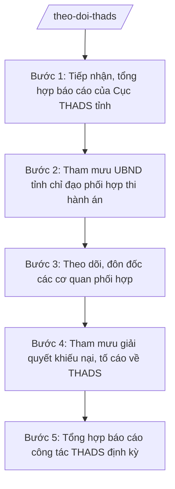

# Skill: Theo dõi, phối hợp thi hành án dân sự

## 2. Khi nào dùng
- Cần tiếp nhận, tổng hợp báo cáo định kỳ, đột xuất của Cục Thi hành án dân sự (THADS) tỉnh về tình hình thi hành án trên địa bàn.
- Có vụ việc thi hành án khó khăn, phức tạp, cần cưỡng chế lớn, cần sự phối hợp của nhiều cơ quan (công an, ngân hàng, chính quyền cấp xã...).
- Cần tham mưu UBND tỉnh ban hành văn bản chỉ đạo các cơ quan phối hợp trong thi hành án dân sự.
- Cần tham mưu giải quyết khiếu nại, tố cáo về THADS thuộc thẩm quyền.
- Cần tổng hợp báo cáo công tác THADS của tỉnh gửi Bộ Tư pháp, UBND tỉnh.

## 3. Đầu vào (Input)

| Trường | Mô tả | Bắt buộc |
|--------|-------|----------|
| `bao_cao_cuc_thads` | Báo cáo của Cục THADS tỉnh (kết quả thi hành, tồn đọng, vụ việc khó khăn) | Có |
| `vu_viec_kho_khan` | Danh sách vụ việc khó khăn, phức tạp, cần cưỡng chế, cần phối hợp | Không |
| `chi_dao_ubnd` | Chỉ đạo của UBND tỉnh, Chủ tịch UBND tỉnh về công tác THADS | Không |
| `don_kntc` | Đơn khiếu nại, tố cáo về THADS thuộc thẩm quyền giải quyết | Không |
| `de_xuat_phoi_hop` | Đề xuất phối hợp của Cục THADS tỉnh gửi các cơ quan | Không |

## 4. Quy trình

**Bước 1. Tiếp nhận, tổng hợp báo cáo của Cục THADS tỉnh**
- Làm gì: Tiếp nhận báo cáo định kỳ, đột xuất của Cục THADS tỉnh; tổng hợp kết quả thi hành án (số việc, số tiền đã thi hành xong, đang tổ chức thi hành), số vụ việc tồn đọng, khó khăn, phức tạp; phân tích nguyên nhân tồn đọng.
- Dùng input: `bao_cao_cuc_thads`
- Vai trò: Chuyên viên Phòng Theo dõi thi hành án dân sự (Sở Tư pháp tỉnh A) tổng hợp, phân tích. AI hỗ trợ tổng hợp số liệu, lập bảng phân loại vụ việc theo mức độ khó khăn và dự thảo báo cáo tổng hợp ⏱ ~03 ngày làm việc (ước tính).
- Lưu ý nghiệp vụ: Số liệu phải khớp với báo cáo của Cục THADS tỉnh; phân biệt rõ vụ việc tồn đọng khách quan và tồn đọng do nguyên nhân chủ quan; không can thiệp vào hoạt động tổ chức thi hành án cụ thể của cơ quan THADS.
- → Kết quả bước: Báo cáo tổng hợp tình hình THADS trên địa bàn tỉnh, phân loại vụ việc khó khăn, phức tạp.

**Bước 2. Tham mưu UBND tỉnh chỉ đạo phối hợp thi hành án**
- Làm gì: Đối với vụ việc khó khăn, phức tạp cần cưỡng chế hoặc phối hợp liên ngành: dự thảo văn bản của UBND tỉnh chỉ đạo Công an tỉnh, ngân hàng, UBND cấp xã và các cơ quan liên quan phối hợp với cơ quan THADS; theo dõi việc thực hiện chỉ đạo.
- Dùng input: `vu_viec_kho_khan`, `de_xuat_phoi_hop`, `chi_dao_ubnd`
- Vai trò: Trưởng phòng Theo dõi THADS soạn dự thảo văn bản chỉ đạo; Giám đốc Sở Tư pháp ký tờ trình; Chủ tịch/Phó Chủ tịch UBND tỉnh ký ban hành. AI hỗ trợ soạn dự thảo văn bản chỉ đạo, xác định rõ trách nhiệm từng cơ quan phối hợp ⏱ ~02 ngày làm việc (ước tính).
- Lưu ý nghiệp vụ: Văn bản chỉ đạo phải cụ thể: vụ việc, cơ quan chủ trì, cơ quan phối hợp, thời hạn; Sở Tư pháp chỉ tham mưu quản lý nhà nước, không trực tiếp tổ chức cưỡng chế (do cơ quan THADS thực hiện).
- → Kết quả bước: Văn bản chỉ đạo phối hợp thi hành án của UBND tỉnh đã ban hành, gửi các cơ quan liên quan.

**Bước 3. Theo dõi, đôn đốc các cơ quan phối hợp**
- Làm gì: Theo dõi, đôn đốc Công an tỉnh, UBND cấp xã, tổ chức tín dụng và các cơ quan liên quan thực hiện nhiệm vụ phối hợp theo văn bản chỉ đạo của UBND tỉnh; tổng hợp khó khăn, vướng mắc trong phối hợp; kiến nghị biện pháp tháo gỡ.
- Dùng input: văn bản chỉ đạo của UBND tỉnh, báo cáo của cơ quan phối hợp
- Vai trò: Chuyên viên Phòng Theo dõi THADS đôn đốc, tổng hợp. AI hỗ trợ lập bảng theo dõi tiến độ phối hợp theo từng vụ việc, cảnh báo nhiệm vụ chậm thực hiện ⏱ ~thường xuyên trong năm (ước tính).
- Lưu ý nghiệp vụ: Đôn đốc bằng văn bản, có thời hạn cụ thể; trường hợp cơ quan phối hợp không thực hiện, báo cáo UBND tỉnh xem xét, chỉ đạo.
- → Kết quả bước: Bảng theo dõi tiến độ phối hợp; văn bản đôn đốc, kiến nghị tháo gỡ vướng mắc.

**Bước 4. Tham mưu giải quyết khiếu nại, tố cáo về THADS**
- Làm gì: Tiếp nhận, phân loại đơn khiếu nại, tố cáo về THADS; tham mưu chuyển đơn đến cơ quan có thẩm quyền giải quyết hoặc tham mưu UBND tỉnh giải quyết đối với đơn thuộc thẩm quyền; theo dõi kết quả giải quyết.
- Dùng input: `don_kntc`
- Vai trò: Chuyên viên Phòng Theo dõi THADS phân loại, dự thảo văn bản xử lý đơn. AI hỗ trợ phân loại đơn theo thẩm quyền, soạn dự thảo văn bản chuyển đơn/tham mưu giải quyết ⏱ ~02 ngày làm việc (ước tính).
- Lưu ý nghiệp vụ: Phân loại đúng thẩm quyền (khiếu nại về quyết định, hành vi của Chấp hành viên do Thủ trưởng cơ quan THADS giải quyết theo quy định); bảo đảm thời hạn xử lý đơn.
- → Kết quả bước: Đơn được phân loại, chuyển đúng thẩm quyền hoặc văn bản tham mưu giải quyết; sổ theo dõi kết quả giải quyết đơn.

**Bước 5. Tổng hợp báo cáo công tác THADS định kỳ**
- Làm gì: Tổng hợp toàn diện công tác quản lý nhà nước về THADS của tỉnh: kết quả thi hành, công tác phối hợp, giải quyết khiếu nại tố cáo, khó khăn, kiến nghị; lập báo cáo gửi Bộ Tư pháp, UBND tỉnh.
- Dùng input: kết quả các Bước 1–4, `bao_cao_cuc_thads`
- Vai trò: Trưởng phòng Theo dõi THADS tổng hợp, soạn báo cáo; Giám đốc Sở ký. AI hỗ trợ tổng hợp số liệu, đối chiếu chỉ tiêu và soạn dự thảo báo cáo ⏱ ~03 ngày làm việc (ước tính).
- Lưu ý nghiệp vụ: Báo cáo trung thực, số liệu có minh chứng; nêu rõ trách nhiệm phối hợp của từng cơ quan; kiến nghị cụ thể với Bộ Tư pháp, UBND tỉnh.
- → Kết quả bước: Báo cáo công tác THADS của tỉnh đã ký, gửi Bộ Tư pháp và UBND tỉnh đúng hạn.

## Luồng quy trình (Workflow)

## 5. Đầu ra (Output)

Sản phẩm:
- Báo cáo tổng hợp tình hình THADS trên địa bàn tỉnh — gửi UBND tỉnh
- Văn bản chỉ đạo phối hợp thi hành án của UBND tỉnh (đã ký ban hành) — gửi các cơ quan liên quan
- Bảng theo dõi tiến độ phối hợp; văn bản đôn đốc — lưu hồ sơ
- Văn bản phân loại, chuyển đơn khiếu nại, tố cáo về THADS — gửi cơ quan có thẩm quyền
- Báo cáo công tác THADS định kỳ của tỉnh — gửi Bộ Tư pháp, UBND tỉnh

**Cấu trúc output chuẩn:**

Khung Báo cáo công tác thi hành án dân sự của tỉnh gồm các phần theo đúng thứ tự, đúng thể thức NĐ 30/2020/NĐ-CP:
1. Quốc hiệu "CỘNG HÒA XÃ HỘI CHỦ NGHĨA VIỆT NAM" — Tiêu ngữ "Độc lập – Tự do – Hạnh phúc"
2. Tên cơ quan: "SỞ TƯ PHÁP TỈNH A"; số, ký hiệu: số.../BC-STP; địa danh, ngày, tháng, năm
3. Tên văn bản: "BÁO CÁO" + tên gọi: "Công tác thi hành án dân sự tỉnh A năm ..."
4. Nội dung: I. Tình hình tổ chức thi hành án (kết quả thi hành về việc, về tiền); II. Công tác chỉ đạo, phối hợp của UBND tỉnh; III. Giải quyết khiếu nại, tố cáo về THADS; IV. Tồn tại, khó khăn (vụ việc phức tạp, kéo dài); V. Phương hướng, kiến nghị
5. Nơi nhận: Bộ Tư pháp, UBND tỉnh A, Cục THADS tỉnh A, lưu Sở
6. Chữ ký: "GIÁM ĐỐC" + chữ ký + họ tên Giám đốc Sở Tư pháp tỉnh A, đóng dấu Sở

## 6. Checklist nghiệm thu
- [ ] Báo cáo tổng hợp số liệu khớp với báo cáo của Cục THADS tỉnh; phân loại rõ vụ việc khó khăn, phức tạp
- [ ] Văn bản chỉ đạo phối hợp của UBND tỉnh cụ thể: vụ việc, cơ quan chủ trì/phối hợp, thời hạn
- [ ] Đã theo dõi, đôn đốc các cơ quan phối hợp bằng văn bản, có thời hạn
- [ ] Đơn khiếu nại, tố cáo được phân loại đúng thẩm quyền, xử lý đúng thời hạn
- [ ] Sở Tư pháp không can thiệp vào hoạt động tổ chức thi hành án cụ thể của cơ quan THADS
- [ ] Báo cáo công tác THADS trung thực, có số liệu minh chứng; gửi Bộ Tư pháp đúng hạn
- [ ] Thể thức văn bản đúng NĐ 30/2020/NĐ-CP
- [ ] Không có số liệu, căn cứ pháp lý nào do AI bịa ra
- [ ] Đã qua human gate: chuyên viên tổng hợp → Trưởng phòng kiểm tra → Phó Giám đốc Sở duyệt → Giám đốc Sở ký báo cáo/tờ trình → Chủ tịch/Phó Chủ tịch UBND tỉnh ký văn bản chỉ đạo

## 7. Ví dụ mô phỏng

*Dữ liệu dưới đây là giả lập 100% phục vụ minh họa.*

### Input mẫu
- bao_cao_cuc_thads: Cục THADS tỉnh A báo cáo năm 2026 (giả lập): tổng số việc phải thi hành 1.000 việc, đã thi hành xong 800 việc; tổng số tiền phải thi hành 100.000.000.000 đồng, đã thi hành xong 70.000.000.000 đồng; 05 vụ việc phức tạp cần cưỡng chế, phối hợp liên ngành
- vu_viec_kho_khan: 05 vụ việc cưỡng chế giao tài sản, kê biên tài sản cần Công an tỉnh A và UBND xã A phối hợp bảo đảm an ninh, trật tự (giả lập)

### Output mẫu (trích)

**BÁO CÁO CÔNG TÁC THI HÀNH ÁN DÂN SỰ TỈNH A NĂM 2026**

CỘNG HÒA XÃ HỘI CHỦ NGHĨA VIỆT NAM
Độc lập – Tự do – Hạnh phúc

SỞ TƯ PHÁP TỈNH A

Số: 78/BC-STP

Tỉnh A, ngày 12 tháng 01 năm 2027

**BÁO CÁO**
**Công tác thi hành án dân sự tỉnh A năm 2026**

I. Tình hình tổ chức thi hành án
Tổng số việc phải thi hành: 1.000 việc, đã thi hành xong 800 việc (đạt 80%). Tổng số tiền phải thi hành: 100.000.000.000 đồng, đã thi hành xong 70.000.000.000 đồng (đạt 70%).

II. Công tác chỉ đạo, phối hợp của UBND tỉnh
UBND tỉnh A đã ban hành 03 văn bản chỉ đạo Công an tỉnh A, UBND các xã phối hợp cưỡng chế 05 vụ việc phức tạp; 100% vụ việc có phương án bảo đảm an ninh, trật tự.

III. Giải quyết khiếu nại, tố cáo về THADS
Tiếp nhận 20 đơn, đã phân loại, chuyển đúng thẩm quyền 20/20 đơn, đúng thời hạn.

IV. Tồn tại, khó khăn
Một số vụ việc phải cưỡng chế nhiều lần do đương sự chống đối; phối hợp định giá, bán đấu giá tài sản còn chậm.

V. Phương hướng, kiến nghị
Kiến nghị Bộ Tư pháp hướng dẫn tháo gỡ vướng mắc trong phối hợp định giá tài sản thi hành án.

Nơi nhận:
- Bộ Tư pháp;
- UBND tỉnh A; Cục THADS tỉnh A;
- Lưu: Sở.

GIÁM ĐỐC
(ký, đóng dấu)
Hoàng Văn S

## 8. Human gate
Chuyên viên Phòng Theo dõi THADS tổng hợp, dự thảo → Trưởng phòng kiểm tra → Phó Giám đốc Sở duyệt → Giám đốc Sở Tư pháp ký báo cáo, ký tờ trình → Chủ tịch/Phó Chủ tịch UBND tỉnh ký văn bản chỉ đạo phối hợp. AI chỉ hỗ trợ tổng hợp số liệu, soạn dự thảo; quyết định chỉ đạo, giải quyết đơn do con người thực hiện.

## 9. Giới hạn
AI tuyệt đối KHÔNG: can thiệp vào việc tổ chức thi hành án cụ thể của cơ quan THADS; quyết định cưỡng chế thay người có thẩm quyền; tự ký văn bản chỉ đạo; bịa số liệu thi hành án; dùng văn bản hết hiệu lực làm căn cứ.

## 10. Căn cứ & lưu ý
- TT 09/2025/TT-BTP (Sở Tư pháp giúp UBND tỉnh quản lý nhà nước về thi hành án dân sự; hiệu lực 01/7/2025)
- NĐ 121/2025/NĐ-CP (phân quyền, phân cấp trong lĩnh vực quản lý nhà nước của Bộ Tư pháp)
- NĐ 150/2025/NĐ-CP; NĐ 370/2025/NĐ-CP (tổ chức cơ quan chuyên môn thuộc UBND cấp tỉnh)
- NĐ 30/2020/NĐ-CP (thể thức văn bản hành chính)
- Lưu ý: Sở Tư pháp giúp UBND tỉnh quản lý nhà nước về THADS; việc tổ chức thi hành án do Cục THADS tỉnh và Chi cục THADS thực hiện theo quy định pháp luật hiện hành; phân định rõ vai trò tham mưu quản lý nhà nước với vai trò tổ chức thi hành án.
