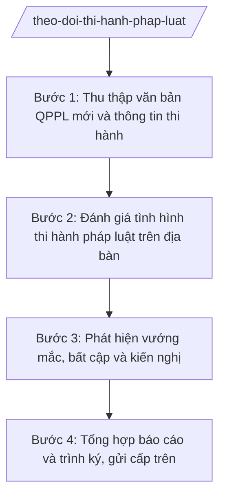

# Skill: Theo dõi tình hình thi hành pháp luật

## 2. Khi nào dùng
- Đến kỳ báo cáo tình hình thi hành pháp luật 6 tháng đầu năm / cả năm của xã.
- Có văn bản QPPL mới của Trung ương/tỉnh liên quan đến địa bàn cần theo dõi việc triển khai.
- Người dân, tổ chức phản ánh vướng mắc khi áp dụng pháp luật trên địa bàn xã.
- Cấp trên (Phòng Tư pháp/Sở Tư pháp) yêu cầu báo cáo chuyên đề về thi hành một lĩnh vực pháp luật.

## 3. Đầu vào (Input)
| Trường | Mô tả | Bắt buộc |
|--------|-------|----------|
| `ky_bao_cao` | Kỳ báo cáo: 6 tháng đầu năm / cả năm / chuyên đề (ghi rõ năm) | Có |
| `van_ban_moi` | Danh sách văn bản QPPL mới ban hành trong kỳ liên quan đến xã | Có |
| `bao_cao_don_vi` | Báo cáo của các đơn vị, thôn về tình hình thi hành pháp luật | Không |
| `phan_anh_nguoi_dan` | Phản ánh, kiến nghị của người dân, tổ chức về vướng mắc pháp luật | Không |
| `linh_vuc_trong_tam` | Lĩnh vực trọng tâm theo dõi trong kỳ (đất đai, hộ tịch, xây dựng...) | Không |
| `can_bo_phu_trach` | Công chức tư pháp – hộ tịch phụ trách tổng hợp | Có |

## 4. Quy trình

**Bước 1. Thu thập văn bản QPPL mới và thông tin thi hành**
- Làm gì: Lập danh sách văn bản QPPL mới ban hành trong kỳ có liên quan đến cấp xã; thu thập báo cáo của các đơn vị, thôn và phản ánh của người dân.
- Dùng input: `ky_bao_cao`, `van_ban_moi`, `bao_cao_don_vi`, `phan_anh_nguoi_dan`
- Vai trò: Công chức tư pháp – hộ tịch xã thu thập; AI hỗ trợ lập danh mục văn bản, phân loại theo lĩnh vực, tổng hợp phản ánh — 1 ngày làm việc
- Lưu ý nghiệp vụ: Chỉ đưa văn bản còn hiệu lực; ghi rõ số hiệu, ngày ban hành, cơ quan ban hành; phản ánh của dân phải ghi nguồn, thời gian tiếp nhận.
- → Kết quả bước: Danh mục văn bản QPPL mới + tập hợp báo cáo, phản ánh đã phân loại.

**Bước 2. Đánh giá tình hình thi hành pháp luật trên địa bàn**
- Làm gì: Đánh giá việc phổ biến, tổ chức thi hành từng văn bản/lĩnh vực: kết quả đạt được, số liệu minh chứng, tồn tại, hạn chế.
- Dùng input: `van_ban_moi`, `bao_cao_don_vi`, `linh_vuc_trong_tam`
- Vai trò: Công chức tư pháp – hộ tịch xã đánh giá; AI hỗ trợ đối chiếu số liệu giữa các nguồn, phát hiện mâu thuẫn, gợi ý khung đánh giá — 1 ngày làm việc
- Lưu ý nghiệp vụ: Đánh giá phải có số liệu cụ thể, không chung chung ("cơ bản tốt"); nêu rõ trách nhiệm của từng đơn vị liên quan.
- → Kết quả bước: Bản đánh giá tình hình THPL theo từng lĩnh vực, có số liệu.

**Bước 3. Phát hiện vướng mắc, bất cập và kiến nghị**
- Làm gì: Tổng hợp các vướng mắc, bất cập phát hiện được (chồng chéo, thiếu hướng dẫn, không phù hợp thực tiễn); đề xuất kiến nghị sửa đổi, bổ sung gửi cơ quan có thẩm quyền.
- Dùng input: `phan_anh_nguoi_dan`, kết quả đánh giá ở Bước 2
- Vai trò: Công chức tư pháp – hộ tịch xã đề xuất; AI hỗ trợ hệ thống hóa vướng mắc, soạn dự thảo kiến nghị — 0,5 ngày làm việc
- Lưu ý nghiệp vụ: Mỗi vướng mắc phải nêu rõ quy định nào, vướng ở điểm nào, đề xuất cụ thể gì; không kiến nghị vượt thẩm quyền của xã.
- → Kết quả bước: Danh mục vướng mắc, bất cập + dự thảo kiến nghị sửa đổi, bổ sung.

**Bước 4. Tổng hợp báo cáo và trình ký, gửi cấp trên**
- Làm gì: Soạn báo cáo tình hình THPL theo đề cương (tình hình chung, kết quả theo lĩnh vực, vướng mắc, kiến nghị); trình lãnh đạo ký; gửi Phòng Tư pháp/Sở Tư pháp đúng thời hạn.
- Dùng input: `ky_bao_cao`, toàn bộ kết quả các bước trên, `can_bo_phu_trach`
- Vai trò: Chánh Văn phòng HĐND và UBND kiểm tra; Chủ tịch UBND xã ký ban hành; AI hỗ trợ soạn báo cáo đúng đề cương, đúng thể thức — 0,5 ngày làm việc
- Lưu ý nghiệp vụ: Báo cáo là văn bản hành chính của UBND xã, phải đúng thể thức NĐ 30/2020/NĐ-CP; gửi đúng thời hạn cấp trên quy định; lưu hồ sơ đầy đủ.
- → Kết quả bước: Báo cáo tình hình THPL của UBND xã đã ký, đã gửi cấp trên.

## Luồng quy trình (Workflow)

## 5. Đầu ra (Output)
- Báo cáo tình hình thi hành pháp luật (6 tháng / năm / chuyên đề) của UBND xã.
- Danh mục văn bản QPPL mới theo dõi trong kỳ (phụ lục).
- Danh mục vướng mắc, bất cập và kiến nghị (phụ lục).

### Cấu trúc output chuẩn
Khung báo cáo của UBND xã (theo NĐ 30/2020/NĐ-CP):
1. Quốc hiệu – tiêu ngữ: "CỘNG HÒA XÃ HỘI CHỦ NGHĨA VIỆT NAM / Độc lập – Tự do – Hạnh phúc".
2. Số, ký hiệu văn bản: số .../BC-UBND.
3. Địa danh và ngày, tháng, năm: "Xã A, ngày ... tháng ... năm ...".
4. Tên loại và trích yếu: "BÁO CÁO / Tình hình thi hành pháp luật 6 tháng đầu năm ... trên địa bàn xã A".
5. Nội dung bắt buộc: I. Tình hình chung (văn bản mới, công tác phổ biến); II. Kết quả thi hành theo lĩnh vực trọng tâm (có số liệu); III. Vướng mắc, bất cập; IV. Kiến nghị, đề xuất.
6. Nơi nhận: Phòng Tư pháp/Sở Tư pháp tỉnh A; Thường trực HĐND xã; lưu VP.
7. Chữ ký: "TM. ỦY BAN NHÂN DÂN / CHỦ TỊCH" + họ tên, đóng dấu.

## 6. Checklist nghiệm thu
- [ ] Đủ các phần theo cấu trúc chuẩn: tình hình chung, kết quả theo lĩnh vực, vướng mắc, kiến nghị.
- [ ] Danh mục văn bản QPPL đầy đủ số hiệu, ngày ban hành, cơ quan ban hành, còn hiệu lực.
- [ ] Số liệu trong báo cáo khớp với báo cáo của đơn vị, thôn (không bịa số liệu).
- [ ] Mỗi vướng mắc nêu rõ quy định vướng, điểm vướng và đề xuất cụ thể.
- [ ] Báo cáo đúng thể thức NĐ 30/2020/NĐ-CP (quốc hiệu, số/ký hiệu, nơi nhận, chữ ký, đóng dấu).
- [ ] Đã gửi cấp trên đúng thời hạn, có xác nhận đã nhận/lưu hồ sơ gửi.
- [ ] Không trích dẫn văn bản ngoài danh sách trắng hoặc văn bản đã hết hiệu lực.
- [ ] Đã qua human gate: công chức soạn → Chánh Văn phòng kiểm tra → Chủ tịch UBND xã ký.

## 7. Ví dụ mô phỏng
*Dữ liệu dưới đây là giả lập 100% phục vụ minh họa.*

### Input mẫu
- ky_bao_cao: 6 tháng đầu năm 2026
- van_ban_moi: 03 văn bản (NĐ 150/2025/NĐ-CP; TT 09/2025/TT-BTP; TT 10/2025/TT-BNV)
- bao_cao_don_vi: 05 thôn báo cáo, 100% đã phổ biến văn bản mới đến người dân
- phan_anh_nguoi_dan: 02 phản ánh về thủ tục cấp giấy chứng nhận quyền sử dụng đất còn chậm
- linh_vuc_trong_tam: Đất đai, hộ tịch
- can_bo_phu_trach: Bà Trần Thị H

### Output mẫu
**BÁO CÁO** số 123/BC-UBND
Tình hình thi hành pháp luật 6 tháng đầu năm 2026 trên địa bàn xã A

CỘNG HÒA XÃ HỘI CHỦ NGHĨA VIỆT NAM
Độc lập – Tự do – Hạnh phúc

Xã A, ngày 09 tháng 10 năm 2026

I. TÌNH HÌNH CHUNG
Trong kỳ, có 03 văn bản QPPL mới liên quan đến cấp xã (NĐ 150/2025/NĐ-CP, TT 09/2025/TT-BTP, TT 10/2025/TT-BNV). 05/05 thôn đã tổ chức phổ biến đến người dân.

II. KẾT QUẢ THI HÀNH THEO LĨNH VỰC
1. Đất đai: tiếp nhận 20 hồ sơ cấp giấy chứng nhận, giải quyết đúng hạn 18 hồ sơ (90%).
2. Hộ tịch: đăng ký khai sinh 30 trường hợp, khai tử 10 trường hợp, đúng hạn 100%.

III. VƯỚNG MẮC, BẤT CẬP
- 02 phản ánh thủ tục cấp giấy chứng nhận quyền sử dụng đất còn chậm do thiếu nhân lực đo đạc.

IV. KIẾN NGHỊ, ĐỀ XUẤT
- Kiến nghị Phòng Tài nguyên và Môi trường hỗ trợ nhân lực đo đạc trong quý IV/2026.

Nơi nhận:
- Phòng Tư pháp tỉnh A;
- Thường trực HĐND xã;
- Lưu: VP.

TM. ỦY BAN NHÂN DÂN
CHỦ TỊCH
Nguyễn Văn A

## 8. Human gate
Công chức tư pháp – hộ tịch xã soạn báo cáo → Chánh Văn phòng HĐND và UBND kiểm tra số liệu, căn cứ pháp lý → Chủ tịch UBND xã ký ban hành trước khi gửi cấp trên. AI chỉ hỗ trợ tổng hợp, soạn thảo; mọi đánh giá, kiến nghị do con người quyết định.

## 9. Giới hạn
AI tuyệt đối KHÔNG: ra quyết định hành chính thay người có thẩm quyền; tự ký/phát hành văn bản; bịa số liệu, căn cứ pháp lý, trích dẫn; dùng văn bản hết hiệu lực; tư vấn vượt thẩm quyền cấp xã. Đặc biệt: không tự "đánh giá" thay công chức, không bịa số liệu thi hành khi đơn vị chưa báo cáo.

## 10. Căn cứ & lưu ý
- TT 09/2025/TT-BTP (hướng dẫn chức năng, nhiệm vụ lĩnh vực tư pháp của Văn phòng HĐND & UBND cấp xã; hiệu lực 01/7/2025).
- NĐ 30/2020/NĐ-CP (thể thức văn bản hành chính).
- Luật Tổ chức chính quyền địa phương 72/2025/QH15.
- Lưu ý: báo cáo THPL là nhiệm vụ định kỳ; cần phân biệt rõ "theo dõi thi hành" (đánh giá việc thực hiện pháp luật) với "tự kiểm tra văn bản" (rà soát văn bản do chính xã ban hành) — hai nhiệm vụ khác nhau, không gộp chung một báo cáo.
