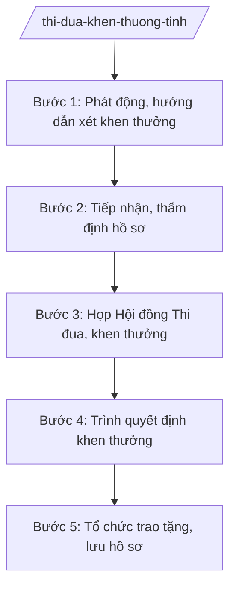

# Skill: Xét thi đua, khen thưởng cấp tỉnh

## 2. Khi nào dùng
- Xét khen thưởng định kỳ cuối năm (Huân chương, danh hiệu thi đua, Bằng khen...).
- Xét khen thưởng đột xuất cho thành tích xuất sắc.
- Tổng kết phong trào thi đua, phát động phong trào mới.

## 3. Đầu vào (Input)
| Trường | Mô tả | Bắt buộc |
|--------|-------|----------|
| `dot_khen_thuong` | Đợt khen thưởng (định kỳ/đột xuất, năm) | Có |
| `hinh_thuc` | Hình thức khen thưởng đề nghị | Có |
| `ho_so_de_nghi` | Hồ sơ đề nghị của cơ quan, đơn vị (thành tích, minh chứng) | Có |
| `tieu_chuan` | Tiêu chuẩn từng hình thức khen thưởng | Có |
| `y_kien_tham_dinh` | Ý kiến thẩm định của cơ quan liên quan | Không |

## 4. Quy trình

**Bước 1. Phát động, hướng dẫn xét khen thưởng**
- Làm gì: Ban hành văn bản phát động/hướng dẫn: hình thức, tiêu chuẩn, hồ sơ, thời hạn gửi đề nghị.
- Dùng input: `dot_khen_thuong`, `tieu_chuan`.
- Vai trò: Chuyên viên Phòng Thi đua, khen thưởng (Sở Nội vụ tỉnh A) soạn; AI hỗ trợ soạn văn bản hướng dẫn ⏱ ~2 ngày làm việc (ước tính)
- Lưu ý nghiệp vụ: Tiêu chuẩn phải đúng quy định; thời hạn đủ để đơn vị chuẩn bị hồ sơ.
- → Kết quả bước: Văn bản phát động, hướng dẫn xét khen thưởng.

**Bước 2. Tiếp nhận, thẩm định hồ sơ**
- Làm gì: Tiếp nhận hồ sơ đề nghị; thẩm định thành tích, đối chiếu tiêu chuẩn; xác minh khi cần.
- Dùng input: `ho_so_de_nghi`, `hinh_thuc`, `y_kien_tham_dinh`.
- Vai trò: Chuyên viên thẩm định; AI hỗ trợ checklist hồ sơ, đối chiếu tiêu chuẩn ⏱ ~7 ngày làm việc (ước tính)
- Lưu ý nghiệp vụ: Thành tích phải có minh chứng; không xét "vớt", không chia đều; xác minh độc lập các trường hợp nghi vấn.
- → Kết quả bước: Danh sách đủ/không đủ điều kiện kèm lý do.

**Bước 3. Họp Hội đồng Thi đua, khen thưởng**
- Làm gì: Trình Hội đồng Thi đua, khen thưởng tỉnh xét, bỏ phiếu; lập biên bản.
- Dùng input: Danh sách Bước 2.
- Vai trò: Hội đồng xét; AI hỗ trợ chuẩn bị tài liệu họp ⏱ ~1 ngày làm việc (ước tính)
- Lưu ý nghiệp vụ: Xét dân chủ, công khai; tỷ lệ phiếu đạt theo quy định.
- → Kết quả bước: Biên bản họp Hội đồng; danh sách trình khen thưởng.

**Bước 4. Trình quyết định khen thưởng**
- Làm gì: Hoàn thiện tờ trình, dự thảo quyết định; trình cấp có thẩm quyền (Chủ tịch UBND tỉnh / Thủ tướng / Chủ tịch nước theo hình thức).
- Dùng input: Biên bản Hội đồng Bước 3.
- Vai trò: Giám đốc Sở Nội vụ ký tờ trình; AI hỗ trợ soạn tờ trình, quyết định ⏱ ~3 ngày làm việc (ước tính)
- Lưu ý nghiệp vụ: Đúng thẩm quyền quyết định từng hình thức; hồ sơ trình đầy đủ.
- → Kết quả bước: Quyết định khen thưởng đã ban hành.

**Bước 5. Tổ chức trao tặng, lưu hồ sơ**
- Làm gì: Tổ chức lễ trao tặng; cập nhật hồ sơ thi đua, khen thưởng; báo cáo tổng kết.
- Dùng input: Quyết định khen thưởng.
- Vai trò: Đơn vị tổ chức; AI hỗ trợ lập danh sách trao tặng ⏱ theo kế hoạch (ước tính)
- Lưu ý nghiệp vụ: Trao tặng trang trọng, đúng nghi thức; lưu hồ sơ đầy đủ.
- → Kết quả bước: Lễ trao tặng đã tổ chức; hồ sơ lưu trữ.

## Luồng quy trình (Workflow)

## 5. Đầu ra (Output)
- Quyết định khen thưởng.
- Danh sách tập thể, cá nhân được khen thưởng.
- Báo cáo tổng kết phong trào thi đua.

**Cấu trúc output chuẩn:**
- Thể thức: tuân thủ Nghị định 30/2020/NĐ-CP về công tác văn thư.
Khung quyết định khen thưởng:
1. Quốc hiệu "CỘNG HÒA XÃ HỘI CHỦ NGHĨA VIỆT NAM", Tiêu ngữ "Độc lập – Tự do – Hạnh phúc"; số, ký hiệu; địa danh, ngày tháng năm.
2. Tên: "QUYẾT ĐỊNH về việc tặng ...".
3. Căn cứ pháp lý (Luật Thi đua, khen thưởng; NĐ 152/2025/NĐ-CP...).
4. Điều 1: Tặng ... cho ... (danh sách kèm theo).
5. Điều 2: Tiền thưởng, chế độ.
6. Điều 3: Trách nhiệm thi hành.
7. Chữ ký người có thẩm quyền; đóng dấu.
- Nơi nhận: liệt kê các cơ quan, đơn vị nhận để biết/thực hiện; kết thúc bằng "- Lưu: VT, [mã đơn vị]".

> **Checklist thể thức văn bản theo NĐ 30/2020/NĐ-CP** — đối chiếu trước khi trình ký:
> 1. Quốc hiệu và Tiêu ngữ.
> 2. Tên cơ quan, tổ chức ban hành văn bản.
> 3. Số, ký hiệu của văn bản.
> 4. Địa danh và thời gian ban hành văn bản.
> 5. Tên loại và trích yếu nội dung văn bản.
> 6. Nội dung văn bản.
> 7. Chức vụ, họ tên và chữ ký của người có thẩm quyền.
> 8. Dấu, chữ ký số của cơ quan, tổ chức.
> 9. Nơi nhận (kèm Phụ lục nếu có).

## 6. Checklist nghiệm thu
- [ ] Hồ sơ đề nghị đầy đủ, thành tích có minh chứng.
- [ ] Thẩm định chặt chẽ, đúng tiêu chuẩn từng hình thức.
- [ ] Hội đồng xét dân chủ, đúng quy trình.
- [ ] Đúng thẩm quyền quyết định.
- [ ] Quyết định đúng thể thức NĐ 30/2020/NĐ-CP.
- [ ] Trao tặng đúng nghi thức; hồ sơ lưu đầy đủ.

## 7. Ví dụ mô phỏng
*Dữ liệu dưới đây là giả lập 100% phục vụ minh họa.*

**Input mẫu:**
- dot_khen_thuong: Tổng kết năm 2026, tỉnh A
- hinh_thuc: Bằng khen của Chủ tịch UBND tỉnh
- ho_so_de_nghi: 30 hồ sơ (giả lập)

**Output mẫu (trích quyết định):**
> **QUYẾT ĐỊNH**
> **Về việc tặng Bằng khen của Chủ tịch Ủy ban nhân dân tỉnh A**
>
> Điều 1. Tặng Bằng khen cho 20 tập thể, 50 cá nhân có thành tích xuất sắc năm 2026 (danh sách kèm theo)...
> (Dữ liệu giả lập 100% phục vụ minh họa)

## 8. Human gate
- Trưởng phòng Thi đua, khen thưởng: kiểm tra thẩm định hồ sơ (Bước 2).
- Hội đồng Thi đua, khen thưởng tỉnh: xét, bỏ phiếu (Bước 3).
- Giám đốc Sở Nội vụ: ký tờ trình (Bước 4).
- Cấp có thẩm quyền: quyết định khen thưởng.

## 9. Giới hạn
- AI không thay Hội đồng xét, bỏ phiếu khen thưởng.
- Không bịa thành tích, minh chứng; không "vớt" hồ sơ không đủ tiêu chuẩn.
- Không đề xuất vượt thẩm quyền quyết định của từng hình thức.

## 10. Căn cứ & lưu ý
- NĐ 152/2025/NĐ-CP (phân cấp trong lĩnh vực thi đua, khen thưởng).
- Luật Thi đua, khen thưởng — dẫn tên, tra cứu bản hiện hành khi áp dụng.
