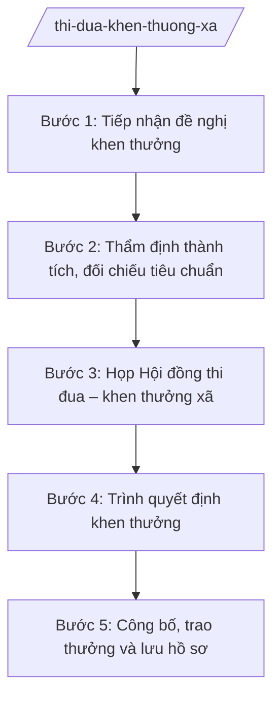

# Skill: Xét thi đua, khen thưởng cấp xã

## 2. Khi nào dùng
- Có đề nghị khen thưởng tập thể, cá nhân có thành tích (phong trào thi đua, đột xuất, chuyên đề).
- Đến đợt xét khen thưởng định kỳ (sơ kết, tổng kết năm, tổng kết phong trào).
- Cần đề nghị cấp trên khen thưởng cho tập thể, cá nhân vượt thẩm quyền của xã.
- Tổng kết công tác thi đua, khen thưởng hằng năm của xã.

## 3. Đầu vào (Input)
| Trường | Mô tả | Bắt buộc |
|--------|-------|----------|
| `doi_tuong_de_nghi` | Tập thể/cá nhân được đề nghị khen thưởng (họ tên/tên đơn vị) | Có |
| `hinh_thuc_khen_thuong` | Giấy khen của Chủ tịch UBND xã / đề nghị cấp trên khen thưởng | Có |
| `tom_tat_thanh_tich` | Tóm tắt thành tích, quá trình đóng góp của đối tượng | Có |
| `tieu_chuan_doi_chieu` | Tiêu chuẩn khen thưởng được đối chiếu theo NĐ 152/2025/NĐ-CP | Có |
| `ho_so_kem_theo` | Biên bản họp bình xét ở cơ sở, xác nhận của đơn vị | Không |
| `can_bo_tham_dinh` | Công chức Văn phòng phụ trách thi đua – khen thưởng | Có |

## 4. Quy trình

**Bước 1. Tiếp nhận đề nghị khen thưởng**
- Làm gì: Tiếp nhận hồ sơ đề nghị khen thưởng từ các thôn, đơn vị; kiểm tra thành phần hồ sơ (tờ trình đề nghị, báo cáo thành tích, biên bản bình xét).
- Dùng input: `doi_tuong_de_nghi`, `hinh_thuc_khen_thuong`, `tom_tat_thanh_tich`, `ho_so_kem_theo`
- Vai trò: Công chức Văn phòng phụ trách thi đua – khen thưởng tiếp nhận; AI hỗ trợ lập danh sách theo dõi, kiểm tra thành phần hồ sơ — 0,5 ngày làm việc
- Lưu ý nghiệp vụ: Hồ sơ thiếu thì yêu cầu bổ sung một lần, có văn bản; không nhận hồ sơ quá thời hạn đợt xét đã thông báo.
- → Kết quả bước: Danh sách hồ sơ đề nghị khen thưởng, phân loại đủ/thiếu thành phần.

**Bước 2. Thẩm định thành tích, đối chiếu tiêu chuẩn**
- Làm gì: Thẩm định tính xác thực của thành tích; đối chiếu với tiêu chuẩn của từng hình thức khen thưởng theo NĐ 152/2025/NĐ-CP; loại hồ sơ không đủ tiêu chuẩn.
- Dùng input: `tom_tat_thanh_tich`, `tieu_chuan_doi_chieu`, `ho_so_kem_theo`
- Vai trò: Công chức phụ trách thi đua – khen thưởng thẩm định; AI hỗ trợ đối chiếu tiêu chuẩn, lập bảng thẩm định — 1 ngày làm việc
- Lưu ý nghiệp vụ: Thành tích phải cụ thể, có minh chứng, trong thời gian xét; không xét khen thưởng cho đối tượng đang bị kỷ luật hoặc có vi phạm chưa khắc phục.
- → Kết quả bước: Bảng thẩm định: đủ tiêu chuẩn / không đủ tiêu chuẩn + lý do từng trường hợp.

**Bước 3. Họp Hội đồng thi đua – khen thưởng xã**
- Làm gì: Chuẩn bị tài liệu, triệu tập họp Hội đồng thi đua – khen thưởng xã; Hội đồng thảo luận, bỏ phiếu/biểu quyết danh sách trình khen thưởng; lập biên bản họp.
- Dùng input: Bảng thẩm định ở Bước 2, `doi_tuong_de_nghi`
- Vai trò: Chủ tịch Hội đồng (lãnh đạo UBND xã) chủ trì; công chức phụ trách làm thư ký; AI hỗ trợ soạn tài liệu họp, dự thảo biên bản — 0,5 ngày làm việc
- Lưu ý nghiệp vụ: Bảo đảm công khai, dân chủ; biên bản ghi rõ kết quả biểu quyết từng trường hợp; thành viên Hội đồng có liên quan đến đối tượng xét thì không tham gia biểu quyết trường hợp đó.
- → Kết quả bước: Biên bản họp Hội đồng + danh sách thống nhất trình khen thưởng.

**Bước 4. Trình quyết định khen thưởng**
- Làm gì: Soạn tờ trình + dự thảo quyết định khen thưởng trình Chủ tịch UBND xã ký (thuộc thẩm quyền xã); hoặc lập hồ sơ đề nghị cấp trên khen thưởng (vượt thẩm quyền).
- Dùng input: Biên bản họp Hội đồng, `hinh_thuc_khen_thuong`
- Vai trò: Chánh Văn phòng HĐND và UBND kiểm tra; Chủ tịch UBND xã ký quyết định; AI hỗ trợ soạn tờ trình, dự thảo quyết định đúng thể thức — 0,5 ngày làm việc
- Lưu ý nghiệp vụ: Phân biệt rõ thẩm quyền: Giấy khen của Chủ tịch UBND xã do Chủ tịch UBND xã quyết định; hình thức cao hơn thì đề nghị cấp trên, xã không tự quyết.
- → Kết quả bước: Quyết định khen thưởng đã ký (hoặc hồ sơ đề nghị cấp trên đã gửi).

**Bước 5. Công bố, trao thưởng và lưu hồ sơ**
- Làm gì: Công bố quyết định khen thưởng; tổ chức trao thưởng (lồng ghép hội nghị phù hợp); cập nhật vào hồ sơ thi đua – khen thưởng; tổng hợp báo cáo.
- Dùng input: Quyết định khen thưởng, `can_bo_tham_dinh`
- Vai trò: Công chức phụ trách thi đua – khen thưởng tổ chức thực hiện; AI hỗ trợ lập danh sách trao thưởng, mẫu giấy chứng nhận — 1 ngày làm việc
- Lưu ý nghiệp vụ: Trao thưởng trang trọng, đúng đối tượng; lưu đầy đủ: tờ trình, báo cáo thành tích, biên bản họp, quyết định; cập nhật sổ theo dõi.
- → Kết quả bước: Lễ trao thưởng hoàn thành; hồ sơ khen thưởng lưu đầy đủ; báo cáo tổng kết.

## Luồng quy trình (Workflow)

## 5. Đầu ra (Output)
- Quyết định khen thưởng của Chủ tịch UBND xã (mẫu số 123/QĐ-UBND).
- Danh sách tập thể, cá nhân được khen thưởng.
- Biên bản họp Hội đồng thi đua – khen thưởng xã.
- Báo cáo tổng kết công tác thi đua, khen thưởng.

### Cấu trúc output chuẩn
Khung quyết định khen thưởng của UBND xã (theo NĐ 30/2020/NĐ-CP):
1. Quốc hiệu – tiêu ngữ: "CỘNG HÒA XÃ HỘI CHỦ NGHĨA VIỆT NAM / Độc lập – Tự do – Hạnh phúc".
2. Số, ký hiệu văn bản: số 123/QĐ-UBND.
3. Địa danh và ngày, tháng, năm: "Xã A, ngày ... tháng ... năm ...".
4. Tên loại văn bản: "QUYẾT ĐỊNH / Về việc khen thưởng ...".
5. Căn cứ: Luật Tổ chức chính quyền địa phương 72/2025/QH15; NĐ 152/2025/NĐ-CP; biên bản họp Hội đồng thi đua – khen thưởng xã.
6. Nội dung: Điều 1: tặng Giấy khen của Chủ tịch UBND xã A cho (danh sách tập thể, cá nhân + thành tích tóm tắt); Điều 2: mức tiền thưởng (nếu có) và nguồn kinh phí; Điều 3: hiệu lực và trách nhiệm thi hành.
7. Nơi nhận: các tập thể, cá nhân được khen thưởng; Hội đồng TĐKT xã; lưu VP.
8. Chữ ký: "TM. ỦY BAN NHÂN DÂN / CHỦ TỊCH" + họ tên Nguyễn Văn A, đóng dấu.

## 6. Checklist nghiệm thu
- [ ] Hồ sơ đề nghị đủ thành phần: tờ trình, báo cáo thành tích, biên bản bình xét cơ sở.
- [ ] Mỗi trường hợp đã được thẩm định, đối chiếu đúng tiêu chuẩn theo NĐ 152/2025/NĐ-CP.
- [ ] Đã họp Hội đồng thi đua – khen thưởng xã, biên bản ghi rõ kết quả biểu quyết.
- [ ] Đúng thẩm quyền: thuộc xã thì Chủ tịch UBND xã quyết định; vượt thẩm quyền thì đề nghị cấp trên.
- [ ] Quyết định đúng thể thức NĐ 30/2020/NĐ-CP: số 123/QĐ-UBND, đủ căn cứ, nơi nhận, chữ ký, đóng dấu.
- [ ] Trao thưởng đúng đối tượng, công khai; hồ sơ lưu đầy đủ, cập nhật sổ theo dõi.
- [ ] Không bịa thành tích, không đưa đối tượng đang bị kỷ luật vào danh sách.
- [ ] Đã qua human gate: công chức thẩm định → Hội đồng họp xét → Chủ tịch UBND xã ký quyết định.

## 7. Ví dụ mô phỏng
*Dữ liệu dưới đây là giả lập 100% phục vụ minh họa.*

### Input mẫu
- doi_tuong_de_nghi: Ông Nguyễn Văn Dân (cá nhân); Thôn B (tập thể)
- hinh_thuc_khen_thuong: Giấy khen của Chủ tịch UBND xã
- tom_tat_thanh_tich: Ông Nguyễn Văn Dân hiến 500 m² đất làm đường giao thông nông thôn năm 2026; Thôn B đạt thôn văn hóa 3 năm liên tục
- tieu_chuan_doi_chieu: Tiêu chuẩn tặng Giấy khen của Chủ tịch UBND cấp xã theo NĐ 152/2025/NĐ-CP
- ho_so_kem_theo: Biên bản bình xét của thôn
- can_bo_tham_dinh: Bà Trần Thị H

### Output mẫu
**QUYẾT ĐỊNH** số 123/QĐ-UBND
Về việc tặng Giấy khen của Chủ tịch Ủy ban nhân dân xã A

CỘNG HÒA XÃ HỘI CHỦ NGHĨA VIỆT NAM
Độc lập – Tự do – Hạnh phúc

Xã A, ngày 09 tháng 10 năm 2026

CHỦ TỊCH ỦY BAN NHÂN DÂN XÃ A

Căn cứ Luật Tổ chức chính quyền địa phương số 72/2025/QH15;
Căn cứ Nghị định số 152/2025/NĐ-CP ngày 14/6/2025 của Chính phủ quy định về thi đua, khen thưởng;
Xét đề nghị của Hội đồng Thi đua – Khen thưởng xã A tại Biên bản họp ngày ...,

QUYẾT ĐỊNH:

Điều 1. Tặng Giấy khen của Chủ tịch Ủy ban nhân dân xã A cho:
1. Ông Nguyễn Văn Dân — đã hiến 500 m² đất làm đường giao thông nông thôn năm 2026;
2. Tập thể Thôn B — đạt danh hiệu thôn văn hóa 3 năm liên tục (2024–2026).

Điều 2. Mức tiền thưởng thực hiện theo quy định hiện hành, trích từ nguồn kinh phí thi đua, khen thưởng của xã.

Điều 3. Quyết định này có hiệu lực thi hành kể từ ngày ký. Chánh Văn phòng HĐND và UBND xã A, Hội đồng Thi đua – Khen thưởng xã và các ông (bà) có tên tại Điều 1 chịu trách nhiệm thi hành Quyết định này.

Nơi nhận:
- Như Điều 3;
- Lưu: VP.

TM. ỦY BAN NHÂN DÂN
CHỦ TỊCH
Nguyễn Văn A

## 8. Human gate
Công chức phụ trách thi đua – khen thưởng thẩm định hồ sơ → Hội đồng thi đua – khen thưởng xã họp xét, biểu quyết → Chánh Văn phòng kiểm tra dự thảo → Chủ tịch UBND xã ký quyết định khen thưởng thuộc thẩm quyền trước khi công bố, trao thưởng. AI không tự đưa ai vào danh sách khen thưởng.

## 9. Giới hạn
AI tuyệt đối KHÔNG: ra quyết định hành chính thay người có thẩm quyền; tự ký/phát hành văn bản; bịa số liệu, căn cứ pháp lý, trích dẫn; dùng văn bản hết hiệu lực; tư vấn vượt thẩm quyền cấp xã. Đặc biệt: không tự "xét" thành tích, không đề xuất mức khen thưởng vượt thẩm quyền của Chủ tịch UBND xã.

## 10. Căn cứ & lưu ý
- NĐ 152/2025/NĐ-CP (14/6/2025; thi đua, khen thưởng).
- Luật Tổ chức chính quyền địa phương 72/2025/QH15.
- NĐ 30/2020/NĐ-CP (thể thức văn bản hành chính).
- Lưu ý: khen thưởng phải đúng đối tượng, đúng tiêu chuẩn, công khai, dân chủ; phân biệt khen thưởng thuộc thẩm quyền Chủ tịch UBND xã với các hình thức phải đề nghị cấp trên.
