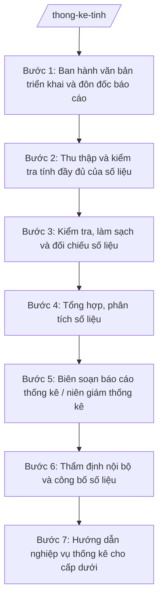

# Skill: Công tác thống kê địa phương

## 2. Khi nào dùng

- Đến kỳ thu thập, tổng hợp số liệu thống kê KT-XH của tỉnh (tháng, quý, 6 tháng, năm);
- Cần tổ chức điều tra, khảo sát thống kê chuyên đề trên địa bàn tỉnh;
- Cần biên soạn báo cáo tình hình KT-XH, niên giám thống kê tỉnh;
- Cần công bố số liệu thống kê chính thức của tỉnh;
- Cần hướng dẫn nghiệp vụ thống kê cho các sở, ban, ngành và UBND cấp xã;
- Cần cung cấp số liệu thống kê phục vụ xây dựng kế hoạch, quy hoạch của tỉnh.

## 3. Đầu vào (Input)

| Trường | Mô tả | Bắt buộc |
|--------|-------|----------|
| `ky_thong_ke` | Kỳ thống kê: tháng / quý / 6 tháng / năm / chuyên đề | Có |
| `so_lieu_don_vi` | Số liệu thống kê do các sở, ban, ngành, UBND cấp xã báo cáo về | Có |
| `che_do_bao_cao` | Chế độ báo cáo thống kê áp dụng (mẫu biểu, chỉ tiêu, thời hạn) | Có |
| `so_lieu_ky_truoc` | Số liệu cùng kỳ năm trước / kỳ trước (để so sánh) | Có |
| `noi_dung_dieu_tra` | Nội dung điều tra, khảo sát chuyên đề (nếu tổ chức điều tra) | Không |
| `yeu_cau_cong_bo` | Yêu cầu công bố số liệu: phạm vi, hình thức công bố | Không |

## 4. Quy trình

**Bước 1. Ban hành văn bản triển khai và đôn đốc báo cáo**
- Làm gì: Soạn văn bản triển khai chế độ báo cáo thống kê kỳ này đến các sở, ban, ngành, UBND cấp xã (mẫu biểu, chỉ tiêu, thời hạn); đôn đốc các đơn vị gửi số liệu đúng hạn; lập danh sách theo dõi tiến độ.
- Dùng input: `ky_thong_ke`, `che_do_bao_cao`.
- Vai trò: Chuyên viên Phòng Thống kê (Sở Tài chính) soạn thảo, AI hỗ trợ dựng khung văn bản và bảng theo dõi tiến độ nộp số liệu; ⏱ ~1–2 ngày làm việc (ước tính).
- Lưu ý nghiệp vụ: Mẫu biểu, chỉ tiêu phải đúng chế độ báo cáo thống kê hiện hành; đôn đốc quyết liệt đơn vị chậm nộp để bảo đảm tiến độ tổng hợp chung.
- → Kết quả bước: Văn bản triển khai đã ban hành + danh sách theo dõi tiến độ nộp số liệu.

**Bước 2. Thu thập và kiểm tra tính đầy đủ của số liệu**
- Làm gì: Thu thập số liệu các đơn vị gửi về; kiểm tra tính đầy đủ (đủ biểu, đủ chỉ tiêu, đúng thời hạn); lập danh sách đơn vị thiếu/chậm, yêu cầu bổ sung; ghi nhận các thuyết minh, giải trình kèm theo.
- Dùng input: `so_lieu_don_vi`.
- Vai trò: Chuyên viên Phòng Thống kê thu thập, kiểm tra; AI hỗ trợ đối chiếu danh mục biểu mẫu phải nộp, liệt kê đơn vị thiếu/chậm; ⏱ ~2–3 ngày làm việc (ước tính).
- Lưu ý nghiệp vụ: Không tổng hợp khi còn thiếu số liệu của đơn vị trọng yếu; mọi số liệu bổ sung sau phải được ghi nhận rõ thời điểm.
- → Kết quả bước: Bộ số liệu đầy đủ của các đơn vị + danh sách đã đôn đốc bổ sung.

**Bước 3. Kiểm tra, làm sạch và đối chiếu số liệu**
- Làm gì: Kiểm tra tính hợp lý của số liệu: đối chiếu với số liệu kỳ trước, cùng kỳ năm trước; phát hiện số liệu bất thường (tăng/giảm đột biến, mâu thuẫn giữa các chỉ tiêu); làm việc với đơn vị để xác minh, hiệu đính; lập bảng ghi nhận các điều chỉnh.
- Dùng input: `so_lieu_don_vi`, `so_lieu_ky_truoc`.
- Vai trò: Chuyên viên Phòng Thống kê kiểm tra, AI hỗ trợ so sánh tự động, cảnh báo các chỉ tiêu biến động bất thường cần xác minh; ⏱ ~3–5 ngày làm việc (ước tính).
- Lưu ý nghiệp vụ: Mọi điều chỉnh số liệu phải có xác nhận của đơn vị báo cáo; AI chỉ cảnh báo bất thường, không tự ý sửa số liệu.
- → Kết quả bước: Bộ số liệu đã được kiểm tra, làm sạch, có bảng ghi nhận điều chỉnh.

**Bước 4. Tổng hợp, phân tích số liệu**
- Làm gì: Tổng hợp số liệu toàn tỉnh theo từng lĩnh vực (kinh tế, xã hội, môi trường...); tính toán các chỉ tiêu tổng hợp (tốc độ tăng trưởng, cơ cấu, bình quân...); phân tích xu hướng, so sánh với mục tiêu kế hoạch; lập các bảng biểu tổng hợp.
- Dùng input: Kết quả Bước 3.
- Vai trò: Chuyên viên Phòng Thống kê tổng hợp, phân tích; AI hỗ trợ tính toán chỉ tiêu, lập bảng biểu và dự thảo phần nhận xét xu hướng; ⏱ ~3–5 ngày làm việc (ước tính).
- Lưu ý nghiệp vụ: Phương pháp tính các chỉ tiêu tổng hợp phải đúng quy định; nhận xét phân tích phải dựa trên số liệu, không suy diễn chủ quan.
- → Kết quả bước: Bảng biểu tổng hợp + dự thảo phân tích số liệu thống kê kỳ này.

**Bước 5. Biên soạn báo cáo thống kê / niên giám thống kê**
- Làm gì: Biên soạn báo cáo tình hình KT-XH kỳ này (đối với kỳ tháng/quý/năm) hoặc niên giám thống kê tỉnh (đối với kỳ năm): phần số liệu tổng hợp, phần phân tích, đánh giá, biểu đồ minh họa; rà soát tính nhất quán giữa số liệu và nhận xét.
- Dùng input: Kết quả Bước 4, `ky_thong_ke`.
- Vai trò: Chuyên viên Phòng Thống kê biên soạn, AI hỗ trợ dựng khung báo cáo/niên giám, rà soát nhất quán số liệu – nhận xét; ⏱ ~3–5 ngày làm việc (ước tính).
- Lưu ý nghiệp vụ: Số liệu trong báo cáo/niên giám là số liệu chính thức của tỉnh, phải chính xác tuyệt đối; niên giám phải đầy đủ các chỉ tiêu theo đề cương đã phê duyệt.
- → Kết quả bước: Dự thảo báo cáo thống kê / niên giám thống kê tỉnh.

**Bước 6. Thẩm định nội bộ và công bố số liệu**
- Làm gì: Trưởng phòng Thống kê và Phó Giám đốc Sở phụ trách rà soát dự thảo; Giám đốc Sở Tài chính (ông Hoàng Văn S) xem xét, ký ban hành báo cáo; công bố số liệu thống kê chính thức theo quy định (họp báo, cổng thông tin...); gửi báo cáo đến UBND tỉnh và cơ quan thống kê trung ương.
- Dùng input: Dự thảo báo cáo/niên giám ở Bước 5; `yeu_cau_cong_bo`.
- Vai trò: Trưởng phòng, Phó Giám đốc, Giám đốc Sở kiểm tra và quyết định; AI hỗ trợ rà soát lỗi kỹ thuật, thể thức; ⏱ ~2–3 ngày làm việc (ước tính).
- Lưu ý nghiệp vụ: Chỉ công bố số liệu đã được lãnh đạo Sở phê duyệt; số liệu công bố phải thống nhất trên mọi kênh; không công bố số liệu chưa qua kiểm tra.
- → Kết quả bước: Báo cáo thống kê / niên giám thống kê đã ban hành + số liệu đã công bố.

**Bước 7. Hướng dẫn nghiệp vụ thống kê cho cấp dưới**
- Làm gì: Hướng dẫn nghiệp vụ thống kê cho các sở, ban, ngành, UBND cấp xã (tập huấn, văn bản hướng dẫn); giải đáp vướng mắc về biểu mẫu, chỉ tiêu, phương pháp tính; kiểm tra việc chấp hành chế độ báo cáo thống kê của các đơn vị.
- Dùng input: Vướng mắc, đề xuất của các đơn vị.
- Vai trò: Chuyên viên Phòng Thống kê thực hiện, AI hỗ trợ soạn tài liệu hướng dẫn, tổng hợp câu hỏi thường gặp; ⏱ ~theo kế hoạch tập huấn. (ước tính)
- Lưu ý nghiệp vụ: Định vị cấp tỉnh là tổng hợp, hướng dẫn nghiệp vụ — số liệu gốc do các đơn vị chịu trách nhiệm; hướng dẫn phải thống nhất, kịp thời.
- → Kết quả bước: Tài liệu hướng dẫn nghiệp vụ + báo cáo kết quả tập huấn, kiểm tra.

## Luồng quy trình (Workflow)

## 5. Đầu ra (Output)

- Văn bản triển khai chế độ báo cáo thống kê kỳ này;
- Bộ số liệu thống kê đã kiểm tra, làm sạch (kèm bảng ghi nhận điều chỉnh);
- Bảng biểu tổng hợp số liệu KT-XH toàn tỉnh;
- Báo cáo tình hình KT-XH kỳ (tháng/quý/6 tháng/năm) đã ban hành;
- Niên giám thống kê tỉnh (kỳ năm) đã ban hành;
- Thông cáo/bản tin công bố số liệu thống kê chính thức;
- Tài liệu hướng dẫn nghiệp vụ thống kê cho các đơn vị.

**Cấu trúc output chuẩn (Báo cáo tình hình KT-XH):**
- Thể thức: tuân thủ Nghị định 30/2020/NĐ-CP về công tác văn thư.

1. Quốc hiệu "CỘNG HÒA XÃ HỘI CHỦ NGHĨA VIỆT NAM", Tiêu ngữ "Độc lập – Tự do – Hạnh phúc";
2. Tên cơ quan ban hành: SỞ TÀI CHÍNH TỈNH A; số, ký hiệu văn bản; địa danh và ngày, tháng, năm ban hành;
3. Tên loại và trích yếu: BÁO CÁO — Tình hình kinh tế – xã hội (tháng.../quý.../năm...) tỉnh A;
4. Phần "Kính gửi": Ủy ban nhân dân tỉnh A (và cơ quan thống kê trung ương theo chế độ);
5. Căn cứ báo cáo (chế độ báo cáo thống kê áp dụng...);
6. Nội dung: khái quát chung; tình hình từng lĩnh vực (sản xuất, thương mại, đầu tư, ngân sách, xã hội...); đánh giá chung, tồn tại, hạn chế; kiến nghị;
7. Biểu số liệu thống kê kèm theo;
8. Nơi nhận;
9. Thẩm quyền, chức vụ, họ tên người ký: GIÁM ĐỐC — (chữ ký, họ tên), dấu của cơ quan.

## 6. Checklist nghiệm thu

- [ ] 100% đơn vị đã nộp số liệu đúng biểu mẫu, chỉ tiêu, thời hạn (có đôn đốc đơn vị chậm);
- [ ] Số liệu đã được kiểm tra, làm sạch; mọi điều chỉnh có xác nhận của đơn vị báo cáo;
- [ ] Không còn chỉ tiêu biến động bất thường chưa được xác minh, giải trình;
- [ ] Chỉ tiêu tổng hợp tính đúng phương pháp; nhận xét phân tích dựa trên số liệu;
- [ ] Số liệu trong báo cáo/niên giám khớp tuyệt đối với bảng biểu tổng hợp;
- [ ] Báo cáo/niên giám đúng thể thức, đã được lãnh đạo Sở ký trước khi công bố;
- [ ] Số liệu công bố thống nhất trên mọi kênh; không công bố số liệu chưa qua kiểm tra;
- [ ] Căn cứ (chế độ báo cáo) đúng văn bản còn hiệu lực, không bịa số hiệu;
- [ ] Số liệu do các đơn vị báo cáo, AI không tự bịa, không tự ý sửa số liệu.

## 7. Ví dụ mô phỏng

*Dữ liệu dưới đây là giả lập 100% phục vụ minh họa.*

### Input mẫu

| Trường | Giá trị giả lập |
|--------|-----------------|
| ky_thong_ke | Quý I năm 2027 |
| so_lieu_don_vi | Số liệu của 20 sở, ban, ngành và 30 UBND cấp xã (giả lập) |
| che_do_bao_cao | Chế độ báo cáo thống kê tổng hợp quý (giả lập) |
| so_lieu_ky_truoc | Số liệu quý IV năm 2026 và quý I năm 2026 (giả lập) |

### Output mẫu (Báo cáo — trích)

> **CỘNG HÒA XÃ HỘI CHỦ NGHĨA VIỆT NAM**
> **Độc lập – Tự do – Hạnh phúc**
>
> **SỞ TÀI CHÍNH TỈNH A**
> Số: 1234/BC-STC
> Tỉnh A, ngày 10 tháng 4 năm 2027
>
> **BÁO CÁO**
> **Tình hình kinh tế – xã hội quý I năm 2027 tỉnh A (giả lập)**
>
> Kính gửi: Ủy ban nhân dân tỉnh A.
>
> Căn cứ chế độ báo cáo thống kê hiện hành, Sở Tài chính tỉnh A báo cáo tình hình KT-XH quý I năm 2027 như sau:
>
> I. Khái quát chung: GRDP quý I tăng 8% so với cùng kỳ (giả lập)...
> II. Tình hình từng lĩnh vực: sản xuất công nghiệp tăng 10%; tổng mức bán lẻ tăng 9%... (giả lập)
> III. Đánh giá chung, tồn tại, hạn chế và kiến nghị...
>
> ***Nơi nhận:*** ...
>
> **GIÁM ĐỐC**
> *(ký, đóng dấu)*
> **Hoàng Văn S**

## 8. Human gate

1. Chuyên viên Phòng Thống kê thu thập, kiểm tra, tổng hợp và biên soạn (Bước 1–5);
2. Trưởng phòng Thống kê và Phó Giám đốc Sở phụ trách rà soát dự thảo báo cáo/niên giám (Bước 6);
3. Giám đốc Sở Tài chính xem xét, ký ban hành báo cáo trước khi công bố (Bước 6);
4. Số liệu công bố là số liệu chính thức của tỉnh — mọi công bố phải qua phê duyệt của lãnh đạo Sở.

## 9. Giới hạn

- AI KHÔNG tự ý sửa đổi, "làm đẹp" số liệu thống kê;
- AI KHÔNG tự ký, tự phát hành báo cáo hay công bố số liệu;
- AI KHÔNG bịa số liệu, chỉ tiêu thống kê;
- AI KHÔNG bịa căn cứ pháp lý, không trích dẫn văn bản đã hết hiệu lực;
- AI KHÔNG đưa ra nhận xét, kết luận vượt quá những gì số liệu thể hiện.

## 10. Căn cứ & lưu ý

- Thông tư 57/2025/TT-BTC hướng dẫn chức năng, nhiệm vụ, quyền hạn của Sở Tài chính và lĩnh vực tài chính – kế hoạch của phòng chuyên môn thuộc UBND cấp xã;
- Luật Thống kê (chỉ nêu tên luật, không kèm số hiệu);
- Nghị định 150/2025/NĐ-CP về tổ chức cơ quan chuyên môn thuộc UBND cấp tỉnh, cấp xã;
- Nghị định 30/2020/NĐ-CP về công tác văn thư (chỉ dùng cho thể thức văn bản);
- Lưu ý: số liệu gốc do các sở, ban, ngành, UBND cấp xã chịu trách nhiệm; Sở Tài chính thực hiện tổng hợp, kiểm tra, công bố số liệu thống kê chính thức của tỉnh; mọi điều chỉnh số liệu phải có xác nhận của đơn vị báo cáo.
