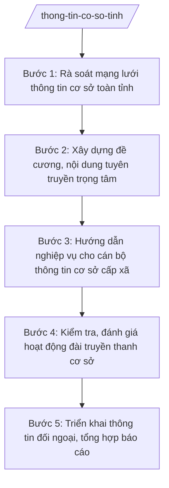

# Skill: Thông tin cơ sở, thông tin đối ngoại

## 2. Khi nào dùng
- Lập kế hoạch công tác thông tin cơ sở hằng năm của tỉnh.
- Rà soát mạng lưới đài truyền thanh cơ sở, cụm thông tin, bảng tin trên địa bàn.
- Xây dựng đề cương, nội dung tuyên truyền trọng tâm cho hệ thống thông tin cơ sở.
- Hướng dẫn nghiệp vụ cho cán bộ làm công tác thông tin cơ sở cấp xã.
- Kiểm tra, đánh giá hoạt động đài truyền thanh cơ sở.
- Triển khai công tác thông tin đối ngoại, quảng bá hình ảnh của tỉnh.
- Báo cáo công tác thông tin cơ sở gửi Bộ KH&CN và UBND tỉnh.

## 3. Đầu vào (Input)
| Trường | Mô tả | Bắt buộc |
|--------|-------|----------|
| `mang_luoi_ttcs` | Mạng lưới thông tin cơ sở: đài truyền thanh xã, cụm loa, bảng tin, trang thông tin điện tử xã | Có |
| `noi_dung_tuyen_truyen` | Nội dung tuyên truyền trọng tâm (chủ trương, chính sách, nhiệm vụ của tỉnh) | Có |
| `ke_hoach_ttcs` | Kế hoạch công tác thông tin cơ sở năm (nếu đã có) | Không |
| `danh_gia_hoat_dong` | Kết quả đánh giá hoạt động đài truyền thanh cơ sở các năm trước | Không |
| `nguoi_ky` | Người ký ban hành (Giám đốc Sở đối với kế hoạch của Sở; Chủ tịch UBND tỉnh đối với kế hoạch của UBND tỉnh) | Có |

## 4. Quy trình

**Bước 1. Rà soát mạng lưới thông tin cơ sở toàn tỉnh**
- Làm gì: Rà soát đài truyền thanh xã, cụm loa truyền thanh, bảng tin, trang thông tin điện tử của xã; đánh giá tình trạng hoạt động (tốt/trung bình/kém/không hoạt động), nguyên nhân.
- Dùng input: `mang_luoi_ttcs`, `danh_gia_hoat_dong`.
- Vai trò: Chuyên viên Phòng Thông tin – Báo chí – Xuất bản (hoặc phòng được giao) phối hợp UBND xã rà soát; AI hỗ trợ lập bảng rà soát, thống kê tỷ lệ hoạt động theo xã ⏱ ~10 ngày làm việc (ước tính)
- Lưu ý nghiệp vụ: Rà soát phải đến từng xã, không báo cáo chung chung; phân biệt đài hoạt động thường xuyên với đài chỉ hoạt động khi có sự kiện.
- → Kết quả bước: Bảng rà soát mạng lưới thông tin cơ sở toàn tỉnh.

**Bước 2. Xây dựng đề cương, nội dung tuyên truyền trọng tâm**
- Làm gì: Xây dựng đề cương tuyên truyền hằng quý/năm: chủ trương của Đảng, chính sách pháp luật, nhiệm vụ trọng tâm của tỉnh; biên tập tài liệu tuyên truyền gửi cơ sở.
- Dùng input: `noi_dung_tuyen_truyen`, bảng rà soát ở Bước 1.
- Vai trò: Chuyên viên biên soạn đề cương; Trưởng phòng kiểm tra; Phó Giám đốc Sở phê duyệt; AI hỗ trợ biên tập tài liệu tuyên truyền ngắn gọn, dễ hiểu cho cơ sở ⏱ ~5 ngày làm việc (ước tính)
- Lưu ý nghiệp vụ: Nội dung phải phù hợp trình độ tiếp nhận của người dân cơ sở; đề cương ngắn gọn, có gợi ý cách tuyên truyền (phát thanh, bảng tin, họp dân).
- → Kết quả bước: Đề cương tuyên truyền + tài liệu gửi hệ thống thông tin cơ sở.

**Bước 3. Hướng dẫn nghiệp vụ cho cán bộ thông tin cơ sở cấp xã**
- Làm gì: Tổ chức tập huấn, hướng dẫn nghiệp vụ cho cán bộ phụ trách đài truyền thanh, thông tin cơ sở xã: kỹ năng biên tập, phát thanh, quản lý thiết bị.
- Dùng input: Bảng rà soát ở Bước 1 (xác định xã yếu cần hỗ trợ).
- Vai trò: Chuyên viên Sở trực tiếp tập huấn; Trưởng phòng theo dõi; AI hỗ trợ soạn tài liệu tập huấn, bài kiểm tra đánh giá ⏱ ~3 ngày làm việc (chuẩn bị) (ước tính)
- Lưu ý nghiệp vụ: Tập huấn phải thực hành trên thiết bị thật; ưu tiên xã có đài hoạt động kém, cán bộ mới.
- → Kết quả bước: Kế hoạch + tài liệu tập huấn nghiệp vụ thông tin cơ sở.

**Bước 4. Kiểm tra, đánh giá hoạt động đài truyền thanh cơ sở**
- Làm gì: Kiểm tra hoạt động của đài truyền thanh xã (tần suất phát thanh, chất lượng nội dung, tình trạng thiết bị); đánh giá, xếp loại; đề xuất hỗ trợ thiết bị cho xã khó khăn.
- Dùng input: `ke_hoach_ttcs`, `mang_luoi_ttcs`.
- Vai trò: Đoàn kiểm tra của Sở thực hiện; chuyên viên lập biên bản, tổng hợp đánh giá; AI hỗ trợ lập bảng chấm điểm, tổng hợp kết quả ⏱ theo kế hoạch (ước tính)
- Lưu ý nghiệp vụ: Đánh giá công bằng giữa các xã; kết quả là căn cứ đề xuất đầu tư, hỗ trợ thiết bị.
- → Kết quả bước: Báo cáo kiểm tra, đánh giá hoạt động thông tin cơ sở.

**Bước 5. Triển khai thông tin đối ngoại, tổng hợp báo cáo**
- Làm gì: Triển khai thông tin đối ngoại của tỉnh (quảng bá hình ảnh, tiềm năng, thành tựu); phối hợp báo chí tuyên truyền; tổng hợp báo cáo công tác thông tin cơ sở năm.
- Dùng input: `noi_dung_tuyen_truyen`, kết quả kiểm tra ở Bước 4, `nguoi_ky`.
- Vai trò: Phó Giám đốc Sở chỉ đạo; chuyên viên triển khai; AI hỗ trợ soạn tin bài quảng bá, tổng hợp báo cáo năm ⏱ ~3 ngày làm việc (ước tính)
- Lưu ý nghiệp vụ: Thông tin đối ngoại phải chính xác, thống nhất với định hướng của tỉnh; không cung cấp thông tin chưa được kiểm chứng cho báo chí nước ngoài.
- → Kết quả bước: Báo cáo công tác thông tin cơ sở, thông tin đối ngoại năm của tỉnh.

## Luồng quy trình (Workflow)

## 5. Đầu ra (Output)
- Kế hoạch công tác thông tin cơ sở năm của tỉnh.
- Đề cương tuyên truyền + tài liệu gửi hệ thống thông tin cơ sở.
- Báo cáo kiểm tra, đánh giá hoạt động đài truyền thanh cơ sở.
- Báo cáo công tác thông tin cơ sở, thông tin đối ngoại năm.

**Cấu trúc output chuẩn:**
Khung Kế hoạch công tác thông tin cơ sở (theo NĐ 30/2020/NĐ-CP):
1. Quốc hiệu "CỘNG HÒA XÃ HỘI CHỦ NGHĨA VIỆT NAM", Tiêu ngữ "Độc lập – Tự do – Hạnh phúc".
2. Số, ký hiệu văn bản: số 1234/KH-SKHCN.
3. Địa danh và ngày, tháng, năm: "Tỉnh A, ngày ... tháng ... năm ...".
4. Tên loại và trích yếu: "KẾ HOẠCH / Công tác thông tin cơ sở tỉnh A năm ...".
5. Căn cứ: TT 10/2025/TT-BKHCN; NĐ 132/2025/NĐ-CP; NĐ 150/2025/NĐ-CP; định hướng công tác tuyên truyền của tỉnh A.
6. Nội dung bắt buộc: I. Mục đích, yêu cầu; II. Đánh giá khái quát mạng lưới thông tin cơ sở; III. Nội dung trọng tâm (đề cương tuyên truyền; củng cố mạng lưới; tập huấn nghiệp vụ; kiểm tra, đánh giá); IV. Kinh phí; V. Tổ chức thực hiện (Sở KH&CN chủ trì; UBND xã thực hiện).
7. Nơi nhận: UBND tỉnh A; các sở, ban, ngành; UBND các xã; lưu VT.
8. Chữ ký: "GIÁM ĐỐC" + họ tên Vũ Thị T, đóng dấu.

## 6. Checklist nghiệm thu
- [ ] Rà soát đến từng xã; phân loại đúng tình trạng hoạt động của đài truyền thanh cơ sở.
- [ ] Đề cương tuyên truyền ngắn gọn, phù hợp trình độ người dân cơ sở.
- [ ] Tập huấn nghiệp vụ có thực hành, ưu tiên xã yếu.
- [ ] Kiểm tra, đánh giá công bằng; kết quả là căn cứ đề xuất đầu tư thiết bị.
- [ ] Thông tin đối ngoại chính xác, thống nhất định hướng của tỉnh.
- [ ] Văn bản đúng thể thức NĐ 30/2020/NĐ-CP; đúng thẩm quyền ký.
- [ ] Không bịa số liệu, không trích dẫn văn bản hết hiệu lực.
- [ ] Đã qua human gate: chuyên viên soạn → Trưởng phòng kiểm tra → Phó Giám đốc/Giám đốc Sở phê duyệt.

## 7. Ví dụ mô phỏng
*Dữ liệu dưới đây là giả lập 100% phục vụ minh họa.*

### Input mẫu
- mang_luoi_ttcs: 120 xã tại tỉnh A: 85 đài truyền thanh hoạt động tốt, 25 hoạt động trung bình, 10 không hoạt động (hỏng thiết bị, thiếu cán bộ)
- noi_dung_tuyen_truyen: Quý IV/2026: tuyên truyền chuyển đổi số, phòng chống thiên tai, xây dựng nông thôn mới
- danh_gia_hoat_dong: Năm 2025, 70% đài duy trì phát thanh 02 buổi/ngày
- nguoi_ky: Bà Vũ Thị T – Giám đốc Sở KH&CN tỉnh A

### Output mẫu
**KẾ HOẠCH** số 1234/KH-SKHCN
Công tác thông tin cơ sở tỉnh A năm 2027

CỘNG HÒA XÃ HỘI CHỦ NGHĨA VIỆT NAM
Độc lập – Tự do – Hạnh phúc

Tỉnh A, ngày 09 tháng 10 năm 2026

I. MỤC ĐÍCH, YÊU CẦU
Củng cố mạng lưới thông tin cơ sở; nâng tỷ lệ đài truyền thanh hoạt động tốt từ 70% lên 90%; bảo đảm thông tin đến người dân kịp thời, chính xác.

II. NỘI DUNG TRỌNG TÂM
1. Rà soát, sửa chữa, cấp bổ sung thiết bị cho 10 xã có đài không hoạt động (quý I/2027).
2. Ban hành đề cương tuyên truyền hằng quý; tập huấn nghiệp vụ cho 120 cán bộ thông tin cơ sở xã.
3. Kiểm tra, đánh giá hoạt động đài truyền thanh cơ sở 02 đợt/năm.
4. Triển khai thông tin đối ngoại: quảng bá tiềm năng, thành tựu của tỉnh A.

III. TỔ CHỨC THỰC HIỆN
Sở KH&CN chủ trì; UBND các xã củng cố đài truyền thanh, bố trí cán bộ phụ trách; báo cáo kết quả về Sở hằng quý.

Nơi nhận:
- UBND tỉnh A;
- Các sở, ban, ngành; UBND các xã;
- Lưu: VT.

GIÁM ĐỐC
Vũ Thị T

## 8. Human gate
Chuyên viên soạn kế hoạch, đề cương tuyên truyền → Trưởng phòng kiểm tra → Phó Giám đốc Sở xem xét → Giám đốc Sở phê duyệt, ký ban hành. Nội dung tuyên truyền trọng tâm, thông tin đối ngoại do Lãnh đạo Sở (hoặc UBND tỉnh) quyết định. AI chỉ hỗ trợ biên tập tài liệu, tổng hợp số liệu — không thay con người quyết định nội dung tuyên truyền.

## 9. Giới hạn
AI tuyệt đối KHÔNG: ra quyết định hành chính thay người có thẩm quyền; tự ký/phát hành văn bản; bịa số liệu, căn cứ pháp lý, trích dẫn; dùng văn bản hết hiệu lực. Đặc biệt: không tự biên soạn nội dung tuyên truyền có tính định hướng chính trị thay cơ quan có thẩm quyền, không bịa số liệu đánh giá hoạt động của xã.

## 10. Căn cứ & lưu ý
- TT 10/2025/TT-BKHCN (27/6/2025; hiệu lực 01/7/2025).
- NĐ 132/2025/NĐ-CP (12/6/2025) — phân định thẩm quyền CQĐP 2 cấp lĩnh vực quản lý nhà nước của Bộ KH&CN.
- NĐ 150/2025/NĐ-CP (12/6/2025; hiệu lực 16/6/2025); sửa đổi bởi NĐ 370/2025/NĐ-CP.
- NĐ 30/2020/NĐ-CP (thể thức văn bản hành chính).
- Lưu ý: Sở KH&CN tiếp nhận lĩnh vực thông tin cơ sở, thông tin đối ngoại từ Sở Thông tin và Truyền thông cũ sau sáp nhập 2025; đài truyền thanh cơ sở do UBND xã trực tiếp quản lý, Sở KH&CN hướng dẫn nghiệp vụ và kiểm tra, đánh giá.
