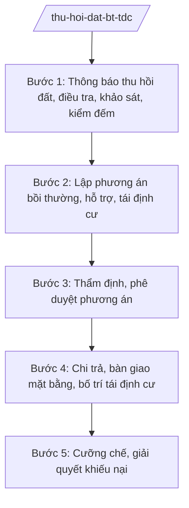

# Skill: Thu hồi đất, bồi thường, hỗ trợ, tái định cư

## 2. Khi nào dùng

- Khi Nhà nước thu hồi đất để thực hiện dự án (quốc phòng, an ninh, phát triển KT-XH vì lợi ích quốc gia, công cộng).
- Khi lập, thẩm định phương án bồi thường, hỗ trợ, tái định cư.
- Khi tổ chức chi trả, bố trí tái định cư; cưỡng chế thu hồi đất.
- Khi giải quyết khiếu nại về bồi thường, hỗ trợ, tái định cư.

## 3. Đầu vào (Input)

| Trường | Mô tả | Bắt buộc |
|--------|-------|----------|
| `du_an` | Tên dự án thu hồi đất | Có |
| `dia_ban` | Xã/phường có đất bị thu hồi | Có |
| `dien_tich_thu_hoi` | Diện tích, loại đất thu hồi | Có |
| `doi_tuong_bi_anh_huong` | Hộ gia đình, cá nhân, tổ chức bị ảnh hưởng | Không |
| `loai_viec` | lập phương án / thẩm định / chi trả / cưỡng chế / giải quyết KN / báo cáo | Có |

## 4. Quy trình

**Bước 1. Thông báo thu hồi đất, điều tra, khảo sát, kiểm đếm**
- Làm gì: Ban hành thông báo thu hồi đất; điều tra, khảo sát, đo đạc, kiểm đếm đất đai, tài sản trên đất.
- Dùng input: `du_an`, `dia_ban`, `dien_tich_thu_hoi`.
- Vai trò: Tổ chức làm nhiệm vụ bồi thường (Trung tâm Phát triển quỹ đất) phối hợp UBND cấp xã; AI hỗ trợ lập kế hoạch, biểu mẫu kiểm đếm — ⏱ 30–60 ngày.
- Lưu ý nghiệp vụ: Thông báo phải đến từng hộ; kiểm đếm có sự chứng kiến của người có đất bị thu hồi; niêm yết công khai kết quả.
- → Kết quả bước: Biên bản kiểm đếm + danh sách đối tượng bị ảnh hưởng.

**Bước 2. Lập phương án bồi thường, hỗ trợ, tái định cư**
- Làm gì: Lập phương án: giá bồi thường đất, tài sản; chính sách hỗ trợ (ổn định đời sống, đào tạo nghề, tìm việc); bố trí tái định cư.
- Dùng input: Kết quả bước 1, `doi_tuong_bi_anh_huong`.
- Vai trò: Tổ chức làm nhiệm vụ bồi thường lập; AI hỗ trợ tính toán theo bảng giá, chính sách — ⏱ 20–30 ngày.
- Lưu ý nghiệp vụ: Lấy ý kiến người dân về phương án (niêm yết, họp dân); giá bồi thường sát giá thị trường; tái định cư phải tốt hơn hoặc bằng nơi ở cũ.
- → Kết quả bước: Dự thảo phương án bồi thường, hỗ trợ, tái định cư + biên bản lấy ý kiến.

**Bước 3. Thẩm định, phê duyệt phương án**
- Làm gì: Sở NN&MT thẩm định phương án; trình UBND tỉnh phê duyệt (đối với dự án thuộc thẩm quyền tỉnh).
- Dùng input: Dự thảo phương án.
- Vai trò: Trưởng phòng Quản lý đất đai thẩm định; AI hỗ trợ đối chiếu chính sách — ⏱ 10 ngày.
- Lưu ý nghiệp vụ: Phương án chưa lấy ý kiến dân hoặc giá chưa sát thị trường phải yêu cầu làm lại; không phê duyệt "cho xong".
- → Kết quả bước: Quyết định phê duyệt phương án bồi thường, hỗ trợ, tái định cư.

**Bước 4. Chi trả, bàn giao mặt bằng, bố trí tái định cư**
- Làm gì: Chi trả tiền bồi thường, hỗ trợ; bàn giao nhà/lô tái định cư; vận động bàn giao mặt bằng đúng tiến độ.
- Dùng input: `loai_viec`.
- Vai trò: Tổ chức làm nhiệm vụ bồi thường + UBND cấp xã; AI hỗ trợ theo dõi tiến độ chi trả — ⏱ theo tiến độ dự án.
- Lưu ý nghiệp vụ: Chi trả công khai, có ký nhận; hỗ trợ tái định cư đầy đủ trước khi yêu cầu bàn giao; quan tâm hộ nghèo, chính sách.
- → Kết quả bước: Biên bản chi trả + biên bản bàn giao mặt bằng.

**Bước 5. Cưỡng chế, giải quyết khiếu nại**
- Làm gì: Vận động, thuyết phục; trường hợp cố tình không bàn giao sau khi đã bồi thường đúng chính sách — tham mưu cưỡng chế thu hồi đất; giải quyết khiếu nại.
- Dùng input: `loai_viec`.
- Vai trò: Ban thực hiện cưỡng chế (theo quyết định của Chủ tịch UBND tỉnh); AI hỗ trợ soạn hồ sơ cưỡng chế — ⏱ theo quy định.
- Lưu ý nghiệp vụ: Cưỡng chế là biện pháp cuối cùng — phải vận động nhiều lần, đúng trình tự; bảo đảm an toàn, không để xảy ra điểm nóng.
- → Kết quả bước: Quyết định cưỡng chế / quyết định giải quyết khiếu nại.

## Luồng quy trình (Workflow)

## 5. Đầu ra (Output)

- Thông báo thu hồi đất; biên bản kiểm đếm.
- Phương án bồi thường, hỗ trợ, tái định cư (kèm quyết định phê duyệt).
- Biên bản chi trả, bàn giao mặt bằng.
- Quyết định cưỡng chế thu hồi đất (nếu có); quyết định giải quyết khiếu nại.

**Cấu trúc output chuẩn (Quyết định phê duyệt phương án bồi thường):**
- Thể thức: tuân thủ Nghị định 30/2020/NĐ-CP về công tác văn thư.

1. Quốc hiệu "CỘNG HÒA XÃ HỘI CHỦ NGHĨA VIỆT NAM", Tiêu ngữ "Độc lập – Tự do – Hạnh phúc"; tên cơ quan (UBND tỉnh A); số, ký hiệu.
2. Tên loại: **QUYẾT ĐỊNH** — về việc phê duyệt phương án bồi thường, hỗ trợ, tái định cư dự án [tên].
3. Căn cứ pháp lý; đề nghị của Sở NN&MT.
4. **Điều 1.** Phê duyệt phương án (tổng kinh phí; nguyên tắc bồi thường, hỗ trợ; bố trí tái định cư).
5. **Điều 2.** Giao tổ chức làm nhiệm vụ bồi thường thực hiện; kinh phí từ [nguồn].
6. **Điều 3.** Hiệu lực; trách nhiệm thi hành.
7. Nơi nhận; chữ ký Chủ tịch UBND tỉnh.

## 6. Checklist nghiệm thu

- [ ] Thông báo thu hồi đến từng hộ; kiểm đếm có chứng kiến, niêm yết công khai.
- [ ] Phương án lấy ý kiến người dân; giá bồi thường sát giá thị trường.
- [ ] Tái định cư bảo đảm tốt hơn hoặc bằng nơi ở cũ.
- [ ] Chi trả công khai, có ký nhận đầy đủ.
- [ ] Cưỡng chế đúng trình tự, là biện pháp cuối cùng, bảo đảm an toàn.
- [ ] Văn bản đúng thể thức NĐ 30/2020/NĐ-CP.

## 7. Ví dụ mô phỏng

*Dữ liệu dưới đây là giả lập 100% phục vụ minh họa.*

**Input mẫu:** du_an = "Đường giao thông AB"; dia_ban = "Xã A"; dien_tich_thu_hoi = "10 ha đất nông nghiệp"; doi_tuong_bi_anh_huong = "50 hộ gia đình"; loai_viec = "lập phương án".

**Output mẫu (trích Phương án):**

> **PHƯƠNG ÁN**
> Bồi thường, hỗ trợ, tái định cư dự án Đường giao thông AB (xã A)
>
> 1. Tổng diện tích thu hồi: 10 ha đất nông nghiệp của 50 hộ gia đình, cá nhân.
> 2. Bồi thường về đất: theo giá đất cụ thể do UBND tỉnh phê duyệt, tổng dự kiến 20 tỷ đồng.
> 3. Hỗ trợ: ổn định đời sống 06 tháng; đào tạo, chuyển đổi nghề cho 80 lao động; thưởng bàn giao mặt bằng đúng tiến độ.
> 4. Tái định cư: không (các hộ còn đất ở, không phải di chuyển chỗ ở).
> 5. Tổng kinh phí: 25 tỷ đồng từ nguồn vốn dự án.
> 6. Tổ chức thực hiện: Trung tâm Phát triển quỹ đất tỉnh A phối hợp UBND xã A; thời gian chi trả trong 60 ngày kể từ ngày phê duyệt./.

## 8. Human gate

- Tổ chức làm nhiệm vụ bồi thường lập → Sở NN&MT thẩm định → Giám đốc Sở ký tờ trình → **UBND tỉnh phê duyệt** phương án.
- Cưỡng chế: **Chủ tịch UBND tỉnh quyết định** sau khi vận động không thành.

## 9. Giới hạn

- AI không tự quyết định mức bồi thường, không tự quyết định cưỡng chế.
- Không bịa số liệu kiểm đếm, giá bồi thường, ý kiến người dân.
- Không dùng văn bản hết hiệu lực làm căn cứ.

## 10. Căn cứ & lưu ý

- Nghị định 151/2025/NĐ-CP về phân định thẩm quyền chính quyền địa phương 2 cấp, phân quyền, phân cấp trong lĩnh vực đất đai.
- Thông tư 19/2025/TT-BNNMT của Bộ Nông nghiệp và Môi trường hướng dẫn chức năng, nhiệm vụ của cơ quan chuyên môn về nông nghiệp và môi trường.
- Luật Đất đai và các văn bản hướng dẫn (dẫn tên, áp dụng bản hiện hành).
- Nghị định 150/2025/NĐ-CP về tổ chức cơ quan chuyên môn thuộc UBND cấp tỉnh.
- Nghị định 30/2020/NĐ-CP về công tác văn thư (thể thức văn bản).
- Lưu ý: bồi thường, tái định cư là vấn đề nhạy cảm, dễ phát sinh khiếu kiện đông người — làm đúng, làm đủ trình tự, công khai, dân chủ ngay từ đầu.
