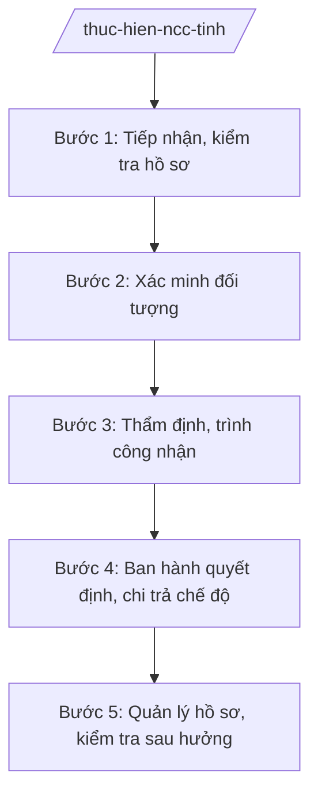

# Skill: Thực hiện chính sách người có công (cấp tỉnh)

## 2. Khi nào dùng
- Xác nhận, công nhận người có công với cách mạng và thân nhân.
- Giải quyết chế độ trợ cấp hằng tháng, trợ cấp một lần, ưu đãi (y tế, giáo dục, nhà ở...).
- Quản lý, rà soát hồ sơ người có công; xử lý hồ sơ giả, trục lợi chính sách.

## 3. Đầu vào (Input)
| Trường | Mô tả | Bắt buộc |
|--------|-------|----------|
| `doi_tuong` | Người đề nghị xác nhận / hưởng chế độ (thông tin cá nhân, quá trình) | Có |
| `loai_che_do` | Loại chế độ đề nghị (xác nhận / trợ cấp hằng tháng / một lần / ưu đãi) | Có |
| `ho_so_giay_to` | Giấy tờ chứng minh (quyết định, huân huy chương, lý lịch...) | Có |
| `ket_qua_xac_minh` | Kết quả xác minh tại địa phương, đơn vị cũ | Không |
| `che_do_hien_huong` | Chế độ đang hưởng (nếu có) | Không |

## 4. Quy trình

**Bước 1. Tiếp nhận, kiểm tra hồ sơ**
- Làm gì: Tiếp nhận hồ sơ tại bộ phận một cửa (Sở Nội vụ hoặc UBND cấp xã chuyển lên); kiểm tra tính đầy đủ, hợp lệ.
- Dùng input: `doi_tuong`, `ho_so_giay_to`, `loai_che_do`
- Vai trò: Chuyên viên Phòng Người có công (Sở Nội vụ tỉnh A) kiểm tra; AI hỗ trợ checklist hồ sơ theo từng loại chế độ ⏱ ~1 ngày làm việc (ước tính)
- Lưu ý nghiệp vụ: Hướng dẫn bổ sung một lần, đầy đủ; không yêu cầu giấy tờ ngoài quy định.
- → Kết quả bước: Giấy tiếp nhận / văn bản hướng dẫn bổ sung.

**Bước 2. Xác minh đối tượng**
- Làm gì: Xác minh quá trình tham gia cách mạng, công tác qua địa phương, đơn vị cũ, nhân chứng; đối chiếu tiêu chuẩn từng đối tượng.
- Dùng input: `ket_qua_xac_minh`, `ho_so_giay_to`
- Vai trò: Chuyên viên phối hợp UBND cấp xã, cơ quan liên quan xác minh; AI hỗ trợ lập phiếu xác minh ⏱ ~10 ngày làm việc (ước tính)
- Lưu ý nghiệp vụ: Xác minh khách quan, thận trọng; đặc biệt cảnh giác hồ sơ giả, khai man để trục lợi.
- → Kết quả bước: Biên bản xác minh.

**Bước 3. Thẩm định, trình công nhận**
- Làm gì: Thẩm định hồ sơ, lập tờ trình đề nghị công nhận người có công / giải quyết chế độ; trình cấp có thẩm quyền.
- Dùng input: Biên bản xác minh Bước 2
- Vai trò: Trưởng phòng Người có công kiểm tra; Giám đốc Sở Nội vụ ký tờ trình; AI hỗ trợ soạn văn bản ⏱ ~5 ngày làm việc (ước tính)
- Lưu ý nghiệp vụ: Đúng đối tượng, đúng chế độ; hồ sơ không đủ căn cứ thì từ chối bằng văn bản nêu rõ lý do.
- → Kết quả bước: Tờ trình + dự thảo quyết định.

**Bước 4. Ban hành quyết định, chi trả chế độ**
- Làm gì: Ban hành quyết định công nhận / hưởng chế độ; chuyển cơ quan chi trả (bảo hiểm xã hội, kho bạc); cấp giấy chứng nhận.
- Dùng input: Quyết định đã ký
- Vai trò: Cấp có thẩm quyền quyết định; AI hỗ trợ lập danh sách chi trả ⏱ ~5 ngày làm việc (ước tính)
- Lưu ý nghiệp vụ: Chi trả đúng đối tượng, đúng mức, kịp thời; công khai danh sách tại địa phương.
- → Kết quả bước: Quyết định + danh sách chi trả chế độ.

**Bước 5. Quản lý hồ sơ, kiểm tra sau hưởng**
- Làm gì: Lưu trữ hồ sơ người có công; kiểm tra định kỳ, đột xuất; xử lý thu hồi khi phát hiện hưởng sai.
- Dùng input: Hồ sơ đã giải quyết
- Vai trò: Chuyên viên quản lý; AI hỗ trợ rà soát dữ liệu, phát hiện bất thường ⏱ định kỳ (ước tính)
- Lưu ý nghiệp vụ: Kiên quyết thu hồi, xử lý vi phạm đối với hồ sơ giả; bảo vệ quyền lợi người có công thật sự.
- → Kết quả bước: Cơ sở dữ liệu người có công; báo cáo kiểm tra.

## Luồng quy trình (Workflow)

## 5. Đầu ra (Output)
- Quyết định công nhận người có công / giải quyết chế độ.
- Danh sách chi trả trợ cấp.
- Cơ sở dữ liệu người có công của tỉnh.

**Cấu trúc output chuẩn:**
- Thể thức: tuân thủ Nghị định 30/2020/NĐ-CP về công tác văn thư.
Khung quyết định giải quyết chế độ:
1. Quốc hiệu "CỘNG HÒA XÃ HỘI CHỦ NGHĨA VIỆT NAM", Tiêu ngữ "Độc lập – Tự do – Hạnh phúc"; số, ký hiệu; địa danh, ngày tháng năm.
2. Tên: "QUYẾT ĐỊNH về việc giải quyết chế độ ... đối với ông/bà ...".
3. Căn cứ pháp lý.
4. Điều 1: Công nhận / giải quyết chế độ ...; mức hưởng ...
5. Điều 2: Trách nhiệm thi hành.
6. Chữ ký; đóng dấu.
- Nơi nhận: liệt kê các cơ quan, đơn vị nhận để biết/thực hiện; kết thúc bằng "- Lưu: VT, [mã đơn vị]".

> **Checklist thể thức văn bản theo NĐ 30/2020/NĐ-CP** — đối chiếu trước khi trình ký:
> 1. Quốc hiệu và Tiêu ngữ.
> 2. Tên cơ quan, tổ chức ban hành văn bản.
> 3. Số, ký hiệu của văn bản.
> 4. Địa danh và thời gian ban hành văn bản.
> 5. Tên loại và trích yếu nội dung văn bản.
> 6. Nội dung văn bản.
> 7. Chức vụ, họ tên và chữ ký của người có thẩm quyền.
> 8. Dấu, chữ ký số của cơ quan, tổ chức.
> 9. Nơi nhận (kèm Phụ lục nếu có).

## 6. Checklist nghiệm thu
- [ ] Hồ sơ đầy đủ, giấy tờ hợp lệ.
- [ ] Đã xác minh khách quan tại địa phương, đơn vị.
- [ ] Đúng đối tượng, đúng chế độ, đúng mức hưởng.
- [ ] Đúng thẩm quyền quyết định.
- [ ] Quyết định đúng thể thức NĐ 30/2020/NĐ-CP.
- [ ] Chi trả đúng đối tượng, kịp thời, công khai.
- [ ] Hồ sơ lưu trữ đầy đủ; có kiểm tra sau hưởng.

## 7. Ví dụ mô phỏng
*Dữ liệu dưới đây là giả lập 100% phục vụ minh họa.*

**Input mẫu:**
- doi_tuong: Ông Nguyễn Văn H, sinh năm 1950, xã A, tỉnh A (giả lập)
- loai_che_do: Xác nhận thương binh và hưởng trợ cấp hằng tháng
- ho_so_giay_to: Giấy chứng nhận bị thương, lý lịch quân nhân (giả lập)

**Output mẫu (trích quyết định):**
> **QUYẾT ĐỊNH**
> **Về việc công nhận và giải quyết chế độ đối với ông Nguyễn Văn H**
>
> Điều 1. Công nhận ông Nguyễn Văn H là thương binh hạng 3/4, được hưởng trợ cấp hằng tháng từ ngày ...
> (Dữ liệu giả lập 100% phục vụ minh họa)

## 8. Human gate
- Trưởng phòng Người có công: kiểm tra xác minh và thẩm định (Bước 2–3).
- Giám đốc Sở Nội vụ: ký tờ trình (Bước 3).
- Cấp có thẩm quyền: quyết định công nhận, giải quyết chế độ.

## 9. Giới hạn
- AI không thay cơ quan nhà nước quyết định công nhận hay từ chối hồ sơ.
- Không bịa giấy tờ, quá trình công tác của đối tượng.
- Không "làm nhanh" hồ sơ thiếu căn cứ; kiên quyết với hồ sơ giả.
- Bảo mật thông tin cá nhân của đối tượng chính sách.

## 10. Căn cứ & lưu ý
- TT 10/2025/TT-BNV (Sở Nội vụ: người có công).
- Pháp lệnh Ưu đãi người có công với cách mạng — dẫn tên, tra cứu bản hiện hành khi áp dụng.
