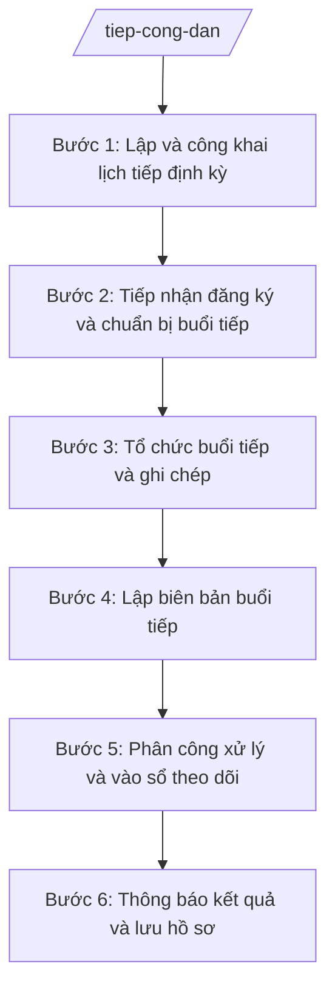

# Skill: Tổ chức tiếp công dân

## Khi nào dùng

- Chuẩn bị lịch tiếp công dân định kỳ hằng tuần/tháng của Chủ tịch UBND xã và công khai tại trụ sở.
- Tổ chức tiếp công dân đột xuất khi phát sinh vụ việc phức tạp, đông người hoặc vượt cấp.
- Lập biên bản buổi tiếp công dân làm căn cứ theo dõi, xử lý và trả lời công dân.
- Cập nhật sổ theo dõi tiếp công dân; rà soát vụ việc đã tiếp nhưng chưa được giải quyết dứt điểm.
- Soạn thông báo kết luận sau buổi tiếp gửi công dân và đơn vị được giao xử lý.

## Đầu vào (Input)

| Trường | Mô tả | Bắt buộc |
|--------|-------|----------|
| `Hình thức tiếp` | Định kỳ / Đột xuất | Có |
| `Ngày giờ tiếp` | Ngày, giờ, buổi tiếp dự kiến | Có |
| `Địa điểm` | Phòng tiếp công dân hoặc địa điểm khác | Có |
| `Người chủ trì` | Chủ tịch / Phó Chủ tịch UBND xã | Có |
| `Thành phần tham dự` | Cán bộ, công chức, đại diện đơn vị liên quan | Có |
| `Người được tiếp` | Họ tên, địa chỉ, giấy tờ tùy thân của công dân | Có |
| `Nội dung vụ việc` | Tóm tắt nội dung công dân trình bày hoặc dự kiến trình bày | Có |
| `Hồ sơ kèm theo` | Đơn thư, giấy tờ liên quan công dân cung cấp (nếu có) | Không |
| `Lịch sử tiếp trước` | Kết quả các lần tiếp trước của cùng vụ việc (nếu có) | Không |

## Quy trình

**Bước 1. Lập và công khai lịch tiếp định kỳ**

- Làm gì: Dự thảo lịch tiếp công dân định kỳ của Chủ tịch UBND xã (ngày cố định trong tuần hoặc tháng), trình ký ban hành, niêm yết tại trụ sở UBND xã và thông báo trên hệ thống thông tin cơ sở.
- Dùng input: `Hình thức tiếp`, `Ngày giờ tiếp`, `Địa điểm`, `Người chủ trì`.
- Vai trò: Công chức Văn phòng HĐND&UBND soạn lịch (AI hỗ trợ soạn thảo thông báo lịch, kiểm tra trùng với lịch họp, lịch công tác của lãnh đạo); Chánh Văn phòng kiểm tra; Chủ tịch UBND xã duyệt. Thời gian ước tính: 0,5 ngày làm việc.
- Lưu ý nghiệp vụ: Lịch tiếp phải cố định, công khai để người dân biết; bố trí khung giờ hợp lý, tránh trùng lịch công tác của người chủ trì.
- → Kết quả bước: Thông báo lịch tiếp công dân định kỳ đã ký duyệt và đã niêm yết.

**Bước 2. Tiếp nhận đăng ký và chuẩn bị buổi tiếp**

- Làm gì: Ghi nhận đăng ký tiếp (trực tiếp, điện thoại); tổng hợp danh sách người đăng ký; thu thập trước nội dung vụ việc và hồ sơ liên quan; chuẩn bị phòng tiếp, sổ ghi chép, biên bản mẫu.
- Dùng input: `Người được tiếp`, `Nội dung vụ việc`, `Hồ sơ kèm theo`, `Lịch sử tiếp trước`.
- Vai trò: Công chức Văn phòng HĐND&UBND tiếp nhận và chuẩn bị (AI hỗ trợ tổng hợp danh sách đăng ký, tóm tắt nội dung vụ việc từ đơn thư kèm theo, tra cứu lịch sử tiếp trước của cùng vụ việc). Thời gian ước tính: 0,5–1 ngày trước buổi tiếp.
- Lưu ý nghiệp vụ: Ưu tiên người cao tuổi, người khuyết tật; trường hợp đông người cùng vụ việc thì hướng dẫn cử đại diện; vụ việc đã có kết quả giải quyết cuối cùng thì giải thích, không tiếp lại cùng nội dung.
- → Kết quả bước: Danh sách người đăng ký tiếp kèm tóm tắt nội dung từng vụ việc.

**Bước 3. Tổ chức buổi tiếp và ghi chép**

- Làm gì: Đón tiếp, kiểm tra giấy tờ tùy thân của công dân; điều hành buổi tiếp theo trình tự; ghi chép đầy đủ diễn biến: nội dung công dân trình bày, ý kiến của người chủ trì và các thành phần tham dự.
- Dùng input: `Người được tiếp`, `Nội dung vụ việc`, `Thành phần tham dự`.
- Vai trò: `Người chủ trì` (Chủ tịch/Phó Chủ tịch UBND xã) điều hành buổi tiếp; công chức Văn phòng ghi chép trực tiếp (AI hỗ trợ chuyển ghi âm thành văn bản nháp để đối chiếu — nội dung chính thức vẫn do công chức xác nhận). ⏱ ~theo thời lượng buổi tiếp thực tế (ước tính).
- Lưu ý nghiệp vụ: Giữ thái độ đúng mực, lắng nghe đầy đủ; không hứa hẹn, cam kết vượt thẩm quyền; ghi chép trung thực, khách quan, không thêm bớt ý của công dân.
- → Kết quả bước: Bản ghi chép nháp diễn biến buổi tiếp.

**Bước 4. Lập biên bản buổi tiếp**

- Làm gì: Soạn biên bản buổi tiếp công dân: thời gian, địa điểm, thành phần, nội dung trình bày, ý kiến trao đổi, kết luận của người chủ trì; đọc lại cho các bên nghe và ký xác nhận.
- Dùng input: Tất cả các trường Input (tổng hợp từ bước 1–3).
- Vai trò: Công chức Văn phòng soạn (AI hỗ trợ dựng biên bản từ bản ghi chép theo đúng cấu trúc chuẩn, kiểm tra đủ các phần bắt buộc); Chánh Văn phòng kiểm tra; người chủ trì, người ghi biên bản và công dân ký. Thời gian ước tính: 1 giờ sau buổi tiếp.
- Lưu ý nghiệp vụ: Kết luận phải rõ ràng: thụ lý giải quyết / chuyển cơ quan có thẩm quyền / hướng dẫn công dân / từ chối có lý do; ghi rõ thời hạn trả lời; biên bản là căn cứ pháp lý để theo dõi xử lý sau này.
- → Kết quả bước: Biên bản buổi tiếp công dân đã ký xác nhận.

**Bước 5. Phân công xử lý và vào sổ theo dõi**

- Làm gì: Chuyển nội dung kết luận cho phòng/ban/công chức liên quan xử lý; ghi vào sổ theo dõi tiếp công dân (mã số vụ việc, nội dung, đơn vị xử lý, thời hạn); đặt lịch kiểm tra tiến độ.
- Dùng input: `Nội dung vụ việc`, kết luận buổi tiếp (từ biên bản).
- Vai trò: Chánh Văn phòng đề xuất phân công (AI hỗ trợ gợi ý đầu mối xử lý theo lĩnh vực, lập phiếu theo dõi có thời hạn); Chủ tịch UBND xã phê duyệt phân công. Thời gian ước tính: 0,5 ngày làm việc.
- Lưu ý nghiệp vụ: Vụ việc thuộc thẩm quyền cấp trên thì chuyển theo quy định và thông báo cho công dân biết nơi chuyển; không để vụ việc "treo" không có đầu mối xử lý.
- → Kết quả bước: Phiếu phân công xử lý + dòng ghi trong sổ theo dõi tiếp công dân.

**Bước 6. Thông báo kết quả và lưu hồ sơ**

- Làm gì: Soạn thông báo kết luận buổi tiếp gửi công dân và đơn vị liên quan; khi có kết quả xử lý, thông báo cho công dân; lưu toàn bộ hồ sơ buổi tiếp theo quy định lưu trữ.
- Dùng input: Kết luận buổi tiếp, `Người được tiếp`.
- Vai trò: Công chức Văn phòng soạn thông báo (AI hỗ trợ soạn thảo); Chánh Văn phòng kiểm tra; Chủ tịch UBND xã ký. Thời gian ước tính: 1 ngày làm việc.
- Lưu ý nghiệp vụ: Thông báo phải nêu rõ nội dung kết luận, đơn vị xử lý, thời hạn trả lời; hồ sơ lưu đầy đủ để tra cứu khi công dân đến tiếp lại cùng vụ việc.
- → Kết quả bước: Thông báo kết luận buổi tiếp đã phát hành; hồ sơ buổi tiếp được lưu trữ hoàn chỉnh.

## Luồng quy trình (Workflow)

## Đầu ra (Output)

- Thông báo lịch tiếp công dân định kỳ (đã ký, đã niêm yết).
- Danh sách đăng ký tiếp công dân kèm tóm tắt nội dung vụ việc.
- Biên bản buổi tiếp công dân (sản phẩm chính).
- Phiếu phân công xử lý sau tiếp.
- Sổ theo dõi tiếp công dân (cập nhật liên tục).
- Thông báo kết luận buổi tiếp gửi công dân và đơn vị liên quan.

### Cấu trúc output chuẩn

**BIÊN BẢN BUỔI TIẾP CÔNG DÂN** — các phần bắt buộc theo đúng thứ tự, đúng thể thức văn bản hành chính theo NĐ 30/2020/NĐ-CP:

1. Quốc hiệu "CỘNG HÒA XÃ HỘI CHỦ NGHĨA VIỆT NAM" – Tiêu ngữ "Độc lập – Tự do – Hạnh phúc".
2. Tên văn bản: BIÊN BẢN BUỔI TIẾP CÔNG DÂN; số biên bản; ngày lập biên bản.
3. Thời gian tiếp (giờ, ngày, tháng, năm); địa điểm tiếp.
4. Thành phần: người chủ trì (họ tên, chức vụ); người ghi biên bản (họ tên, chức vụ); người được tiếp (họ tên, địa chỉ, giấy tờ tùy thân); các thành phần tham dự khác.
5. Nội dung công dân trình bày (ghi trung thực, đầy đủ).
6. Ý kiến trao đổi của người chủ trì và các thành phần tham dự.
7. Kết luận của người chủ trì: hướng xử lý (thụ lý giải quyết / chuyển cơ quan có thẩm quyền / hướng dẫn / từ chối có lý do), đơn vị thực hiện, thời hạn trả lời.
8. Biên bản được đọc lại cho các bên nghe; chữ ký của người chủ trì, người ghi biên bản, người được tiếp; đóng dấu (nếu có).
9. Phân phối: 01 bản biên bản giao công dân (khi có yêu cầu); đơn vị được phân công xử lý; lưu sổ theo dõi tiếp công dân.

> **Checklist thể thức văn bản theo NĐ 30/2020/NĐ-CP** — đối chiếu trước khi trình ký:
> 1. Quốc hiệu và Tiêu ngữ.
> 2. Tên cơ quan, tổ chức ban hành văn bản.
> 3. Số, ký hiệu của văn bản.
> 4. Địa danh và thời gian ban hành văn bản.
> 5. Tên loại và trích yếu nội dung văn bản.
> 6. Nội dung văn bản.
> 7. Chức vụ, họ tên và chữ ký của người có thẩm quyền.
> 8. Dấu, chữ ký số của cơ quan, tổ chức.
> 9. Nơi nhận (kèm Phụ lục nếu có).

## Checklist nghiệm thu

1. Lịch tiếp định kỳ đã được ký duyệt và niêm yết công khai đúng thời hạn.
2. Danh sách đăng ký có đủ họ tên, địa chỉ, nội dung vụ việc của từng người.
3. Biên bản ghi đúng thời gian, địa điểm, thành phần của buổi tiếp thực tế.
4. Nội dung công dân trình bày được ghi trung thực, không thêm bớt, không suy diễn.
5. Kết luận nêu rõ hướng xử lý, đơn vị thực hiện và thời hạn cụ thể.
6. Biên bản có đủ chữ ký: người chủ trì, người ghi biên bản, người được tiếp.
7. Mọi vụ việc đã được phân công đầu mối xử lý và ghi vào sổ theo dõi, không sót.
8. Thể thức văn bản đúng NĐ 30/2020/NĐ-CP; không bịa đặt số hiệu văn bản pháp luật.

## Ví dụ mô phỏng

*Dữ liệu dưới đây là giả lập 100% phục vụ minh họa.*

**Input mẫu:**

| Trường | Giá trị mẫu |
|--------|-------------|
| Hình thức tiếp | Định kỳ |
| Ngày giờ tiếp | 08 giờ 00, ngày 15/10/2026 |
| Địa điểm | Phòng tiếp công dân, trụ sở UBND xã A |
| Người chủ trì | Ông Nguyễn Văn A — Chủ tịch UBND xã A |
| Thành phần tham dự | Ông Phạm Văn C — Chánh Văn phòng HĐND&UBND xã A; công chức địa chính — xây dựng |
| Người được tiếp | Ông Nguyễn Văn Dân, địa chỉ: thôn 1, xã A, tỉnh A; SĐT: 0900 000 001 |
| Nội dung vụ việc | Kiến nghị xã sửa chữa 500 m đường giao thông thôn 1 bị hư hỏng sau mùa mưa |
| Hồ sơ kèm theo | Đơn kiến nghị của 20 hộ dân thôn 1 (có chữ ký) |
| Lịch sử tiếp trước | Chưa từng tiếp vụ việc này |

**Output mẫu (Biên bản buổi tiếp công dân):**

CỘNG HÒA XÃ HỘI CHỦ NGHĨA VIỆT NAM
Độc lập – Tự do – Hạnh phúc

**BIÊN BẢN BUỔI TIẾP CÔNG DÂN**
Số: 10/BB-TD · Xã A, ngày 15 tháng 10 năm 2026

1. Thời gian: 08 giờ 00 phút, ngày 15/10/2026.
2. Địa điểm: Phòng tiếp công dân, trụ sở UBND xã A, tỉnh A.
3. Thành phần:
   - Người chủ trì: Ông Nguyễn Văn A — Chủ tịch UBND xã A.
   - Người ghi biên bản: Ông Phạm Văn C — Chánh Văn phòng HĐND và UBND xã A.
   - Người được tiếp: Ông Nguyễn Văn Dân — đại diện 20 hộ dân thôn 1, xã A, tỉnh A.
   - Tham dự: công chức địa chính — xây dựng xã A.
4. Nội dung công dân trình bày: Ông Nguyễn Văn Dân trình bày kiến nghị UBND xã A sửa chữa khoảng 500 m đường giao thông thôn 1 bị hư hỏng, sụt lún sau mùa mưa, ảnh hưởng việc đi lại của khoảng 100 nhân khẩu; kèm đơn kiến nghị có chữ ký của 20 hộ dân.
5. Ý kiến trao đổi: Công chức địa chính — xây dựng báo cáo đã khảo sát hiện trạng, đoạn đường thuộc danh mục duy tu năm 2026 của xã.
6. Kết luận của người chủ trì: Giao Phòng Kinh tế xã A chủ trì, phối hợp thôn 1 lập phương án sửa chữa, báo cáo UBND xã trước ngày 30/10/2026; Văn phòng HĐND&UBND thông báo kết quả cho ông Nguyễn Văn Dân.
7. Biên bản được đọc lại cho các bên nghe, cùng thống nhất ký tên.

NGƯỜI CHỦ TRÌ · NGƯỜI GHI BIÊN BẢN · NGƯỜI ĐƯỢC TIẾP
(Ký, ghi rõ họ tên) · (Ký, ghi rõ họ tên) · (Ký, ghi rõ họ tên)

## Human gate

- Công chức Văn phòng HĐND&UBND soạn thảo (lịch tiếp, biên bản, thông báo) → Chánh Văn phòng kiểm tra nội dung và thể thức → Chủ tịch UBND xã ký duyệt trước khi ban hành.
- Sổ theo dõi tiếp công dân do Chánh Văn phòng xác nhận định kỳ hằng tháng; Chủ tịch UBND xã kiểm tra đột xuất khi cần.

## Giới hạn

- AI không thay người chủ trì điều hành buổi tiếp công dân; không tiếp xúc, hứa hẹn với công dân thay lãnh đạo.
- AI không kết luận đúng/sai nội dung khiếu nại, tố cáo của công dân; không đưa ra cam kết về kết quả giải quyết.
- AI không tự ký, tự phát hành biên bản, thông báo; mọi văn bản phải qua người có thẩm quyền ký.
- AI không bịa đặt số hiệu, ngày ban hành của văn bản pháp luật; không viện dẫn văn bản đã hết hiệu lực.

## Căn cứ & lưu ý

- NĐ 150/2025/NĐ-CP: quy định tổ chức cơ quan chuyên môn thuộc UBND cấp xã; Văn phòng HĐND và UBND là đầu mối tham mưu lĩnh vực văn phòng, trong đó có công tác tiếp công dân.
- NĐ 30/2020/NĐ-CP: thể thức và kỹ thuật trình bày văn bản hành chính (áp dụng cho biên bản, thông báo).
- Nội dung về trình tự, thủ tục tiếp công dân thực hiện theo quy định pháp luật về tiếp công dân (không gắn số hiệu cụ thể do chưa xác thực trong tài liệu).
