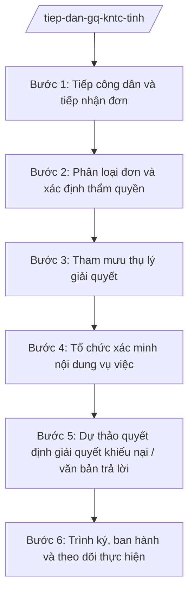

# Skill: Tiếp dân, tham mưu giải quyết KNTC thuộc thẩm quyền Chủ tịch UBND tỉnh

## 2. Khi nào dùng

- Tổ chức tiếp công dân định kỳ, đột xuất tại trụ sở tiếp công dân của tỉnh.
- Tiếp nhận, phân loại đơn khiếu nại, tố cáo, kiến nghị, phản ánh gửi đến UBND tỉnh, Chủ tịch UBND tỉnh.
- Xác định đơn thuộc thẩm quyền giải quyết của Chủ tịch UBND tỉnh (khiếu nại lần 2, tố cáo thuộc thẩm quyền) hay phải chuyển cơ quan có thẩm quyền.
- Tham mưu thụ lý giải quyết: lập kế hoạch xác minh, thành lập tổ công tác, làm việc với sở, ngành, UBND xã liên quan.
- Dự thảo quyết định giải quyết khiếu nại (lần 2), văn bản trả lời tố cáo trình Chủ tịch UBND tỉnh ký ban hành.
- Đôn đốc, theo dõi thời hạn giải quyết các vụ việc khiếu nại, tố cáo phức tạp, kéo dài.

## 3. Đầu vào (Input)

| Trường | Mô tả | Bắt buộc |
|--------|-------|----------|
| `Đơn thư của công dân` | Đơn khiếu nại/tố cáo/kiến nghị/phản ánh (trực tiếp, bưu điện, trực tuyến) | Có |
| `Thông tin người gửi` | Họ tên, địa chỉ, số điện thoại, giấy tờ tùy thân (khi tiếp trực tiếp) | Có (đơn nặc danh ghi "Không rõ") |
| `Nội dung vụ việc` | Tóm tắt sự việc, yêu cầu của công dân; quyết định hành chính bị khiếu nại (nếu có) | Có |
| `Lịch sử giải quyết` | Quyết định giải quyết khiếu nại lần 1, văn bản trả lời trước đây (nếu có) | Không |
| `Hồ sơ vụ việc` | Tài liệu, chứng cứ kèm theo; hồ sơ của sở, ngành, UBND xã liên quan | Không |
| `Ý kiến cơ quan liên quan` | Ý kiến của sở, ban, ngành, UBND xã về nội dung vụ việc | Không |

## 4. Quy trình

**Bước 1. Tiếp công dân và tiếp nhận đơn**

- **Làm gì**: Tổ chức tiếp công dân theo lịch (định kỳ có lãnh đạo UBND tỉnh, Thanh tra tỉnh; thường xuyên có công chức tiếp dân); ghi sổ tiếp công dân: họ tên, nội dung trình bày, yêu cầu; tiếp nhận đơn kèm tài liệu, cấp giấy biên nhận.
- **Dùng input**: `Đơn thư của công dân`, `Thông tin người gửi`, `Nội dung vụ việc`.
- **Vai trò**: Công chức Ban Tiếp công dân/Thanh tra tỉnh tiếp dân, ghi sổ (AI hỗ trợ trích xuất thông tin, soạn biên bản tiếp công dân, cấp mã số theo dõi). Thời gian ước tính: trong ngày tiếp dân.
- **Lưu ý nghiệp vụ**: Thái độ tiếp dân đúng mực, lắng nghe đầy đủ; không hứa hẹn kết quả giải quyết; đơn tố cáo phải bảo mật tuyệt đối thông tin người tố cáo.
- **→ Kết quả bước**: Sổ tiếp công dân; biên bản tiếp công dân; giấy biên nhận đơn.

**Bước 2. Phân loại đơn và xác định thẩm quyền**

- **Làm gì**: Phân loại đơn: khiếu nại, tố cáo, kiến nghị, phản ánh; đối chiếu với thẩm quyền: khiếu nại đã có quyết định giải quyết lần 1 → thuộc thẩm quyền giải quyết lần 2 của Chủ tịch UBND tỉnh; tố cáo hành vi vi phạm thuộc thẩm quyền Chủ tịch UBND tỉnh → thụ lý; đơn thuộc thẩm quyền sở, UBND xã hoặc cơ quan trung ương → chuyển.
- **Dùng input**: Đơn thư, `Nội dung vụ việc`, `Lịch sử giải quyết`.
- **Vai trò**: Chuyên viên phân loại (AI hỗ trợ gợi ý phân loại và tra cứu thẩm quyền theo lĩnh vực từ chuỗi 28 nghị định 120–152/2025/NĐ-CP và NĐ 141/2025/NĐ-CP; chuyên viên quyết định phân loại cuối cùng). Thời gian ước tính: 2 ngày làm việc.
- **Lưu ý nghiệp vụ**: AI chỉ gợi ý, không kết luận thẩm quyền thay người; phân biệt rõ khiếu nại lần 2 (thuộc Chủ tịch UBND tỉnh) với khiếu nại lần đầu thuộc sở, UBND xã.
- **→ Kết quả bước**: Phiếu phân loại đơn kèm đề xuất: thụ lý tại tỉnh / chuyển cơ quan có thẩm quyền.

**Bước 3. Tham mưu thụ lý giải quyết**

- **Làm gì**: Đối với đơn thuộc thẩm quyền Chủ tịch UBND tỉnh: soạn dự thảo văn bản thụ lý giải quyết; lập kế hoạch xác minh (nội dung, thời gian, đơn vị phối hợp); đề xuất thành lập tổ công tác xác minh khi vụ việc phức tạp; thông báo thụ lý cho người khiếu nại/tố cáo.
- **Dùng input**: Phiếu phân loại đơn (bước 2), `Hồ sơ vụ việc`.
- **Vai trò**: Chuyên viên soạn thảo (AI hỗ trợ soạn văn bản thụ lý, lập kế hoạch xác minh, tính thời hạn giải quyết theo loại vụ việc); Trưởng phòng thẩm định; Chánh Thanh tra tỉnh trình Chủ tịch UBND tỉnh. Thời gian ước tính: 5 ngày làm việc.
- **Lưu ý nghiệp vụ**: Thụ lý phải đúng thời hạn quy định; kế hoạch xác minh phải cụ thể, khả thi; thông báo cho người dân biết vụ việc đã được thụ lý và thời hạn giải quyết.
- **→ Kết quả bước**: Văn bản thụ lý giải quyết; kế hoạch xác minh; quyết định thành lập tổ công tác (nếu có).

**Bước 4. Tổ chức xác minh nội dung vụ việc**

- **Làm gì**: Tổ công tác làm việc với người khiếu nại/tố cáo, đối tượng bị khiếu nại/tố cáo; thu thập tài liệu, chứng cứ; làm việc với sở, ban, ngành, UBND xã liên quan; lập biên bản xác minh từng nội dung.
- **Dùng input**: Kế hoạch xác minh (bước 3), `Hồ sơ vụ việc`, `Ý kiến cơ quan liên quan`.
- **Vai trò**: Tổ công tác xác minh (do Thanh tra tỉnh chủ trì, có sở, ngành, UBND xã liên quan tham gia); chuyên viên tổng hợp (AI hỗ trợ hệ thống hóa biên bản, đối chiếu các nguồn chứng cứ, phát hiện mâu thuẫn cần xác minh bổ sung). Thời gian ước tính: 15–30 ngày làm việc tùy vụ việc.
- **Lưu ý nghiệp vụ**: Xác minh khách quan, toàn diện; mọi nội dung trong dự thảo quyết định sau này phải có chứng cứ; bảo mật thông tin người tố cáo trong suốt quá trình.
- **→ Kết quả bước**: Biên bản xác minh; báo cáo kết quả xác minh của tổ công tác.

**Bước 5. Dự thảo quyết định giải quyết khiếu nại / văn bản trả lời**

- **Làm gì**: Soạn dự thảo quyết định giải quyết khiếu nại lần 2 (giữ nguyên, sửa đổi một phần/toàn bộ, hủy quyết định lần 1...) hoặc văn bản kết luận nội dung tố cáo; thẩm định pháp chế nội dung dự thảo.
- **Dùng input**: Báo cáo kết quả xác minh (bước 4), `Lịch sử giải quyết`, quy định pháp luật liên quan còn hiệu lực.
- **Vai trò**: Chuyên viên soạn dự thảo (AI hỗ trợ dựng khung quyết định, rà soát viện dẫn pháp lý, kiểm tra tính logic giữa nội dung xác minh và nội dung quyết định); Trưởng phòng và Chánh Thanh tra tỉnh thẩm định. Thời gian ước tính: 7 ngày làm việc.
- **Lưu ý nghiệp vụ**: AI hỗ trợ soạn thảo, không kết luận đúng/sai vụ việc thay người có thẩm quyền; quyết định phải nêu rõ quyền khiếu nại tiếp/khởi kiện hành chính của công dân.
- **→ Kết quả bước**: Dự thảo quyết định giải quyết khiếu nại / văn bản kết luận tố cáo (đã thẩm định).

**Bước 6. Trình ký, ban hành và theo dõi thực hiện**

- **Làm gì**: Trình Chánh Thanh tra ký tờ trình, Chủ tịch UBND tỉnh ký ban hành quyết định; gửi quyết định cho người khiếu nại, cơ quan, tổ chức, cá nhân liên quan; đôn đốc thực hiện quyết định; tổng hợp báo cáo tình hình giải quyết KNTC định kỳ và đột xuất.
- **Dùng input**: Dự thảo quyết định đã thẩm định (bước 5).
- **Vai trò**: Chánh Thanh tra tỉnh trình (AI hỗ trợ rà soát hồ sơ trình, theo dõi thời hạn giải quyết, tổng hợp số liệu báo cáo); Chủ tịch UBND tỉnh ký ban hành quyết định. Thời gian ước tính: 5 ngày làm việc.
- **Lưu ý nghiệp vụ**: Quyết định giải quyết khiếu nại có hiệu lực thi hành; đơn vị không thực hiện phải bị xử lý theo quy định; vụ việc phức tạp, kéo dài phải báo cáo cấp trên theo quy định.
- **→ Kết quả bước**: Quyết định giải quyết khiếu nại đã ban hành; báo cáo đôn đốc thực hiện.

## Luồng quy trình (Workflow)

## 5. Đầu ra (Output)

- Sổ tiếp công dân, biên bản tiếp công dân.
- Phiếu phân loại đơn thư KNTC.
- Văn bản thụ lý giải quyết khiếu nại/tố cáo.
- Kế hoạch xác minh, báo cáo kết quả xác minh.
- Tờ trình + dự thảo quyết định giải quyết khiếu nại (sản phẩm chính).
- Báo cáo tình hình giải quyết KNTC định kỳ.

**Cấu trúc output chuẩn:**

**QUYẾT ĐỊNH GIẢI QUYẾT KHIẾU NẠI (LẦN 2)** — các phần bắt buộc theo đúng thứ tự, đúng thể thức văn bản hành chính theo NĐ 30/2020/NĐ-CP:

1. Quốc hiệu "CỘNG HÒA XÃ HỘI CHỦ NGHĨA VIỆT NAM", Tiêu ngữ "Độc lập – Tự do – Hạnh phúc".
2. Tên cơ quan ban hành: ỦY BAN NHÂN DÂN TỈNH A. Số, ký hiệu văn bản; địa danh và thời gian ban hành.
3. Tên loại và trích yếu: QUYẾT ĐỊNH — Về việc giải quyết khiếu nại của ông/bà ... (lần 2).
4. Căn cứ ban hành (quyết định giải quyết lần 1; NĐ 141/2025/NĐ-CP; quy định pháp luật về khiếu nại còn hiệu lực...).
5. Họ tên, địa chỉ người khiếu nại; quyết định hành chính/hành vi hành chính bị khiếu nại; nội dung khiếu nại; yêu cầu của người khiếu nại.
6. Kết quả xác minh nội dung khiếu nại.
7. Kết luận: khiếu nại đúng/một phần đúng/sai; giữ nguyên/sửa đổi/hủy quyết định lần 1.
8. Quyết định: nội dung giải quyết cụ thể; trách nhiệm thực hiện của cơ quan, tổ chức, cá nhân; quyền khiếu nại tiếp/khởi kiện hành chính của công dân.
9. Điều khoản thi hành; nơi nhận; ký, đóng dấu (Chủ tịch UBND tỉnh ký).

## 6. Checklist nghiệm thu

1. 100% lượt tiếp dân được ghi sổ, đơn nhận được cấp giấy biên nhận.
2. Phân loại đơn đúng bản chất; xác định thẩm quyền đúng (lần 2 thuộc Chủ tịch UBND tỉnh).
3. Thụ lý đúng thời hạn; thông báo thụ lý bằng văn bản cho người dân.
4. Xác minh đầy đủ nội dung khiếu nại/tố cáo, có biên bản, chứng cứ.
5. Dự thảo quyết định đã qua thẩm định trước khi trình ký.
6. Quyết định do Chủ tịch UBND tỉnh ký ban hành; gửi đúng, đủ nơi nhận.
7. Thông tin người tố cáo được bảo mật tuyệt đối.
8. Đôn đốc thực hiện quyết định; báo cáo vụ việc phức tạp, kéo dài theo quy định.
9. Thể thức văn bản đúng NĐ 30/2020/NĐ-CP.

## 7. Ví dụ mô phỏng

*Dữ liệu dưới đây là giả lập 100% phục vụ minh họa.*

**Input mẫu:**

| Trường | Giá trị mẫu |
|--------|-------------|
| Đơn thư của công dân | Đơn khiếu nại của ông Trần Văn H, xã A, tỉnh A gửi Chủ tịch UBND tỉnh A ngày 05/02/2027 |
| Thông tin người gửi | Ông Trần Văn H, thôn 3, xã A, tỉnh A; SĐT: 0900 000 003 |
| Nội dung vụ việc | Không đồng ý Quyết định số 45/QĐ-UBND ngày 10/12/2026 của Chủ tịch UBND xã A về bồi thường đất; yêu cầu xem xét lại mức bồi thường 200 triệu đồng |
| Lịch sử giải quyết | Đã có Quyết định giải quyết khiếu nại lần 1 của Chủ tịch UBND xã A (giữ nguyên quyết định bồi thường) |
| Hồ sơ vụ việc | Quyết định bồi thường, biên bản kiểm đếm, đơn khiếu nại lần 1 |
| Ý kiến cơ quan liên quan | UBND xã A báo cáo việc bồi thường đúng phương án đã phê duyệt |

**Output mẫu (trích Quyết định giải quyết khiếu nại lần 2):**

**ỦY BAN NHÂN DÂN TỈNH A**

Số: 1234/QĐ-UBND
Tỉnh A, ngày 20 tháng 4 năm 2027

**QUYẾT ĐỊNH**
**Về việc giải quyết khiếu nại của ông Trần Văn H (lần 2)**

*Căn cứ Nghị định số 141/2025/NĐ-CP ngày 12/6/2025 của Chính phủ;*
*Căn cứ Quyết định số 45/QĐ-UBND ngày 10/12/2026 của Chủ tịch UBND xã A về bồi thường đất...*

**QUYẾT ĐỊNH:**

**Điều 1.** Kết luận nội dung khiếu nại của ông Trần Văn H:
1. Khiếu nại về mức bồi thường 200 triệu đồng là có một phần đúng: diện tích đất ở thực tế lớn hơn 50 m² so với phương án (có biên bản xác minh ngày 15/3/2027).
2. Sửa đổi một phần Quyết định số 45/QĐ-UBND: bổ sung bồi thường 50 m² đất ở theo giá quy định.

**Điều 2.** Giao UBND xã A thực hiện chi trả bổ sung trong 30 ngày; báo cáo Thanh tra tỉnh A kết quả.

**Điều 3.** Ông Trần Văn H có quyền khởi kiện vụ án hành chính tại Tòa án theo quy định của pháp luật nếu không đồng ý với quyết định này.
...

*Nơi nhận:* ...
**CHỦ TỊCH**
(Ký, đóng dấu — ông Phạm Văn P)

## 8. Human gate (người kiểm duyệt)

- Công chức tiếp dân ghi nhận → Chuyên viên phân loại, đề xuất thụ lý → Trưởng phòng thẩm định → Chánh Thanh tra tỉnh duyệt kế hoạch xác minh, thẩm định dự thảo quyết định → Chủ tịch UBND tỉnh ký ban hành quyết định giải quyết khiếu nại (lần 2).
- AI chỉ hỗ trợ soạn thảo, tổng hợp; không kết luận đúng/sai vụ việc thay người có thẩm quyền.

## 9. Giới hạn (guardrails)

- AI không kết luận khiếu nại đúng/sai, không đánh giá tính có căn cứ của tố cáo thay người có thẩm quyền.
- AI không quyết định thụ lý, từ chối hay chuyển đơn thay Chủ tịch UBND tỉnh, Chánh Thanh tra tỉnh.
- AI không tiết lộ danh tính, thông tin của người tố cáo dưới bất kỳ hình thức nào.
- AI không tự ký, ban hành quyết định giải quyết khiếu nại; không bịa đặt chứng cứ, số liệu, căn cứ pháp lý.

## 10. Căn cứ & lưu ý

- NĐ 141/2025/NĐ-CP: phân định thẩm quyền của chính quyền địa phương 2 cấp trong lĩnh vực quản lý nhà nước của Thanh tra Chính phủ (liên quan thẩm quyền giải quyết khiếu nại, tố cáo của Chủ tịch UBND tỉnh).
- Chuỗi 28 nghị định 120–152/2025/NĐ-CP: tra cứu thẩm quyền theo lĩnh vực khi xác định đơn thuộc cấp nào.
- NĐ 30/2020/NĐ-CP: thể thức và kỹ thuật trình bày văn bản hành chính.
- Trình tự, thủ tục tiếp công dân, giải quyết khiếu nại, tố cáo thực hiện theo quy định hiện hành của pháp luật về khiếu nại, tố cáo (không gắn số hiệu cụ thể do chưa xác thực trong tài liệu).
