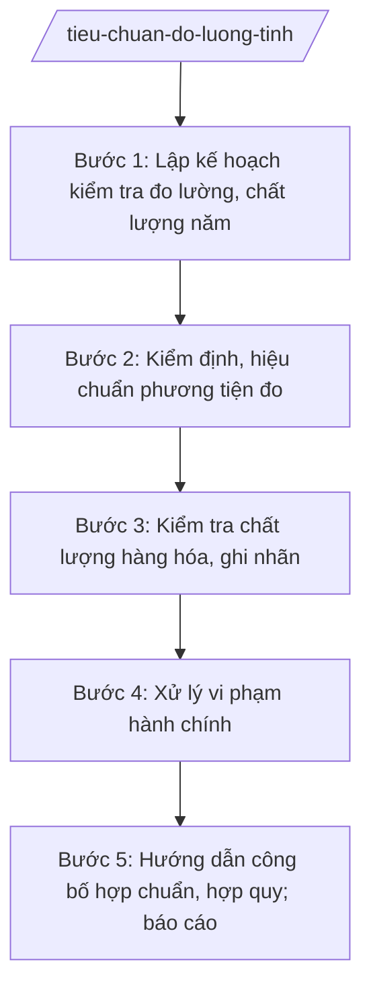

# Skill: Tiêu chuẩn, đo lường, chất lượng

## 2. Khi nào dùng
- Lập kế hoạch kiểm tra nhà nước về đo lường, chất lượng hàng năm của tỉnh.
- Kiểm định, hiệu chuẩn phương tiện đo (cân, cột đo xăng dầu, công tơ điện...) trên địa bàn.
- Kiểm tra chất lượng sản phẩm, hàng hóa lưu thông; kiểm tra ghi nhãn hàng hóa.
- Hướng dẫn doanh nghiệp công bố hợp chuẩn, công bố hợp quy.
- Xử lý vi phạm hành chính trong lĩnh vực tiêu chuẩn, đo lường, chất lượng.
- Báo cáo công tác tiêu chuẩn, đo lường, chất lượng gửi Bộ KH&CN và UBND tỉnh.

## 3. Đầu vào (Input)
| Trường | Mô tả | Bắt buộc |
|--------|-------|----------|
| `nam_ke_hoach` | Năm lập kế hoạch kiểm tra đo lường, chất lượng | Có |
| `danh_sach_phuong_tien_do` | Danh sách phương tiện đo phải kiểm định trên địa bàn (trạm xăng dầu, chợ, siêu thị, cơ sở sản xuất) | Có |
| `ke_hoach_kiem_tra` | Kế hoạch kiểm tra đã được phê duyệt (đối tượng, thời gian, nội dung kiểm tra) | Không |
| `bien_ban_kiem_tra` | Biên bản kiểm tra thực tế tại cơ sở | Không |
| `nguoi_ky` | Người có thẩm quyền ký (Giám đốc Sở; Chủ tịch UBND tỉnh đối với kế hoạch của UBND tỉnh) | Có |

## 4. Quy trình

**Bước 1. Lập kế hoạch kiểm tra đo lường, chất lượng năm**
- Làm gì: Rà soát đối tượng quản lý (cơ sở kinh doanh xăng dầu, chợ, siêu thị, cơ sở sản xuất); lập kế hoạch kiểm tra nhà nước về đo lường, chất lượng năm của tỉnh.
- Dùng input: `nam_ke_hoach`, `danh_sach_phuong_tien_do`, `nguoi_ky`
- Vai trò: Chuyên viên Chi cục Tiêu chuẩn Đo lường Chất lượng (hoặc phòng được giao) lập kế hoạch; Trưởng phòng/Chi cục trưởng kiểm tra; Giám đốc Sở phê duyệt; AI hỗ trợ lập danh sách đối tượng, phân lịch kiểm tra ⏱ ~5 ngày làm việc (ước tính)
- Lưu ý nghiệp vụ: Kế hoạch phải bao quát nhóm đối tượng có nguy cơ vi phạm cao (xăng dầu, cân chợ, hàng hóa thiết yếu); tránh kiểm tra trùng lặp với kế hoạch của lực lượng quản lý thị trường.
- → Kết quả bước: Kế hoạch kiểm tra nhà nước về đo lường, chất lượng năm đã phê duyệt.

**Bước 2. Kiểm định, hiệu chuẩn phương tiện đo**
- Làm gì: Tổ chức kiểm định định kỳ phương tiện đo thuộc danh mục phải kiểm định; dán tem kiểm định; lập sổ theo dõi.
- Dùng input: `danh_sach_phuong_tien_do`, `ke_hoach_kiem_tra`
- Vai trò: Kiểm định viên (đơn vị kiểm định được chỉ định) thực hiện kiểm định; chuyên viên Sở giám sát, tổng hợp; AI hỗ trợ lập lịch kiểm định, theo dõi tem kiểm định đến hạn ⏱ theo kế hoạch năm (ước tính)
- Lưu ý nghiệp vụ: Phương tiện đo hết hạn kiểm định không được sử dụng trong mua bán; tem kiểm định phải còn hiệu lực, dán đúng vị trí.
- → Kết quả bước: Giấy chứng nhận kiểm định + sổ theo dõi phương tiện đo trên địa bàn.

**Bước 3. Kiểm tra chất lượng hàng hóa, ghi nhãn**
- Làm gì: Kiểm tra chất lượng sản phẩm, hàng hóa lưu thông trên thị trường; kiểm tra ghi nhãn hàng hóa; lấy mẫu thử nghiệm khi cần.
- Dùng input: `ke_hoach_kiem_tra`, `bien_ban_kiem_tra`
- Vai trò: Đoàn kiểm tra (Sở KH&CN chủ trì, phối hợp lực lượng liên quan) thực hiện; chuyên viên lập biên bản; AI hỗ trợ soạn biên bản kiểm tra, tổng hợp kết quả ⏱ theo kế hoạch (ước tính)
- Lưu ý nghiệp vụ: Kiểm tra phải đúng nội dung quyết định kiểm tra; lấy mẫu phải niêm phong, có biên bản; kết quả thử nghiệm là căn cứ xử lý.
- → Kết quả bước: Biên bản kiểm tra + kết quả thử nghiệm mẫu (nếu có).

**Bước 4. Xử lý vi phạm hành chính**
- Làm gì: Lập biên bản vi phạm hành chính đối với hành vi vi phạm về đo lường, chất lượng, ghi nhãn; trình ban hành Quyết định xử phạt vi phạm hành chính.
- Dùng input: `bien_ban_kiem_tra`, kết quả thử nghiệm mẫu
- Vai trò: Chuyên viên lập biên bản vi phạm; Trưởng phòng/Chi cục trưởng thẩm tra; người có thẩm quyền xử phạt (Giám đốc Sở hoặc Chủ tịch UBND tỉnh theo mức phạt) ký Quyết định; AI hỗ trợ soạn biên bản, dự thảo quyết định, đối chiếu khung phạt ⏱ ~3 ngày làm việc (ước tính)
- Lưu ý nghiệp vụ: Xác định đúng hành vi vi phạm, đúng khung phạt; bảo đảm thời hiệu, thời hạn xử phạt; quyết định xử phạt phải đúng thể thức, đúng thẩm quyền.
- → Kết quả bước: Quyết định xử phạt vi phạm hành chính (số 1234/QĐ-XPHC).

**Bước 5. Hướng dẫn công bố hợp chuẩn, hợp quy; báo cáo**
- Làm gì: Hướng dẫn doanh nghiệp công bố hợp chuẩn, công bố hợp quy sản phẩm, hàng hóa; tiếp nhận bản công bố; tổng hợp báo cáo năm.
- Dùng input: Hồ sơ công bố của doanh nghiệp, kết quả kiểm tra các bước trên
- Vai trò: Chuyên viên hướng dẫn, tiếp nhận hồ sơ công bố; Phó Giám đốc Sở chỉ đạo; AI hỗ trợ kiểm tra thành phần hồ sơ công bố, soạn báo cáo tổng kết ⏱ ~3 ngày làm việc (ước tính)
- Lưu ý nghiệp vụ: Công bố hợp chuẩn/hợp quy là trách nhiệm của tổ chức, cá nhân sản xuất, kinh doanh; cơ quan quản lý chỉ tiếp nhận, không "cấp phép" công bố.
- → Kết quả bước: Báo cáo công tác tiêu chuẩn, đo lường, chất lượng năm của tỉnh.

## Luồng quy trình (Workflow)

## 5. Đầu ra (Output)
- Kế hoạch kiểm tra nhà nước về đo lường, chất lượng năm.
- Biên bản kiểm tra + kết quả thử nghiệm mẫu.
- Quyết định xử phạt vi phạm hành chính trong lĩnh vực tiêu chuẩn, đo lường, chất lượng.
- Báo cáo công tác tiêu chuẩn, đo lường, chất lượng năm.

**Cấu trúc output chuẩn:**
Khung Quyết định xử phạt vi phạm hành chính (theo NĐ 30/2020/NĐ-CP):
1. Quốc hiệu "CỘNG HÒA XÃ HỘI CHỦ NGHĨA VIỆT NAM", Tiêu ngữ "Độc lập – Tự do – Hạnh phúc".
2. Số, ký hiệu văn bản: số 1234/QĐ-XPHC.
3. Địa danh và ngày, tháng, năm: "Tỉnh A, ngày ... tháng ... năm ...".
4. Tên loại và trích yếu: "QUYẾT ĐỊNH / Xử phạt vi phạm hành chính trong lĩnh vực tiêu chuẩn, đo lường, chất lượng".
5. Căn cứ: TT 10/2025/TT-BKHCN; NĐ 132/2025/NĐ-CP; biên bản vi phạm hành chính số ...; quy định xử phạt vi phạm hành chính trong lĩnh vực tiêu chuẩn, đo lường, chất lượng.
6. Nội dung bắt buộc: Điều 1. Xử phạt đối với ông/bà ..., địa chỉ ...; hành vi vi phạm ...; mức phạt tiền ... đồng; biện pháp khắc phục hậu quả ...; Điều 2. Thời hạn chấp hành (10 ngày), nơi nộp phạt; Điều 3. Quyền khiếu nại, khởi kiện; Điều 4. Hiệu lực và tổ chức thi hành.
7. Nơi nhận: Cá nhân/tổ chức bị xử phạt; Kho bạc Nhà nước; đơn vị liên quan; lưu hồ sơ.
8. Chữ ký của người có thẩm quyền xử phạt + họ tên, đóng dấu.

## 6. Checklist nghiệm thu
- [ ] Kế hoạch kiểm tra bao quát đối tượng nguy cơ cao, không trùng lặp với lực lượng khác.
- [ ] Phương tiện đo được kiểm định định kỳ, tem kiểm định còn hiệu lực.
- [ ] Biên bản kiểm tra đúng nội dung quyết định kiểm tra; mẫu thử nghiệm được niêm phong đúng quy định.
- [ ] Hành vi vi phạm được xác định đúng, khung phạt đúng, quyết định đúng thẩm quyền và thời hiệu.
- [ ] Hồ sơ công bố hợp chuẩn/hợp quy được tiếp nhận, kiểm tra thành phần đầy đủ.
- [ ] Văn bản đúng thể thức NĐ 30/2020/NĐ-CP.
- [ ] Không bịa số liệu, không trích dẫn văn bản hết hiệu lực.
- [ ] Đã qua human gate: chuyên viên lập → Trưởng phòng/Chi cục trưởng thẩm tra → người có thẩm quyền ký.

## 7. Ví dụ mô phỏng
*Dữ liệu dưới đây là giả lập 100% phục vụ minh họa.*

### Input mẫu
- nam_ke_hoach: 2027
- danh_sach_phuong_tien_do: 120 cột đo xăng dầu, 45 cân tại 08 chợ đầu mối, 30 công tơ tại cơ sở sản xuất trên địa bàn tỉnh A
- ke_hoach_kiem_tra: Kiểm tra 40 cơ sở kinh doanh xăng dầu, 20 cơ sở sản xuất hàng hóa trong quý II/2027
- bien_ban_kiem_tra: Cơ sở X sử dụng 02 cột đo xăng dầu hết hạn kiểm định 03 tháng
- nguoi_ky: Bà Vũ Thị T – Giám đốc Sở KH&CN tỉnh A

### Output mẫu
**QUYẾT ĐỊNH** số 1234/QĐ-XPHC
Xử phạt vi phạm hành chính trong lĩnh vực đo lường

CỘNG HÒA XÃ HỘI CHỦ NGHĨA VIỆT NAM
Độc lập – Tự do – Hạnh phúc

Tỉnh A, ngày 09 tháng 10 năm 2026

GIÁM ĐỐC SỞ KHOA HỌC VÀ CÔNG NGHỆ TỈNH A

Căn cứ Thông tư số 10/2025/TT-BKHCN ngày 27/6/2025 của Bộ Khoa học và Công nghệ;
Căn cứ Biên bản vi phạm hành chính số 56/BB-VPHC ngày 01/10/2026;
Xét đề nghị của Chi cục trưởng Chi cục Tiêu chuẩn Đo lường Chất lượng,

QUYẾT ĐỊNH:

Điều 1. Xử phạt vi phạm hành chính đối với Cơ sở kinh doanh xăng dầu X, địa chỉ xã A, tỉnh A, người đại diện ông Nguyễn Văn Q.
a) Hành vi vi phạm: Sử dụng 02 phương tiện đo (cột đo xăng dầu) đã hết thời hạn kiểm định trong mua bán hàng hóa.
b) Mức phạt tiền: 15.000.000 đồng (mười lăm triệu đồng).
c) Biện pháp khắc phục hậu quả: Buộc kiểm định lại phương tiện đo trước khi tiếp tục sử dụng.

Điều 2. Cơ sở X phải chấp hành trong thời hạn 10 ngày kể từ ngày nhận quyết định; nộp phạt tại Kho bạc Nhà nước khu vực.

Điều 3. Cơ sở X có quyền khiếu nại, khởi kiện theo quy định của pháp luật.

Điều 4. Quyết định có hiệu lực kể từ ngày ký.

Nơi nhận:
- Cơ sở X;
- Kho bạc Nhà nước khu vực;
- Lưu: hồ sơ.

GIÁM ĐỐC
Vũ Thị T

## 8. Human gate
Chuyên viên/Chi cục lập kế hoạch, biên bản kiểm tra → Trưởng phòng/Chi cục trưởng thẩm tra → người có thẩm quyền xử phạt ký Quyết định (Giám đốc Sở hoặc Chủ tịch UBND tỉnh tùy mức phạt). AI chỉ hỗ trợ soạn thảo, đối chiếu khung phạt, theo dõi lịch kiểm định — không thay con người xác định hành vi vi phạm và quyết định mức phạt.

## 9. Giới hạn
AI tuyệt đối KHÔNG: ra quyết định hành chính thay người có thẩm quyền; tự ký/phát hành văn bản; bịa số liệu, căn cứ pháp lý, trích dẫn; dùng văn bản hết hiệu lực. Đặc biệt: không tự kết luận hàng hóa vi phạm chất lượng khi chưa có kết quả thử nghiệm, không bịa mức phạt ngoài khung quy định.

## 10. Căn cứ & lưu ý
- TT 10/2025/TT-BKHCN (27/6/2025; hiệu lực 01/7/2025).
- NĐ 132/2025/NĐ-CP (12/6/2025) — phân định thẩm quyền CQĐP 2 cấp lĩnh vực quản lý nhà nước của Bộ KH&CN.
- NĐ 150/2025/NĐ-CP (12/6/2025; hiệu lực 16/6/2025); sửa đổi bởi NĐ 370/2025/NĐ-CP.
- NĐ 30/2020/NĐ-CP (thể thức văn bản hành chính).
- Luật Tiêu chuẩn và quy chuẩn kỹ thuật; Luật Đo lường; Luật Chất lượng sản phẩm, hàng hóa (chỉ nêu tên).
- Lưu ý: việc xử phạt vi phạm hành chính phải đúng thẩm quyền, thời hiệu, thời hạn; số hiệu nghị định xử phạt trong từng lĩnh vực tra cứu theo văn bản hiện hành, không bịa số hiệu.
