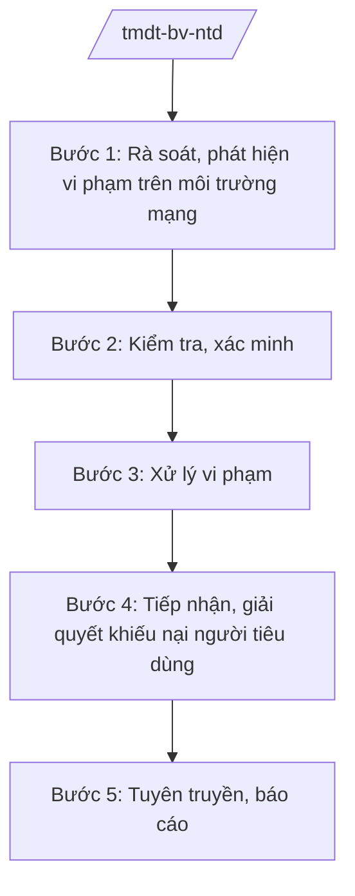

# Skill: Thương mại điện tử & bảo vệ người tiêu dùng

## 2. Khi nào dùng

- Khi kiểm tra hoạt động thương mại điện tử trên địa bàn (website, sàn, mạng xã hội bán hàng).
- Khi xử lý vi phạm: hàng giả, hàng nhái bán online; quảng cáo sai sự thật; không niêm yết giá.
- Khi tiếp nhận, giải quyết khiếu nại của người tiêu dùng.
- Khi tuyên truyền pháp luật về TMĐT, bảo vệ người tiêu dùng.

## 3. Đầu vào (Input)

| Trường | Mô tả | Bắt buộc |
|--------|-------|----------|
| `loai_viec` | kiểm tra TMĐT / xử lý vi phạm / giải quyết khiếu nại NTD / tuyên truyền / báo cáo | Có |
| `doi_tuong` | Website/sàn/tài khoản mạng xã hội/tổ chức, cá nhân kinh doanh | Không |
| `noi_dung_kn` | Nội dung khiếu nại của người tiêu dùng | Không |
| `bang_chung` | Hóa đơn, ảnh chụp, tin nhắn giao dịch... | Không |

## 4. Quy trình

**Bước 1. Rà soát, phát hiện vi phạm trên môi trường mạng**
- Làm gì: Rà soát website TMĐT, sàn giao dịch, livestream bán hàng có dấu hiệu vi phạm (hàng giả, giá ảo, khuyến mãi sai sự thật).
- Dùng input: `loai_viec`, `doi_tuong`.
- Vai trò: Chuyên viên Phòng Quản lý thương mại/Cục (Chi cục) QLTT theo dõi; AI hỗ trợ tổng hợp dấu hiệu từ phản ánh, tin báo — ⏱ thường xuyên.
- Lưu ý nghiệp vụ: Lưu giữ bằng chứng điện tử (chụp màn hình có thời gian); xác minh chủ thể kinh doanh (trong/ngoài tỉnh).
- → Kết quả bước: Danh sách đối tượng nghi vấn + bằng chứng ban đầu.

**Bước 2. Kiểm tra, xác minh**
- Làm gì: Kiểm tra website/sàn (thông báo với Bộ Công Thương theo quy định); phối hợp kiểm tra kho hàng thực tế nếu cần.
- Dùng input: `doi_tuong`.
- Vai trò: Đoàn kiểm tra (Sở Công Thương/Chi cục QLTT); AI hỗ trợ soạn quyết định kiểm tra, biên bản — ⏱ 3–5 ngày.
- Lưu ý nghiệp vụ: Đối với sàn TMĐT lớn có trụ sở ngoài tỉnh — phối hợp Bộ Công Thương, địa phương nơi đặt trụ sở.
- → Kết quả bước: Biên bản kiểm tra, xác minh.

**Bước 3. Xử lý vi phạm**
- Làm gì: Lập biên bản VPHC; xử phạt: bán hàng giả, quảng cáo sai sự thật, không đăng ký/thông báo website TMĐT; yêu cầu gỡ bỏ thông tin vi phạm.
- Dùng input: Kết quả bước 2.
- Vai trò: Người có thẩm quyền xử phạt ký quyết định; AI hỗ trợ tra cứu khung phạt — ⏱ trong thời hiệu.
- Lưu ý nghiệp vụ: Buộc gỡ bỏ quảng cáo sai sự thật, cải chính công khai; hàng giả phải tịch thu, tiêu hủy.
- → Kết quả bước: Quyết định xử phạt VPHC.

**Bước 4. Tiếp nhận, giải quyết khiếu nại người tiêu dùng**
- Làm gì: Tiếp nhận khiếu nại (trực tiếp, điện thoại, email); phân loại; hòa giải giữa NTD và tổ chức kinh doanh; chuyển cơ quan có thẩm quyền nếu vượt phạm vi.
- Dùng input: `noi_dung_kn`, `bang_chung`.
- Vai trò: Chuyên viên phụ trách bảo vệ NTD; AI hỗ trợ phân loại, dự thảo văn bản — ⏱ 7–15 ngày/vụ.
- Lưu ý nghiệp vụ: Ưu tiên hòa giải; bảo mật thông tin cá nhân của người khiếu nại; vụ việc có dấu hiệu lừa đảo chuyển Công an.
- → Kết quả bước: Biên bản hòa giải thành/không thành; văn bản chuyển xử lý.

**Bước 5. Tuyên truyền, báo cáo**
- Làm gì: Tuyên truyền pháp luật TMĐT, kỹ năng mua sắm an toàn cho người dân; báo cáo định kỳ.
- Dùng input: `loai_viec`.
- Vai trò: Chuyên viên; AI hỗ trợ soạn tài liệu tuyên truyền — ⏱ theo kế hoạch.
- Lưu ý nghiệp vụ: Phối hợp Hội Bảo vệ người tiêu dùng tỉnh (nếu có).
- → Kết quả bước: Tài liệu tuyên truyền + báo cáo định kỳ.

## Luồng quy trình (Workflow)

## 5. Đầu ra (Output)

- Biên bản kiểm tra hoạt động TMĐT; quyết định xử phạt VPHC.
- Biên bản hòa giải khiếu nại người tiêu dùng.
- Tài liệu tuyên truyền; báo cáo định kỳ.

**Cấu trúc output chuẩn (Biên bản hòa giải khiếu nại NTD):**
- Thể thức: tuân thủ Nghị định 30/2020/NĐ-CP về công tác văn thư.

1. Quốc hiệu "CỘNG HÒA XÃ HỘI CHỦ NGHĨA VIỆT NAM", Tiêu ngữ "Độc lập – Tự do – Hạnh phúc"; tên cơ quan (Sở Công Thương tỉnh A); số, ký hiệu.
2. Tên loại: **BIÊN BẢN HÒA GIẢI** — khiếu nại của người tiêu dùng.
3. Thời gian, địa điểm; thành phần (đại diện Sở, bên khiếu nại, bên bị khiếu nại).
4. Nội dung khiếu nại (tóm tắt + bằng chứng).
5. Ý kiến các bên.
6. Kết quả hòa giải: thành (thỏa thuận cụ thể, thời hạn thực hiện) / không thành (hướng dẫn khởi kiện).
7. Chữ ký các bên.
- Nơi nhận: liệt kê các cơ quan, đơn vị nhận để biết/thực hiện; kết thúc bằng "- Lưu: VT, [mã đơn vị]".
## 6. Checklist nghiệm thu

- [ ] Bằng chứng điện tử được lưu giữ đầy đủ, hợp lệ.
- [ ] Kiểm tra đúng thẩm quyền; phối hợp Bộ Công Thương khi đối tượng ngoài tỉnh.
- [ ] Xử phạt đúng điều khoản, khung phạt; buộc gỡ bỏ/cải chính khi cần.
- [ ] Khiếu nại NTD được xử lý trong hạn; ưu tiên hòa giải.
- [ ] Thông tin cá nhân người khiếu nại được bảo mật.
- [ ] Văn bản đúng thể thức NĐ 30/2020/NĐ-CP.

## 7. Ví dụ mô phỏng

*Dữ liệu dưới đây là giả lập 100% phục vụ minh họa.*

**Input mẫu:** loai_viec = "giải quyết khiếu nại NTD"; noi_dung_kn = "Bà Trần Thị Dân mua nồi chiên không dầu qua livestream, nhận hàng giả, shop không đổi trả"; bang_chung = "Ảnh chụp sản phẩm, tin nhắn chốt đơn".

**Output mẫu (trích Biên bản hòa giải):**

> **SỞ CÔNG THƯƠNG TỈNH A**
>
> **BIÊN BẢN HÒA GIẢI**
> Khiếu nại của người tiêu dùng
>
> Thời gian: ngày 10/9/2026. Thành phần: bà Đặng Thị Y – Chuyên viên (chủ trì); bà Trần Thị Dân (bên khiếu nại); ông Nguyễn Văn G – đại diện shop AB (bên bị khiếu nại).
> Nội dung: bà Dân mua nồi chiên không dầu giá 1.200.000 đồng qua livestream ngày 01/9/2026; hàng nhận được là hàng giả, shop từ chối đổi trả.
> Kết quả hòa giải: **thành**. Shop AB đồng ý hoàn tiền 1.200.000 đồng cho bà Dân trong 03 ngày; cam kết gỡ bỏ quảng cáo sai sự thật.
> Các bên ký tên./.

## 8. Human gate

- Chuyên viên soạn → Trưởng phòng kiểm tra → Phó Giám đốc Sở duyệt → Giám đốc Sở ký (quyết định xử phạt theo thẩm quyền).
- Hòa giải NTD: chuyên viên chủ trì, báo cáo Trưởng phòng kết quả.

## 9. Giới hạn

- AI không tự kết luận hàng giả, không tự áp mức phạt, không tự hòa giải thay người.
- Không bịa bằng chứng, nội dung khiếu nại.
- Không dùng văn bản hết hiệu lực làm căn cứ.

## 10. Căn cứ & lưu ý

- Thông tư 37/2025/TT-BCT của Bộ Công Thương hướng dẫn chức năng, nhiệm vụ của cơ quan chuyên môn về công thương (lĩnh vực TMĐT, bảo vệ người tiêu dùng).
- Luật Bảo vệ quyền lợi người tiêu dùng và các văn bản hướng dẫn (dẫn tên, áp dụng bản hiện hành).
- Nghị định 150/2025/NĐ-CP về tổ chức cơ quan chuyên môn thuộc UBND cấp tỉnh.
- Nghị định 30/2020/NĐ-CP về công tác văn thư (thể thức văn bản).
- Lưu ý: TMĐT xuyên biên giới, xuyên tỉnh — chủ động phối hợp Bộ Công Thương và địa phương liên quan.
