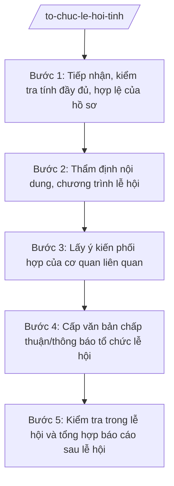

# Skill: Tổ chức lễ hội cấp tỉnh

## 2. Khi nào dùng

- Tiếp nhận hồ sơ đề nghị tổ chức lễ hội của tổ chức, cá nhân (lễ hội truyền thống, lễ hội tín ngưỡng, lễ hội du lịch, lễ hội văn hóa...).
- Thẩm định nội dung, chương trình lễ hội: đúng thuần phong mỹ tục, không mê tín dị đoan, không lợi dụng lễ hội để trục lợi.
- Cấp văn bản chấp thuận/thông báo tổ chức lễ hội thuộc thẩm quyền Sở VHTTDL; tham mưu UBND tỉnh đối với lễ hội quy mô lớn.
- Kiểm tra trước và trong thời gian diễn ra lễ hội về nội dung, an ninh trật tự, phòng cháy chữa cháy, vệ sinh môi trường, an toàn thực phẩm.
- Tổng hợp báo cáo tình hình tổ chức lễ hội trên địa bàn tỉnh gửi UBND tỉnh và Bộ VHTTDL.

## 3. Đầu vào (Input)

| Trường | Mô tả | Bắt buộc |
|--------|-------|----------|
| `ho_so_de_nghi` | Đơn đề nghị + phương án tổ chức: tên lễ hội, đơn vị tổ chức, thời gian, địa điểm, quy mô dự kiến (số người tham gia), nội dung chương trình phần lễ và phần hội | Có |
| `phuong_an_dam_bao` | Phương án bảo đảm an ninh trật tự, phòng cháy chữa cháy, vệ sinh môi trường, an toàn thực phẩm, y tế, phân luồng giao thông | Có |
| `y_kien_phoi_hop` | Ý kiến của Công an tỉnh, UBND xã nơi tổ chức lễ hội, các cơ quan liên quan (nếu đã có) | Không |
| `lich_su_to_chuc` | Lịch sử tổ chức các năm trước; vi phạm đã xảy ra (nếu có) | Không |
| `thoi_han` | Thời hạn trả lời chấp thuận/từ chối | Có |

## 4. Quy trình

**Bước 1. Tiếp nhận, kiểm tra tính đầy đủ, hợp lệ của hồ sơ**

- Làm gì: Tiếp nhận hồ sơ đề nghị tổ chức lễ hội qua bộ phận một cửa Sở (trực tiếp/trực tuyến); kiểm tra tính đầy đủ, hợp lệ của đơn đề nghị, phương án tổ chức, phương án bảo đảm; hướng dẫn bổ sung một lần nếu hồ sơ thiếu.
- Dùng input: `ho_so_de_nghi`, `phuong_an_dam_bao`, `thoi_han`.
- Vai trò: Công chức bộ phận một cửa Sở VHTTDL tiếp nhận, kiểm tra hình thức. AI hỗ trợ: lập checklist hồ sơ đề nghị tổ chức lễ hội, soạn văn bản hướng dẫn bổ sung hồ sơ, theo dõi thời hạn giải quyết. ⏱ ~1–2 ngày làm việc (ước tính).
- Lưu ý nghiệp vụ: Ghi phiếu tiếp nhận, hẹn ngày trả kết quả theo cơ chế một cửa (NĐ 118/2025/NĐ-CP); không yêu cầu bổ sung quá một lần đối với cùng một nội dung.
- → Kết quả bước: Hồ sơ đầy đủ, hợp lệ được chuyển Phòng Quản lý văn hóa thụ lý (kèm phiếu hẹn trả kết quả).

**Bước 2. Thẩm định nội dung, chương trình lễ hội**

- Làm gì: Thẩm định nội dung phần lễ, phần hội: phù hợp thuần phong mỹ tục, không mê tín dị đoan, không cờ bạc, không chèo kéo du khách; quy mô tổ chức phù hợp điều kiện địa điểm; đối chiếu lịch sử tổ chức các năm trước (vi phạm nếu có).
- Dùng input: `ho_so_de_nghi`, `phuong_an_dam_bao`, `lich_su_to_chuc`.
- Vai trò: Chuyên viên Phòng Quản lý văn hóa (ông Phạm Văn N) chủ trì thẩm định; Trưởng phòng (bà Đặng Thị Y) kiểm tra kết quả thẩm định. AI hỗ trợ: lập bảng tiêu chí thẩm định nội dung lễ hội, soạn báo cáo thẩm định (đạt/không đạt + lý do cụ thể), tra cứu vi phạm các năm trước. ⏱ ~5–7 ngày làm việc (ước tính).
- Lưu ý nghiệp vụ: Nội dung lễ hội có yếu tố tín ngưỡng phải tôn trọng quyền tự do tín ngưỡng nhưng kiên quyết loại bỏ hủ tục, mê tín dị đoan; hoạt động thu tiền công đức, bán hàng trong lễ hội phải có phương án quản lý rõ ràng.
- → Kết quả bước: Báo cáo thẩm định nội dung lễ hội (đề xuất chấp thuận/từ chối/yêu cầu điều chỉnh).

**Bước 3. Lấy ý kiến phối hợp của cơ quan liên quan**

- Làm gì: Gửi văn bản lấy ý kiến Công an tỉnh (phương án ANTT), UBND xã nơi tổ chức (điều kiện địa điểm, vệ sinh môi trường), cơ quan y tế/PCCC (nếu quy mô lớn); tổng hợp ý kiến, yêu cầu đơn vị tổ chức điều chỉnh phương án nếu cần.
- Dùng input: Kết quả bước 2; `y_kien_phoi_hop`.
- Vai trò: Chuyên viên Phòng Quản lý văn hóa soạn văn bản lấy ý kiến, đôn đốc trả lời; Trưởng phòng (bà Đặng Thị Y) ký văn bản lấy ý kiến. AI hỗ trợ: soạn văn bản lấy ý kiến, lập bảng tổng hợp ý kiến các cơ quan, soạn văn bản yêu cầu điều chỉnh phương án. ⏱ ~5–7 ngày làm việc (ước tính).
- Lưu ý nghiệp vụ: Quy định rõ thời hạn trả lời ý kiến (không quá 5 ngày làm việc); quá hạn không trả lời thì coi như đồng ý theo nguyên tắc phối hợp.
- → Kết quả bước: Bảng tổng hợp ý kiến phối hợp + phương án tổ chức đã điều chỉnh (nếu có).

**Bước 4. Cấp văn bản chấp thuận/thông báo tổ chức lễ hội**

- Làm gì: Dự thảo văn bản chấp thuận tổ chức lễ hội (nêu rõ tên lễ hội, thời gian, địa điểm, quy mô, yêu cầu bảo đảm, trách nhiệm báo cáo sau lễ hội) hoặc văn bản từ chối có nêu rõ lý do; trình ký, phát hành; gửi các cơ quan phối hợp để theo dõi.
- Dùng input: Kết quả bước 2–3.
- Vai trò: Chuyên viên soạn dự thảo; Trưởng phòng (bà Đặng Thị Y) kiểm tra; Phó Giám đốc Sở (ông Đỗ Văn U) cho ý kiến; Giám đốc Sở (bà Vũ Thị T) ký văn bản chấp thuận. Lễ hội quy mô lớn, nhạy cảm thì Giám đốc Sở ký tờ trình, tham mưu Chủ tịch UBND tỉnh (ông Phạm Văn P) cho ý kiến. AI hỗ trợ: soạn dự thảo văn bản chấp thuận/từ chối đúng thể thức, lập danh sách nơi nhận, theo dõi phát hành. ⏱ ~3–5 ngày làm việc (ước tính).
- Lưu ý nghiệp vụ: Văn bản từ chối phải nêu rõ lý do, căn cứ và hướng khắc phục; không chấp thuận lễ hội có nội dung vi phạm thuần phong mỹ tục hoặc không bảo đảm điều kiện an toàn.
- → Kết quả bước: Văn bản chấp thuận/thông báo tổ chức lễ hội (hoặc văn bản từ chối có lý do) đã ký, phát hành đúng nơi nhận.

**Bước 5. Kiểm tra trong lễ hội và tổng hợp báo cáo sau lễ hội**

- Làm gì: Tổ chức kiểm tra trước và trong thời gian diễn ra lễ hội (nội dung thực tế so với hồ sơ, ANTT, VSMT, thu chi công đức); lập biên bản, yêu cầu dừng ngay hoạt động vi phạm; sau lễ hội, yêu cầu đơn vị tổ chức báo cáo kết quả, tổng hợp báo cáo chung gửi UBND tỉnh, Bộ VHTTDL.
- Dùng input: Văn bản chấp thuận ở bước 4; báo cáo của đơn vị tổ chức.
- Vai trò: Đoàn kiểm tra liên ngành (Sở VHTTDL chủ trì, Công an tỉnh, UBND xã phối hợp) do Phó Giám đốc Sở (ông Đỗ Văn U) làm trưởng đoàn; chuyên viên tổng hợp báo cáo. AI hỗ trợ: lập kế hoạch kiểm tra, soạn biên bản kiểm tra, soạn báo cáo tổng hợp tình hình lễ hội toàn tỉnh. ⏱ ~trong thời gian lễ hội + 5 ngày tổng hợp sau lễ hội (ước tính).
- Lưu ý nghiệp vụ: Kiên quyết xử lý các biểu hiện mê tín dị đoan, cờ bạc, chèo kéo, tăng giá dịch vụ trong lễ hội; báo cáo sau lễ hội phải đánh giá cả mặt được và tồn tại, kiến nghị năm sau.
- → Kết quả bước: Biên bản kiểm tra lễ hội + báo cáo tổng hợp tình hình tổ chức lễ hội gửi UBND tỉnh, Bộ VHTTDL.

## Luồng quy trình (Workflow)

## 5. Đầu ra (Output)

### Sản phẩm

1. **Văn bản chấp thuận tổ chức lễ hội** (sản phẩm chính) — hoặc văn bản từ chối có nêu rõ lý do.
2. Báo cáo thẩm định nội dung lễ hội + bảng tổng hợp ý kiến phối hợp.
3. Biên bản kiểm tra trước/trong lễ hội.
4. Báo cáo tổng hợp tình hình tổ chức lễ hội trên địa bàn tỉnh.

**Cấu trúc output chuẩn (Văn bản chấp thuận tổ chức lễ hội):**
- Thể thức: tuân thủ Nghị định 30/2020/NĐ-CP về công tác văn thư.

1. Quốc hiệu "CỘNG HÒA XÃ HỘI CHỦ NGHĨA VIỆT NAM", Tiêu ngữ "Độc lập – Tự do – Hạnh phúc": CỘNG HÒA XÃ HỘI CHỦ NGHĨA VIỆT NAM / Độc lập – Tự do – Hạnh phúc.
2. Tên cơ quan ban hành: SỞ VĂN HÓA, THỂ THAO VÀ DU LỊCH TỈNH A.
3. Số, ký hiệu văn bản: số/SVHTTDL-QLVH.
4. Địa danh, ngày tháng năm ban hành: Tỉnh A, ngày … tháng … năm ….
5. Tên loại và trích yếu nội dung (công văn): V/v chấp thuận tổ chức lễ hội …
6. Kính gửi: (tên đơn vị đề nghị tổ chức lễ hội).
7. Nội dung chính:
   - Chấp thuận cho (đơn vị) tổ chức lễ hội (tên lễ hội), thời gian, địa điểm, quy mô dự kiến;
   - Yêu cầu: tổ chức đúng nội dung đã thẩm định; bảo đảm ANTT, PCCC, VSMT, ATTP theo phương án đã duyệt; không để xảy ra mê tín dị đoan, cờ bạc, chèo kéo du khách; quản lý thu chi công đức công khai, minh bạch;
   - Đơn vị tổ chức chịu trách nhiệm trước pháp luật và báo cáo kết quả về Sở trong 10 ngày sau khi kết thúc lễ hội.
8. Nơi nhận (đơn vị tổ chức; Công an tỉnh; UBND xã nơi tổ chức; lưu VT, QLVH).
9. Chữ ký, họ tên người ký: KT. GIÁM ĐỐC / PHÓ GIÁM ĐỐC / (ký, đóng dấu, ghi rõ họ tên).

## 6. Checklist nghiệm thu

- [ ] Đủ 9 phần theo Cấu trúc output chuẩn mục 5, đúng thứ tự thể thức NĐ 30/2020/NĐ-CP.
- [ ] Hồ sơ đề nghị có đủ: đơn, phương án tổ chức, phương án bảo đảm ANTT/PCCC/VSMT/ATTP.
- [ ] Nội dung lễ hội đã thẩm định: không mê tín dị đoan, không trái thuần phong mỹ tục, quy mô phù hợp địa điểm.
- [ ] Đã lấy ý kiến Công an tỉnh và UBND xã nơi tổ chức; ý kiến được tổng hợp đầy đủ.
- [ ] Văn bản chấp thuận nêu rõ thời gian, địa điểm, quy mô và các yêu cầu bảo đảm, trách nhiệm báo cáo sau lễ hội.
- [ ] Trường hợp từ chối: văn bản nêu rõ lý do, căn cứ và hướng khắc phục.
- [ ] Có kiểm tra thực tế trước/trong lễ hội; vi phạm được lập biên bản, xử lý kịp thời.
- [ ] Đã qua đủ human gate: chuyên viên thẩm định → Trưởng phòng kiểm tra → Phó Giám đốc Sở → Giám đốc Sở ký (lễ hội lớn: trình Chủ tịch UBND tỉnh).

## 7. Ví dụ mô phỏng

*Dữ liệu dưới đây là giả lập 100% phục vụ minh họa.*

**Input mẫu:**

| Trường | Giá trị mẫu |
|--------|-------------|
| ho_so_de_nghi | Ban Tổ chức lễ hội xã A đề nghị tổ chức Lễ hội đình làng Hạ: thời gian rằm tháng Giêng năm 2027 (3 ngày), địa điểm khu vực đình làng Hạ, quy mô dự kiến 5.000 lượt người; phần lễ: rước kiệu, tế lễ; phần hội: thi đấu vật, hát quan họ, trò chơi dân gian |
| phuong_an_dam_bao | Công an xã A chủ trì ANTT, phân luồng giao thông; trạm y tế xã trực sơ cứu; bố trí 20 thùng rác, thu gom hằng ngày; phương án PCCC tại khu vực hội chợ |
| y_kien_phoi_hop | Công an tỉnh A: nhất trí, đề nghị tăng cường lực lượng ngày chính hội; UBND xã A: nhất trí |
| thoi_han | 15 ngày làm việc trước ngày khai hội |

**Output mẫu:**

CỘNG HÒA XÃ HỘI CHỦ NGHĨA VIỆT NAM
Độc lập – Tự do – Hạnh phúc
---------------

SỞ VĂN HÓA, THỂ THAO VÀ DU LỊCH TỈNH A

Số: 1234/SVHTTDL-QLVH

Tỉnh A, ngày 10 tháng 01 năm 2027

**V/v chấp thuận tổ chức Lễ hội đình làng Hạ, xã A**

*Kính gửi:* Ban Tổ chức lễ hội xã A

*Căn cứ* Thông tư số 10/2025/TT-BVHTTDL ngày 19/6/2025 của Bộ Văn hóa, Thể thao và Du lịch; Nghị định số 137/2025/NĐ-CP ngày 12/6/2025; Nghị định số 138/2025/NĐ-CP ngày 12/6/2025; sau khi thẩm định hồ sơ và lấy ý kiến các cơ quan liên quan,

Sở Văn hóa, Thể thao và Du lịch tỉnh A chấp thuận cho Ban Tổ chức lễ hội xã A tổ chức Lễ hội đình làng Hạ với các nội dung sau:

1. Thời gian: 03 ngày, từ rằm tháng Giêng năm 2027; địa điểm: khu vực đình làng Hạ, thôn 2, xã A; quy mô dự kiến 5.000 lượt người.
2. Nội dung: phần lễ (rước kiệu, tế lễ) và phần hội (thi đấu vật, hát quan họ, trò chơi dân gian) theo phương án đã thẩm định; không bổ sung nội dung chưa được chấp thuận.
3. Yêu cầu: bảo đảm an ninh trật tự, phòng cháy chữa cháy, vệ sinh môi trường, an toàn thực phẩm theo phương án đã duyệt; kiên quyết ngăn chặn mê tín dị đoan, cờ bạc, chèo kéo du khách; quản lý thu chi công đức công khai, minh bạch.
4. Ban Tổ chức chịu trách nhiệm trước pháp luật về mọi hoạt động của lễ hội và gửi báo cáo kết quả về Sở trong 10 ngày sau khi kết thúc lễ hội./.

***Nơi nhận:***
- Ban Tổ chức lễ hội xã A;
- Công an tỉnh A; UBND xã A;
- Lưu: VT, QLVH.

**KT. GIÁM ĐỐC**
**PHÓ GIÁM ĐỐC**

*(Ký, đóng dấu)*

**Đỗ Văn U**

## 8. Human gate (người kiểm duyệt)

- Chuyên viên Phòng Quản lý văn hóa (ông Phạm Văn N) thẩm định hồ sơ, soạn dự thảo văn bản, chịu trách nhiệm về đánh giá nội dung lễ hội.
- Trưởng phòng Quản lý văn hóa (bà Đặng Thị Y) kiểm tra kết quả thẩm định và dự thảo văn bản ở bước 2–4.
- Phó Giám đốc Sở (ông Đỗ Văn U) cho ý kiến; làm trưởng đoàn kiểm tra lễ hội.
- Giám đốc Sở (bà Vũ Thị T) ký văn bản chấp thuận/từ chối tổ chức lễ hội. Lễ hội quy mô lớn, nhạy cảm: tham mưu Chủ tịch UBND tỉnh (ông Phạm Văn P) cho ý kiến trước khi chấp thuận.

## 9. Giới hạn (guardrails)

- AI KHÔNG quyết định chấp thuận/từ chối tổ chức lễ hội thay Giám đốc Sở; không tự ký, phát hành văn bản.
- AI không bịa nội dung thẩm định, ý kiến phối hợp của Công an tỉnh/UBND xã.
- AI không bịa căn cứ pháp lý, số hiệu văn bản; không viện dẫn văn bản đã hết hiệu lực.
- AI không chấp thuận lễ hội có nội dung mê tín dị đoan, trái thuần phong mỹ tục hoặc không bảo đảm điều kiện an toàn — phải đề xuất từ chối/điều chỉnh.
- AI không vượt thẩm quyền: lễ hội thuộc thẩm quyền trung ương thì tham mưu trình Bộ, không tự quyết ở cấp tỉnh.

## 10. Căn cứ & lưu ý

- Thông tư 10/2025/TT-BVHTTDL ngày 19/6/2025 (hiệu lực 01/7/2025) của Bộ VHTTDL — hướng dẫn chức năng, nhiệm vụ của Sở Văn hóa, Thể thao và Du lịch (thay thế TT 08/2021/TT-BVHTTDL).
- Nghị định 137/2025/NĐ-CP ngày 12/6/2025 — phân định thẩm quyền của chính quyền địa phương 02 cấp trong lĩnh vực văn hóa, thể thao và du lịch.
- Nghị định 138/2025/NĐ-CP ngày 12/6/2025 — phân quyền, phân cấp trong lĩnh vực văn hóa, thể thao và du lịch.
- Nghị định 118/2025/NĐ-CP ngày 09/6/2025 — cơ chế một cửa, một cửa liên thông trong giải quyết thủ tục hành chính.
- Việc quản lý, tổ chức lễ hội thực hiện theo quy định pháp luật chuyên ngành về lễ hội và tín ngưỡng.
- Nghị định 30/2020/NĐ-CP — thể thức văn bản hành chính.
- Lưu ý: phân biệt lễ hội truyền thống, lễ hội tín ngưỡng, lễ hội du lịch để áp dụng đúng trình tự, thẩm quyền chấp thuận.
