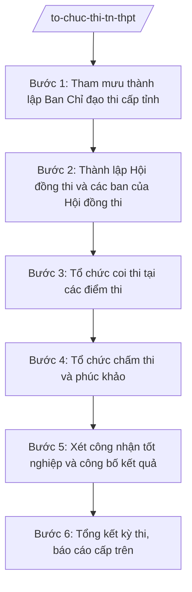

# Skill: Tổ chức kỳ thi tốt nghiệp THPT

## 2. Khi nào dùng

- Hằng năm, trước kỳ thi tốt nghiệp THPT: tham mưu UBND tỉnh thành lập Ban Chỉ đạo thi cấp tỉnh (Sở GD&ĐT là cơ quan thường trực).
- Thành lập Hội đồng thi và các ban của Hội đồng thi (ban coi thi, ban chấm thi, ban phúc khảo...).
- Tổ chức các khâu coi thi, chấm thi, phúc khảo, xét công nhận tốt nghiệp và công bố kết quả.
- Tổng kết kỳ thi, báo cáo Bộ GD&ĐT và UBND tỉnh; xử lý các tình huống phát sinh (gian lận, sự cố).

## 3. Đầu vào (Input)

| Trường | Mô tả | Bắt buộc |
|--------|-------|----------|
| `ky_thi` | Kỳ thi tốt nghiệp THPT năm … (vd: năm 2026) | Có |
| `so_luong_thi_sinh` | Số thí sinh đăng ký dự thi toàn tỉnh, phân theo điểm thi | Có |
| `so_diem_thi` | Số điểm thi, danh sách địa điểm đặt điểm thi | Có |
| `nhan_su_thi` | Dự kiến nhân sự: cán bộ coi thi, chấm thi, thanh tra thi, công an, y tế | Có |
| `lich_thi` | Lịch thi do Bộ GD&ĐT ban hành; mốc thời gian các khâu của tỉnh | Có |
| `phuong_an_dam_bao` | Phương án bảo đảm an ninh, an toàn, y tế, điện, giao thông, thông tin liên lạc | Có |
| `don_vi_phoi_hop` | Công an tỉnh, Sở Y tế, Công ty Điện lực, UBND các xã có điểm thi... | Có |

## 4. Quy trình

**Bước 1. Tham mưu thành lập Ban Chỉ đạo thi cấp tỉnh**

- Làm gì: Soạn Tờ trình UBND tỉnh kèm dự thảo Quyết định thành lập Ban Chỉ đạo thi cấp tỉnh; phân công nhiệm vụ các thành viên; Sở GD&ĐT là cơ quan thường trực, giúp Ban Chỉ đạo điều hành toàn bộ kỳ thi.
- Dùng input: `ky_thi`, `don_vi_phoi_hop`, `phuong_an_dam_bao`.
- Vai trò: Chuyên viên Phòng Khảo thí và Kiểm định chất lượng giáo dục soạn dự thảo. AI hỗ trợ: soạn dự thảo tờ trình, quyết định đúng thể thức; lập bảng phân công nhiệm vụ thành viên Ban Chỉ đạo (Trưởng ban: Phó Chủ tịch UBND tỉnh; Phó Trưởng ban thường trực: Giám đốc Sở GD&ĐT). ⏱ ~5–7 ngày làm việc (ước tính).
- Lưu ý nghiệp vụ: Quyết định thành lập Ban Chỉ đạo phải ban hành trước ngày thi ít nhất 60 ngày; thành phần Ban Chỉ đạo phải có đại diện Công an tỉnh, Sở Y tế, Sở Tài chính, UBND các xã có điểm thi.
- → Kết quả bước: Tờ trình + dự thảo Quyết định thành lập Ban Chỉ đạo thi cấp tỉnh.

**Bước 2. Thành lập Hội đồng thi và các ban của Hội đồng thi**

- Làm gì: Soạn quyết định thành lập Hội đồng thi; thành lập các ban: ban thư ký, ban coi thi, ban chấm thi, ban phúc khảo, ban thanh tra thi; phân công điểm thi, nhân sự từng ban.
- Dùng input: `so_luong_thi_sinh`, `so_diem_thi`, `nhan_su_thi`, `lich_thi`.
- Vai trò: Trưởng phòng Khảo thí và Kiểm định chất lượng giáo dục (ông Bùi Văn X) chủ trì xây dựng phương án nhân sự; Phó Giám đốc Sở (ông Đỗ Văn U) xem xét; Giám đốc Sở (ông Hoàng Văn S) ký quyết định thành lập. AI hỗ trợ: lập danh sách nhân sự theo điểm thi/ban, kiểm tra không trùng lặp phân công, soạn dự thảo quyết định. ⏱ ~7–10 ngày làm việc (ước tính).
- Lưu ý nghiệp vụ: Cán bộ coi thi không được coi thi tại điểm thi nơi có người thân dự thi; mỗi phòng thi bố trí 02 cán bộ coi thi; lực lượng thanh tra thi độc lập với ban coi thi.
- → Kết quả bước: Quyết định thành lập Hội đồng thi + danh sách các ban, phân công điểm thi.

**Bước 3. Tổ chức coi thi tại các điểm thi**

- Làm gì: Triển khai coi thi theo đúng lịch thi và quy chế thi; bảo đảm an ninh đề thi, bài thi; xử lý tình huống phát sinh tại điểm thi (thí sinh vi phạm, sự cố y tế, mất điện...); lập biên bản coi thi.
- Dùng input: `lich_thi`, `so_diem_thi`, `phuong_an_dam_bao`, kết quả bước 2.
- Vai trò: Trưởng điểm thi điều hành tại điểm thi; thanh tra thi của Sở giám sát; cơ quan thường trực (Sở GD&ĐT) trực điều hành, tiếp nhận báo cáo nhanh. AI hỗ trợ: soạn mẫu biên bản coi thi, biểu mẫu báo cáo nhanh theo buổi thi, tổng hợp báo cáo nhanh toàn tỉnh. ⏱ ~theo lịch thi (3–4 ngày) + 2 ngày tổng hợp (ước tính).
- Lưu ý nghiệp vụ: Mọi biên bản xử lý vi phạm phải lập tại chỗ, có chữ ký của cán bộ coi thi, thí sinh vi phạm (hoặc ghi rõ lý do vắng mặt) và trưởng điểm thi; niêm phong bài thi, đề thi đúng quy định ngay sau mỗi buổi thi.
- → Kết quả bước: Biên bản coi thi các điểm thi + báo cáo nhanh kết quả coi thi toàn tỉnh.

**Bước 4. Tổ chức chấm thi và phúc khảo**

- Làm gì: Tổ chức chấm thi tập trung tại địa điểm do Hội đồng thi quy định; chấm kiểm tra, chấm phúc khảo theo đơn đề nghị của thí sinh; nhập điểm, đối soát, bảo mật kết quả trước khi công bố.
- Dùng input: Bài thi đã niêm phong từ bước 3; đơn phúc khảo của thí sinh.
- Vai trò: Trưởng ban chấm thi điều hành; cán bộ chấm thi thực hiện; Phòng Khảo thí và KĐCLGD (ông Bùi Văn X) giám sát quy trình. AI hỗ trợ: lập lịch chấm thi, biểu mẫu biên bản chấm thi/phúc khảo, kiểm tra tính khớp giữa điểm chấm và điểm nhập máy (đối soát 2 vòng độc lập). ⏱ ~10–15 ngày làm việc (ước tính).
- Lưu ý nghiệp vụ: Bài thi chấm 2 vòng độc lập; chênh lệch điểm giữa 2 vòng vượt ngưỡng quy định phải chấm vòng 3; kết quả phúc khảo là kết quả chính thức, không khiếu nại lần 2.
- → Kết quả bước: Bảng điểm chính thức toàn tỉnh + biên bản chấm thi, phúc khảo.

**Bước 5. Xét công nhận tốt nghiệp và công bố kết quả**

- Làm gì: Tổ chức xét công nhận tốt nghiệp THPT cho thí sinh đủ điều kiện; công bố kết quả thi, cấp giấy chứng nhận tốt nghiệp tạm thời; tiếp nhận, giải quyết khiếu nại về kết quả (nếu có).
- Dùng input: Bảng điểm chính thức ở bước 4; hồ sơ thí sinh.
- Vai trò: Hội đồng xét công nhận tốt nghiệp (do Giám đốc Sở quyết định thành lập) thực hiện; Giám đốc Sở (ông Hoàng Văn S) ký quyết định công nhận. AI hỗ trợ: lập danh sách thí sinh đủ/không đủ điều kiện tốt nghiệp theo quy chế, soạn dự thảo quyết định công nhận, mẫu giấy chứng nhận tốt nghiệp tạm thời. ⏱ ~5–7 ngày làm việc (ước tính).
- Lưu ý nghiệp vụ: Chỉ công bố kết quả sau khi Hội đồng xét công nhận tốt nghiệp hoàn thành; danh sách công nhận phải khớp tuyệt đối với bảng điểm đã đối soát.
- → Kết quả bước: Quyết định công nhận tốt nghiệp + kết quả thi được công bố chính thức.

**Bước 6. Tổng kết kỳ thi, báo cáo cấp trên**

- Làm gì: Tổng hợp toàn bộ quá trình tổ chức kỳ thi: số liệu thí sinh, kết quả thi, vi phạm, tình huống phát sinh và cách xử lý; đánh giá ưu điểm, hạn chế, bài học kinh nghiệm; báo cáo Bộ GD&ĐT và UBND tỉnh.
- Dùng input: Kết quả các bước 1–5.
- Vai trò: Chuyên viên Phòng Khảo thí và KĐCLGD tổng hợp, Trưởng phòng (ông Bùi Văn X) kiểm tra; Giám đốc Sở (ông Hoàng Văn S) ký báo cáo. AI hỗ trợ: tổng hợp số liệu thành bảng biểu, soạn dự thảo báo cáo tổng kết đúng thể thức, đối chiếu số liệu giữa các khâu. ⏱ ~5–7 ngày làm việc (ước tính).
- Lưu ý nghiệp vụ: Báo cáo phải trung thực về vi phạm, sự cố; không che giấu sai phạm; kiến nghị cụ thể cho kỳ thi năm sau.
- → Kết quả bước: Báo cáo tổng kết kỳ thi tốt nghiệp THPT năm … đã ký ban hành.

## Luồng quy trình (Workflow)

## 5. Đầu ra (Output)

### Sản phẩm

1. **Quyết định thành lập Ban Chỉ đạo thi cấp tỉnh** (sản phẩm chính) — Chủ tịch UBND tỉnh ký ban hành; Sở GD&ĐT là cơ quan thường trực.
2. Quyết định thành lập Hội đồng thi và các ban của Hội đồng thi (Giám đốc Sở ký).
3. Kế hoạch tổ chức kỳ thi tốt nghiệp THPT (Ban Chỉ đạo thi ban hành).
4. Quyết định công nhận tốt nghiệp THPT (Giám đốc Sở ký).
5. Báo cáo tổng kết kỳ thi (gửi Bộ GD&ĐT, UBND tỉnh).

**Cấu trúc output chuẩn (Quyết định thành lập Ban Chỉ đạo thi cấp tỉnh):**
- Thể thức: tuân thủ Nghị định 30/2020/NĐ-CP về công tác văn thư.

1. Quốc hiệu "CỘNG HÒA XÃ HỘI CHỦ NGHĨA VIỆT NAM", Tiêu ngữ "Độc lập – Tự do – Hạnh phúc": CỘNG HÒA XÃ HỘI CHỦ NGHĨA VIỆT NAM / Độc lập – Tự do – Hạnh phúc.
2. Tên cơ quan ban hành: ỦY BAN NHÂN DÂN TỈNH A.
3. Số, ký hiệu văn bản: số 1234/QĐ-UBND.
4. Địa danh, ngày tháng năm ban hành: Tỉnh A, ngày … tháng … năm ….
5. Tên loại và trích yếu nội dung: QUYẾT ĐỊNH / Về việc thành lập Ban Chỉ đạo thi tốt nghiệp trung học phổ thông năm … tỉnh A.
6. Căn cứ ban hành: Luật Giáo dục; Thông tư 15/2025/TT-BGDĐT; quy định của pháp luật chuyên ngành về giáo dục về tổ chức kỳ thi tốt nghiệp THPT (ghi rõ số hiệu, ngày ban hành); Tờ trình của Sở GD&ĐT tỉnh A.
7. Nội dung quyết định theo từng điều:
   - Điều 1. Thành lập Ban Chỉ đạo thi (danh sách thành viên: Trưởng ban, các Phó Trưởng ban, ủy viên; Sở GD&ĐT là cơ quan thường trực);
   - Điều 2. Nhiệm vụ, quyền hạn của Ban Chỉ đạo;
   - Điều 3. Hiệu lực thi hành;
   - Điều 4. Trách nhiệm thi hành.
8. Nơi nhận (Bộ GD&ĐT; Thường trực Tỉnh ủy, HĐND tỉnh; Chủ tịch, các Phó Chủ tịch UBND tỉnh; các thành viên Ban Chỉ đạo; các sở, ban, ngành; UBND các xã có điểm thi; lưu VT, KT&KĐCL).
9. Chữ ký, họ tên người ký: TM. ỦY BAN NHÂN DÂN / CHỦ TỊCH / (ký, đóng dấu, ghi rõ họ tên).

## 6. Checklist nghiệm thu

- [ ] Đủ 9 phần theo Cấu trúc output chuẩn mục 5, đúng thứ tự thể thức NĐ 30/2020/NĐ-CP.
- [ ] Quyết định thành lập Ban Chỉ đạo ban hành trước ngày thi ít nhất 60 ngày; Sở GD&ĐT được xác định là cơ quan thường trực.
- [ ] Danh sách Hội đồng thi, các ban, phân công điểm thi đầy đủ, không trùng lặp nhân sự; tuân thủ nguyên tắc tránh người thân dự thi.
- [ ] Biên bản coi thi, chấm thi, phúc khảo lập đúng mẫu, có đầy đủ chữ ký theo quy định.
- [ ] Bảng điểm đã đối soát 2 vòng độc lập; danh sách công nhận tốt nghiệp khớp tuyệt đối với bảng điểm.
- [ ] Kết quả chỉ công bố sau khi có quyết định công nhận tốt nghiệp của Giám đốc Sở.
- [ ] Báo cáo tổng kết trung thực về vi phạm, sự cố; có kiến nghị cho kỳ thi năm sau.
- [ ] Đã qua đủ nấc human gate: chuyên viên → Trưởng phòng → Phó Giám đốc Sở → Giám đốc Sở → Chủ tịch UBND tỉnh (đối với quyết định thành lập Ban Chỉ đạo).

## 7. Ví dụ mô phỏng

*Dữ liệu dưới đây là giả lập 100% phục vụ minh họa.*

**Input mẫu:**

| Trường | Giá trị mẫu |
|--------|-------------|
| ky_thi | Kỳ thi tốt nghiệp THPT năm 2026 |
| so_luong_thi_sinh | 10.000 thí sinh |
| so_diem_thi | 20 điểm thi trên địa bàn tỉnh A |
| nhan_su_thi | 1.200 cán bộ coi thi; 300 cán bộ chấm thi; 40 thanh tra thi |
| lich_thi | Theo lịch của Bộ GD&ĐT: 25–27/6/2026 |
| phuong_an_dam_bao | Công an bảo vệ đề thi, bài thi; y tế trực 20/20 điểm thi; điện dự phòng |
| don_vi_phoi_hop | Công an tỉnh A; Sở Y tế tỉnh A; Công ty Điện lực A; UBND các xã có điểm thi |

**Output mẫu:**

CỘNG HÒA XÃ HỘI CHỦ NGHĨA VIỆT NAM
Độc lập – Tự do – Hạnh phúc
---------------

ỦY BAN NHÂN DÂN TỈNH A

Số: 1234/QĐ-UBND

Tỉnh A, ngày 20 tháng 4 năm 2026

**QUYẾT ĐỊNH**
**Về việc thành lập Ban Chỉ đạo thi tốt nghiệp trung học phổ thông năm 2026 tỉnh A**

*Căn cứ* Luật Giáo dục;
*Căn cứ* Thông tư số 15/2025/TT-BGDĐT ngày 24/7/2025 của Bộ Giáo dục và Đào tạo hướng dẫn chức năng, nhiệm vụ, quyền hạn của Sở Giáo dục và Đào tạo và Phòng Văn hóa – Xã hội trong lĩnh vực giáo dục và đào tạo;
*Căn cứ* quy định của pháp luật chuyên ngành về giáo dục về tổ chức kỳ thi tốt nghiệp trung học phổ thông;
*Xét* Tờ trình số 234/TTr-SGDĐT ngày 15/4/2026 của Sở Giáo dục và Đào tạo tỉnh A;

**QUYẾT ĐỊNH:**

**Điều 1.** Thành lập Ban Chỉ đạo thi tốt nghiệp trung học phổ thông năm 2026 tỉnh A, gồm:
1. Bà Lê Thị Q, Phó Chủ tịch UBND tỉnh – Trưởng ban;
2. Ông Hoàng Văn S, Giám đốc Sở Giáo dục và Đào tạo – Phó Trưởng ban thường trực;
3. … (danh sách các Phó Trưởng ban, ủy viên).

Sở Giáo dục và Đào tạo là cơ quan thường trực của Ban Chỉ đạo.

**Điều 2.** Ban Chỉ đạo có nhiệm vụ chỉ đạo, điều hành toàn bộ công tác tổ chức kỳ thi tốt nghiệp THPT năm 2026 trên địa bàn tỉnh A bảo đảm an toàn, nghiêm túc, đúng quy chế.

**Điều 3.** Quyết định này có hiệu lực thi hành kể từ ngày ký; Ban Chỉ đạo tự giải thể sau khi hoàn thành nhiệm vụ.

**Điều 4.** Chánh Văn phòng UBND tỉnh, Giám đốc Sở Giáo dục và Đào tạo, Thủ trưởng các sở, ban, ngành, Chủ tịch UBND các xã có điểm thi và các thành viên có tên tại Điều 1 chịu trách nhiệm thi hành Quyết định này./.

***Nơi nhận:***
- Như Điều 4;
- Bộ GD&ĐT (báo cáo);
- Thường trực Tỉnh ủy, HĐND tỉnh;
- Chủ tịch, các Phó Chủ tịch UBND tỉnh;
- Lưu: VT, KT&KĐCL.

**TM. ỦY BAN NHÂN DÂN**
**CHỦ TỊCH**

*(Ký, đóng dấu)*

**Phạm Văn P**

## 8. Human gate (người kiểm duyệt)

- Chuyên viên Phòng Khảo thí và KĐCLGD soạn tờ trình, dự thảo quyết định, kế hoạch; chịu trách nhiệm về số liệu thí sinh, điểm thi, nhân sự.
- Trưởng phòng Khảo thí và KĐCLGD (ông Bùi Văn X) kiểm tra toàn bộ hồ sơ tổ chức kỳ thi ở các bước 1–2 và 6; trả lại sửa nếu chưa đạt.
- Phó Giám đốc Sở (ông Đỗ Văn U) xem xét, cho ý kiến trước khi trình Giám đốc Sở.
- Giám đốc Sở (ông Hoàng Văn S) ký quyết định thành lập Hội đồng thi, quyết định công nhận tốt nghiệp; ký tờ trình trình UBND tỉnh thành lập Ban Chỉ đạo thi.
- Chủ tịch UBND tỉnh (ông Phạm Văn P) ký ban hành quyết định thành lập Ban Chỉ đạo thi cấp tỉnh.

## 9. Giới hạn (guardrails)

- AI KHÔNG ra quyết định hành chính thay người có thẩm quyền (không quyết định thành lập Ban Chỉ đạo, Hội đồng thi, không công nhận tốt nghiệp thay Hội đồng).
- AI không tự ký, đóng dấu, phát hành văn bản dưới danh nghĩa UBND tỉnh, Sở GD&ĐT, Ban Chỉ đạo thi hay bất kỳ cá nhân nào.
- AI không bịa số liệu thí sinh, điểm thi, kết quả thi; mọi con số phải có nguồn từ hồ sơ đăng ký dự thi, biên bản coi thi/chấm thi.
- AI không bịa căn cứ pháp lý, số hiệu văn bản; không viện dẫn văn bản đã hết hiệu lực (không dùng TT 12/2020/TT-BGDĐT đã bị TT 15/2025/TT-BGDĐT thay thế).
- AI không can thiệp vào kết quả chấm thi, phúc khảo; không gợi ý thay đổi điểm số của thí sinh.

## 10. Căn cứ & lưu ý

- Thông tư 15/2025/TT-BGDĐT ngày 24/7/2025 của Bộ GD&ĐT (hiệu lực 24/7/2025) — chức năng, nhiệm vụ, quyền hạn của Sở GD&ĐT (thay thế TT 12/2020/TT-BGDĐT).
- Thông tư 45/2026/TT-BGDĐT ngày 10/6/2026 của Bộ GD&ĐT (hiệu lực 10/6/2026) — sửa đổi, bổ sung TT 15/2025/TT-BGDĐT.
- Nghị định 142/2025/NĐ-CP ngày 12/6/2025 — phân định thẩm quyền của chính quyền địa phương 02 cấp trong lĩnh vực quản lý nhà nước của Bộ GD&ĐT.
- Nghị định 30/2020/NĐ-CP — thể thức văn bản hành chính.
- Lưu ý: quy chế tổ chức kỳ thi tốt nghiệp THPT (lịch thi, cấu trúc đề thi, quy trình coi thi/chấm thi/phúc khảo, xét công nhận tốt nghiệp) thực hiện theo quy định pháp luật chuyên ngành về giáo dục do Bộ GD&ĐT ban hành; số hiệu văn bản chuyên ngành không có trong danh mục được phép trích dẫn thì ghi "theo quy định pháp luật chuyên ngành về giáo dục", tuyệt đối không bịa số hiệu.
