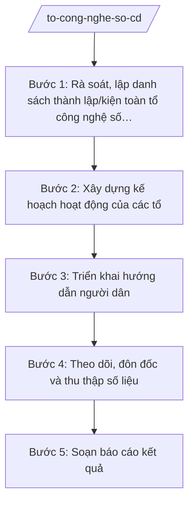

# Skill: Tổ công nghệ số cộng đồng

## 2. Khi nào dùng

- Khi xã cần thành lập mới hoặc kiện toàn tổ công nghệ số cộng đồng tại các thôn/xóm (nhiệm vụ chuyển đổi số, xã hội số giao cấp xã theo TT 10/2025/TT-BKHCN).
- Khi cần xây dựng kế hoạch hoạt động hằng năm/quý của các tổ công nghệ số cộng đồng.
- Khi cần tổ chức hướng dẫn người dân sử dụng dịch vụ công trực tuyến, thanh toán không dùng tiền mặt, kỹ năng số cơ bản (cài đặt, sử dụng ứng dụng, phòng tránh lừa đảo trên mạng).
- Khi cần tổng hợp, báo cáo kết quả hoạt động của các tổ công nghệ số cộng đồng lên cấp trên.

## 3. Đầu vào (Input)

| Trường | Mô tả | Bắt buộc |
|--------|-------|----------|
| `thon_xom` | Danh sách thôn/xóm, số hộ dân, tình trạng tổ công nghệ số cộng đồng hiện có | Có |
| `thanh_vien_du_kien` | Danh sách thành viên dự kiến mỗi tổ (tổ trưởng, thành viên): họ tên, vai trò, số điện thoại | Có |
| `nhiem_vu_trong_tam` | Nhiệm vụ chuyển đổi số trọng tâm của xã trong kỳ (vd: 100% hồ sơ trực tuyến, thu phí không tiền mặt) | Có |
| `doi_tuong_uu_tien` | Nhóm người dân ưu tiên hỗ trợ (người cao tuổi, hộ nghèo, tiểu thương chợ) | Không |
| `ky_bao_cao` | Kỳ kế hoạch/báo cáo (quý, 6 tháng, năm) | Có |
| `so_lieu_ky_truoc` | Số liệu kết quả kỳ trước (số lượt hướng dẫn, số hồ sơ trực tuyến) nếu có | Không |

## 4. Quy trình

**Bước 1. Rà soát, lập danh sách thành lập/kiện toàn tổ công nghệ số cộng đồng**
- Làm gì: Rà soát từng thôn/xóm: tổ đã có hay chưa, số thành viên, năng lực; lập danh sách thành lập mới/kiện toàn (thay thế, bổ sung thành viên); dự thảo quyết định thành lập.
- Dùng input: `thon_xom`, `thanh_vien_du_kien`.
- Vai trò: Công chức văn hóa – xã hội phụ trách lĩnh vực chuyển đổi số rà soát, lập danh sách; AI hỗ trợ tổng hợp bảng thôn – tình trạng tổ – đề xuất thành lập/kiện toàn (~0,5 ngày).
- Lưu ý nghiệp vụ: Mỗi thôn/xóm có 1 tổ; thành viên ưu tiên đoàn viên, thanh niên, người am hiểu công nghệ, có uy tín; tổ trưởng do thôn đề cử.
- → Kết quả bước: Bảng rà soát + dự thảo quyết định thành lập/kiện toàn tổ công nghệ số cộng đồng các thôn.

**Bước 2. Xây dựng kế hoạch hoạt động của các tổ**
- Làm gì: Lập kế hoạch hoạt động theo kỳ: mục tiêu (số lượt người dân được hướng dẫn, tỷ lệ hồ sơ trực tuyến); nội dung (hướng dẫn dịch vụ công trực tuyến, thanh toán không dùng tiền mặt, kỹ năng số cơ bản, an toàn thông tin); hình thức (hướng dẫn trực tiếp tại nhà, điểm hỗ trợ lưu động, nhóm Zalo thôn); phân công, kinh phí, tiến độ.
- Dùng input: `nhiem_vu_trong_tam`, `doi_tuong_uu_tien`, `ky_bao_cao`, `so_lieu_ky_truoc`.
- Vai trò: Công chức văn hóa – xã hội soạn kế hoạch; Trưởng phòng Văn hóa – Xã hội (ông Vũ Văn E) kiểm tra, trình Phó Chủ tịch UBND xã (bà Trần Thị B) phê duyệt; AI hỗ trợ soạn thảo kế hoạch theo thể thức NĐ 30/2020/NĐ-CP (~1 ngày).
- Lưu ý nghiệp vụ: Mục tiêu phải đo được (số lượt, tỷ lệ %); nội dung bám nhiệm vụ chuyển đổi số của xã; có lịch hỗ trợ lưu động đến từng thôn.
- → Kết quả bước: Dự thảo Kế hoạch hoạt động tổ công nghệ số cộng đồng (kỳ …).

**Bước 3. Triển khai hướng dẫn người dân**
- Làm gì: Các tổ công nghệ số cộng đồng triển khai theo kế hoạch: hướng dẫn cài đặt và sử dụng ứng dụng dịch vụ công trực tuyến; hướng dẫn thanh toán không dùng tiền mặt (quét mã QR, ví điện tử); kỹ năng số cơ bản (tra cứu thông tin, phòng tránh lừa đảo); ghi nhật ký lượt hỗ trợ.
- Dùng input: Kế hoạch bước 2, `doi_tuong_uu_tien`.
- Vai trò: Thành viên tổ công nghệ số cộng đồng các thôn trực tiếp hướng dẫn người dân; công chức văn hóa – xã hội theo dõi, đôn đốc; AI hỗ trợ soạn tài liệu hướng dẫn ngắn gọn, dễ hiểu cho người dân (~1 ngày, cập nhật suốt kỳ).
- Lưu ý nghiệp vụ: Hướng dẫn tận nơi cho người cao tuổi, người khó khăn; không thu thập thông tin cá nhân, mật khẩu của người dân; cảnh báo lừa đảo mạo danh cơ quan nhà nước.
- → Kết quả bước: Nhật ký lượt hướng dẫn của các tổ + tài liệu hướng dẫn người dân.

**Bước 4. Theo dõi, đôn đốc và thu thập số liệu**
- Làm gì: Thu thập số liệu từ các tổ: số lượt người dân được hướng dẫn theo nội dung; số hồ sơ dịch vụ công trực tuyến phát sinh; khó khăn, vướng mắc; tổng hợp theo biểu mẫu thống nhất.
- Dùng input: Nhật ký bước 3, `ky_bao_cao`, `so_lieu_ky_truoc`.
- Vai trò: Công chức văn hóa – xã hội tổng hợp số liệu; AI hỗ trợ kiểm tra tính nhất quán số liệu giữa các tổ, lập bảng tổng hợp (~0,5 ngày).
- Lưu ý nghiệp vụ: Số liệu phải có nguồn (nhật ký tổ), không ước đoán; đối chiếu với số liệu kỳ trước để đánh giá tiến bộ.
- → Kết quả bước: Bảng tổng hợp số liệu hoạt động của các tổ công nghệ số cộng đồng.

**Bước 5. Soạn báo cáo kết quả**
- Làm gì: Soạn báo cáo kết quả hoạt động: tình hình triển khai; kết quả đạt được so với mục tiêu kế hoạch; khó khăn, vướng mắc; đề xuất, kiến nghị; phương hướng kỳ tới.
- Dùng input: Bảng tổng hợp bước 4, kế hoạch bước 2.
- Vai trò: Công chức văn hóa – xã hội soạn; Trưởng phòng Văn hóa – Xã hội (ông Vũ Văn E) kiểm tra, trình Chủ tịch UBND xã (ông Nguyễn Văn A) ký báo cáo gửi cấp trên; AI hỗ trợ soạn báo cáo theo thể thức NĐ 30/2020/NĐ-CP (~0,5 ngày).
- Lưu ý nghiệp vụ: Báo cáo trung thực, số liệu khớp với bảng tổng hợp; nêu rõ khó khăn thực tế (thiết bị, đường truyền, nhận thức người dân) và đề xuất cụ thể.
- → Kết quả bước: Báo cáo kết quả hoạt động tổ công nghệ số cộng đồng (kỳ …) trình ký.

## Luồng quy trình (Workflow)

## 5. Đầu ra (Output)

**Danh sách sản phẩm:**
1. Kế hoạch hoạt động tổ công nghệ số cộng đồng (kỳ …) (sản phẩm chính 1).
2. Báo cáo kết quả hoạt động tổ công nghệ số cộng đồng (kỳ …) (sản phẩm chính 2).
3. Quyết định thành lập/kiện toàn tổ công nghệ số cộng đồng các thôn (văn bản kèm theo).
4. Tài liệu hướng dẫn người dân (tờ rơi, hướng dẫn ngắn) (tài liệu kèm theo).
5. Bảng tổng hợp số liệu hoạt động (phụ lục báo cáo).

**Cấu trúc output chuẩn — Kế hoạch hoạt động tổ công nghệ số cộng đồng (đúng thể thức NĐ 30/2020/NĐ-CP):**

1. Quốc hiệu – tiêu ngữ: "CỘNG HÒA XÃ HỘI CHỦ NGHĨA VIỆT NAM / Độc lập – Tự do – Hạnh phúc".
2. Số, ký hiệu văn bản: số/ký hiệu theo quy định (vd: 123/KH-UBND).
3. Địa danh, ngày tháng năm ban hành: "Xã A, ngày … tháng … năm …".
4. Tên loại và trích yếu: "KẾ HOẠCH — Hoạt động tổ công nghệ số cộng đồng xã A năm … (quý …)".
5. Căn cứ: TT 10/2025/TT-BKHCN; NĐ 150/2025/NĐ-CP; nhiệm vụ chuyển đổi số của xã.
6. Nội dung: I. Mục đích, yêu cầu; II. Mục tiêu cụ thể (chỉ tiêu đo được); III. Nội dung, hình thức hoạt động; IV. Tổ chức thực hiện (phân công Phòng VH-XH, các thôn, tổ công nghệ số cộng đồng); V. Kinh phí; VI. Chế độ báo cáo.
7. Nơi nhận: lưu VP, Phòng VH-XH, các thôn, các tổ công nghệ số cộng đồng.
8. Chữ ký: Phó Chủ tịch UBND xã (hoặc Chủ tịch) ký, đóng dấu UBND xã.

**Cấu trúc output chuẩn — Báo cáo kết quả hoạt động (đúng thể thức NĐ 30/2020/NĐ-CP):**

1. Quốc hiệu "CỘNG HÒA XÃ HỘI CHỦ NGHĨA VIỆT NAM" – Tiêu ngữ "Độc lập – Tự do – Hạnh phúc".
2. Số, ký hiệu văn bản: số/ký hiệu theo quy định (vd: 123/BC-UBND).
3. Địa danh, ngày tháng năm ban hành.
4. Tên loại và trích yếu: "BÁO CÁO — Kết quả hoạt động tổ công nghệ số cộng đồng xã A (quý …/năm …)".
5. Căn cứ: Kế hoạch số …/KH-UBND; TT 10/2025/TT-BKHCN.
6. Nội dung: I. Tình hình triển khai; II. Kết quả đạt được (bảng số liệu theo tổ, theo nội dung); III. Đánh giá chung (so với mục tiêu); IV. Khó khăn, vướng mắc; V. Đề xuất, kiến nghị; VI. Phương hướng kỳ tới.
7. Nơi nhận: UBND tỉnh A (Sở KH&CN), lưu VP, Phòng VH-XH.
8. Chữ ký: Chủ tịch UBND xã ký, đóng dấu.

## 6. Checklist nghiệm thu

- [ ] Mỗi thôn/xóm có 1 tổ công nghệ số cộng đồng, danh sách thành viên rõ họ tên, vai trò, liên hệ.
- [ ] Kế hoạch có mục tiêu đo được (số lượt hướng dẫn, tỷ lệ hồ sơ trực tuyến), bám nhiệm vụ chuyển đổi số của xã.
- [ ] Nội dung hướng dẫn đủ 3 nhóm: dịch vụ công trực tuyến, thanh toán không dùng tiền mặt, kỹ năng số cơ bản/an toàn thông tin.
- [ ] Có lịch hỗ trợ lưu động đến từng thôn và phân công tổ chức thực hiện rõ ràng.
- [ ] Báo cáo có bảng số liệu theo tổ, khớp với nhật ký/bảng tổng hợp, đánh giá đúng mức so với mục tiêu.
- [ ] Văn bản đúng thể thức NĐ 30/2020/NĐ-CP (quốc hiệu, số/ký hiệu, nơi nhận, chữ ký, con dấu).
- [ ] Số liệu, tên người, tên thôn trong văn bản khớp đúng Input, không bịa số liệu.
- [ ] Đã qua human gate: Trưởng phòng kiểm tra, lãnh đạo UBND xã phê duyệt/ký.

## 7. Ví dụ mô phỏng

*Dữ liệu dưới đây là giả lập 100% phục vụ minh họa.*

**Input mẫu:**
- thon_xom: 5 thôn (Thôn 1–5), 500 hộ dân; Thôn 1–3 đã có tổ (mỗi tổ 5 người), Thôn 4–5 chưa có tổ
- thanh_vien_du_kien: Thôn 4: ông Nguyễn Văn G (tổ trưởng), 4 thành viên; Thôn 5: bà Trần Thị H (tổ trưởng), 4 thành viên; kiện toàn Thôn 2 (thay 1 thành viên)
- nhiem_vu_trong_tam: 80% hồ sơ TTHC nộp trực tuyến; 100% tiểu thương chợ xã thanh toán QR
- doi_tuong_uu_tien: người cao tuổi, hộ nghèo
- ky_bao_cao: quý IV/2026

**Output mẫu — Kế hoạch hoạt động:**

> CỘNG HÒA XÃ HỘI CHỦ NGHĨA VIỆT NAM
> Độc lập – Tự do – Hạnh phúc
>
> Số: 123/KH-UBND
>
> Xã A, ngày 09 tháng 10 năm 2026
>
> **KẾ HOẠCH**
> **Hoạt động tổ công nghệ số cộng đồng xã A quý IV năm 2026**
>
> Căn cứ Thông tư số 10/2025/TT-BKHCN ngày 27/6/2025 của Bộ Khoa học và Công nghệ;
> Căn cứ Nghị định số 150/2025/NĐ-CP ngày 12/6/2025 của Chính phủ;
>
> **I. MỤC ĐÍCH, YÊU CẦU**
> 1. Phát huy vai trò tổ công nghệ số cộng đồng trong hỗ trợ người dân sử dụng dịch vụ số.
> 2. Hoạt động thiết thực, đến từng hộ dân, ưu tiên người cao tuổi, hộ nghèo.
>
> **II. MỤC TIÊU CỤ THỂ**
> 1. Hướng dẫn ít nhất 1.000 lượt người dân sử dụng dịch vụ công trực tuyến.
> 2. 100% tiểu thương chợ xã A sử dụng thanh toán QR.
> 3. Thành lập mới 2 tổ công nghệ số cộng đồng tại Thôn 4, Thôn 5; kiện toàn tổ Thôn 2.
>
> **III. NỘI DUNG, HÌNH THỨC**
> 1. Hướng dẫn nộp hồ sơ dịch vụ công trực tuyến tại nhà dân và điểm hỗ trợ lưu động.
> 2. Hướng dẫn thanh toán không dùng tiền mặt cho tiểu thương chợ xã.
> 3. Tuyên truyền kỹ năng phòng tránh lừa đảo trên mạng.
>
> **IV. TỔ CHỨC THỰC HIỆN**
> 1. Phòng Văn hóa – Xã hội: tham mưu, theo dõi, tổng hợp báo cáo.
> 2. Các thôn: tạo điều kiện cho tổ hoạt động; đề cử nhân sự.
> 3. Tổ công nghệ số cộng đồng: trực tiếp hướng dẫn người dân, ghi nhật ký.
>
> **V. KINH PHÍ:** từ nguồn ngân sách xã và nguồn hợp pháp khác.
>
> **VI. CHẾ ĐỘ BÁO CÁO:** các tổ báo cáo hằng tháng về Phòng VH-XH trước ngày 25.
>
> **Nơi nhận:**
> - Lưu: VP, Phòng VH-XH;
> - Các thôn 1–5; các tổ công nghệ số cộng đồng.
>
> **KT. CHỦ TỊCH**
> **PHÓ CHỦ TỊCH**
>
> *(Ký, đóng dấu)*
> **Trần Thị B**

## 8. Human gate (người kiểm duyệt)

- Công chức văn hóa – xã hội phụ trách lĩnh vực chuyển đổi số soạn kế hoạch, báo cáo, dự thảo quyết định thành lập/kiện toàn.
- Trưởng phòng Văn hóa – Xã hội (ông Vũ Văn E) kiểm tra nội dung, số liệu, thể thức.
- Phó Chủ tịch UBND xã (bà Trần Thị B) phê duyệt Kế hoạch hoạt động.
- Chủ tịch UBND xã (ông Nguyễn Văn A) ký ban hành quyết định thành lập/kiện toàn tổ và ký báo cáo gửi cấp trên.

## 9. Giới hạn (guardrails)

- AI KHÔNG ra quyết định hành chính thay người có thẩm quyền; không tự phê duyệt kế hoạch, không tự ban hành quyết định thành lập tổ.
- AI KHÔNG tự ký, đóng dấu hoặc phát hành văn bản dưới danh nghĩa UBND xã hay cá nhân lãnh đạo.
- AI KHÔNG bịa số liệu kết quả (số lượt hướng dẫn, tỷ lệ hồ sơ trực tuyến), số hiệu văn bản, căn cứ pháp lý.
- AI KHÔNG dùng văn bản đã hết hiệu lực (vd: TT 01/2021/TT-BKHCN, TT 11/2022/TT-BTTTT đã được thay thế bởi TT 10/2025/TT-BKHCN).
- AI KHÔNG thu thập, lưu giữ thông tin cá nhân, mật khẩu của người dân trong quá trình hỗ trợ hướng dẫn.

## 10. Căn cứ & lưu ý

- Thông tư số 10/2025/TT-BKHCN ngày 27/6/2025 của Bộ Khoa học và Công nghệ (hiệu lực 01/7/2025): hướng dẫn chức năng, nhiệm vụ của cơ quan chuyên môn cấp xã trong các lĩnh vực thuộc phạm vi quản lý của Bộ KH&CN (chuyển đổi số, chính quyền số, kinh tế số, xã hội số).
- Nghị định số 132/2025/NĐ-CP ngày 12/6/2025 của Chính phủ: phân định thẩm quyền CQĐP 2 cấp trong lĩnh vực quản lý nhà nước của Bộ Khoa học và Công nghệ.
- Nghị định số 150/2025/NĐ-CP ngày 12/6/2025 của Chính phủ: tổ chức Phòng Văn hóa – Xã hội cấp xã; sửa đổi bởi NĐ 370/2025/NĐ-CP.
- Nghị định số 30/2020/NĐ-CP của Chính phủ: thể thức văn bản hành chính.
- Lưu ý: tổ công nghệ số cộng đồng hoạt động theo nguyên tắc tự nguyện, gần dân; hiệu quả đo bằng số người dân thực sự sử dụng được dịch vụ số.
