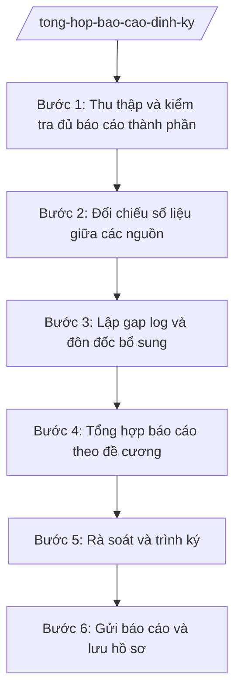

# Skill: Tổng hợp báo cáo định kỳ

> **Ghi chú áp dụng đa cấp:** Skill dùng chung cho mọi cấp hành chính. Các chức danh, đơn vị nêu trong quy trình (ví dụ: "Chủ tịch UBND xã", "Chánh Văn phòng", "Sở Tài chính") được viết theo mẫu minh họa — khi áp dụng ở cấp khác, thay bằng chức danh/đơn vị tương ứng của cấp đó (cấp tỉnh: Chủ tịch UBND tỉnh, Giám đốc Sở; cấp trung ương: Bộ trưởng, Vụ trưởng/Cục trưởng).

## Khi nào dùng

- Lập báo cáo tháng, quý, 6 tháng, năm của UBND xã gửi UBND tỉnh và các sở, ngành.
- Gộp báo cáo thành phần của Văn phòng HĐND&UBND, Phòng Kinh tế, Phòng Văn hóa – Xã hội, Trung tâm PVHCC theo đúng đề cương mẫu của cấp trên.
- Đối chiếu, kiểm tra tính thống nhất của số liệu giữa các đơn vị và với kỳ báo cáo trước.
- Lập danh mục số liệu thiếu, chưa thống nhất (gap log) và đôn đốc đơn vị bổ sung trước hạn nộp.
- Rà soát lần cuối báo cáo tổng hợp trước khi trình Chủ tịch UBND xã ký ban hành.

## Đầu vào (Input)

| Trường | Mô tả | Bắt buộc |
|--------|-------|----------|
| `ten_bao_cao` | Tên đầy đủ của báo cáo (VD: Báo cáo tình hình kinh tế – xã hội tháng 10 năm 2026) | Có |
| `ky_bao_cao` | Tháng / Quý / 6 tháng / Năm và thời gian cụ thể | Có |
| `de_cuong_mau` | Đề cương, yêu cầu nội dung của cấp trên (các mục bắt buộc) | Có |
| `bao_cao_thanh_phan` | Báo cáo của từng phòng/ban/Trung tâm PVHCC | Có |
| `han_nop` | Thời hạn gửi báo cáo cho cấp trên | Có |
| `so_lieu_ky_truoc` | Số liệu kỳ báo cáo liền trước để đối chiếu, phát hiện biến động | Không |
| `don_vi_dau_moi` | Đơn vị chủ trì tổng hợp (mặc định: Văn phòng HĐND&UBND) | Không |

## Quy trình

**Bước 1. Thu thập và kiểm tra đủ báo cáo thành phần**

- Làm gì: Gửi đề cương và hạn nộp nội bộ cho các phòng, ban, Trung tâm PVHCC; thu thập báo cáo thành phần; lập bảng theo dõi đơn vị nào đã nộp, chưa nộp.
- Dùng input: `de_cuong_mau`, `bao_cao_thanh_phan`, `han_nop`.
- Vai trò: Công chức Văn phòng HĐND&UBND làm đầu mối (AI hỗ trợ soạn thông báo gửi đề cương, lập bảng theo dõi tiến độ nộp, gửi nhắc tự động). ⏱ ~trước hạn nộp nội bộ 3–5 ngày (ước tính).
- Lưu ý nghiệp vụ: Quy định hạn nộp nội bộ sớm hơn hạn nộp của cấp trên để còn thời gian tổng hợp, đối chiếu và đôn đốc bổ sung.
- → Kết quả bước: Bảng theo dõi thu thập báo cáo thành phần (đã nộp/chưa nộp từng đơn vị).

**Bước 2. Đối chiếu số liệu giữa các nguồn**

- Làm gì: So sánh các chỉ tiêu trùng lặp giữa báo cáo của các đơn vị (VD: số hộ nghèo trong báo cáo của Phòng Văn hóa – Xã hội với số liệu giảm nghèo trong báo cáo kinh tế – xã hội của Phòng Kinh tế); đối chiếu với số liệu kỳ trước để phát hiện biến động bất thường.
- Dùng input: `bao_cao_thanh_phan`, `so_lieu_ky_truoc`, `de_cuong_mau`.
- Vai trò: Công chức Văn phòng đối chiếu (AI hỗ trợ so sánh tự động, đánh dấu các chỉ tiêu chênh lệch giữa các nguồn và các biến động đột biến so với kỳ trước để người kiểm tra xác minh). ⏱ 1–2 ngày (ước tính) làm việc.
- Lưu ý nghiệp vụ: AI chỉ đánh dấu điểm nghi vấn, không tự ý "chốt" số liệu; mọi chênh lệch phải được đơn vị liên quan xác nhận lại bằng giải trình cụ thể.
- → Kết quả bước: Bảng đối chiếu số liệu (ghi rõ chỉ tiêu nào khớp, chỉ tiêu nào chênh lệch).

**Bước 3. Lập gap log và đôn đốc bổ sung**

- Làm gì: Lập danh mục các số liệu thiếu, chưa thống nhất (gap log): chỉ tiêu nào thiếu, đơn vị nào phải bổ sung, hạn bổ sung; gửi phiếu đôn đốc và theo dõi đến khi đủ số liệu.
- Dùng input: Bảng đối chiếu số liệu (bước 2), bảng theo dõi thu thập (bước 1).
- Vai trò: Công chức Văn phòng lập gap log (AI hỗ trợ tổng hợp gap log tự động từ bảng đối chiếu, soạn phiếu đôn đốc gửi từng đơn vị); Chánh Văn phòng ký đôn đốc. ⏱ 1 ngày (ước tính) làm việc.
- Lưu ý nghiệp vụ: Gap log phải cụ thể đến từng chỉ tiêu, từng đơn vị, không ghi chung chung "đề nghị bổ sung số liệu"; đơn vị quá hạn bổ sung thì báo cáo Chủ tịch UBND xã.
- → Kết quả bước: Gap log số liệu thiếu/chưa thống nhất + phiếu đôn đốc đã gửi các đơn vị.

**Bước 4. Tổng hợp báo cáo theo đề cương**

- Làm gì: Gộp nội dung các báo cáo thành phần theo đúng thứ tự các mục của đề cương; viết phần đánh giá chung, tồn tại, hạn chế, nhiệm vụ kỳ tới; thống nhất số liệu, đơn vị tính, cách trình bày toàn báo cáo.
- Dùng input: `de_cuong_mau`, `bao_cao_thanh_phan` (đã bổ sung sau đôn đốc), `ten_bao_cao`, `ky_bao_cao`.
- Vai trò: Công chức Văn phòng tổng hợp (AI hỗ trợ dựng khung báo cáo theo đề cương, gộp số liệu vào từng mục, kiểm tra mục nào của đề cương còn thiếu, soạn nháp phần nhận xét, đánh giá). ⏱ 2–3 ngày (ước tính) làm việc.
- Lưu ý nghiệp vụ: Không bịa số liệu còn thiếu — mục nào chưa có số liệu thì ghi rõ "đang cập nhật" hoặc để trống có chú thích; mọi số liệu phải ghi rõ nguồn và kỳ số liệu.
- → Kết quả bước: Dự thảo báo cáo tổng hợp đúng đề cương mẫu của cấp trên.

**Bước 5. Rà soát và trình ký**

- Làm gì: Chánh Văn phòng rà soát toàn văn: đủ các mục của đề cương, số liệu thống nhất giữa các phần, đúng thể thức văn bản; trình Chủ tịch UBND xã xem xét, ký duyệt.
- Dùng input: Dự thảo báo cáo (bước 4).
- Vai trò: Chánh Văn phòng HĐND&UBND rà soát (AI hỗ trợ kiểm tra thể thức theo NĐ 30/2020/NĐ-CP, đối chiếu lần cuối số liệu tổng với số liệu thành phần); Chủ tịch UBND xã ký duyệt. ⏱ 1 ngày (ước tính) làm việc.
- Lưu ý nghiệp vụ: Báo cáo gửi cấp trên phải do Chủ tịch UBND xã ký; kiểm tra kỹ số liệu tổng hợp khớp với số liệu thành phần trước khi trình ký.
- → Kết quả bước: Báo cáo tổng hợp đã được ký duyệt.

**Bước 6. Gửi báo cáo và lưu hồ sơ**

- Làm gì: Gửi báo cáo đến cấp trên đúng hạn, đúng địa chỉ nhận; lưu hồ sơ đầy đủ: báo cáo đã ký, báo cáo thành phần, bảng đối chiếu, gap log, phiếu đôn đốc để phục vụ kiểm tra và đối chiếu kỳ sau.
- Dùng input: Báo cáo đã ký duyệt, `han_nop`.
- Vai trò: Công chức Văn phòng gửi và lưu hồ sơ (AI hỗ trợ lập danh mục hồ sơ lưu theo từng kỳ báo cáo). ⏱ ~trong thời hạn nộp báo cáo (ước tính).
- Lưu ý nghiệp vụ: Giữ bằng chứng đã gửi báo cáo đúng hạn (biên nhận, xác nhận gửi); hồ sơ đầy đủ là cơ sở để đối chiếu số liệu kỳ báo cáo tiếp theo.
- → Kết quả bước: Báo cáo đã gửi đúng hạn; hồ sơ kỳ báo cáo được lưu trữ đầy đủ.

## Luồng quy trình (Workflow)

## 5. Đầu ra (Output)

- Báo cáo tổng hợp định kỳ theo đúng đề cương mẫu (sản phẩm chính).
- Bảng theo dõi thu thập báo cáo thành phần.
- Bảng đối chiếu số liệu giữa các nguồn.
- Gap log số liệu thiếu/chưa thống nhất.
- Phiếu đôn đốc bổ sung số liệu.
- Hồ sơ lưu kỳ báo cáo (báo cáo đã ký, báo cáo thành phần, đối chiếu, gap log).

### Cấu trúc output chuẩn

**BÁO CÁO TỔNG HỢP ĐỊNH KỲ** — các phần bắt buộc theo đúng thứ tự, đúng thể thức văn bản hành chính theo NĐ 30/2020/NĐ-CP:

1. Quốc hiệu "CỘNG HÒA XÃ HỘI CHỦ NGHĨA VIỆT NAM" – Tiêu ngữ "Độc lập – Tự do – Hạnh phúc".
2. Tên cơ quan ban hành: ỦY BAN NHÂN DÂN XÃ A; số, ký hiệu văn bản.
3. Địa danh, ngày, tháng, năm ban hành.
4. Tên báo cáo: BÁO CÁO + nội dung và kỳ báo cáo (VD: tình hình kinh tế – xã hội tháng 10 năm 2026).
5. Kính gửi: (cơ quan cấp trên nhận báo cáo).
6. Phần I: Kết quả thực hiện (trình bày theo từng mục của đề cương, có số liệu cụ thể, ghi rõ nguồn số liệu).
7. Phần II: Tồn tại, hạn chế và nguyên nhân.
8. Phần III: Nhiệm vụ, giải pháp trọng tâm kỳ tới.
9. Nơi nhận (ghi đầy đủ); chữ ký người có thẩm quyền (Chủ tịch UBND xã), đóng dấu.

> **Checklist thể thức văn bản theo NĐ 30/2020/NĐ-CP** — đối chiếu trước khi trình ký:
> 1. Quốc hiệu và Tiêu ngữ.
> 2. Tên cơ quan, tổ chức ban hành văn bản.
> 3. Số, ký hiệu của văn bản.
> 4. Địa danh và thời gian ban hành văn bản.
> 5. Tên loại và trích yếu nội dung văn bản.
> 6. Nội dung văn bản.
> 7. Chức vụ, họ tên và chữ ký của người có thẩm quyền.
> 8. Dấu, chữ ký số của cơ quan, tổ chức.
> 9. Nơi nhận (kèm Phụ lục nếu có).

## 6. Checklist nghiệm thu

1. Báo cáo có đủ các mục theo đề cương mẫu của cấp trên, đúng thứ tự.
2. 100% đơn vị có báo cáo thành phần đã được thu thập, không thiếu đầu mối.
3. Số liệu giữa các báo cáo thành phần đã được đối chiếu; chênh lệch đã có giải trình xác nhận.
4. Gap log liệt kê cụ thể từng chỉ tiêu thiếu/chưa thống nhất, có đơn vị và hạn bổ sung.
5. Không có số liệu bịa đặt: mục chưa có số liệu được ghi rõ "đang cập nhật" hoặc chú thích.
6. Số liệu tổng trong báo cáo khớp với số liệu báo cáo thành phần.
7. Phần đánh giá, tồn tại, nhiệm vụ kỳ tới bám sát số liệu, không chung chung.
8. Báo cáo do Chủ tịch UBND xã ký; thể thức đúng NĐ 30/2020/NĐ-CP.
9. Báo cáo gửi đúng hạn, đúng địa chỉ; hồ sơ kỳ báo cáo lưu đầy đủ.

## 7. Ví dụ mô phỏng

*Dữ liệu dưới đây là giả lập 100% phục vụ minh họa.*

**Input mẫu:**

| Trường | Giá trị mẫu |
|--------|-------------|
| Tên báo cáo | Báo cáo tình hình kinh tế – xã hội tháng 10 năm 2026 |
| Kỳ báo cáo | Tháng 10/2026 |
| Đề cương mẫu | Đề cương báo cáo tháng của UBND tỉnh A (3 phần: kết quả, tồn tại, nhiệm vụ) |
| Báo cáo thành phần | Báo cáo của Văn phòng HĐND&UBND; Phòng Kinh tế; Phòng Văn hóa – Xã hội; Trung tâm PVHCC xã A |
| Hạn nộp | 05/11/2026 |
| Số liệu kỳ trước | Số liệu báo cáo tháng 9/2026 |
| Đơn vị đầu mối | Văn phòng HĐND&UBND xã A |

**Output mẫu (Báo cáo tổng hợp — trích cấu trúc):**

CỘNG HÒA XÃ HỘI CHỦ NGHĨA VIỆT NAM
Độc lập – Tự do – Hạnh phúc

ỦY BAN NHÂN DÂN XÃ A
Số: 120/BC-UBND · Xã A, ngày 04 tháng 11 năm 2026

**BÁO CÁO**
**Tình hình kinh tế – xã hội tháng 10 năm 2026**

Kính gửi: Ủy ban nhân dân tỉnh A.

**I. KẾT QUẢ THỰC HIỆN**

1. Kinh tế: Tổng thu ngân sách xã tháng 10 đạt 500 triệu đồng, lũy kế 10 tháng đạt 5.000 triệu đồng (đạt 100% dự toán năm, số liệu do Phòng Kinh tế cung cấp).
2. Văn hóa – xã hội: Toàn xã có 1.000 hộ với 4.000 nhân khẩu; 03 trường học duy trì dạy học ổn định; 50 hộ nghèo đang được rà soát theo kế hoạch (số liệu do Phòng Văn hóa – Xã hội cung cấp, đã đối chiếu thống nhất).
3. Hành chính công: Trung tâm PVHCC tiếp nhận 200 hồ sơ, giải quyết đúng hạn 195 hồ sơ (đạt 98%).

**II. TỒN TẠI, HẠN CHẾ**

- Tiến độ duy tu 500 m đường giao thông thôn 1 còn chậm do mùa mưa (nguyên nhân khách quan).

**III. NHIỆM VỤ TRỌNG TÂM THÁNG 11/2026**

- Hoàn thành sửa chữa đường giao thông thôn 1 trước ngày 30/11/2026.
- Tiếp tục rà soát hộ nghèo, phấn đấu giảm 10 hộ trong quý IV/2026.

Nơi nhận: Như kính gửi; Lưu: VT.
CHỦ TỊCH
(Ký, đóng dấu — Ông Nguyễn Văn A)

## 8. Human gate

- Công chức Văn phòng HĐND&UBND tổng hợp dự thảo → Chánh Văn phòng rà soát (đủ mục đề cương, số liệu thống nhất, đúng thể thức) → Chủ tịch UBND xã ký duyệt trước khi gửi cấp trên.
- Gap log và phiếu đôn đốc do Chánh Văn phòng ký ban hành.

## 9. Giới hạn

- AI không tự ý "chốt" số liệu khi các nguồn báo cáo chênh lệch nhau; mọi chênh lệch phải do đơn vị liên quan xác nhận.
- AI không bịa đặt số liệu còn thiếu; không tự điền số liệu vào mục trống.
- AI không thay đổi số liệu do đơn vị báo cáo nếu không có xác nhận, giải trình của đơn vị đó.
- AI không ký, không gửi báo cáo thay người có thẩm quyền.

## 10. Căn cứ & lưu ý

- NĐ 150/2025/NĐ-CP: vị trí, chức năng, nhiệm vụ của UBND cấp xã và các phòng chuyên môn trong mô hình chính quyền địa phương 2 cấp.
- TT 06/2026/TT-BNV: khung nhiệm vụ ngành Nội vụ ở cấp xã, trong đó có công tác văn thư, báo cáo, cải cách hành chính.
- NĐ 30/2020/NĐ-CP: thể thức và kỹ thuật trình bày văn bản hành chính.
