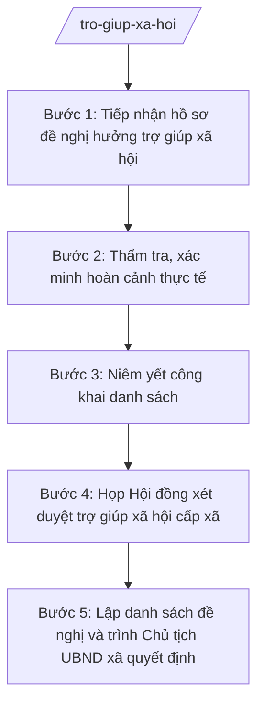

# Skill: Xét hưởng trợ giúp xã hội

## 2. Khi nào dùng

- Tiếp nhận hồ sơ đề nghị hưởng trợ giúp xã hội hằng tháng/một lần của đối tượng bảo trợ xã hội (người cao tuổi cô đơn, người khuyết tật, trẻ em mồ côi, hộ gia đình khó khăn đặc biệt...).
- Thẩm tra, xác minh hoàn cảnh thực tế của người đề nghị tại hộ gia đình, khu dân cư.
- Tổ chức họp Hội đồng xét duyệt trợ giúp xã hội cấp xã để xem xét từng trường hợp.
- Niêm yết công khai danh sách đề nghị hưởng trợ giúp xã hội tại trụ sở UBND xã và nhà văn hóa thôn.
- Lập danh sách đề nghị hưởng trợ giúp xã hội trình Chủ tịch UBND xã quyết định.

## 3. Đầu vào (Input)

| Trường | Mô tả | Bắt buộc |
|--------|-------|----------|
| `dot_xet_duyet` | Đợt xét duyệt (tháng/quý hoặc đợt phát sinh) | Có |
| `ho_so_de_nghi` | Danh sách hồ sơ đề nghị hưởng trợ giúp xã hội (họ tên, hoàn cảnh, loại đối tượng, giấy tờ kèm theo) | Có |
| `ket_qua_tham_tra` | Kết quả thẩm tra, xác minh hoàn cảnh thực tế tại hộ gia đình | Có |
| `bien_ban_niem_yet` | Biên bản niêm yết công khai danh sách tại UBND xã/thôn (thời gian, địa điểm niêm yết) | Có |
| `y_kien_phan_anh` | Ý kiến phản ánh của người dân trong thời gian niêm yết (nếu có) | Không |

## 4. Quy trình

**Bước 1. Tiếp nhận hồ sơ đề nghị hưởng trợ giúp xã hội**

- Làm gì: Tiếp nhận đơn đề nghị và giấy tờ kèm theo của người dân; kiểm tra tính đầy đủ của hồ sơ; lập sổ theo dõi, phiếu tiếp nhận và hẹn trả kết quả.
- Dùng input: `ho_so_de_nghi`, `dot_xet_duyet`.
- Vai trò: Công chức văn hóa – xã hội phụ trách lĩnh vực bảo trợ xã hội tiếp nhận tại UBND xã/bộ phận một cửa; AI hỗ trợ kiểm tra checklist thành phần hồ sơ, soạn phiếu tiếp nhận ⏱ ~30–45 phút/hồ sơ (ước tính).
- Lưu ý nghiệp vụ: Hướng dẫn người dân bổ sung hồ sơ thiếu một lần, đầy đủ; không để người dân đi lại nhiều lần; ghi sổ theo dõi đầy đủ, không bỏ sót hồ sơ.
- → Kết quả bước: Hồ sơ đề nghị đã tiếp nhận + sổ theo dõi, phiếu hẹn trả kết quả.

**Bước 2. Thẩm tra, xác minh hoàn cảnh thực tế**

- Làm gì: Xuống hộ gia đình xác minh hoàn cảnh thực tế (thu nhập, điều kiện sống, người nuôi dưỡng); lấy ý kiến trưởng thôn, hộ liền kề; lập biên bản/phiếu xác minh.
- Dùng input: `ho_so_de_nghi`, `ket_qua_tham_tra`.
- Vai trò: Công chức văn hóa – xã hội chủ trì xác minh, phối hợp trưởng thôn; AI hỗ trợ soạn phiếu xác minh, tổng hợp kết quả thẩm tra ⏱ ~1–2 giờ/trường hợp, tùy số lượng (ước tính).
- Lưu ý nghiệp vụ: Xác minh khách quan, trung thực, đúng thực tế; không xác minh qua loa trên giấy; ghi rõ căn cứ kết luận đủ/không đủ điều kiện.
- → Kết quả bước: Phiếu/biên bản xác minh hoàn cảnh từng trường hợp.

**Bước 3. Niêm yết công khai danh sách**

- Làm gì: Lập danh sách các trường hợp đề nghị hưởng sau thẩm tra; niêm yết công khai tại trụ sở UBND xã và nhà văn hóa thôn trong thời gian quy định; lập biên bản niêm yết; tiếp nhận ý kiến phản ánh của người dân.
- Dùng input: `ho_so_de_nghi` (đã thẩm tra), `bien_ban_niem_yet`, `y_kien_phan_anh`.
- Vai trò: Công chức văn hóa – xã hội thực hiện niêm yết; AI hỗ trợ soạn danh sách niêm yết, dự thảo biên bản niêm yết ⏱ ~1 giờ (ước tính).
- Lưu ý nghiệp vụ: Niêm yết đúng địa điểm, đủ thời gian quy định; mọi ý kiến phản ánh phải được ghi nhận và xác minh lại trước khi đưa ra Hội đồng.
- → Kết quả bước: Danh sách đã niêm yết + biên bản niêm yết + tổng hợp ý kiến phản ánh (nếu có).

**Bước 4. Họp Hội đồng xét duyệt trợ giúp xã hội cấp xã**

- Làm gì: Chuẩn bị tài liệu họp (danh sách, hồ sơ thẩm tra, biên bản niêm yết); tổ chức họp Hội đồng xét duyệt xem xét từng trường hợp; biểu quyết; lập biên bản họp.
- Dùng input: `ho_so_de_nghi`, `ket_qua_tham_tra`, `bien_ban_niem_yet`, `y_kien_phan_anh`.
- Vai trò: Hội đồng xét duyệt trợ giúp xã hội cấp xã (thành phần theo quy định hiện hành) họp và biểu quyết; công chức văn hóa – xã hội chuẩn bị tài liệu, ghi biên bản; AI hỗ trợ soạn tài liệu họp, dự thảo biên bản ⏱ ~2–3 giờ chuẩn bị + thời gian họp (ước tính).
- Lưu ý nghiệp vụ: Xem xét từng trường hợp cụ thể, không biểu quyết gộp khi có ý kiến khác nhau; biên bản phải ghi rõ kết quả biểu quyết từng trường hợp (đồng ý/không đồng ý, lý do).
- → Kết quả bước: Biên bản họp Hội đồng xét duyệt trợ giúp xã hội cấp xã.

**Bước 5. Lập danh sách đề nghị và trình Chủ tịch UBND xã quyết định**

- Làm gì: Căn cứ biên bản họp Hội đồng, lập danh sách chính thức các trường hợp đủ điều kiện đề nghị hưởng trợ giúp xã hội; soạn tờ trình trình Chủ tịch UBND xã xem xét, quyết định.
- Dùng input: `ho_so_de_nghi`, kết quả biểu quyết tại Bước 4, `dot_xet_duyet`.
- Vai trò: Công chức văn hóa – xã hội soạn thảo; AI hỗ trợ lập danh sách, soạn tờ trình đúng thể thức NĐ 30/2020/NĐ-CP ⏱ ~1–2 giờ (ước tính). Trưởng phòng Văn hóa – Xã hội kiểm tra trước khi trình.
- Lưu ý nghiệp vụ: Danh sách trình phải khớp tuyệt đối với kết quả biểu quyết của Hội đồng; không tự ý thêm/bớt trường hợp sau khi Hội đồng đã biểu quyết.
- → Kết quả bước: Danh sách đề nghị hưởng trợ giúp xã hội + tờ trình trình Chủ tịch UBND xã.

## Luồng quy trình (Workflow)

## 5. Đầu ra (Output)

**Danh sách sản phẩm:**
1. Biên bản họp Hội đồng xét duyệt trợ giúp xã hội cấp xã.
2. Danh sách đề nghị hưởng trợ giúp xã hội (kèm tờ trình trình Chủ tịch UBND xã).
3. Biên bản niêm yết công khai (tài liệu kèm theo).

**Cấu trúc output chuẩn** (Biên bản họp Hội đồng xét duyệt — thể thức biên bản cuộc họp theo NĐ 30/2020/NĐ-CP):
1. Quốc hiệu – Tiêu ngữ: "CỘNG HÒA XÃ HỘI CHỦ NGHĨA VIỆT NAM / Độc lập – Tự do – Hạnh phúc".
2. Tên biên bản: "BIÊN BẢN họp Hội đồng xét duyệt trợ giúp xã hội xã A đợt ...".
3. Thời gian, địa điểm họp.
4. Thành phần tham dự (chủ trì, thư ký, các thành viên Hội đồng; vắng mặt nếu có).
5. Nội dung cuộc họp: từng trường hợp được xem xét (họ tên, hoàn cảnh, kết quả thẩm tra, ý kiến thảo luận, kết quả biểu quyết).
6. Kết luận của cuộc họp (danh sách các trường hợp được Hội đồng thống nhất đề nghị/không đề nghị).
7. Chữ ký: thư ký và chủ trì cuộc họp.
8. Phân phối: các thành viên Hội đồng xét duyệt; UBND xã (để ra quyết định); lưu hồ sơ trợ giúp xã hội.

**Cấu trúc danh sách đề nghị** (theo NĐ 30/2020/NĐ-CP): quốc hiệu – tiêu ngữ; tên cơ quan (UBND xã A); số, ký hiệu; địa danh, ngày tháng năm; tên loại và trích yếu ("DANH SÁCH đề nghị hưởng trợ giúp xã hội đợt ..."); căn cứ (biên bản họp Hội đồng, văn bản pháp lý); nội dung là bảng danh sách (STT, họ tên, năm sinh, loại đối tượng, thôn, mức đề nghị, ghi chú); nơi nhận; chữ ký.

## 6. Checklist nghiệm thu

- [ ] 100% hồ sơ đề nghị đã được thẩm tra, xác minh hoàn cảnh thực tế, có phiếu/biên bản xác minh
- [ ] Danh sách đã niêm yết công khai đúng địa điểm, đủ thời gian; có biên bản niêm yết
- [ ] Ý kiến phản ánh trong thời gian niêm yết (nếu có) đã được xác minh lại và báo cáo Hội đồng
- [ ] Biên bản họp Hội đồng ghi rõ kết quả biểu quyết từng trường hợp, có chữ ký thư ký và chủ trì
- [ ] Danh sách đề nghị khớp tuyệt đối với kết quả biểu quyết của Hội đồng
- [ ] Đủ thành phần thể thức văn bản hành chính/biên bản theo NĐ 30/2020/NĐ-CP
- [ ] Căn cứ pháp lý đúng, còn hiệu lực, không bịa số hiệu văn bản
- [ ] Đã qua human gate: Hội đồng xét duyệt biểu quyết, Trưởng phòng kiểm tra, Chủ tịch UBND xã quyết định
- [ ] Dữ liệu ví dụ (nếu có) 100% hư cấu theo quy ước

## 7. Ví dụ mô phỏng

*Dữ liệu dưới đây là giả lập 100% phục vụ minh họa.*

**Input mẫu:**
- `dot_xet_duyet`: "Đợt 1 năm 2026"
- `ho_so_de_nghi`: 05 hồ sơ (02 người cao tuổi cô đơn, 02 người khuyết tật đặc biệt nặng, 01 trẻ em mồ côi)
- `ket_qua_tham_tra`: 04 trường hợp đủ điều kiện; 01 trường hợp không đủ (còn người nuôi dưỡng có thu nhập ổn định)
- `bien_ban_niem_yet`: niêm yết từ ngày 05/02/2026 đến 12/02/2026 tại trụ sở UBND xã A và nhà văn hóa thôn 1, thôn 2
- `y_kien_phan_anh`: không có ý kiến phản ánh

**Output mẫu:**

CỘNG HÒA XÃ HỘI CHỦ NGHĨA VIỆT NAM
Độc lập – Tự do – Hạnh phúc

**BIÊN BẢN**
**Họp Hội đồng xét duyệt trợ giúp xã hội xã A đợt 1 năm 2026**

*Thời gian:* 08 giờ 00 phút, ngày 15 tháng 02 năm 2026.
*Địa điểm:* Hội trường UBND xã A.
*Chủ trì:* Bà Trần Thị B – Phó Chủ tịch UBND xã.
*Thư ký:* Ông Nguyễn Văn G – Công chức Văn hóa – Xã hội xã A.
*Thành phần:* các thành viên Hội đồng xét duyệt trợ giúp xã hội xã A (05/05 thành viên có mặt).

*Nội dung:*
Hội đồng đã xem xét từng hồ sơ đề nghị hưởng trợ giúp xã hội đợt 1 năm 2026, căn cứ kết quả thẩm tra hoàn cảnh và biên bản niêm yết công khai (không có ý kiến phản ánh), thống nhất như sau:

1. Ông Nguyễn Văn Dân (sinh năm 1950, thôn 1) – người cao tuổi cô đơn, không nơi nương tựa: biểu quyết 05/05 đồng ý đề nghị hưởng trợ giúp xã hội hằng tháng.
2. Bà Trần Thị Dân (sinh năm 1955, thôn 2) – người khuyết tật đặc biệt nặng: biểu quyết 05/05 đồng ý.
3. Ông Nguyễn Văn H (sinh năm 1970, thôn 1) – người khuyết tật đặc biệt nặng: biểu quyết 05/05 đồng ý.
4. Cháu Trần Thị I (sinh năm 2018, thôn 2) – trẻ em mồ côi cả cha lẫn mẹ: biểu quyết 05/05 đồng ý.
5. Ông Phạm Văn K (sinh năm 1962, thôn 3) – còn người nuôi dưỡng có thu nhập ổn định: biểu quyết 05/05 không đồng ý.

*Kết luận:* Hội đồng thống nhất đề nghị hưởng trợ giúp xã hội đối với 04 trường hợp (từ số 1 đến số 4); không đề nghị đối với 01 trường hợp (số 5). Giao công chức Văn hóa – Xã hội hoàn thiện danh sách, trình Chủ tịch UBND xã quyết định.

Biên bản kết thúc hồi 10 giờ 30 phút cùng ngày.

**THƯ KÝ**
Nguyễn Văn G

**CHỦ TRÌ**
Trần Thị B

## 8. Human gate (người kiểm duyệt)

- Công chức văn hóa – xã hội chuẩn bị tài liệu → Hội đồng xét duyệt trợ giúp xã hội cấp xã họp, biểu quyết từng trường hợp (bước bắt buộc, không được bỏ qua) → Trưởng phòng Văn hóa – Xã hội (ông Vũ Văn E) kiểm tra danh sách, tờ trình → Chủ tịch UBND xã (ông Nguyễn Văn A) quyết định.
- Không có biên bản họp Hội đồng hợp lệ thì không được trình Chủ tịch UBND xã quyết định.

## 9. Giới hạn (guardrails)

- AI KHÔNG thay Hội đồng xét duyệt biểu quyết, KHÔNG quyết định ai được/không được hưởng trợ giúp xã hội.
- AI KHÔNG tự ký, đóng dấu, phát hành văn bản hành chính.
- KHÔNG bịa số liệu hồ sơ, kết quả thẩm tra, kết quả biểu quyết, số hiệu văn bản, căn cứ pháp lý.
- KHÔNG dùng văn bản đã hết hiệu lực; khi trích dẫn TT 10/2025/TT-BNV phải đối chiếu nội dung đã được TT 06/2026/TT-BNV sửa đổi, bổ sung.
- KHÔNG tư vấn vượt thẩm quyền của cấp xã và của Hội đồng xét duyệt.

## 10. Căn cứ & lưu ý

- Thông tư 14/2025/TT-BYT: quy định phân định thẩm quyền của chính quyền địa phương 2 cấp trong lĩnh vực bảo trợ xã hội và phòng, chống tệ nạn xã hội (thuộc chùm TT 14–19/2025/TT-BYT kèm theo TT 20/2025/TT-BYT).
- Thông tư 20/2025/TT-BYT ngày 23/6/2025 của Bộ Y tế: hướng dẫn chức năng, nhiệm vụ, quyền hạn của cơ quan chuyên môn về y tế thuộc UBND cấp tỉnh và UBND cấp xã.
- Thông tư 10/2025/TT-BNV ngày 19/6/2025; sửa đổi, bổ sung bởi TT 06/2026/TT-BNV ngày 29/4/2026 (hiệu lực 15/6/2026): lĩnh vực nội vụ của phòng chuyên môn thuộc UBND cấp xã.
- Nghị định 150/2025/NĐ-CP; Nghị định 370/2025/NĐ-CP: tổ chức Phòng Văn hóa – Xã hội cấp xã.
- Nghị định 30/2020/NĐ-CP: thể thức văn bản hành chính.
- Lưu ý: việc xét duyệt phải qua Hội đồng xét duyệt trợ giúp xã hội cấp xã; quyết định hưởng trợ giúp xã hội do Chủ tịch UBND xã ban hành theo thẩm quyền.
