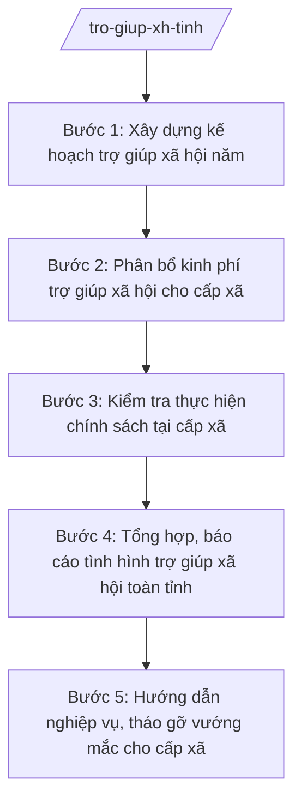

# Skill: Quản lý trợ giúp xã hội cấp tỉnh

## 2. Khi nào dùng
- Xây dựng kế hoạch trợ giúp xã hội hằng năm của tỉnh (đối tượng bảo trợ xã hội, mức chuẩn, kinh phí).
- Phân bổ, điều chỉnh kinh phí trợ giúp xã hội cho các xã, phường, đặc khu.
- Kiểm tra việc thực hiện chính sách trợ giúp xã hội tại cấp xã (xét duyệt, chi trả, niêm yết).
- Tổng hợp, báo cáo tình hình trợ giúp xã hội toàn tỉnh gửi UBND tỉnh, Bộ Nội vụ.
- Hướng dẫn nghiệp vụ, tháo gỡ vướng mắc cho công chức văn hóa – xã hội cấp xã.

## 3. Đầu vào (Input)
| Trường | Mô tả | Bắt buộc |
|--------|-------|----------|
| `nam_ke_hoach` | Năm kế hoạch | Có |
| `muc_chuan_tro_giup` | Mức chuẩn trợ giúp xã hội áp dụng | Có |
| `so_lieu_doi_tuong` | Số liệu đối tượng bảo trợ xã hội toàn tỉnh (theo nhóm: người cao tuổi, người khuyết tật, trẻ em mồ côi...) | Có |
| `du_toan_kinh_phi` | Dự toán kinh phí trợ giúp xã hội năm kế hoạch | Có |
| `bao_cao_xa` | Báo cáo thực hiện chính sách trợ giúp xã hội của các xã (kỳ trước) | Có |
| `van_ban_chi_dao` | Văn bản chỉ đạo của Trung ương, UBND tỉnh về trợ giúp xã hội | Không |

## 4. Quy trình

**Bước 1. Xây dựng kế hoạch trợ giúp xã hội năm**
- Làm gì: Tổng hợp số liệu đối tượng, dự toán kinh phí; soạn thảo kế hoạch trợ giúp xã hội năm của tỉnh (mục tiêu, nhiệm vụ, giải pháp, phân công trách nhiệm).
- Dùng input: `nam_ke_hoach`, `muc_chuan_tro_giup`, `so_lieu_doi_tuong`, `du_toan_kinh_phi`, `van_ban_chi_dao`.
- Vai trò: Chuyên viên Phòng Bảo trợ xã hội (Sở Nội vụ tỉnh A) soạn thảo; AI hỗ trợ tổng hợp số liệu, soạn dự thảo kế hoạch ⏱ ~3–5 ngày làm việc (ước tính).
- Lưu ý nghiệp vụ: Kế hoạch phải bám mức chuẩn trợ giúp xã hội và khả năng cân đối ngân sách; phân công rõ trách nhiệm Sở – xã.
- → Kết quả bước: Dự thảo kế hoạch trợ giúp xã hội năm của tỉnh.

**Bước 2. Phân bổ kinh phí trợ giúp xã hội cho cấp xã**
- Làm gì: Căn cứ kế hoạch được duyệt và số liệu đối tượng từng xã, lập phương án phân bổ kinh phí; soạn tờ trình, dự thảo quyết định phân bổ.
- Dùng input: `du_toan_kinh_phi`, `so_lieu_doi_tuong` (chi tiết theo xã).
- Vai trò: Chuyên viên Phòng Bảo trợ xã hội lập phương án; Trưởng phòng kiểm tra; AI hỗ trợ lập bảng phân bổ, soạn tờ trình ⏱ ~2–3 ngày làm việc (ước tính).
- Lưu ý nghiệp vụ: Phân bổ đúng đối tượng, đúng định mức; không phân bổ vượt dự toán được giao; lưu vết tính toán để đối chiếu khi kiểm tra, kiểm toán.
- → Kết quả bước: Phương án phân bổ kinh phí + tờ trình trình lãnh đạo Sở.

**Bước 3. Kiểm tra thực hiện chính sách tại cấp xã**
- Làm gì: Lập kế hoạch kiểm tra; kiểm tra tại xã về: xét duyệt đối tượng, niêm yết công khai, chi trả trợ cấp, quản lý hồ sơ; lập biên bản, kết luận kiểm tra.
- Dùng input: `bao_cao_xa`, phương án phân bổ tại Bước 2.
- Vai trò: Đoàn kiểm tra của Sở Nội vụ (Trưởng phòng Bảo trợ xã hội làm trưởng đoàn) thực hiện; AI hỗ trợ soạn đề cương kiểm tra, tổng hợp biên bản ⏱ ~1–2 ngày/xã (ước tính).
- Lưu ý nghiệp vụ: Kiểm tra có trọng tâm (xã có dấu hiệu sai sót, xã có số đối tượng lớn); kết luận rõ sai phạm (nếu có) và kiến nghị xử lý, thời hạn khắc phục.
- → Kết quả bước: Biên bản, kết luận kiểm tra từng xã.

**Bước 4. Tổng hợp, báo cáo tình hình trợ giúp xã hội toàn tỉnh**
- Làm gì: Tổng hợp số liệu chi trả, đối tượng tăng/giảm, kinh phí đã sử dụng; soạn báo cáo định kỳ (quý/năm) gửi UBND tỉnh, Bộ Nội vụ.
- Dùng input: `bao_cao_xa`, kết quả kiểm tra tại Bước 3, `so_lieu_doi_tuong`.
- Vai trò: Chuyên viên Phòng Bảo trợ xã hội tổng hợp; AI hỗ trợ đối chiếu số liệu, soạn báo cáo đúng biểu mẫu ⏱ ~2–3 ngày làm việc (ước tính).
- Lưu ý nghiệp vụ: Số liệu báo cáo phải khớp giữa các xã và với số liệu phân bổ; giải trình rõ biến động tăng/giảm đối tượng.
- → Kết quả bước: Báo cáo tình hình trợ giúp xã hội (quý/năm).

**Bước 5. Hướng dẫn nghiệp vụ, tháo gỡ vướng mắc cho cấp xã**
- Làm gì: Ban hành văn bản hướng dẫn nghiệp vụ (xét duyệt, chi trả, quản lý hồ sơ); trả lời vướng mắc của xã; tổ chức tập huấn khi có chính sách mới.
- Dùng input: vướng mắc tổng hợp từ `bao_cao_xa` và kiểm tra tại Bước 3.
- Vai trò: Phòng Bảo trợ xã hội chủ trì; AI hỗ trợ soạn văn bản hướng dẫn, tài liệu tập huấn ⏱ ~2–4 ngày làm việc/đợt (ước tính).
- Lưu ý nghiệp vụ: Hướng dẫn phải thống nhất, có ví dụ minh họa tình huống thường gặp; không hướng dẫn trái với văn bản của Trung ương.
- → Kết quả bước: Văn bản hướng dẫn nghiệp vụ / tài liệu tập huấn.

## Luồng quy trình (Workflow)

## 5. Đầu ra (Output)

**Danh sách sản phẩm:**
1. Kế hoạch trợ giúp xã hội năm của tỉnh (trình Chủ tịch UBND tỉnh phê duyệt).
2. Quyết định phân bổ kinh phí trợ giúp xã hội cho cấp xã.
3. Biên bản, kết luận kiểm tra thực hiện chính sách tại xã.
4. Báo cáo tình hình trợ giúp xã hội định kỳ.
5. Văn bản hướng dẫn nghiệp vụ cho cấp xã.

**Cấu trúc output chuẩn** (Kế hoạch — thể thức văn bản hành chính theo NĐ 30/2020/NĐ-CP):
1. Quốc hiệu "CỘNG HÒA XÃ HỘI CHỦ NGHĨA VIỆT NAM", Tiêu ngữ "Độc lập – Tự do – Hạnh phúc".
2. Tên cơ quan ban hành: ỦY BAN NHÂN DÂN TỈNH A.
3. Số, ký hiệu; địa danh, ngày tháng năm.
4. Tên loại và trích yếu: "KẾ HOẠCH Trợ giúp xã hội năm ... trên địa bàn tỉnh A".
5. Căn cứ ban hành (văn bản Trung ương, quyết định của UBND tỉnh).
6. Nội dung: mục tiêu; nhiệm vụ, giải pháp (theo nhóm đối tượng); kinh phí và nguồn kinh phí; phân công trách nhiệm (Sở Nội vụ, Sở Tài chính, UBND cấp xã...); tổ chức thực hiện.
7. Nơi nhận; chữ ký người có thẩm quyền.

## 6. Checklist nghiệm thu

- [ ] Kế hoạch bám mức chuẩn trợ giúp xã hội và dự toán ngân sách được giao
- [ ] Phương án phân bổ kinh phí khớp số liệu đối tượng từng xã, không vượt dự toán
- [ ] Kiểm tra có kế hoạch, biên bản, kết luận rõ sai phạm và kiến nghị khắc phục (nếu có)
- [ ] Báo cáo tổng hợp số liệu khớp giữa các xã và với số liệu phân bổ
- [ ] Văn bản hướng dẫn nghiệp vụ thống nhất, không trái văn bản Trung ương
- [ ] Đủ thành phần thể thức văn bản hành chính theo NĐ 30/2020/NĐ-CP
- [ ] Căn cứ pháp lý đúng, còn hiệu lực, không bịa số hiệu văn bản
- [ ] Đã qua human gate: Trưởng phòng kiểm tra → Giám đốc Sở → Chủ tịch UBND tỉnh (với kế hoạch, quyết định phân bổ)
- [ ] Dữ liệu ví dụ (nếu có) 100% hư cấu theo quy ước

## 7. Ví dụ mô phỏng

*Dữ liệu dưới đây là giả lập 100% phục vụ minh họa.*

**Input mẫu:**
- `nam_ke_hoach`: 2026
- `muc_chuan_tro_giup`: 500.000 đồng/người/tháng (giả lập)
- `so_lieu_doi_tuong`: 12.000 đối tượng bảo trợ xã hội toàn tỉnh A (giả lập)
- `du_toan_kinh_phi`: 72.000.000.000 đồng (giả lập)
- `bao_cao_xa`: 20/20 xã đã gửi báo cáo quý IV năm 2025
- `van_ban_chi_dao`: Công văn chỉ đạo của Bộ Nội vụ về tăng cường quản lý trợ giúp xã hội (giả lập)

**Output mẫu (trích Kế hoạch):**

CỘNG HÒA XÃ HỘI CHỦ NGHĨA VIỆT NAM
Độc lập – Tự do – Hạnh phúc

ỦY BAN NHÂN DÂN TỈNH A
Số: 1234/QĐ-UBND
Tỉnh A, ngày 15 tháng 01 năm 2026

**KẾ HOẠCH**
**Trợ giúp xã hội năm 2026 trên địa bàn tỉnh A**

*Căn cứ* Công văn chỉ đạo của Bộ Nội vụ về tăng cường quản lý trợ giúp xã hội (giả lập);
*Căn cứ* đề nghị của Giám đốc Sở Nội vụ tỉnh A tại Tờ trình số 56/TTr-SNV ngày 10/01/2026,

**I. Mục tiêu:** 100% đối tượng bảo trợ xã hội đủ điều kiện được hưởng trợ cấp đúng, đủ, kịp thời; không để xảy ra chi sai đối tượng.

**II. Nhiệm vụ, giải pháp:**
1. Rà soát, cập nhật danh sách 12.000 đối tượng (số liệu giả lập) trong quý I/2026.
2. Phân bổ 72.000.000.000 đồng (số liệu giả lập) cho 20 xã theo số đối tượng thực tế.
3. Kiểm tra ít nhất 06 xã về xét duyệt, chi trả, niêm yết công khai.
4. Tập huấn nghiệp vụ cho 40 công chức văn hóa – xã hội cấp xã (số liệu giả lập).

**III. Kinh phí:** ngân sách tỉnh đảm bảo theo dự toán được giao.

**IV. Tổ chức thực hiện:** Sở Nội vụ chủ trì; Sở Tài chính phối hợp bố trí kinh phí; UBND cấp xã tổ chức thực hiện.

*Nơi nhận:* ... **CHỦ TỊCH** (ký tên, đóng dấu — phần ký do người có thẩm quyền thực hiện)

## 8. Human gate (người kiểm duyệt)

- Chuyên viên Phòng Bảo trợ xã hội soạn thảo → Trưởng phòng Bảo trợ xã hội (bà Đặng Thị Y) kiểm tra → Phó Giám đốc Sở (ông Đỗ Văn U) cho ý kiến → Giám đốc Sở Nội vụ (ông Hoàng Văn S) ký văn bản thuộc thẩm quyền Sở.
- Kế hoạch năm, quyết định phân bổ kinh phí: Giám đốc Sở trình → Chủ tịch UBND tỉnh (ông Phạm Văn P) phê duyệt/quyết định.
- AI không thay thế bất kỳ nấc duyệt nào.

## 9. Giới hạn (guardrails)

- AI KHÔNG quyết định phân bổ kinh phí, KHÔNG phê duyệt kế hoạch thay lãnh đạo Sở/UBND tỉnh.
- AI KHÔNG tự ký, đóng dấu, phát hành văn bản hành chính.
- KHÔNG bịa số liệu đối tượng, kinh phí, kết quả kiểm tra, số hiệu văn bản, căn cứ pháp lý.
- KHÔNG dùng văn bản đã hết hiệu lực; phân định rõ thẩm quyền cấp tỉnh (chính sách, phân bổ, kiểm tra) với thẩm quyền cấp xã (xét duyệt, chi trả trực tiếp) — không làm thay việc của xã.
- KHÔNG tư vấn vượt thẩm quyền của Sở Nội vụ.

## 10. Căn cứ & lưu ý

- Thông tư 10/2025/TT-BNV ngày 19/6/2025; sửa đổi, bổ sung bởi TT 06/2026/TT-BNV ngày 29/4/2026: chức năng, nhiệm vụ của Sở Nội vụ (đầu mối lĩnh vực lao động – thương binh và xã hội ở địa phương).
- Thông tư 14/2025/TT-BYT: quy định phân định thẩm quyền của chính quyền địa phương 2 cấp trong lĩnh vực bảo trợ xã hội (thuộc chùm TT 14–19/2025/TT-BYT kèm theo TT 20/2025/TT-BYT).
- Nghị định 150/2025/NĐ-CP; Nghị định 370/2025/NĐ-CP: tổ chức Sở Nội vụ.
- Nghị định 30/2020/NĐ-CP: thể thức văn bản hành chính.
- Lưu ý: cấp tỉnh quản lý vĩ mô (kế hoạch, phân bổ, kiểm tra, báo cáo); việc xét duyệt, chi trả trực tiếp cho đối tượng do cấp xã thực hiện (xem skill `tro-giup-xa-hoi`).
