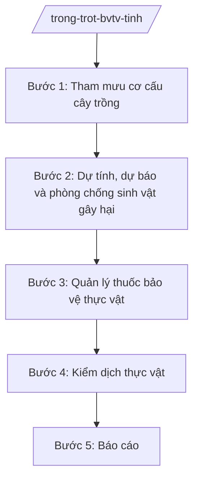

# Skill: Trồng trọt, bảo vệ thực vật

## 2. Khi nào dùng

- Khi tham mưu cơ cấu cây trồng, chuyển đổi cơ cấu cây trồng trên đất lúa.
- Khi phòng chống sinh vật gây hại (sâu bệnh, dịch hại) trên cây trồng.
- Khi quản lý kinh doanh, sử dụng thuốc bảo vệ thực vật.
- Khi kiểm dịch thực vật nội địa; cấp giấy chứng nhận kiểm dịch.

## 3. Đầu vào (Input)

| Trường | Mô tả | Bắt buộc |
|--------|-------|----------|
| `loai_viec` | cơ cấu cây trồng / phòng chống dịch hại / quản lý thuốc BVTV / kiểm dịch / báo cáo | Có |
| `dich_hai` | Tên sinh vật gây hại (nếu có) | Không |
| `dia_ban` | Vùng bị hại / vùng kiểm dịch | Không |
| `doi_tuong` | Hộ nông dân, cơ sở kinh doanh thuốc BVTV | Không |

## 4. Quy trình

**Bước 1. Tham mưu cơ cấu cây trồng**
- Làm gì: Đánh giá hiệu quả cây trồng vụ trước; tham mưu cơ cấu giống, thời vụ; kế hoạch chuyển đổi cơ cấu cây trồng trên đất trồng lúa kém hiệu quả.
- Dùng input: `loai_viec`.
- Vai trò: Chuyên viên Phòng/Chi cục Trồng trọt và BVTV; AI hỗ trợ phân tích số liệu, dự thảo kế hoạch — ⏱ 7 ngày/vụ.
- Lưu ý nghiệp vụ: Chuyển đổi trên đất lúa phải đúng quy định, không làm mất đất lúa trái phép; ưu tiên giống chất lượng, thích ứng biến đổi khí hậu.
- → Kết quả bước: Kế hoạch sản xuất vụ + văn bản hướng dẫn cơ cấu giống.

**Bước 2. Dự tính, dự báo và phòng chống sinh vật gây hại**
- Làm gì: Điều tra, dự báo sâu bệnh; ban hành thông báo phòng trừ; tổ chức phòng trừ diện rộng khi bùng phát.
- Dùng input: `dich_hai`, `dia_ban`.
- Vai trò: Trạm BVTV/trạm trồng trọt; AI hỗ trợ tổng hợp số liệu điều tra — ⏱ hằng tuần trong vụ.
- Lưu ý nghiệp vụ: Thông báo phòng trừ kịp thời vụ; hướng dẫn dùng thuốc đúng nguyên tắc "4 đúng".
- → Kết quả bước: Thông báo dự báo sâu bệnh + hướng dẫn phòng trừ.

**Bước 3. Quản lý thuốc bảo vệ thực vật**
- Làm gì: Kiểm tra điều kiện kinh doanh thuốc BVTV; kiểm tra việc sử dụng; thu gom, xử lý bao bì thuốc BVTV sau sử dụng; xử lý thuốc cấm, thuốc ngoài danh mục.
- Dùng input: `doi_tuong`.
- Vai trò: Đoàn kiểm tra; AI hỗ trợ lập biên bản, tra cứu danh mục thuốc — ⏱ định kỳ + đột xuất.
- Lưu ý nghiệp vụ: Thuốc ngoài danh mục, thuốc cấm tịch thu, tiêu hủy; cơ sở kinh doanh phải có chứng chỉ hành nghề.
- → Kết quả bước: Biên bản kiểm tra + quyết định xử phạt (nếu có).

**Bước 4. Kiểm dịch thực vật**
- Làm gì: Kiểm dịch thực vật nội địa đối với giống cây trồng, sản phẩm vận chuyển; cấp giấy chứng nhận kiểm dịch; xử lý lô hàng nhiễm đối tượng kiểm dịch.
- Dùng input: `doi_tuong`.
- Vai trò: Chi cục Trồng trọt và BVTV; AI hỗ trợ lập sổ theo dõi — ⏱ theo yêu cầu.
- Lưu ý nghiệp vụ: Đối tượng kiểm dịch phải xử lý (tiêu hủy/xông hơi) trước khi cho lưu thông.
- → Kết quả bước: Giấy chứng nhận kiểm dịch thực vật / biên bản xử lý.

**Bước 5. Báo cáo**
- Làm gì: Tổng hợp diện tích, năng suất, sản lượng; tình hình sâu bệnh, thuốc BVTV; báo cáo UBND tỉnh, Bộ NN&MT.
- Dùng input: `loai_viec` (báo cáo).
- Vai trò: Chuyên viên tổng hợp; AI hỗ trợ lập bảng số liệu — ⏱ 3 ngày.
- Lưu ý nghiệp vụ: Số liệu sản lượng đối chiếu với thống kê.
- → Kết quả bước: Báo cáo trồng trọt, BVTV định kỳ.

## Luồng quy trình (Workflow)

## 5. Đầu ra (Output)

- Kế hoạch sản xuất vụ; văn bản hướng dẫn cơ cấu giống.
- Thông báo dự báo sâu bệnh.
- Biên bản kiểm tra thuốc BVTV; quyết định xử phạt.
- Giấy chứng nhận kiểm dịch thực vật; báo cáo định kỳ.

**Cấu trúc output chuẩn (Thông báo dự báo sâu bệnh):**
- Thể thức: tuân thủ Nghị định 30/2020/NĐ-CP về công tác văn thư.

1. Quốc hiệu "CỘNG HÒA XÃ HỘI CHỦ NGHĨA VIỆT NAM", Tiêu ngữ "Độc lập – Tự do – Hạnh phúc"; tên cơ quan (Chi cục Trồng trọt và BVTV tỉnh A); số, ký hiệu.
2. Tên loại: **THÔNG BÁO** — về tình hình sinh vật gây hại và hướng dẫn phòng trừ [đợt/vụ].
3. Diễn biến sâu bệnh (đối tượng, diện tích, mức độ).
4. Dự báo thời gian tới.
5. Hướng dẫn biện pháp phòng trừ cụ thể (thuốc, liều lượng, thời điểm — đúng "4 đúng").
6. Nơi nhận; chữ ký Chi cục trưởng.

## 6. Checklist nghiệm thu

- [ ] Kế hoạch vụ ban hành trước thời vụ gieo trồng.
- [ ] Dự báo sâu bệnh kịp thời, hướng dẫn phòng trừ cụ thể.
- [ ] Cơ sở kinh doanh thuốc BVTV có chứng chỉ hành nghề; không để lọt thuốc cấm.
- [ ] Bao bì thuốc BVTV sau sử dụng được thu gom, xử lý.
- [ ] Lô hàng nhiễm đối tượng kiểm dịch được xử lý trước khi lưu thông.
- [ ] Văn bản đúng thể thức NĐ 30/2020/NĐ-CP.

## 7. Ví dụ mô phỏng

*Dữ liệu dưới đây là giả lập 100% phục vụ minh họa.*

**Input mẫu:** loai_viec = "phòng chống dịch hại"; dich_hai = "Rầy nâu hại lúa"; dia_ban = "Các xã vùng trũng A".

**Output mẫu (trích Thông báo):**

> **CHI CỤC TRỒNG TRỌT VÀ BVTV TỈNH A**
> Số: 123/TB-TTBVTV
>
> **THÔNG BÁO**
> Về rầy nâu hại lúa vụ mùa 2026
>
> Hiện nay rầy nâu đã xuất hiện tại các xã vùng trũng A với mật độ 500–800 con/m², diện tích nhiễm 200 ha, có nguy cơ bùng phát.
> Chi cục hướng dẫn: nông dân thăm đồng thường xuyên; khi mật độ trên 1.000 con/m² tiến hành phun trừ bằng thuốc trong danh mục, đúng nguyên tắc "4 đúng"; bảo vệ thiên địch; không phun tràn lan.
> UBND các xã chỉ đạo HTX, tổ khuyến nông đôn đốc thực hiện./.
>
> *Nơi nhận:* ... — **CHI CỤC TRƯỞNG** *(ký, đóng dấu)*

## 8. Human gate

- Chuyên viên soạn → Trưởng phòng/Chi cục trưởng kiểm tra → Phó Giám đốc Sở duyệt → Giám đốc Sở ký.
- Kế hoạch vụ: Giám đốc Sở ký ban hành sau khi thống nhất với UBND cấp xã vùng sản xuất.

## 9. Giới hạn

- AI không tự kết luận dịch hại, không tự quyết định biện pháp xử lý bắt buộc.
- Không bịa số liệu diện tích nhiễm, dự báo.
- Không dùng văn bản hết hiệu lực làm căn cứ.

## 10. Căn cứ & lưu ý

- Thông tư 19/2025/TT-BNNMT của Bộ Nông nghiệp và Môi trường hướng dẫn chức năng, nhiệm vụ của cơ quan chuyên môn về nông nghiệp và môi trường.
- Luật Trồng trọt, Luật Bảo vệ và kiểm dịch thực vật và các văn bản hướng dẫn (dẫn tên, áp dụng bản hiện hành).
- Nghị định 150/2025/NĐ-CP về tổ chức cơ quan chuyên môn thuộc UBND cấp tỉnh.
- Nghị định 30/2020/NĐ-CP về công tác văn thư (thể thức văn bản).
- Lưu ý: gắn với hệ thống khuyến nông (TT 60/2025/TT-BNNMT) để đưa tiến bộ kỹ thuật đến nông dân.
