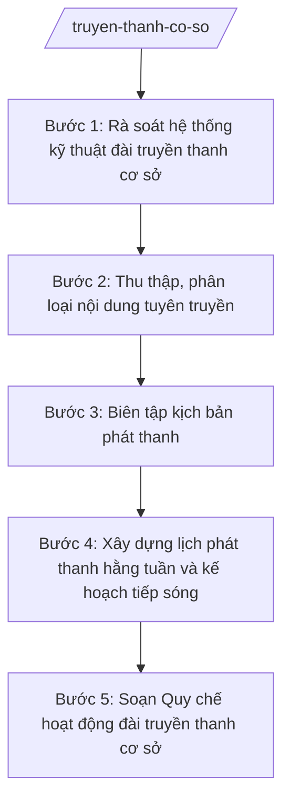

# Skill: Quản lý đài truyền thanh cơ sở

## 2. Khi nào dùng

- Khi Phòng Văn hóa – Xã hội xã được giao quản lý đài truyền thanh cơ sở (nhiệm vụ ngành văn hóa, thông tin giao cấp xã theo TT 10/2025/TT-BVHTTDL).
- Khi cần xây dựng lịch phát thanh hằng tuần, biên tập nội dung tuyên truyền chủ trương, chính sách, nhiệm vụ của địa phương.
- Khi cần tổ chức tiếp sóng chương trình của đài cấp trên và quản lý kỹ thuật hệ thống loa máy (cụm loa, dây truyền, thiết bị phát).
- Khi cần ban hành/quy định lại Quy chế hoạt động của đài truyền thanh cơ sở.

## 3. Đầu vào (Input)

| Trường | Mô tả | Bắt buộc |
|--------|-------|----------|
| `thon_xom` | Danh sách thôn/xóm và vị trí các cụm loa, tình trạng thiết bị loa máy | Có |
| `van_ban_chi_dao` | Văn bản chỉ đạo của cấp trên cần tuyên truyền (văn bản, thông báo, chỉ thị) | Có |
| `nhiem_vu_dia_phuong` | Các nhiệm vụ trọng tâm của xã trong tuần/kỳ cần tuyên truyền | Có |
| `khung_gio_phat` | Khung giờ phát thanh dự kiến (sáng, trưa, chiều, tối) | Có |
| `lich_tiep_song` | Lịch tiếp sóng đài cấp trên (tỉnh A, trung ương) | Không |
| `bien_tap_vien` | Thông tin biên tập viên/phát thanh viên, người vận hành đài | Có |
| `ky_han_ap_dung` | Tuần/tháng áp dụng lịch phát thanh | Có |

## 4. Quy trình

**Bước 1. Rà soát hệ thống kỹ thuật đài truyền thanh cơ sở**
- Làm gì: Kiểm tra toàn bộ thiết bị: máy phát, cụm loa các thôn, dây truyền thanh, nguồn điện dự phòng; lập biên bản tình trạng (tốt/kém/hỏng); đề xuất sửa chữa, thay thế.
- Dùng input: `thon_xom`, `ky_han_ap_dung`.
- Vai trò: Công chức văn hóa – xã hội phụ trách lĩnh vực thông tin thực hiện kiểm tra; AI hỗ trợ lập bảng kiểm kê thiết bị và mẫu biên bản tình trạng (~0,5 ngày).
- Lưu ý nghiệp vụ: Bảo đảm loa phủ sóng đến các thôn/xóm, đặc biệt khu dân cư tập trung; thiết bị hỏng phải báo cáo sửa chữa kịp thời trước kỳ phát thanh.
- → Kết quả bước: Bảng kiểm kê thiết bị + biên bản tình trạng kỹ thuật hệ thống loa máy.

**Bước 2. Thu thập, phân loại nội dung tuyên truyền**
- Làm gì: Tổng hợp nội dung cần tuyên truyền: chủ trương, chính sách của Đảng và Nhà nước; nhiệm vụ trọng tâm của xã trong tuần; các sự kiện, ngày kỷ niệm; nội dung theo văn bản chỉ đạo cấp trên.
- Dùng input: `van_ban_chi_dao`, `nhiem_vu_dia_phuong`, `ky_han_ap_dung`.
- Vai trò: Công chức văn hóa – xã hội phụ trách lĩnh vực thông tin tổng hợp; AI hỗ trợ phân loại nội dung theo chủ đề, sắp xếp thứ tự ưu tiên, ước tính thời lượng (~0,5 ngày).
- Lưu ý nghiệp vụ: Nội dung phải chính xác, bám sát văn bản gốc; không đưa thông tin chưa được kiểm chứng; ưu tiên nội dung phục vụ trực tiếp người dân (lịch tiêm chủng, lịch thu hoạch, phòng chống thiên tai).
- → Kết quả bước: Danh mục nội dung tuyên truyền theo chủ đề, đã phân loại ưu tiên.

**Bước 3. Biên tập kịch bản phát thanh**
- Làm gì: Soạn kịch bản phát thanh từng buổi (mở đầu, tin chính, tin địa phương, kết thúc); viết dạng văn nói, ngắn gọn, dễ hiểu; ghi rõ thời lượng từng mục.
- Dùng input: Danh mục nội dung bước 2, `khung_gio_phat`.
- Vai trò: Công chức văn hóa – xã hội phụ trách biên tập; biên tập viên/phát thanh viên rà soát ngôn từ; AI hỗ trợ chuyển văn bản hành chính thành văn nói phát thanh, ước tính thời lượng (~1 ngày).
- Lưu ý nghiệp vụ: Ngôn ngữ giản dị, câu ngắn; thuật ngữ hành chính phải giải thích dễ hiểu; thời lượng mỗi buổi phát không quá khung giờ quy định.
- → Kết quả bước: Kịch bản phát thanh từng buổi trong tuần.

**Bước 4. Xây dựng lịch phát thanh hằng tuần và kế hoạch tiếp sóng**
- Làm gì: Lập lịch phát thanh hằng tuần: ngày, khung giờ, nội dung từng buổi, người phát, người vận hành; bố trí lịch tiếp sóng đài cấp trên xen kẽ chương trình địa phương.
- Dùng input: `khung_gio_phat`, `lich_tiep_song`, kịch bản bước 3, `bien_tap_vien`, `ky_han_ap_dung`.
- Vai trò: Công chức văn hóa – xã hội lập lịch; Trưởng phòng Văn hóa – Xã hội (ông Vũ Văn E) kiểm tra, trình Phó Chủ tịch UBND xã (bà Trần Thị B) phụ trách lĩnh vực phê duyệt; AI hỗ trợ ghép khung giờ – nội dung – nhân sự thành bảng lịch hoàn chỉnh (~0,5 ngày).
- Lưu ý nghiệp vụ: Không trùng giờ tiếp sóng đài cấp trên với giờ phát chương trình địa phương; bảo đảm mỗi thôn đều nghe được; có phương án phát lại khi thiết bị sự cố.
- → Kết quả bước: Dự thảo Lịch phát thanh hằng tuần + kế hoạch tiếp sóng.

**Bước 5. Soạn Quy chế hoạt động đài truyền thanh cơ sở**
- Làm gì: Soạn Quy chế hoạt động đài: chức năng, nhiệm vụ; tổ chức bộ máy (người phụ trách, biên tập viên, phát thanh viên, kỹ thuật viên); chế độ phát thanh; quản lý tài chính, thiết bị; khen thưởng, kỷ luật.
- Dùng input: Toàn bộ kết quả các bước trên, `thon_xom`, `bien_tap_vien`.
- Vai trò: Công chức văn hóa – xã hội soạn; Trưởng phòng Văn hóa – Xã hội (ông Vũ Văn E) kiểm tra, trình Chủ tịch UBND xã (ông Nguyễn Văn A) ký ban hành quyết định; AI hỗ trợ soạn thảo theo thể thức văn bản hành chính NĐ 30/2020/NĐ-CP (~1 ngày).
- Lưu ý nghiệp vụ: Quy chế do Chủ tịch UBND xã ký ban hành dưới dạng quyết định; quy định rõ trách nhiệm bảo quản thiết bị và chế độ báo cáo định kỳ.
- → Kết quả bước: Dự thảo Quy chế hoạt động đài truyền thanh cơ sở trình ký ban hành.

## Luồng quy trình (Workflow)

## 5. Đầu ra (Output)

**Danh sách sản phẩm:**
1. Lịch phát thanh hằng tuần của đài truyền thanh cơ sở (sản phẩm chính 1).
2. Quy chế hoạt động đài truyền thanh cơ sở (kèm quyết định ban hành) (sản phẩm chính 2).
3. Kịch bản phát thanh từng buổi trong tuần (tài liệu kèm theo).
4. Bảng kiểm kê, biên bản tình trạng kỹ thuật hệ thống loa máy (tài liệu kèm theo).

**Cấu trúc output chuẩn — Lịch phát thanh hằng tuần (đúng thể thức NĐ 30/2020/NĐ-CP):**

1. Quốc hiệu – tiêu ngữ: "CỘNG HÒA XÃ HỘI CHỦ NGHĨA VIỆT NAM / Độc lập – Tự do – Hạnh phúc".
2. Số, ký hiệu văn bản: số/ký hiệu theo quy định (vd: 123/LPS-UBND).
3. Địa danh, ngày tháng năm ban hành: "Xã A, ngày … tháng … năm …".
4. Tên loại và trích yếu: "LỊCH PHÁT THANH — Đài truyền thanh cơ sở xã A, tuần … (từ ngày … đến ngày …)".
5. Căn cứ: TT 10/2025/TT-BVHTTDL; NĐ 150/2025/NĐ-CP; văn bản chỉ đạo của cấp trên (nếu có).
6. Nội dung: bảng lịch chi tiết theo ngày: buổi (sáng/trưa/chiều/tối), khung giờ, nội dung phát, tiếp sóng/tự phát, người phát thanh, người vận hành, ghi chú.
7. Nơi nhận: lưu VP, Phòng Văn hóa – Xã hội, các thôn/xóm, lưu hồ sơ đài.
8. Chữ ký: Phó Chủ tịch UBND xã phụ trách lĩnh vực ký, đóng dấu UBND xã.

**Cấu trúc output chuẩn — Quy chế hoạt động đài truyền thanh cơ sở (đúng thể thức NĐ 30/2020/NĐ-CP):**

1. Quốc hiệu "CỘNG HÒA XÃ HỘI CHỦ NGHĨA VIỆT NAM" – Tiêu ngữ "Độc lập – Tự do – Hạnh phúc".
2. Số, ký hiệu của Quyết định ban hành (vd: 123/QĐ-UBND).
3. Địa danh, ngày tháng năm ban hành.
4. Tên loại và trích yếu: "QUYẾT ĐỊNH — Ban hành Quy chế hoạt động đài truyền thanh cơ sở xã A".
5. Căn cứ: TT 10/2025/TT-BVHTTDL; NĐ 150/2025/NĐ-CP; NĐ 370/2025/NĐ-CP.
6. Nội dung: Điều 1 (ban hành Quy chế kèm theo); Điều 2 (hiệu lực); Điều 3 (tổ chức thực hiện). Phụ lục Quy chế gồm các chương: quy định chung; chức năng, nhiệm vụ; tổ chức bộ máy và nhân sự; chế độ phát thanh; quản lý thiết bị, tài chính; khen thưởng, xử lý vi phạm; điều khoản thi hành.
7. Nơi nhận: như trên.
8. Chữ ký: Chủ tịch UBND xã ký, đóng dấu.

## 6. Checklist nghiệm thu

- [ ] Lịch phát thanh đủ các buổi theo khung giờ đã phê duyệt, không trùng giờ tiếp sóng đài cấp trên.
- [ ] Nội dung tuyên truyền bám sát văn bản chỉ đạo và nhiệm vụ địa phương, không có thông tin sai lệch.
- [ ] Kịch bản viết dạng văn nói, câu ngắn, dễ hiểu, có ghi thời lượng từng mục.
- [ ] Bảng kiểm kê thiết bị đầy đủ các cụm loa thôn/xóm, nêu rõ tình trạng và đề xuất xử lý.
- [ ] Quy chế hoạt động đủ các chương theo cấu trúc chuẩn, phân công trách nhiệm rõ người.
- [ ] Văn bản đúng thể thức NĐ 30/2020/NĐ-CP (quốc hiệu, số/ký hiệu, nơi nhận, chữ ký, con dấu).
- [ ] Số liệu, tên người, tên thôn/xóm trong văn bản khớp đúng Input.
- [ ] Đã qua human gate: Trưởng phòng kiểm tra, lãnh đạo UBND xã phê duyệt/ký ban hành.

## 7. Ví dụ mô phỏng

*Dữ liệu dưới đây là giả lập 100% phục vụ minh họa.*

**Input mẫu:**
- thon_xom: 5 thôn (Thôn 1–5), 12 cụm loa (10 cụm hoạt động tốt, 2 cụm hỏng dây tại Thôn 4, Thôn 5)
- van_ban_chi_dao: Thông báo của UBND tỉnh A về đợt cao điểm tuyên truyền phòng chống dịch sốt xuất huyết
- nhiem_vu_dia_phuong: tuyên truyền lịch tiêm chủng mở rộng tháng 10; vận động hiến đất làm đường thôn
- khung_gio_phat: sáng 05:30–06:30, trưa 11:30–12:00, chiều 17:30–18:30
- lich_tiep_song: tiếp sóng Đài tỉnh A lúc 06:00–06:30 và 18:00–18:30 hằng ngày
- bien_tap_vien: Ông Nguyễn Văn G (phụ trách đài), bà Trần Thị H (phát thanh viên)
- ky_han_ap_dung: tuần 42 (12/10–18/10/2026)

**Output mẫu — Lịch phát thanh hằng tuần:**

> CỘNG HÒA XÃ HỘI CHỦ NGHĨA VIỆT NAM
> Độc lập – Tự do – Hạnh phúc
>
> Số: 123/LPS-UBND
>
> Xã A, ngày 09 tháng 10 năm 2026
>
> **LỊCH PHÁT THANH**
> **Đài truyền thanh cơ sở xã A — Tuần 42 (từ ngày 12/10/2026 đến ngày 18/10/2026)**
>
> Căn cứ Thông tư số 10/2025/TT-BVHTTDL ngày 19/6/2025 của Bộ Văn hóa, Thể thao và Du lịch;
> Căn cứ Nghị định số 150/2025/NĐ-CP ngày 12/6/2025 của Chính phủ;
> Theo đề nghị của Trưởng phòng Văn hóa – Xã hội xã A,
>
> **NỘI DUNG LỊCH PHÁT THANH**
>
> | Ngày | Buổi sáng (05:30–06:30) | Buổi trưa (11:30–12:00) | Buổi chiều (17:30–18:30) |
> |------|-------------------------|-------------------------|--------------------------|
> | Thứ 2 (12/10) | 05:30 tin địa phương (lịch tiêm chủng mở rộng tháng 10); 06:00 tiếp sóng Đài tỉnh A | Tin nhắc lại lịch tiêm chủng; vận động hiến đất làm đường thôn | 17:30 tin địa phương; 18:00 tiếp sóng Đài tỉnh A |
> | Thứ 3 (13/10) | 05:30 tuyên truyền phòng chống dịch sốt xuất huyết; 06:00 tiếp sóng Đài tỉnh A | Nhắc các biện pháp diệt bọ gậy | 17:30 tin địa phương; 18:00 tiếp sóng Đài tỉnh A |
> | Thứ 4–Chủ nhật | (tương tự, luân phiên nội dung theo kịch bản kèm theo) | | |
>
> Người phát thanh: bà Trần Thị H. Người vận hành: ông Nguyễn Văn G.
> Ghi chú: 2 cụm loa tại Thôn 4, Thôn 5 đang sửa chữa, dự kiến khôi phục trước 15/10/2026.
>
> **Nơi nhận:**
> - Lưu: VP, Phòng VH-XH;
> - Các thôn 1–5 (để phối hợp);
> - Lưu hồ sơ đài.
>
> **KT. CHỦ TỊCH**
> **PHÓ CHỦ TỊCH**
>
> *(Ký, đóng dấu)*
> **Trần Thị B**

## 8. Human gate (người kiểm duyệt)

- Công chức văn hóa – xã hội phụ trách lĩnh vực thông tin soạn lịch, kịch bản, dự thảo Quy chế.
- Trưởng phòng Văn hóa – Xã hội (ông Vũ Văn E) kiểm tra nội dung, thể thức, trình lãnh đạo UBND xã.
- Phó Chủ tịch UBND xã (bà Trần Thị B) phê duyệt Lịch phát thanh hằng tuần.
- Chủ tịch UBND xã (ông Nguyễn Văn A) ký ban hành Quy chế hoạt động đài truyền thanh cơ sở.
- Kịch bản phát thanh từng buổi do Trưởng phòng Văn hóa – Xã hội duyệt trước khi phát.

## 9. Giới hạn (guardrails)

- AI KHÔNG ra quyết định hành chính thay người có thẩm quyền; không tự phê duyệt lịch phát thanh, không tự ban hành Quy chế.
- AI KHÔNG tự ký, đóng dấu hoặc phát hành văn bản dưới danh nghĩa UBND xã hay cá nhân lãnh đạo.
- AI KHÔNG bịa số liệu thiết bị, số hiệu văn bản, căn cứ pháp lý; chỉ dùng văn bản có trong tai-lieu-moi-nhat.md.
- AI KHÔNG dùng văn bản đã hết hiệu lực (vd: TT 08/2021/TT-BVHTTDL đã được thay thế bởi TT 10/2025/TT-BVHTTDL).
- Nội dung tuyên truyền do con người chịu trách nhiệm về tính chính xác; AI chỉ hỗ trợ biên tập, sắp xếp.

## 10. Căn cứ & lưu ý

- Thông tư số 10/2025/TT-BVHTTDL ngày 19/6/2025 của Bộ Văn hóa, Thể thao và Du lịch (hiệu lực 01/7/2025): hướng dẫn chức năng, nhiệm vụ của Phòng Văn hóa – Xã hội cấp xã trong lĩnh vực văn hóa, thể thao, du lịch và thông tin; cấp xã được giao 15 nhiệm vụ ngành VHTTDL.
- Nghị định số 137/2025/NĐ-CP, Nghị định số 138/2025/NĐ-CP ngày 12/6/2025 của Chính phủ: phân định thẩm quyền và phân quyền, phân cấp trong lĩnh vực văn hóa, thể thao và du lịch.
- Nghị định số 150/2025/NĐ-CP ngày 12/6/2025 của Chính phủ: tổ chức cơ quan chuyên môn thuộc UBND cấp xã (Phòng Văn hóa – Xã hội); sửa đổi bởi NĐ 370/2025/NĐ-CP.
- Nghị định số 30/2020/NĐ-CP của Chính phủ: thể thức văn bản hành chính (áp dụng cho Quy chế, Lịch phát thanh ban hành dưới dạng văn bản).
- Lưu ý: đài truyền thanh cơ sở là kênh tuyên truyền trực tiếp đến người dân; ưu tiên nội dung thiết thực, dễ hiểu, đúng giờ giấc.
