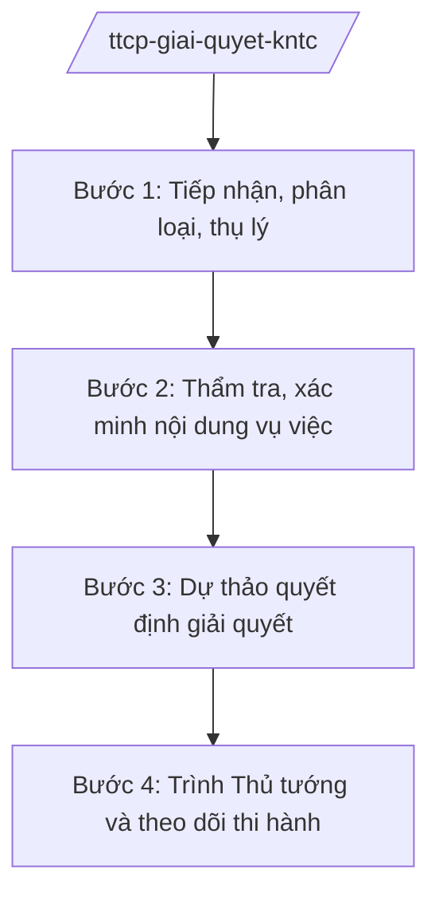

# Skill: Giải quyết KNTC thuộc thẩm quyền Thủ tướng

## 2. Khi nào dùng

Khi Thanh tra Chính phủ thụ lý, thẩm tra, tham mưu giải quyết vụ việc khiếu nại, tố cáo phức tạp,
đông người hoặc thuộc thẩm quyền giải quyết của Thủ tướng Chính phủ.

## 3. Đầu vào (Input)

| Trường | Mô tả | Bắt buộc |
|--------|-------|----------|
| `loai_vu_viec` | Khiếu nại / Tố cáo | Có |
| `noi_dung_vu_viec` | Tóm tắt nội dung vụ việc | Có |
| `doi_tuong` | Người khiếu nại/tố cáo; đối tượng bị khiếu nại/tố cáo | Có |
| `ho_so` | Hồ sơ vụ việc (đơn, tài liệu kèm theo, kết quả giải quyết các cấp) | Có |
| `thoi_han` | Thời hạn giải quyết theo quy định | Có |

## 4. Quy trình

**Bước 1. Tiếp nhận, phân loại, thụ lý**

- Làm gì: Tiếp nhận hồ sơ; kiểm tra thẩm quyền (có thuộc thẩm quyền Thủ tướng không); phân loại vụ việc; đề xuất thụ lý.
- Dùng input: `loai_vu_viec`, `noi_dung_vu_viec`, `ho_so`.
- Vai trò: Vụ tiếp nhận (Vụ Tiếp công dân và Xử lý đơn thư — theo chức năng) chủ trì, AI hỗ trợ kiểm tra điều kiện thụ lý, lập phiếu phân loại ⏱ ~1–2 ngày (ước tính).
- Lưu ý nghiệp vụ: Vụ việc không thuộc thẩm quyền phải chuyển đúng cơ quan có thẩm quyền và thông báo cho người gửi đơn.
- → Kết quả bước: Quyết định thụ lý (hoặc văn bản chuyển đơn đúng thẩm quyền).

**Bước 2. Thẩm tra, xác minh nội dung vụ việc**

- Làm gì: Nghiên cứu hồ sơ; làm việc với các bộ/ngành/địa phương liên quan; xác minh tình tiết; tổ chức đối thoại với người khiếu nại (nếu cần).
- Dùng input: Hồ sơ vụ việc đã thụ lý.
- Vai trò: Tổ thẩm tra (chuyên viên), AI hỗ trợ tổng hợp hồ sơ, lập bảng đối chiếu nội dung khiếu nại với kết quả xác minh ⏱ ~10–30 ngày tùy phức tạp (ước tính).
- Lưu ý nghiệp vụ: Xác minh phải khách quan, toàn diện; bảo đảm quyền của người khiếu nại, tố cáo và người bị ảnh hưởng.
- → Kết quả bước: Báo cáo kết quả thẩm tra, xác minh.

**Bước 3. Dự thảo quyết định giải quyết**

- Làm gì: Soạn dự thảo quyết định giải quyết khiếu nại / kết luận nội dung tố cáo trình Thủ tướng; đề xuất biện pháp xử lý, khắc phục.
- Dùng input: Báo cáo thẩm tra, `thoi_han`.
- Vai trò: Vụ chuyên môn soạn thảo, AI hỗ trợ soạn dự thảo đúng cấu trúc, kiểm tra căn cứ pháp lý ⏱ ~3–5 ngày (ước tính).
- Lưu ý nghiệp vụ: Quyết định phải đúng pháp luật, khả thi; kiến nghị xử lý trách nhiệm tổ chức, cá nhân nếu có vi phạm.
- → Kết quả bước: Dự thảo quyết định giải quyết trình Thủ tướng.

**Bước 4. Trình Thủ tướng và theo dõi thi hành**

- Làm gì: Hoàn thiện hồ sơ trình Thủ tướng Chính phủ quyết định; sau khi có quyết định, theo dõi, đôn đốc việc thi hành; báo cáo kết quả.
- Dùng input: Dự thảo quyết định.
- Vai trò: Phó Tổng Thanh tra phụ trách cho ý kiến, **Tổng Thanh tra Chính phủ (ông Lê Văn CC — giả lập) ký tờ trình Thủ tướng**; AI hỗ trợ theo dõi tiến độ thi hành ⏱ ~2–3 ngày cho trình (ước tính).
- Lưu ý nghiệp vụ: Quyết định giải quyết khiếu nại của Thủ tướng là quyết định cuối cùng về mặt hành chính.
- → Kết quả bước: Quyết định giải quyết của Thủ tướng + kế hoạch theo dõi thi hành.

## Luồng quy trình (Workflow)

## 5. Đầu ra (Output)

- Tờ trình Thủ tướng + dự thảo quyết định giải quyết khiếu nại / kết luận nội dung tố cáo.
- Báo cáo kết quả thẩm tra, xác minh.

### Cấu trúc output chuẩn

**Tờ trình Thủ tướng về giải quyết khiếu nại** (thể thức NĐ 30/2020/NĐ-CP):
1. Quốc hiệu "CỘNG HÒA XÃ HỘI CHỦ NGHĨA VIỆT NAM", Tiêu ngữ "Độc lập – Tự do – Hạnh phúc"; "Tờ trình về việc giải quyết khiếu nại của ..."; số, ký hiệu; địa danh, ngày tháng năm.
2. Kính gửi: Thủ tướng Chính phủ.
3. Tóm tắt nội dung vụ việc và quá trình giải quyết.
4. Kết quả thẩm tra, xác minh.
5. Nhận xét, đánh giá; đề xuất phương án giải quyết.
6. Dự thảo quyết định kèm theo.
7. Nơi nhận (kết thúc "- Lưu: VT, [mã đơn vị]."); chữ ký (ghi rõ chức danh, họ tên người ký; ký hiệu "KT."/"TL." khi ký thay) Tổng Thanh tra, đóng dấu.

> **Checklist thể thức văn bản theo NĐ 30/2020/NĐ-CP** — đối chiếu trước khi trình ký:
> 1. Quốc hiệu và Tiêu ngữ.
> 2. Tên cơ quan, tổ chức ban hành văn bản.
> 3. Số, ký hiệu của văn bản.
> 4. Địa danh và thời gian ban hành văn bản.
> 5. Tên loại và trích yếu nội dung văn bản.
> 6. Nội dung văn bản.
> 7. Chức vụ, họ tên và chữ ký của người có thẩm quyền.
> 8. Dấu, chữ ký số của cơ quan, tổ chức.
> 9. Nơi nhận (kèm Phụ lục nếu có).

## 6. Checklist nghiệm thu

- [ ] Xác định đúng thẩm quyền (thuộc Thủ tướng mới thụ lý).
- [ ] Thẩm tra đầy đủ, khách quan; có đối chiếu nội dung khiếu nại với kết quả xác minh.
- [ ] Dự thảo quyết định đúng pháp luật, khả thi.
- [ ] Đúng thời hạn giải quyết theo quy định.
- [ ] Thể thức đúng NĐ 30/2020/NĐ-CP; đúng thẩm quyền ký.
- [ ] Bảo mật thông tin người tố cáo; không bịa hồ sơ, căn cứ.

## 7. Ví dụ mô phỏng

*Dữ liệu dưới đây là giả lập 100% phục vụ minh họa.*

**Input mẫu:** loai_vu_viec = Khiếu nại; noi_dung_vu_viec = "khiếu nại quyết định thu hồi đất của dự án AA (giả lập)";
doi_tuong = "12 hộ dân xã A, tỉnh A (giả lập)".

**Output mẫu (trích Tờ trình):**

> THANH TRA CHÍNH PHỦ
>
> Số: 234/TTr-TTCP
> (Địa danh minh họa), ngày 20 tháng 11 năm 2026
>
> **TỜ TRÌNH**
> **Về việc giải quyết khiếu nại của 12 hộ dân xã A, tỉnh A (giả lập)**
>
> Kính gửi: Thủ tướng Chính phủ
>
> **I. TÓM TẮT VỤ VIỆC** ... (giả lập)
> **II. QUÁ TRÌNH GIẢI QUYẾT** ... (giả lập: đã giải quyết lần 1 tại tỉnh)
> **III. KẾT QUẢ THẨM TRA, XÁC MINH** ... (giả lập)
> **IV. NHẬN XÉT VÀ ĐỀ XUẤT** ... (giả lập)
>
> Kính trình Thủ tướng Chính phủ xem xét, quyết định (kèm dự thảo Quyết định).
>
> Nơi nhận: ...
> **TỔNG THANH TRA CHÍNH PHỦ** (ký, đóng dấu — giả lập: ông Lê Văn CC)

## 8. Human gate

- Vụ trưởng vụ chuyên môn duyệt báo cáo thẩm tra và dự thảo quyết định.
- Phó Tổng Thanh tra phụ trách cho ý kiến.
- **Tổng Thanh tra ký tờ trình; Thủ tướng Chính phủ quyết định giải quyết.**

## 9. Giới hạn

- AI không quyết định nội dung giải quyết thay người có thẩm quyền.
- AI không tự ký, phát hành văn bản; không bịa hồ sơ, kết quả xác minh.
- Bảo vệ bí mật thông tin người tố cáo theo quy định.

## 10. Căn cứ & lưu ý

- Nghị định 109/2025/NĐ-CP ngày 20/05/2025 (hiệu lực 01/6/2025) — chức năng, nhiệm vụ, quyền hạn và cơ cấu tổ chức của Thanh tra Chính phủ.
- Luật Khiếu nại, Luật Tố cáo (tên luật, không ghi số hiệu) — thẩm quyền, trình tự giải quyết.
- Nghị định 30/2020/NĐ-CP — thể thức văn bản (chỉ dùng cho thể thức).
- Lưu ý: Thanh tra Chính phủ giúp Thủ tướng Chính phủ quản lý nhà nước về công tác giải quyết khiếu nại, tố cáo; quyết định của Thủ tướng là quyết định cuối cùng.
