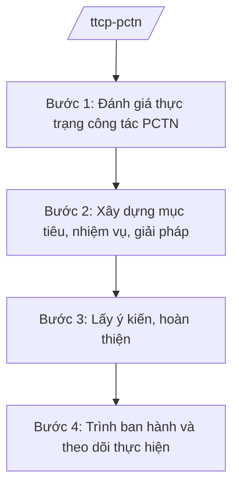

# Skill: PCTN (chiến lược quốc gia, kiểm soát tài sản)

## 2. Khi nào dùng

Khi Thanh tra Chính phủ xây dựng chiến lược quốc gia về phòng, chống tham nhũng, kế hoạch thực hiện,
hoặc triển khai công tác kiểm soát tài sản, thu nhập của người có chức vụ, quyền hạn.

## 3. Đầu vào (Input)

| Trường | Mô tả | Bắt buộc |
|--------|-------|----------|
| `noi_dung` | Chiến lược PCTN / Kế hoạch thực hiện / Kiểm soát tài sản, thu nhập | Có |
| `giai_doan` | Giai đoạn chiến lược/kế hoạch | Có |
| `du_lieu_danh_gia` | Kết quả thực hiện PCTN giai đoạn trước, số liệu kê khai tài sản | Không |

## 4. Quy trình

**Bước 1. Đánh giá thực trạng công tác PCTN**

- Làm gì: Tổng hợp kết quả thực hiện chiến lược/kế hoạch PCTN giai đoạn trước; phân tích tình hình tham nhũng; đánh giá công tác kê khai, kiểm soát tài sản, thu nhập.
- Dùng input: `du_lieu_danh_gia`, `giai_doan`.
- Vai trò: Vụ/Cục PCTN (theo chức năng) chủ trì, AI hỗ trợ tổng hợp số liệu, phân tích xu hướng ⏱ ~4–6 ngày (ước tính).
- Lưu ý nghiệp vụ: Đánh giá phải dựa trên số liệu thực tế từ các bộ/ngành/địa phương; chỉ rõ hạn chế.
- → Kết quả bước: Báo cáo đánh giá thực trạng công tác PCTN.

**Bước 2. Xây dựng mục tiêu, nhiệm vụ, giải pháp**

- Làm gì: Xác định mục tiêu, nhiệm vụ trọng tâm; đề xuất giải pháp (hoàn thiện thể chế, kiểm soát quyền lực, kiểm soát tài sản thu nhập, hợp tác quốc tế về PCTN).
- Dùng input: Báo cáo đánh giá, `giai_doan`.
- Vai trò: Đơn vị PCTN soạn thảo, AI hỗ trợ xây dựng khung mục tiêu–nhiệm vụ–giải pháp ⏱ ~3–5 ngày (ước tính).
- Lưu ý nghiệp vụ: Giải pháp kiểm soát tài sản, thu nhập phải bảo đảm tính khả thi và bảo mật thông tin cá nhân theo quy định.
- → Kết quả bước: Dự thảo chiến lược/kế hoạch PCTN.

**Bước 3. Lấy ý kiến, hoàn thiện**

- Làm gì: Lấy ý kiến các bộ/ngành/địa phương, cơ quan liên quan; tổ chức hội thảo; tiếp thu, hoàn thiện dự thảo.
- Dùng input: Dự thảo chiến lược/kế hoạch.
- Vai trò: Đơn vị PCTN tổng hợp, AI hỗ trợ lập bảng tổng hợp ý kiến ⏱ ~3–5 ngày (ước tính).
- Lưu ý nghiệp vụ: Chiến lược quốc gia về PCTN do Chính phủ ban hành theo đề nghị của Thanh tra Chính phủ.
- → Kết quả bước: Dự thảo hoàn thiện trình cấp có thẩm quyền.

**Bước 4. Trình ban hành và theo dõi thực hiện**

- Làm gì: Trình Chính phủ ban hành chiến lược/kế hoạch; hướng dẫn, đôn đốc các bộ/ngành/địa phương thực hiện; tổng hợp báo cáo định kỳ.
- Dùng input: Dự thảo hoàn thiện.
- Vai trò: Phó Tổng Thanh tra phụ trách cho ý kiến, **Tổng Thanh tra Chính phủ (ông Lê Văn CC — giả lập) ký tờ trình Chính phủ**; AI hỗ trợ theo dõi tiến độ ⏱ ~2–3 ngày cho trình (ước tính).
- Lưu ý nghiệp vụ: Công tác kiểm soát tài sản, thu nhập thực hiện theo chế độ mật đối với bản kê khai.
- → Kết quả bước: Chiến lược/kế hoạch PCTN được ban hành + cơ chế theo dõi.

## Luồng quy trình (Workflow)

## 5. Đầu ra (Output)

- Tờ trình Chính phủ + dự thảo chiến lược/kế hoạch quốc gia về PCTN.
- Báo cáo đánh giá thực trạng; báo cáo định kỳ công tác PCTN.

### Cấu trúc output chuẩn

**Tờ trình Chính phủ về chiến lược PCTN** (thể thức NĐ 30/2020/NĐ-CP):
1. Quốc hiệu "CỘNG HÒA XÃ HỘI CHỦ NGHĨA VIỆT NAM", Tiêu ngữ "Độc lập – Tự do – Hạnh phúc"; "Tờ trình về Chiến lược quốc gia phòng, chống tham nhũng ..."; số, ký hiệu; địa danh, ngày tháng năm.
2. Kính gửi: Chính phủ.
3. Sự cần thiết; đánh giá thực trạng.
4. Quan điểm, mục tiêu.
5. Nhiệm vụ, giải pháp chủ yếu.
6. Tổ chức thực hiện.
7. Nơi nhận (kết thúc "- Lưu: VT, [mã đơn vị]."); chữ ký (ghi rõ chức danh, họ tên người ký; ký hiệu "KT."/"TL." khi ký thay) Tổng Thanh tra, đóng dấu.
## 6. Checklist nghiệm thu

- [ ] Đánh giá thực trạng đầy đủ, số liệu có nguồn.
- [ ] Mục tiêu, giải pháp cụ thể, khả thi, phân công rõ.
- [ ] Đã lấy ý kiến các bên liên quan.
- [ ] Chế độ mật đối với kiểm soát tài sản, thu nhập được tuân thủ.
- [ ] Thể thức đúng NĐ 30/2020/NĐ-CP; đúng thẩm quyền ký.
- [ ] Không bịa số liệu, căn cứ.

## 7. Ví dụ mô phỏng

*Dữ liệu dưới đây là giả lập 100% phục vụ minh họa.*

**Input mẫu:** noi_dung = "Kế hoạch thực hiện Chiến lược quốc gia PCTN năm 2026";
giai_doan = 2026 (giả lập).

**Output mẫu (trích Kế hoạch):**

> THANH TRA CHÍNH PHỦ
>
> Số: 345/KH-TTCP
> (Địa danh minh họa), ngày 10 tháng 01 năm 2026
>
> **KẾ HOẠCH**
> **Thực hiện Chiến lược quốc gia phòng, chống tham nhũng năm 2026**
>
> **I. MỤC ĐÍCH, YÊU CẦU** ...
> **II. NHIỆM VỤ TRỌNG TÂM**
> 1. Hoàn thiện thể chế về PCTN ... (giả lập)
> 2. Kiểm soát tài sản, thu nhập của người có chức vụ, quyền hạn ... (giả lập)
> 3. Xử lý, ngăn chặn tham nhũng ... (giả lập)
> **III. TỔ CHỨC THỰC HIỆN** ...
>
> Nơi nhận: ...
> **TỔNG THANH TRA CHÍNH PHỦ** (ký, đóng dấu — giả lập: ông Lê Văn CC)

## 8. Human gate

- Lãnh đạo đơn vị PCTN duyệt dự thảo.
- Phó Tổng Thanh tra phụ trách cho ý kiến.
- **Tổng Thanh tra ký tờ trình Chính phủ.**

## 9. Giới hạn

- AI không kết luận hành vi tham nhũng thay cơ quan có thẩm quyền.
- AI không tự ký, phát hành văn bản; không bịa số liệu.
- Bản kê khai tài sản, thu nhập thực hiện chế độ mật — tuyệt đối không tiết lộ.

## 10. Căn cứ & lưu ý

- Nghị định 109/2025/NĐ-CP ngày 20/05/2025 (hiệu lực 01/6/2025) — chức năng, nhiệm vụ, quyền hạn và cơ cấu tổ chức của Thanh tra Chính phủ.
- Luật Phòng, chống tham nhũng (tên luật, không ghi số hiệu) — khung pháp lý PCTN, kiểm soát tài sản thu nhập.
- Nghị định 30/2020/NĐ-CP — thể thức văn bản (chỉ dùng cho thể thức).
- Lưu ý: Thanh tra Chính phủ là cơ quan đầu mối giúp Chính phủ quản lý nhà nước về công tác PCTN.
