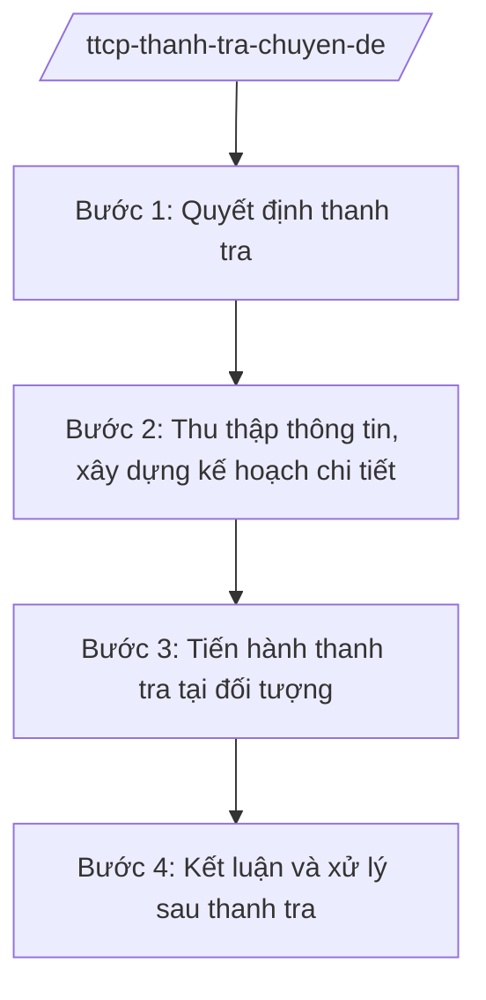

# Skill: Thanh tra chuyên đề, đột xuất

## 2. Khi nào dùng

Khi Thanh tra Chính phủ thực hiện thanh tra chuyên đề (theo lĩnh vực được xác định) hoặc thanh tra
đột xuất khi phát hiện dấu hiệu vi phạm, theo chỉ đạo của Thủ tướng Chính phủ.

## 3. Đầu vào (Input)

| Trường | Mô tả | Bắt buộc |
|--------|-------|----------|
| `chu_de` | Chuyên đề thanh tra / nội dung đột xuất | Có |
| `can_cu` | Dấu hiệu vi phạm / chỉ đạo của Thủ tướng / đề xuất của vụ | Có |
| `doi_tuong` | Bộ/ngành/địa phương, tổ chức, cá nhân được thanh tra | Có |
| `pham_vi_thoi_ky` | Phạm vi, thời kỳ thanh tra | Có |

## 4. Quy trình

**Bước 1. Quyết định thanh tra**

- Làm gì: Xây dựng đề cương thanh tra chuyên đề/đột xuất; ban hành quyết định thanh tra; thành lập đoàn thanh tra.
- Dùng input: `chu_de`, `can_cu`, `doi_tuong`, `pham_vi_thoi_ky`.
- Vai trò: Vụ chuyên môn đề xuất, AI hỗ trợ soạn đề cương và dự thảo quyết định thanh tra ⏱ ~2–3 ngày (ước tính).
- Lưu ý nghiệp vụ: Thanh tra đột xuất phải có căn cứ rõ ràng (dấu hiệu vi phạm hoặc chỉ đạo của cấp có thẩm quyền); quyết định thanh tra do Tổng Thanh tra ký.
- → Kết quả bước: Quyết định thanh tra + đoàn thanh tra được thành lập.

**Bước 2. Thu thập thông tin, xây dựng kế hoạch chi tiết**

- Làm gì: Thu thập hồ sơ, tài liệu liên quan đến chuyên đề; xây dựng kế hoạch tiến hành chi tiết của đoàn.
- Dùng input: Hồ sơ, tài liệu của đối tượng và cơ quan quản lý.
- Vai trò: Trưởng đoàn thanh tra chỉ đạo, AI hỗ trợ tổng hợp tài liệu, lập kế hoạch chi tiết ⏱ ~3–5 ngày (ước tính).
- Lưu ý nghiệp vụ: Kế hoạch phải xác định rõ nội dung, phương pháp, phân công thành viên đoàn.
- → Kết quả bước: Kế hoạch tiến hành thanh tra chi tiết được phê duyệt.

**Bước 3. Tiến hành thanh tra tại đối tượng**

- Làm gì: Công bố quyết định thanh tra; kiểm tra hồ sơ, chứng từ, thực tế; làm việc với tổ chức, cá nhân liên quan; lập biên bản.
- Dùng input: Kế hoạch chi tiết.
- Vai trò: Đoàn thanh tra thực hiện, AI hỗ trợ tổng hợp biên bản, đối chiếu quy định ⏱ ~15–45 ngày tùy quy mô (ước tính).
- Lưu ý nghiệp vụ: Tuân thủ trình tự, thủ tục; bảo đảm khách quan, không làm ảnh hưởng hoạt động bình thường của đối tượng.
- → Kết quả bước: Biên bản thanh tra + báo cáo kết quả của đoàn.

**Bước 4. Kết luận và xử lý sau thanh tra**

- Làm gì: Dự thảo kết luận thanh tra chuyên đề/đột xuất; kiến nghị xử lý vi phạm, xử lý trách nhiệm; theo dõi thực hiện kết luận.
- Dùng input: Báo cáo kết quả của đoàn.
- Vai trò: Vụ chuyên môn thẩm định dự thảo, Phó Tổng Thanh tra cho ý kiến, **Tổng Thanh tra Chính phủ (ông Lê Văn CC — giả lập) ký kết luận**; AI hỗ trợ soạn dự thảo ⏱ ~5–7 ngày (ước tính).
- Lưu ý nghiệp vụ: Kết luận thanh tra đột xuất có thể kiến nghị chuyển cơ quan điều tra nếu phát hiện dấu hiệu tội phạm.
- → Kết quả bước: Kết luận thanh tra + kiến nghị xử lý + kế hoạch theo dõi.

## Luồng quy trình (Workflow)

## 5. Đầu ra (Output)

- Quyết định thanh tra; biên bản thanh tra; kết luận thanh tra chuyên đề/đột xuất; kiến nghị xử lý.

### Cấu trúc output chuẩn

**Kết luận thanh tra chuyên đề/đột xuất** (thể thức NĐ 30/2020/NĐ-CP):
1. Quốc hiệu "CỘNG HÒA XÃ HỘI CHỦ NGHĨA VIỆT NAM", Tiêu ngữ "Độc lập – Tự do – Hạnh phúc"; "KẾT LUẬN THANH TRA ..."; số, ký hiệu; địa danh, ngày tháng năm.
2. Căn cứ (quyết định thanh tra).
3. Khái quát về chuyên đề/đối tượng.
4. Kết quả kiểm tra theo từng nội dung.
5. Nhận xét, đánh giá; vi phạm và căn cứ pháp lý.
6. Kiến nghị biện pháp xử lý; thời hạn thực hiện.
7. Nơi nhận (kết thúc "- Lưu: VT, [mã đơn vị]."); chữ ký (ghi rõ chức danh, họ tên người ký; ký hiệu "KT."/"TL." khi ký thay) Tổng Thanh tra, đóng dấu.

> **Checklist thể thức văn bản theo NĐ 30/2020/NĐ-CP** — đối chiếu trước khi trình ký:
> 1. Quốc hiệu và Tiêu ngữ.
> 2. Tên cơ quan, tổ chức ban hành văn bản.
> 3. Số, ký hiệu của văn bản.
> 4. Địa danh và thời gian ban hành văn bản.
> 5. Tên loại và trích yếu nội dung văn bản.
> 6. Nội dung văn bản.
> 7. Chức vụ, họ tên và chữ ký của người có thẩm quyền.
> 8. Dấu, chữ ký số của cơ quan, tổ chức.
> 9. Nơi nhận (kèm Phụ lục nếu có).

## 6. Checklist nghiệm thu

- [ ] Có căn cứ rõ ràng cho thanh tra chuyên đề/đột xuất.
- [ ] Quyết định thanh tra đúng thẩm quyền, đúng trình tự.
- [ ] Biên bản đầy đủ, khách quan.
- [ ] Kết luận chỉ rõ vi phạm + căn cứ + biện pháp xử lý + thời hạn.
- [ ] Có kế hoạch theo dõi thực hiện kết luận.
- [ ] Thể thức đúng NĐ 30/2020/NĐ-CP.
- [ ] Không bịa hồ sơ, căn cứ; bảo mật thông tin.

## 7. Ví dụ mô phỏng

*Dữ liệu dưới đây là giả lập 100% phục vụ minh họa.*

**Input mẫu:** chu_de = "Thanh tra chuyên đề quản lý, sử dụng vốn đầu tư công (giả lập)";
doi_tuong = "một số ban quản lý dự án tại tỉnh A (giả lập)".

**Output mẫu (trích Kết luận):**

> THANH TRA CHÍNH PHỦ
>
> Số: 567/KL-TTCP
> (Địa danh minh họa), ngày 20 tháng 12 năm 2026
>
> **KẾT LUẬN THANH TRA**
> **Chuyên đề quản lý, sử dụng vốn đầu tư công tại một số ban quản lý dự án tỉnh A (giả lập)**
>
> *Căn cứ Quyết định thanh tra số ... (giả lập);*
>
> **I. KHÁI QUÁT** ...
> **II. KẾT QUẢ KIỂM TRA** ... (giả lập: 3 nhóm nội dung)
> **III. NHẬN XÉT, ĐÁNH GIÁ** ... (giả lập)
> **IV. KIẾN NGHỊ BIỆN PHÁP XỬ LÝ**
> 1. Thu hồi ... đồng (giả lập)... 2. Kiểm điểm trách nhiệm... 3. Thời hạn thực hiện: 60 ngày (giả lập).
>
> Nơi nhận: ...
> **TỔNG THANH TRA CHÍNH PHỦ** (ký, đóng dấu — giả lập: ông Lê Văn CC)

## 8. Human gate

- Vụ trưởng vụ chuyên môn duyệt đề cương và dự thảo kết luận.
- Phó Tổng Thanh tra phụ trách cho ý kiến.
- **Tổng Thanh tra ký quyết định thanh tra và kết luận thanh tra.**

## 9. Giới hạn

- AI không kết luận vi phạm thay đoàn thanh tra và người có thẩm quyền.
- AI không tự ký, phát hành văn bản; không bịa hồ sơ, kết quả kiểm tra.
- Thông tin thanh tra phải được bảo mật theo quy định.

## 10. Căn cứ & lưu ý

- Nghị định 109/2025/NĐ-CP ngày 20/05/2025 (hiệu lực 01/6/2025) — chức năng, nhiệm vụ, quyền hạn và cơ cấu tổ chức của Thanh tra Chính phủ.
- Luật Thanh tra (tên luật, không ghi số hiệu) — thanh tra chuyên đề, thanh tra đột xuất.
- Nghị định 30/2020/NĐ-CP — thể thức văn bản (chỉ dùng cho thể thức).
- Lưu ý: kết quả thanh tra chuyên đề là cơ sở để kiến nghị hoàn thiện chính sách, pháp luật trong lĩnh vực được thanh tra.
