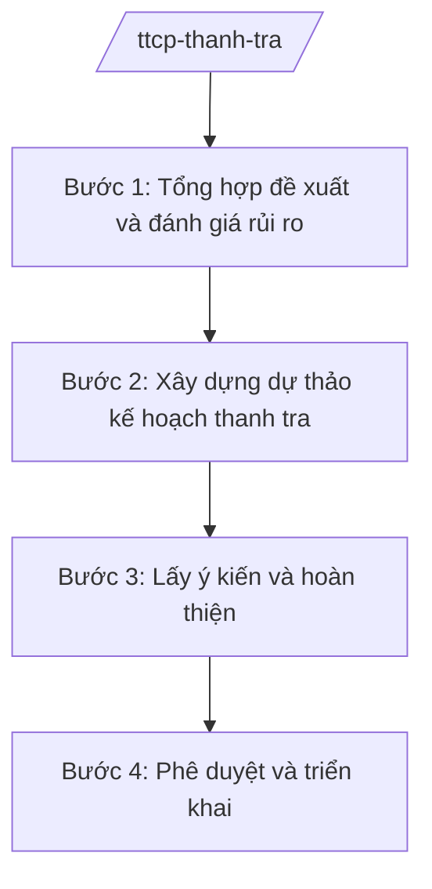

# Skill: Thanh tra (kế hoạch thanh tra của Thanh tra Chính phủ)

## 2. Khi nào dùng

Khi Thanh tra Chính phủ xây dựng định hướng, kế hoạch thanh tra hằng năm (thanh tra việc thực hiện
chính sách, pháp luật, nhiệm vụ của bộ/ngành/địa phương thuộc phạm vi quản lý).

## 3. Đầu vào (Input)

| Trường | Mô tả | Bắt buộc |
|--------|-------|----------|
| `nam_ke_hoach` | Năm thực hiện kế hoạch thanh tra | Có |
| `dinh_huong` | Định hướng thanh tra của Chính phủ, Thủ tướng | Có |
| `de_xuat_don_vi` | Đề xuất của các vụ/cục thuộc Thanh tra Chính phủ | Không |
| `trong_tam` | Lĩnh vực trọng tâm cần thanh tra | Không |

## 4. Quy trình

**Bước 1. Tổng hợp đề xuất và đánh giá rủi ro**

- Làm gì: Thu thập đề xuất thanh tra của các vụ/cục; tổng hợp kiến nghị của bộ/ngành/địa phương, đơn thư, dư luận; đánh giá rủi ro lĩnh vực.
- Dùng input: `de_xuat_don_vi`, `dinh_huong`.
- Vai trò: Vụ Kế hoạch – Tổng hợp (giả lập tên theo chức năng) chủ trì, AI hỗ trợ tổng hợp, phân loại đề xuất theo lĩnh vực và mức độ rủi ro ⏱ ~3–5 ngày (ước tính).
- Lưu ý nghiệp vụ: Ưu tiên lĩnh vực có dấu hiệu vi phạm, dư luận bức xúc, hoặc theo chỉ đạo của Thủ tướng.
- → Kết quả bước: Danh mục đề xuất thanh tra đã phân loại.

**Bước 2. Xây dựng dự thảo kế hoạch thanh tra**

- Làm gì: Lựa chọn cuộc thanh tra đưa vào kế hoạch năm (tên, đối tượng, nội dung, thời gian, đơn vị chủ trì); tránh trùng lặp với kế hoạch của bộ/ngành/địa phương.
- Dùng input: Danh mục đề xuất, `nam_ke_hoach`, `trong_tam`.
- Vai trò: Vụ Kế hoạch – Tổng hợp soạn thảo, AI hỗ trợ kiểm tra trùng lặp với kế hoạch thanh tra đã công bố của các cơ quan ⏱ ~2–3 ngày (ước tính).
- Lưu ý nghiệp vụ: Kế hoạch thanh tra phải được phối hợp, tránh chồng chéo, trùng lặp đối tượng và nội dung.
- → Kết quả bước: Dự thảo kế hoạch thanh tra năm.

**Bước 3. Lấy ý kiến và hoàn thiện**

- Làm gì: Xin ý kiến các vụ/cục trong cơ quan, các bộ/ngành/địa phương liên quan về dự thảo kế hoạch; tiếp thu, hoàn thiện.
- Dùng input: Dự thảo kế hoạch.
- Vai trò: Vụ Kế hoạch – Tổng hợp đầu mối, AI hỗ trợ tổng hợp ý kiến ⏱ ~2–3 ngày (ước tính).
- Lưu ý nghiệp vụ: Kế hoạch thanh tra của Thanh tra Chính phủ do Tổng Thanh tra Chính phủ phê duyệt sau khi báo cáo Thủ tướng.
- → Kết quả bước: Dự thảo kế hoạch hoàn thiện trình phê duyệt.

**Bước 4. Phê duyệt và triển khai**

- Làm gì: Trình Tổng Thanh tra Chính phủ phê duyệt; công bố kế hoạch; giao các vụ/cục triển khai; theo dõi tiến độ thực hiện.
- Dùng input: Dự thảo hoàn thiện.
- Vai trò: Phó Tổng Thanh tra phụ trách cho ý kiến, **Tổng Thanh tra Chính phủ (ông Lê Văn CC — giả lập) phê duyệt**; AI hỗ trợ theo dõi tiến độ các cuộc thanh tra ⏱ ~1–2 ngày cho ban hành (ước tính).
- Lưu ý nghiệp vụ: Việc điều chỉnh, bổ sung kế hoạch trong năm phải đúng trình tự.
- → Kết quả bước: Kế hoạch thanh tra năm đã phê duyệt, công bố.

## Luồng quy trình (Workflow)

## 5. Đầu ra (Output)

- Kế hoạch thanh tra năm của Thanh tra Chính phủ (Tổng Thanh tra phê duyệt).
- Báo cáo Thủ tướng Chính phủ về kế hoạch thanh tra.

### Cấu trúc output chuẩn

**Kế hoạch thanh tra năm** (thể thức NĐ 30/2020/NĐ-CP):
1. Quốc hiệu "CỘNG HÒA XÃ HỘI CHỦ NGHĨA VIỆT NAM", Tiêu ngữ "Độc lập – Tự do – Hạnh phúc"; "KẾ HOẠCH Thanh tra năm ..."; số, ký hiệu; địa danh, ngày tháng năm.
2. Mục đích, yêu cầu.
3. Nội dung: danh mục cuộc thanh tra (tên, đối tượng, nội dung, thời gian, đơn vị chủ trì).
4. Tổ chức thực hiện.
5. Nơi nhận (kết thúc "- Lưu: VT, [mã đơn vị]."); chữ ký (ghi rõ chức danh, họ tên người ký; ký hiệu "KT."/"TL." khi ký thay) Tổng Thanh tra, đóng dấu.

> **Checklist thể thức văn bản theo NĐ 30/2020/NĐ-CP** — đối chiếu trước khi trình ký:
> 1. Quốc hiệu và Tiêu ngữ.
> 2. Tên cơ quan, tổ chức ban hành văn bản.
> 3. Số, ký hiệu của văn bản.
> 4. Địa danh và thời gian ban hành văn bản.
> 5. Tên loại và trích yếu nội dung văn bản.
> 6. Nội dung văn bản.
> 7. Chức vụ, họ tên và chữ ký của người có thẩm quyền.
> 8. Dấu, chữ ký số của cơ quan, tổ chức.
> 9. Nơi nhận (kèm Phụ lục nếu có).

## 6. Checklist nghiệm thu

- [ ] Danh mục thanh tra bám sát định hướng của Chính phủ, Thủ tướng.
- [ ] Không trùng lặp đối tượng, nội dung với kế hoạch của cơ quan khác.
- [ ] Đã xin ý kiến các bên liên quan.
- [ ] Phân công đơn vị chủ trì, thời gian cụ thể từng cuộc.
- [ ] Thể thức đúng NĐ 30/2020/NĐ-CP; Tổng Thanh tra phê duyệt.
- [ ] Không bịa căn cứ pháp lý.

## 7. Ví dụ mô phỏng

*Dữ liệu dưới đây là giả lập 100% phục vụ minh họa.*

**Input mẫu:** nam_ke_hoach = 2026; trong_tam = "quản lý, sử dụng đất đai; đầu tư công" (giả lập).

**Output mẫu (trích Kế hoạch):**

> THANH TRA CHÍNH PHỦ
>
> Số: 123/KH-TTCP
> (Địa danh minh họa), ngày 15 tháng 12 năm 2025
>
> **KẾ HOẠCH**
> **Thanh tra năm 2026 của Thanh tra Chính phủ**
>
> **I. MỤC ĐÍCH, YÊU CẦU** ...
> **II. NỘI DUNG**
> | STT | Cuộc thanh tra | Đối tượng | Thời gian | Đơn vị chủ trì |
> |-----|----------------|-----------|-----------|----------------|
> | 1 | ... (giả lập) | ... | Quý I/2026 | Vụ I (giả lập) |
> | 2 | ... (giả lập) | ... | Quý II/2026 | Vụ II (giả lập) |
> **III. TỔ CHỨC THỰC HIỆN** ...
>
> Nơi nhận: ...
> **TỔNG THANH TRA CHÍNH PHỦ** (ký, đóng dấu — giả lập: ông Lê Văn CC)

## 8. Human gate

- Vụ trưởng Vụ Kế hoạch – Tổng hợp duyệt dự thảo.
- Phó Tổng Thanh tra phụ trách cho ý kiến.
- **Tổng Thanh tra Chính phủ phê duyệt kế hoạch.**

## 9. Giới hạn

- AI không quyết định đưa cuộc thanh tra nào vào kế hoạch thay lãnh đạo.
- AI không tự ký, phát hành văn bản; không bịa đề xuất, căn cứ.
- Mọi căn cứ pháp lý phải có thật.

## 10. Căn cứ & lưu ý

- Nghị định 109/2025/NĐ-CP ngày 20/05/2025 của Chính phủ (hiệu lực 01/6/2025) — chức năng, nhiệm vụ, quyền hạn và cơ cấu tổ chức của Thanh tra Chính phủ.
- Nghị quyết 176/2025/QH15 ngày 18/02/2025 — cơ cấu tổ chức của Chính phủ (TTCP là cơ quan ngang bộ).
- Luật Thanh tra (tên luật, không ghi số hiệu) — nguyên tắc xây dựng kế hoạch thanh tra.
- Nghị định 30/2020/NĐ-CP — thể thức văn bản (chỉ dùng cho thể thức).
- Lưu ý: kế hoạch thanh tra năm là căn cứ để thành lập các đoàn thanh tra trong năm.
