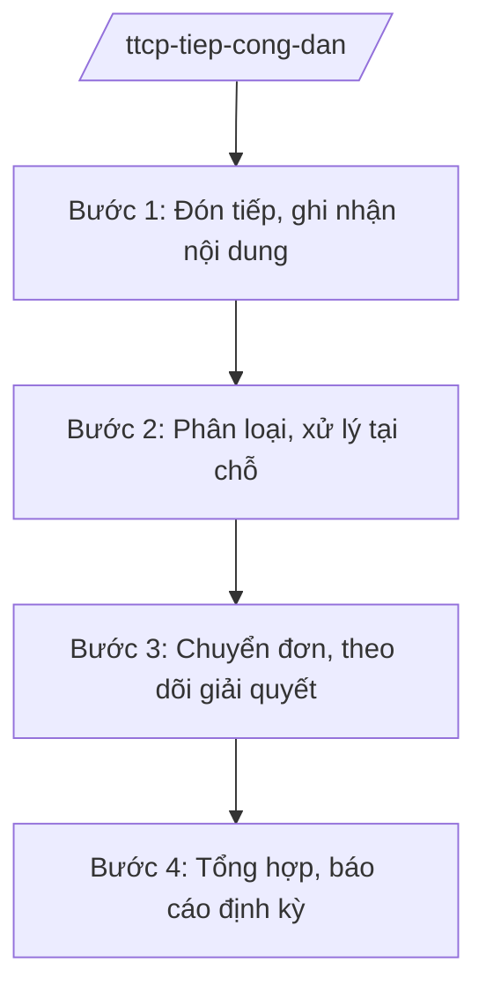

# Skill: Tiếp công dân tại Trụ sở Tiếp công dân Trung ương

## 2. Khi nào dùng

Khi tổ chức tiếp công dân đến khiếu nại, tố cáo, kiến nghị, phản ánh tại Trụ sở Tiếp công dân
Trung ương (tiếp thường xuyên và tiếp định kỳ của lãnh đạo Thanh tra Chính phủ).

## 3. Đầu vào (Input)

| Trường | Mô tả | Bắt buộc |
|--------|-------|----------|
| `hinh_thuc` | Tiếp thường xuyên / Tiếp định kỳ của lãnh đạo | Có |
| `thong_tin_cong_dan` | Họ tên, nội dung trình bày của công dân | Có |
| `ho_so_kem_theo` | Đơn thư, tài liệu công dân mang theo | Không |

## 4. Quy trình

**Bước 1. Đón tiếp, ghi nhận nội dung**

- Làm gì: Đón tiếp công dân; ghi biên bản nội dung trình bày; kiểm tra giấy tờ tùy thân và hồ sơ kèm theo.
- Dùng input: `thong_tin_cong_dan`, `ho_so_kem_theo`.
- Vai trò: Cán bộ tiếp công dân (Ban Tiếp công dân Trung ương — theo chức năng), AI hỗ trợ soạn biên bản tiếp công dân đúng mẫu ⏱ ~0,5 giờ/trường hợp (ước tính).
- Lưu ý nghiệp vụ: Thái độ đúng mực, lắng nghe đầy đủ; ghi chép trung thực nội dung trình bày.
- → Kết quả bước: Biên bản tiếp công dân.

**Bước 2. Phân loại, xử lý tại chỗ**

- Làm gì: Phân loại vụ việc (khiếu nại/tố cáo/kiến nghị/phản ánh); hướng dẫn công dân gửi đơn đúng cơ quan có thẩm quyền đối với vụ việc không thuộc thẩm quyền trung ương; giải thích chính sách, pháp luật.
- Dùng input: Biên bản tiếp công dân.
- Vai trò: Cán bộ tiếp công dân, AI hỗ trợ tra cứu thẩm quyền giải quyết và soạn văn bản hướng dẫn ⏱ ~0,5 giờ/trường hợp (ước tính).
- Lưu ý nghiệp vụ: Vụ việc đã được giải quyết đúng pháp luật thì giải thích, vận động công dân chấp hành, không tiếp nhận tràn lan.
- → Kết quả bước: Kết quả phân loại + văn bản hướng dẫn (nếu chuyển đúng thẩm quyền).

**Bước 3. Chuyển đơn, theo dõi giải quyết**

- Làm gì: Đối với vụ việc thuộc thẩm quyền trung ương: chuyển đơn đến vụ chuyên môn thụ lý; theo dõi tiến độ giải quyết; đôn đốc cơ quan được giao.
- Dùng input: Hồ sơ vụ việc thuộc thẩm quyền.
- Vai trò: Ban Tiếp công dân Trung ương đầu mối, AI hỗ trợ cập nhật sổ theo dõi, nhắc hạn xử lý ⏱ ~0,5 ngày (ước tính).
- Lưu ý nghiệp vụ: Mọi đơn chuyển phải có văn bản và được theo dõi đến khi có kết quả giải quyết.
- → Kết quả bước: Đơn được chuyển đúng đầu mối + sổ theo dõi cập nhật.

**Bước 4. Tổng hợp, báo cáo định kỳ**

- Làm gì: Tổng hợp tình hình tiếp công dân, phân tích vụ việc đông người, phức tạp, vượt cấp; báo cáo lãnh đạo Thanh tra Chính phủ và Thủ tướng Chính phủ (định kỳ/đột xuất).
- Dùng input: Sổ theo dõi, biên bản tiếp công dân.
- Vai trò: Trưởng Ban Tiếp công dân Trung ương tổng hợp, AI hỗ trợ thống kê, phân tích xu hướng ⏱ ~2–3 ngày/đợt báo cáo (ước tính).
- Lưu ý nghiệp vụ: Kịp thời báo cáo các vụ việc phức tạp, đông người, có nguy cơ gây mất an ninh, trật tự.
- → Kết quả bước: Báo cáo tình hình tiếp công dân định kỳ/đột xuất.

## Luồng quy trình (Workflow)

## 5. Đầu ra (Output)

- Biên bản tiếp công dân; văn bản hướng dẫn/chuyển đơn; sổ theo dõi; báo cáo tình hình tiếp công dân.

### Cấu trúc output chuẩn (thể thức NĐ 30/2020/NĐ-CP)

**Biên bản tiếp công dân** (mẫu thống nhất):
1. Quốc hiệu "CỘNG HÒA XÃ HỘI CHỦ NGHĨA VIỆT NAM", Tiêu ngữ "Độc lập – Tự do – Hạnh phúc"; "BIÊN BẢN TIẾP CÔNG DÂN"; địa điểm, ngày giờ tiếp.
2. Thành phần: cán bộ tiếp; công dân được tiếp (họ tên, địa chỉ, giấy tờ).
3. Nội dung công dân trình bày.
4. Ý kiến của cán bộ tiếp (hướng dẫn/giải thích/tiếp nhận).
5. Chữ ký (ghi rõ chức danh, họ tên người ký; ký hiệu "KT."/"TL." khi ký thay) cán bộ tiếp và công dân.
6. Nơi nhận (kết thúc "- Lưu: VT, [mã đơn vị].").

> **Checklist thể thức văn bản theo NĐ 30/2020/NĐ-CP** — đối chiếu trước khi trình ký:
> 1. Quốc hiệu và Tiêu ngữ.
> 2. Tên cơ quan, tổ chức ban hành văn bản.
> 3. Số, ký hiệu của văn bản.
> 4. Địa danh và thời gian ban hành văn bản.
> 5. Tên loại và trích yếu nội dung văn bản.
> 6. Nội dung văn bản.
> 7. Chức vụ, họ tên và chữ ký của người có thẩm quyền.
> 8. Dấu, chữ ký số của cơ quan, tổ chức.
> 9. Nơi nhận (kèm Phụ lục nếu có).

## 6. Checklist nghiệm thu

- [ ] Biên bản ghi đầy đủ, trung thực nội dung trình bày.
- [ ] Phân loại đúng (khiếu nại/tố cáo/kiến nghị/phản ánh).
- [ ] Vụ việc không thuộc thẩm quyền được hướng dẫn đúng cơ quan giải quyết.
- [ ] Đơn thuộc thẩm quyền được chuyển đúng đầu mối và theo dõi đến cùng.
- [ ] Vụ việc phức tạp, đông người được báo cáo kịp thời.
- [ ] Không bịa nội dung biên bản, hồ sơ.

## 7. Ví dụ mô phỏng

*Dữ liệu dưới đây là giả lập 100% phục vụ minh họa.*

**Input mẫu:** hinh_thuc = Tiếp thường xuyên; thong_tin_cong_dan = "ông Nguyễn Văn AA (giả lập) khiếu nại về chính sách bồi thường dự án" (giả lập).

**Output mẫu (Biên bản tiếp công dân):**

> CỘNG HÒA XÃ HỘI CHỦ NGHĨA VIỆT NAM
> Độc lập – Tự do – Hạnh phúc
>
> **BIÊN BẢN TIẾP CÔNG DÂN**
>
> Hôm nay, ngày 10 tháng 10 năm 2026, tại Trụ sở Tiếp công dân Trung ương (giả lập địa điểm minh họa):
> - Cán bộ tiếp: ông/bà ... (giả lập)
> - Công dân: ông Nguyễn Văn AA (giả lập), địa chỉ: xã A, tỉnh A (giả lập).
>
> **Nội dung trình bày:** Ông AA khiếu nại về chính sách bồi thường khi thu hồi đất thực hiện dự án AA (giả lập)...
> **Ý kiến của cán bộ tiếp:** Hướng dẫn ông AA gửi đơn đến ... (cơ quan có thẩm quyền, giả lập); tiếp nhận đơn chuyển vụ chuyên môn theo dõi (giả lập).
>
> Cán bộ tiếp (ký) — Công dân (ký)

## 8. Human gate

- Trưởng Ban Tiếp công dân Trung ương duyệt việc chuyển đơn và báo cáo.
- Vụ việc phức tạp báo cáo Phó Tổng Thanh tra / Tổng Thanh tra chỉ đạo.

## 9. Giới hạn

- AI không quyết định nội dung giải quyết vụ việc thay người có thẩm quyền.
- AI không bịa biên bản, hồ sơ tiếp công dân.
- Bảo vệ thông tin cá nhân của công dân và bí mật người tố cáo.

## 10. Căn cứ & lưu ý

- Nghị định 109/2025/NĐ-CP ngày 20/05/2025 (hiệu lực 01/6/2025) — chức năng, nhiệm vụ, quyền hạn và cơ cấu tổ chức của Thanh tra Chính phủ (trong đó có Ban Tiếp công dân Trung ương).
- Luật Tiếp công dân, Luật Khiếu nại, Luật Tố cáo (tên luật, không ghi số hiệu).
- Nghị định 30/2020/NĐ-CP — thể thức văn bản (chỉ dùng cho thể thức).
- Lưu ý: Trụ sở Tiếp công dân Trung ương là đầu mối tiếp công dân của các cơ quan trung ương.
