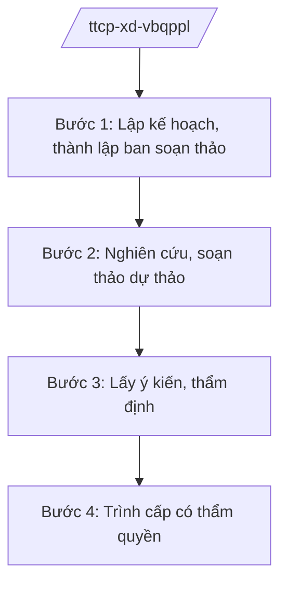

# Skill: Xây dựng VBQPPL lĩnh vực thanh tra, KNTC, PCTN

## 2. Khi nào dùng

Khi Thanh tra Chính phủ được giao chủ trì soạn thảo văn bản QPPL (luật, nghị định, thông tư liên tịch
hoặc văn bản thuộc thẩm quyền) trong lĩnh vực thanh tra, tiếp công dân, giải quyết khiếu nại, tố cáo,
phòng, chống tham nhũng.

## 3. Đầu vào (Input)

| Trường | Mô tả | Bắt buộc |
|--------|-------|----------|
| `ten_van_ban` | Tên văn bản cần xây dựng | Có |
| `loai_van_ban` | Luật / Nghị định / Thông tư / Văn bản khác | Có |
| `yeu_cau_chinh_sach` | Nội dung chính sách cần thể chế hóa | Có |
| `don_vi_chu_tri` | Vụ/cục chủ trì soạn thảo | Có |
| `cap_trinh` | Quốc hội / Chính phủ / TTCP ban hành | Có |

## 4. Quy trình

**Bước 1. Lập kế hoạch, thành lập ban soạn thảo**

- Làm gì: Thành lập ban soạn thảo/tổ biên tập; xây dựng kế hoạch soạn thảo.
- Dùng input: `ten_van_ban`, `don_vi_chu_tri`, `cap_trinh`.
- Vai trò: Vụ Pháp chế (theo chức năng) phối hợp, AI hỗ trợ dựng kế hoạch ⏱ ~1 ngày (ước tính).
- Lưu ý nghiệp vụ: Thành phần ban soạn thảo có đại diện Bộ Tư pháp, Văn phòng Chính phủ.
- → Kết quả bước: Quyết định thành lập ban soạn thảo + kế hoạch được phê duyệt.

**Bước 2. Nghiên cứu, soạn thảo dự thảo**

- Làm gì: Tổng kết thi hành pháp luật hiện hành trong lĩnh vực; soạn dự thảo điều khoản và tờ trình.
- Dùng input: `yeu_cau_chinh_sach`.
- Vai trò: Tổ biên tập soạn thảo, AI hỗ trợ tổng hợp tài liệu, kiểm tra tính thống nhất ⏱ ~5–10 ngày (ước tính).
- Lưu ý nghiệp vụ: Nội dung phải phù hợp với Luật Thanh tra, Luật Khiếu nại, Luật Tố cáo, Luật PCTN và các luật liên quan.
- → Kết quả bước: Dự thảo lần 1 + tờ trình.

**Bước 3. Lấy ý kiến, thẩm định**

- Làm gì: Lấy ý kiến bộ/ngành/địa phương, đối tượng chịu tác động; đăng Cổng TTĐT; gửi Bộ Tư pháp thẩm định (đối với dự án luật, nghị định); tiếp thu, giải trình.
- Dùng input: Dự thảo lần 1, `loai_van_ban`.
- Vai trò: Đơn vị chủ trì tổng hợp, AI hỗ trợ phân loại ý kiến, lập bảng tiếp thu ⏱ ~3–5 ngày (ước tính).
- Lưu ý nghiệp vụ: Ý kiến thẩm định của Bộ Tư pháp là bắt buộc đối với dự án luật, dự thảo nghị định.
- → Kết quả bước: Dự thảo hoàn thiện + báo cáo thẩm định + bảng tiếp thu.

**Bước 4. Trình cấp có thẩm quyền**

- Làm gì: Hoàn thiện hồ sơ trình Quốc hội/Chính phủ (hoặc Tổng Thanh tra ký ban hành nếu thuộc thẩm quyền).
- Dùng input: Hồ sơ hoàn thiện, `cap_trinh`.
- Vai trò: Phó Tổng Thanh tra phụ trách cho ý kiến, **Tổng Thanh tra Chính phủ (ông Lê Văn CC — giả lập) ký tờ trình**; AI hỗ trợ: rà soát thành phần hồ sơ ⏱ ~2 ngày (ước tính).
- Lưu ý nghiệp vụ: Hồ sơ trình phải đầy đủ theo quy định của Luật Ban hành VBQPPL.
- → Kết quả bước: Hồ sơ trình cấp có thẩm quyền ban hành văn bản.

## Luồng quy trình (Workflow)

## 5. Đầu ra (Output)

- Hồ sơ dự thảo văn bản QPPL lĩnh vực thanh tra/KNTC/PCTN (tờ trình, dự thảo, đánh giá tác động, tổng hợp ý kiến, báo cáo thẩm định).

### Cấu trúc output chuẩn

**Tờ trình về dự thảo văn bản** (thể thức NĐ 30/2020/NĐ-CP):
1. Quốc hiệu "CỘNG HÒA XÃ HỘI CHỦ NGHĨA VIỆT NAM", Tiêu ngữ "Độc lập – Tự do – Hạnh phúc"; "Tờ trình về ..."; số, ký hiệu; địa danh, ngày tháng năm.
2. Kính gửi: cấp có thẩm quyền.
3. Sự cần thiết ban hành.
4. Mục đích, quan điểm xây dựng.
5. Quá trình xây dựng, ý kiến tham gia.
6. Bố cục, nội dung cơ bản.
7. Nơi nhận (kết thúc "- Lưu: VT, [mã đơn vị]."); chữ ký (ghi rõ chức danh, họ tên người ký; ký hiệu "KT."/"TL." khi ký thay) Tổng Thanh tra, đóng dấu.
## 6. Checklist nghiệm thu

- [ ] Dự thảo phù hợp với các luật về thanh tra, KNTC, PCTN.
- [ ] Đã lấy ý kiến đầy đủ; có báo cáo thẩm định (nếu bắt buộc).
- [ ] Mọi ý kiến được tiếp thu/giải trình.
- [ ] Thể thức đúng NĐ 30/2020/NĐ-CP; đúng thẩm quyền ký.
- [ ] Không bịa căn cứ pháp lý, không viện dẫn văn bản hết hiệu lực.

## 7. Ví dụ mô phỏng

*Dữ liệu dưới đây là giả lập 100% phục vụ minh họa.*

**Input mẫu:** ten_van_ban = "Nghị định sửa đổi công tác tiếp công dân (giả lập)";
loai_van_ban = Nghị định; cap_trinh = Chính phủ.

**Output mẫu (trích Tờ trình):**

> THANH TRA CHÍNH PHỦ
>
> Số: 456/TTr-TTCP
> (Địa danh minh họa), ngày 25 tháng 11 năm 2026
>
> **TỜ TRÌNH**
> **Về dự thảo Nghị định sửa đổi, bổ sung một số điều về công tác tiếp công dân (giả lập)**
>
> Kính gửi: Chính phủ
>
> **I. SỰ CẦN THIẾT BAN HÀNH** ... (giả lập)
> **II. MỤC ĐÍCH, QUAN ĐIỂM** ...
> **III. QUÁ TRÌNH XÂY DỰNG** ... (đã lấy ý kiến; Bộ Tư pháp thẩm định — giả lập)
> **IV. BỐ CỤC, NỘI DUNG CƠ BẢN** ... (giả lập)
>
> Kính trình Chính phủ xem xét, ban hành.
>
> Nơi nhận: ...
> **TỔNG THANH TRA CHÍNH PHỦ** (ký, đóng dấu — giả lập: ông Lê Văn CC)

## 8. Human gate

- Vụ trưởng vụ chuyên môn duyệt dự thảo.
- Phó Tổng Thanh tra phụ trách cho ý kiến.
- **Tổng Thanh tra ký tờ trình (hoặc ký ban hành nếu thuộc thẩm quyền).**

## 9. Giới hạn

- AI không quyết định nội dung chính sách thay ban soạn thảo và lãnh đạo.
- AI không tự ký, phát hành văn bản; không bịa ý kiến thẩm định.
- Mọi căn cứ pháp lý phải có thật.

## 10. Căn cứ & lưu ý

- Nghị định 109/2025/NĐ-CP ngày 20/05/2025 (hiệu lực 01/6/2025) — chức năng, nhiệm vụ, quyền hạn và cơ cấu tổ chức của Thanh tra Chính phủ.
- Luật Ban hành văn bản quy phạm pháp luật (tên luật, không ghi số hiệu).
- Nghị định 30/2020/NĐ-CP — thể thức văn bản (chỉ dùng cho thể thức).
- Lưu ý: văn bản trong lĩnh vực thanh tra, KNTC, PCTN do Thanh tra Chính phủ chủ trì phải bảo đảm thống nhất với hệ thống pháp luật hiện hành.
