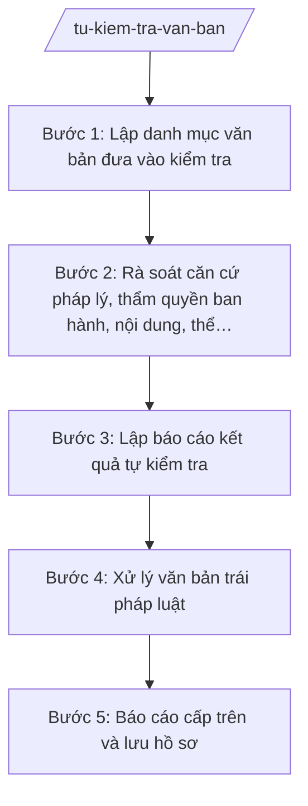

# Skill: Tự kiểm tra văn bản QPPL do cấp xã ban hành

## 2. Khi nào dùng
- Đến kỳ tự kiểm tra văn bản QPPL định kỳ hằng năm của xã.
- Có văn bản QPPL của Trung ương/tỉnh mới ban hành làm thay đổi căn cứ pháp lý của văn bản xã.
- Cấp trên yêu cầu kiểm tra một văn bản cụ thể của HĐND/UBND xã có dấu hiệu trái pháp luật.
- Trước khi ban hành văn bản thay thế, cần rà soát văn bản cũ để xử lý đồng bộ.

## 3. Đầu vào (Input)
| Trường | Mô tả | Bắt buộc |
|--------|-------|----------|
| `danh_muc_van_ban` | Danh sách văn bản QPPL do HĐND/UBND xã ban hành cần kiểm tra (số hiệu, ngày ban hành, trích yếu) | Có |
| `van_ban_goc` | File/bản sao từng văn bản cần kiểm tra | Có |
| `can_cu_moi` | Văn bản QPPL cấp trên mới ban hành liên quan (nếu có) | Không |
| `ket_qua_ky_truoc` | Kết luận kiểm tra kỳ trước, văn bản đang chờ xử lý | Không |
| `can_bo_phu_trach` | Công chức tư pháp – hộ tịch phụ trách | Có |

## 4. Quy trình

**Bước 1. Lập danh mục văn bản đưa vào kiểm tra**
- Làm gì: Liệt kê toàn bộ văn bản QPPL do HĐND xã (nghị quyết) và UBND xã (quyết định) ban hành còn hiệu lực; loại trừ văn bản đã hết hiệu lực, đã bị bãi bỏ.
- Dùng input: `danh_muc_van_ban`, `van_ban_goc`, `ket_qua_ky_truoc`.
- Vai trò: Công chức tư pháp – hộ tịch xã lập danh mục; AI hỗ trợ chuẩn hóa danh mục, đánh dấu văn bản đã xử lý kỳ trước ⏱ 0,5 ngày (ước tính) làm việc
- Lưu ý nghiệp vụ: Văn bản của cấp xã chủ yếu là nghị quyết của HĐND và quyết định của UBND; văn bản hành chính thông thường (công văn, thông báo) không thuộc diện kiểm tra này.
- → Kết quả bước: Danh mục văn bản QPPL đưa vào tự kiểm tra, có phân loại.

**Bước 2. Rà soát căn cứ pháp lý, thẩm quyền ban hành, nội dung, thể thức**
- Làm gì: Kiểm tra từng văn bản theo 4 nội dung: căn cứ pháp lý có còn hiệu lực, đúng thẩm quyền ban hành, nội dung có trái văn bản cấp trên, thể thức đúng quy định của Luật Ban hành văn bản quy phạm pháp luật.
- Dùng input: `van_ban_goc`, `can_cu_moi`.
- Vai trò: Công chức tư pháp – hộ tịch xã rà soát, kết luận; AI hỗ trợ đối chiếu căn cứ pháp lý với danh sách văn bản còn hiệu lực, kiểm tra thể thức ⏱ 2 ngày (ước tính) làm việc
- Lưu ý nghiệp vụ: Căn cứ pháp lý hết hiệu lực là lỗi phổ biến nhất; thẩm quyền: HĐND xã chỉ ban hành nghị quyết, UBND xã ban hành quyết định; nội dung không được trái luật, nghị quyết cấp trên.
- → Kết quả bước: Phiếu kiểm tra từng văn bản, ghi rõ đạt/không đạt từng nội dung và lý do.

**Bước 3. Lập báo cáo kết quả tự kiểm tra**
- Làm gì: Tổng hợp kết quả: số văn bản kiểm tra, số văn bản đúng pháp luật, số văn bản có vi phạm (phân loại vi phạm); đề xuất hướng xử lý từng văn bản vi phạm.
- Dùng input: Phiếu kiểm tra ở Bước 2, `danh_muc_van_ban`.
- Vai trò: Công chức tư pháp – hộ tịch xã tổng hợp; AI hỗ trợ lập bảng tổng hợp, soạn báo cáo ⏱ 0,5 ngày (ước tính) làm việc
- Lưu ý nghiệp vụ: Báo cáo phải trung thực, không che giấu vi phạm; mỗi văn bản vi phạm phải nêu cụ thể điều, khoản trái và văn bản cấp trên bị trái.
- → Kết quả bước: Báo cáo kết quả tự kiểm tra văn bản QPPL.

**Bước 4. Xử lý văn bản trái pháp luật**
- Làm gì: Theo kết luận kiểm tra, tham mưu xử lý: sửa đổi, bổ sung; bãi bỏ một phần/toàn bộ; ban hành văn bản thay thế; trình HĐND/UBND xã quyết định.
- Dùng input: Báo cáo tự kiểm tra, văn bản vi phạm.
- Vai trò: Công chức tư pháp – hộ tịch tham mưu; Chánh Văn phòng HĐND và UBND thẩm định; HĐND/UBND xã quyết định xử lý; AI hỗ trợ soạn dự thảo quyết định xử lý ⏱ 3 ngày (ước tính) làm việc
- Lưu ý nghiệp vụ: Thẩm quyền xử lý thuộc cơ quan ban hành văn bản (HĐND xử lý nghị quyết, UBND xử lý quyết định); văn bản xử lý cũng phải đúng thể thức.
- → Kết quả bước: Quyết định xử lý văn bản trái pháp luật (sửa đổi/bãi bỏ/thay thế) đã được ban hành.

**Bước 5. Báo cáo cấp trên và lưu hồ sơ**
- Làm gì: Gửi báo cáo kết quả tự kiểm tra + quyết định xử lý (nếu có) về Phòng Tư pháp/Sở Tư pháp; lưu hồ sơ kiểm tra đầy đủ.
- Dùng input: Báo cáo tự kiểm tra, quyết định xử lý, `can_bo_phu_trach`.
- Vai trò: Chánh Văn phòng HĐND và UBND kiểm tra hồ sơ; AI hỗ trợ lập danh mục hồ sơ lưu ⏱ 0,5 ngày (ước tính) làm việc
- Lưu ý nghiệp vụ: Gửi đúng thời hạn cấp trên quy định; hồ sơ lưu gồm danh mục, phiếu kiểm tra, báo cáo, quyết định xử lý.
- → Kết quả bước: Hồ sơ tự kiểm tra hoàn chỉnh, đã báo cáo cấp trên.

## Luồng quy trình (Workflow)

## 5. Đầu ra (Output)
- Báo cáo kết quả tự kiểm tra văn bản QPPL của UBND xã.
- Phiếu kiểm tra từng văn bản (phụ lục).
- Quyết định xử lý văn bản trái pháp luật — nếu có (sửa đổi, bổ sung, bãi bỏ, thay thế).

### Cấu trúc output chuẩn
Khung báo cáo của UBND xã (theo NĐ 30/2020/NĐ-CP):
1. Quốc hiệu – tiêu ngữ: "CỘNG HÒA XÃ HỘI CHỦ NGHĨA VIỆT NAM / Độc lập – Tự do – Hạnh phúc".
2. Số, ký hiệu văn bản: số .../BC-UBND.
3. Địa danh và ngày, tháng, năm: "Xã A, ngày ... tháng ... năm ...".
4. Tên loại và trích yếu: "BÁO CÁO / Kết quả tự kiểm tra văn bản quy phạm pháp luật do HĐND, UBND xã A ban hành năm ...".
5. Nội dung bắt buộc: I. Văn bản đưa vào kiểm tra (số lượng, phân loại); II. Kết quả kiểm tra (số văn bản đúng pháp luật; số văn bản vi phạm, phân loại vi phạm: căn cứ pháp lý/thẩm quyền/nội dung/thể thức); III. Xử lý văn bản vi phạm; IV. Kiến nghị.
6. Nơi nhận: Phòng Tư pháp/Sở Tư pháp tỉnh A; Thường trực HĐND xã; lưu VP.
7. Chữ ký: "TM. ỦY BAN NHÂN DÂN / CHỦ TỊCH" + họ tên, đóng dấu.

## 6. Checklist nghiệm thu
- [ ] Danh mục kiểm tra bao quát hết văn bản QPPL còn hiệu lực của HĐND/UBND xã.
- [ ] Mỗi văn bản có phiếu kiểm tra đủ 4 nội dung: căn cứ pháp lý, thẩm quyền, nội dung, thể thức.
- [ ] Kết luận vi phạm nêu cụ thể điều, khoản trái và văn bản cấp trên bị trái (không chung chung).
- [ ] Văn bản vi phạm đã có phương án xử lý tương ứng (sửa đổi/bổ sung/bãi bỏ/thay thế).
- [ ] Quyết định xử lý (nếu có) do đúng cơ quan có thẩm quyền ban hành, đúng thể thức.
- [ ] Báo cáo đúng thể thức NĐ 30/2020/NĐ-CP, đã gửi cấp trên đúng hạn.
- [ ] Không trích dẫn văn bản hết hiệu lực làm căn cứ kiểm tra.
- [ ] Đã qua human gate: công chức soạn → Chánh Văn phòng kiểm tra → Chủ tịch UBND xã ký.

## 7. Ví dụ mô phỏng
*Dữ liệu dưới đây là giả lập 100% phục vụ minh họa.*

### Input mẫu
- danh_muc_van_ban: 02 văn bản (NQ 05/2024/NQ-HĐND về phí vệ sinh; QĐ 12/2024/QĐ-UBND về tổ chức lễ hội)
- van_ban_goc: bản sao 02 văn bản trên
- can_cu_moi: Không
- ket_qua_ky_truoc: Kỳ trước không có văn bản vi phạm
- can_bo_phu_trach: Ông Nguyễn Văn G

### Output mẫu
**BÁO CÁO** số 123/BC-UBND
Kết quả tự kiểm tra văn bản QPPL do HĐND, UBND xã A ban hành năm 2026

CỘNG HÒA XÃ HỘI CHỦ NGHĨA VIỆT NAM
Độc lập – Tự do – Hạnh phúc

Xã A, ngày 09 tháng 10 năm 2026

I. VĂN BẢN ĐƯA VÀO KIỂM TRA
Tổng số 02 văn bản còn hiệu lực: 01 nghị quyết của HĐND xã, 01 quyết định của UBND xã.

II. KẾT QUẢ KIỂM TRA
1. Văn bản đúng pháp luật: 01 (QĐ 12/2024/QĐ-UBND).
2. Văn bản có vi phạm: 01 (NQ 05/2024/NQ-HĐND): căn cứ pháp lý viện dẫn đã hết hiệu lực.

III. XỬ LÝ VĂN BẢN VI PHẠM
Đề nghị HĐND xã ban hành nghị quyết sửa đổi, bổ sung NQ 05/2024/NQ-HĐND, cập nhật căn cứ pháp lý còn hiệu lực.

IV. KIẾN NGHỊ
Không.

Nơi nhận:
- Phòng Tư pháp tỉnh A;
- Thường trực HĐND xã;
- Lưu: VP.

TM. ỦY BAN NHÂN DÂN
CHỦ TỊCH
Nguyễn Văn A

## 8. Human gate
Công chức tư pháp – hộ tịch xã rà soát, lập phiếu kiểm tra và dự thảo báo cáo → Chánh Văn phòng HĐND và UBND kiểm tra kết luận vi phạm → Chủ tịch UBND xã ký báo cáo; quyết định xử lý văn bản vi phạm do HĐND/UBND xã (cơ quan ban hành) quyết định. AI chỉ hỗ trợ đối chiếu, soạn thảo.

## 9. Giới hạn
AI tuyệt đối KHÔNG: ra quyết định hành chính thay người có thẩm quyền; tự ký/phát hành văn bản; bịa số liệu, căn cứ pháp lý, trích dẫn; dùng văn bản hết hiệu lực; tư vấn vượt thẩm quyền cấp xã. Đặc biệt: không tự kết luận văn bản "trái pháp luật" — kết luận vi phạm do công chức và lãnh đạo xã quyết định.

## 10. Căn cứ & lưu ý
- TT 09/2025/TT-BTP (hướng dẫn chức năng, nhiệm vụ lĩnh vực tư pháp của Văn phòng HĐND & UBND cấp xã; hiệu lực 01/7/2025).
- NĐ 30/2020/NĐ-CP (thể thức văn bản hành chính).
- Luật Tổ chức chính quyền địa phương 72/2025/QH15.
- Lưu ý: phân biệt "tự kiểm tra" (xã tự rà văn bản của mình) với "kiểm tra theo thẩm quyền của cấp trên"; văn bản hành chính thông thường không thuộc diện kiểm tra văn bản QPPL.
