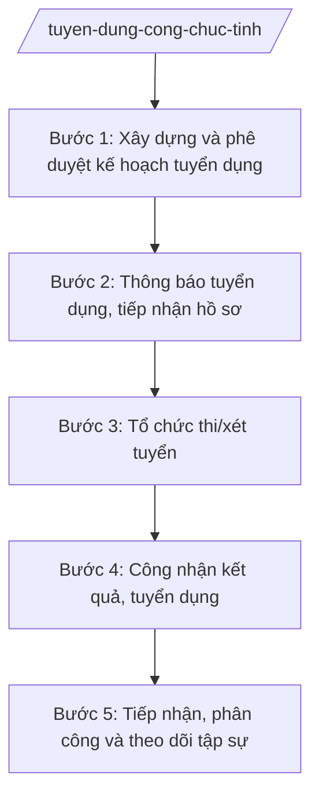

# Skill: Tuyển dụng công chức cấp tỉnh

## 2. Khi nào dùng
- Tuyển dụng công chức hằng năm theo chỉ tiêu biên chế được giao.
- Tuyển dụng theo vị trí việc làm còn thiếu tại các sở, ban, ngành, UBND cấp xã.
- Tuyển dụng trong trường hợp đặc biệt theo quy định.

## 3. Đầu vào (Input)
| Trường | Mô tả | Bắt buộc |
|--------|-------|----------|
| `chi_tieu` | Chỉ tiêu tuyển dụng theo vị trí việc làm, đơn vị | Có |
| `ke_hoach_tuyen_dung` | Kế hoạch tuyển dụng đã được phê duyệt | Có |
| `tieu_chuan_vi_tri` | Tiêu chuẩn từng vị trí việc làm cần tuyển | Có |
| `hinh_thuc` | Hình thức tuyển dụng (thi tuyển / xét tuyển) | Có |
| `hoi_dong` | Hội đồng tuyển dụng (dự kiến thành phần) | Không |

## 4. Quy trình

**Bước 1. Xây dựng và phê duyệt kế hoạch tuyển dụng**
- Làm gì: Tổng hợp nhu cầu của các cơ quan, đơn vị; xây dựng kế hoạch (chỉ tiêu, vị trí, tiêu chuẩn, hình thức, kinh phí, tiến độ); trình UBND tỉnh phê duyệt.
- Dùng input: `chi_tieu`, `tieu_chuan_vi_tri`, `hinh_thuc`.
- Vai trò: Chuyên viên Phòng Công chức, viên chức (Sở Nội vụ tỉnh A) tổng hợp; AI hỗ trợ lập bảng chỉ tiêu theo đơn vị ⏱ ~5 ngày làm việc (ước tính)
- Lưu ý nghiệp vụ: Chỉ tiêu trong tổng biên chế được giao; tiêu chuẩn vị trí việc làm phải đã được phê duyệt.
- → Kết quả bước: Kế hoạch tuyển dụng đã phê duyệt.

**Bước 2. Thông báo tuyển dụng, tiếp nhận hồ sơ**
- Làm gì: Đăng thông báo tuyển dụng (chỉ tiêu, điều kiện, hồ sơ, thời gian, địa điểm); tiếp nhận, kiểm tra hồ sơ đăng ký.
- Dùng input: `ke_hoach_tuyen_dung`.
- Vai trò: Hội đồng tuyển dụng tiếp nhận; AI hỗ trợ soạn thông báo, lập danh sách thí sinh đủ điều kiện ⏱ ~10 ngày làm việc (ước tính)
- Lưu ý nghiệp vụ: Thông báo công khai trên cổng thông tin; kiểm tra điều kiện dự tuyển chặt chẽ, công bằng.
- → Kết quả bước: Danh sách thí sinh đủ điều kiện dự tuyển.

**Bước 3. Tổ chức thi/xét tuyển**
- Làm gì: Tổ chức thi (trắc nghiệm, viết, phỏng vấn) hoặc xét tuyển theo quy định; chấm thi, tổng hợp điểm; đảm bảo an toàn, nghiêm túc.
- Dùng input: Danh sách thí sinh Bước 2.
- Vai trò: Hội đồng tuyển dụng tổ chức; AI hỗ trợ tổng hợp điểm, xếp hạng (không chấm thay) ⏱ theo lịch thi (ước tính)
- Lưu ý nghiệp vụ: Bảo mật đề thi; chấm thi khách quan; giải quyết khiếu nại về kết quả đúng quy định.
- → Kết quả bước: Kết quả thi/xét tuyển.

**Bước 4. Công nhận kết quả, tuyển dụng**
- Làm gì: Trình người có thẩm quyền công nhận kết quả; thông báo trúng tuyển; ra quyết định tuyển dụng, phân công đơn vị công tác.
- Dùng input: Kết quả Bước 3.
- Vai trò: Giám đốc Sở Nội vụ trình; Chủ tịch UBND tỉnh A quyết định công nhận; AI hỗ trợ soạn quyết định ⏱ ~5 ngày làm việc (ước tính)
- Lưu ý nghiệp vụ: Lấy theo thứ tự điểm từ cao xuống thấp trong chỉ tiêu; công khai kết quả.
- → Kết quả bước: Quyết định công nhận kết quả và quyết định tuyển dụng.

**Bước 5. Tiếp nhận, phân công và theo dõi tập sự**
- Làm gì: Đơn vị tiếp nhận, phân công công tác; theo dõi thời gian tập sự; đánh giá hết tập sự để bổ nhiệm ngạch.
- Dùng input: Quyết định tuyển dụng.
- Vai trò: Thủ trưởng đơn vị tiếp nhận; AI hỗ trợ lập bảng theo dõi tập sự ⏱ theo thời gian tập sự (ước tính)
- Lưu ý nghiệp vụ: Bố trí người hướng dẫn tập sự; đánh giá tập sự đúng quy định trước khi bổ nhiệm chính thức.
- → Kết quả bước: Báo cáo kết quả tập sự; quyết định bổ nhiệm ngạch.

## Luồng quy trình (Workflow)

## 5. Đầu ra (Output)
- Kế hoạch tuyển dụng công chức.
- Thông báo tuyển dụng.
- Quyết định công nhận kết quả trúng tuyển.
- Quyết định tuyển dụng công chức.

**Cấu trúc output chuẩn:**
- Thể thức: tuân thủ Nghị định 30/2020/NĐ-CP về công tác văn thư.
Khung kế hoạch tuyển dụng công chức:
1. Quốc hiệu "CỘNG HÒA XÃ HỘI CHỦ NGHĨA VIỆT NAM", Tiêu ngữ "Độc lập – Tự do – Hạnh phúc"; số, ký hiệu; địa danh, ngày tháng năm.
2. Tên: "KẾ HOẠCH tuyển dụng công chức năm ... tỉnh A".
3. Căn cứ pháp lý.
4. Chỉ tiêu, vị trí, đơn vị cần tuyển (bảng).
5. Điều kiện, tiêu chuẩn dự tuyển.
6. Hình thức, nội dung thi/xét tuyển.
7. Hội đồng tuyển dụng; kinh phí; tiến độ.
8. Tổ chức thực hiện; chữ ký.
- Nơi nhận: liệt kê các cơ quan, đơn vị nhận để biết/thực hiện; kết thúc bằng "- Lưu: VT, [mã đơn vị]".

> **Checklist thể thức văn bản theo NĐ 30/2020/NĐ-CP** — đối chiếu trước khi trình ký:
> 1. Quốc hiệu và Tiêu ngữ.
> 2. Tên cơ quan, tổ chức ban hành văn bản.
> 3. Số, ký hiệu của văn bản.
> 4. Địa danh và thời gian ban hành văn bản.
> 5. Tên loại và trích yếu nội dung văn bản.
> 6. Nội dung văn bản.
> 7. Chức vụ, họ tên và chữ ký của người có thẩm quyền.
> 8. Dấu, chữ ký số của cơ quan, tổ chức.
> 9. Nơi nhận (kèm Phụ lục nếu có).

## 6. Checklist nghiệm thu
- [ ] Chỉ tiêu trong tổng biên chế được giao, đúng vị trí việc làm.
- [ ] Thông báo tuyển dụng công khai, đủ nội dung.
- [ ] Hồ sơ thí sinh được kiểm tra điều kiện chặt chẽ.
- [ ] Tổ chức thi nghiêm túc, bảo mật, khách quan.
- [ ] Lấy trúng tuyển theo thứ tự điểm, công khai kết quả.
- [ ] Quyết định đúng thẩm quyền, đúng thể thức NĐ 30/2020/NĐ-CP.
- [ ] Có theo dõi, đánh giá tập sự trước khi bổ nhiệm ngạch.

## 7. Ví dụ mô phỏng
*Dữ liệu dưới đây là giả lập 100% phục vụ minh họa.*

**Input mẫu:**
- chi_tieu: 50 chỉ tiêu (Sở Tài chính 10, Sở Nội vụ 8, UBND xã A 12...) (giả lập)
- hinh_thuc: Thi tuyển
- ke_hoach_tuyen_dung: Kế hoạch số 12/KH-UBND ngày ... của UBND tỉnh A (giả lập)

**Output mẫu (trích thông báo):**
> **THÔNG BÁO**
> **Tuyển dụng công chức tỉnh A năm 2026**
>
> 1. Chỉ tiêu: 50 chỉ tiêu (danh sách kèm theo)...
> 2. Điều kiện dự tuyển: ...
> 3. Hồ sơ, thời gian, địa điểm nộp: ...
> (Số liệu giả lập 100% phục vụ minh họa)

## 8. Human gate
- Trưởng phòng Công chức, viên chức: kiểm tra kế hoạch và danh sách thí sinh (Bước 1–2).
- Hội đồng tuyển dụng: quyết định kết quả thi/xét tuyển (Bước 3).
- Giám đốc Sở Nội vụ: trình công nhận kết quả (Bước 4).
- Chủ tịch UBND tỉnh: quyết định công nhận kết quả trúng tuyển.

## 9. Giới hạn
- AI không thay hội đồng ra đề, chấm thi hay quyết định trúng tuyển.
- Không can thiệp, làm sai lệch kết quả thi tuyển.
- Không bịa chỉ tiêu, tiêu chuẩn vị trí việc làm.
- Mọi khâu phải công khai, minh bạch theo quy định.

## 10. Căn cứ & lưu ý
- TT 10/2025/TT-BNV (Sở Nội vụ: quản lý công chức).
- NĐ 25/2025/NĐ-CP (chức năng, nhiệm vụ của Bộ Nội vụ).
- Luật Cán bộ, công chức — dẫn tên, tra cứu bản hiện hành khi áp dụng.
