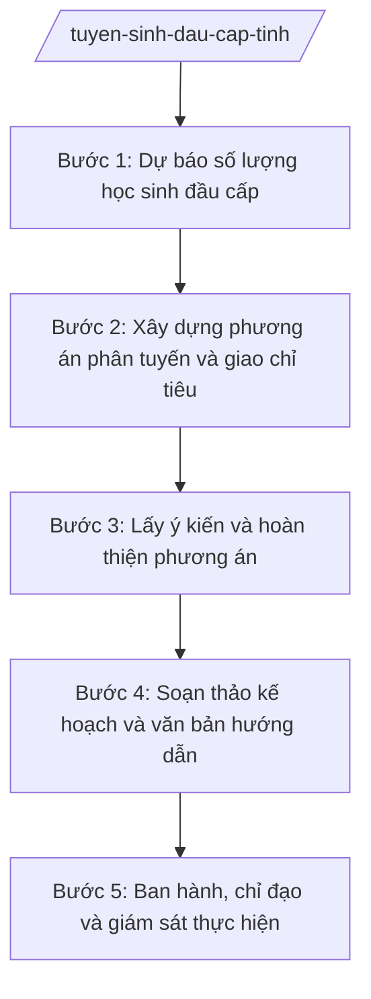

# Skill: Chỉ đạo tuyển sinh đầu cấp

## 2. Khi nào dùng

- Hằng năm, trước năm học mới: xây dựng kế hoạch tuyển sinh vào lớp 1, lớp 6, lớp 10 trên địa bàn tỉnh.
- Phân tuyến tuyển sinh, giao chỉ tiêu cho các trường MN, TH, THCS, THPT và trung tâm GDNN-GDTX.
- Hướng dẫn phương thức tuyển sinh (xét tuyển, thi tuyển, kết hợp) theo từng cấp học, địa bàn.
- Hướng dẫn cơ chế thu và sử dụng mức thu dịch vụ tuyển sinh theo TT 45/2026/TT-BGDĐT; giám sát, xử lý vi phạm trong tuyển sinh.

## 3. Đầu vào (Input)

| Trường | Mô tả | Bắt buộc |
|--------|-------|----------|
| `nam_hoc` | Năm học tuyển sinh (vd: 2026–2027) | Có |
| `du_bao_hoc_sinh` | Số trẻ 5 tuổi, học sinh lớp 5, lớp 9 trên địa bàn; dự báo biến động dân số | Có |
| `mang_luoi_truong` | Danh sách trường MN/TH/THCS/THPT, trung tâm GDNN-GDTX: địa chỉ, số lớp, sức chứa | Có |
| `phuong_thuc_tuyen_sinh` | Xét tuyển / thi tuyển / kết hợp theo từng cấp học, địa bàn | Có |
| `muc_thu_dich_vu` | Mức thu dịch vụ tuyển sinh áp dụng theo TT 45/2026/TT-BGDĐT | Không |
| `lich_trinh` | Các mốc thời gian: ban hành kế hoạch, tổ chức tuyển sinh, báo cáo kết quả | Có |
| `y_kien_don_vi` | Ý kiến của UBND các xã, các trường về phân tuyến, chỉ tiêu | Không |

## 4. Quy trình

**Bước 1. Dự báo số lượng học sinh đầu cấp**

- Làm gì: Thu thập số liệu trẻ 5 tuổi, học sinh lớp 5, lớp 9 từ các xã và các trường; dự báo số lượng tuyển sinh lớp 1, lớp 6, lớp 10 năm học mới, tính đến biến động dân số, học sinh chuyển đến/chuyển đi.
- Dùng input: `nam_hoc`, `du_bao_hoc_sinh`, `mang_luoi_truong`.
- Vai trò: Chuyên viên Phòng Giáo dục Tiểu học, Phòng Giáo dục Trung học tổng hợp số liệu. AI hỗ trợ: tổng hợp số liệu từ biểu mẫu các xã gửi, kiểm tra tính khớp giữa số liệu xã và số liệu trường, lập bảng dự báo theo xã/cấp học. ⏱ ~5–7 ngày làm việc (ước tính).
- Lưu ý nghiệp vụ: Số liệu dự báo phải dựa trên danh sách học sinh thực tế cuối năm học trước, không ước tính cảm tính; tách riêng học sinh có nhu cầu học trường tư thục, trường ngoài tỉnh.
- → Kết quả bước: Bảng dự báo số lượng tuyển sinh lớp 1, lớp 6, lớp 10 toàn tỉnh theo xã.

**Bước 2. Xây dựng phương án phân tuyến và giao chỉ tiêu**

- Làm gì: Xây dựng tuyến tuyển sinh cho từng trường (địa bàn tuyển sinh của mỗi trường TH, THCS; phân luồng sau THCS vào THPT/GDNN-GDTX); giao chỉ tiêu số lớp, số học sinh cho từng trường, trung tâm GDNN-GDTX bảo đảm cân đối sức chứa.
- Dùng input: Kết quả bước 1; `mang_luoi_truong`, `phuong_thuc_tuyen_sinh`.
- Vai trò: Trưởng phòng Giáo dục Trung học (ông Bùi Văn X) chủ trì phương án cấp THCS, THPT; chuyên viên Phòng Giáo dục Tiểu học phụ trách cấp TH. AI hỗ trợ: lập bảng phân tuyến, chỉ tiêu chi tiết theo trường; kiểm tra không để học sinh "rơi" khỏi tuyến (mọi học sinh trong độ tuổi đều có trường tiếp nhận). ⏱ ~5–7 ngày làm việc (ước tính).
- Lưu ý nghiệp vụ: Tuyến tuyển sinh phải công khai, ổn định, hạn chế thay đổi đột ngột gây bức xúc; chỉ tiêu không vượt quá sức chứa thực tế (số phòng học, giáo viên) của trường.
- → Kết quả bước: Phương án phân tuyến tuyển sinh + bảng chỉ tiêu chi tiết theo trường/trung tâm.

**Bước 3. Lấy ý kiến và hoàn thiện phương án**

- Làm gì: Gửi dự thảo kế hoạch lấy ý kiến UBND các xã, các trường THPT, trung tâm GDNN-GDTX; tổng hợp ý kiến, điều chỉnh phương án phân tuyến, chỉ tiêu cho phù hợp thực tế địa phương.
- Dùng input: Kết quả bước 2; `y_kien_don_vi`.
- Vai trò: Văn phòng Sở (bà Ngô Thị V — Chánh Văn phòng) điều phối lấy ý kiến; chuyên viên các phòng tổng hợp. AI hỗ trợ: tổng hợp ý kiến góp ý theo nhóm nội dung, lập bảng đối chiếu tiếp thu/giải trình từng ý kiến. ⏱ ~7–10 ngày làm việc (ước tính).
- Lưu ý nghiệp vụ: Mọi ý kiến không tiếp thu phải giải trình rõ lý do bằng văn bản; không điều chỉnh chỉ tiêu vượt khung năng lực đã thẩm định ở bước 2.
- → Kết quả bước: Dự thảo kế hoạch tuyển sinh đã hoàn thiện sau lấy ý kiến + bảng tổng hợp tiếp thu ý kiến.

**Bước 4. Soạn thảo kế hoạch và văn bản hướng dẫn**

- Làm gì: Soạn Kế hoạch tuyển sinh đầu cấp năm học … (phân tuyến, chỉ tiêu, phương thức, lịch trình, trách nhiệm các đơn vị); soạn văn bản hướng dẫn phương thức tuyển sinh và cơ chế thu, sử dụng mức thu dịch vụ tuyển sinh theo TT 45/2026/TT-BGDĐT.
- Dùng input: Kết quả bước 3; `muc_thu_dich_vu`, `lich_trinh`.
- Vai trò: Chuyên viên Phòng Giáo dục Trung học, Phòng Giáo dục Tiểu học soạn dự thảo. AI hỗ trợ: soạn dự thảo kế hoạch và văn bản hướng dẫn đúng thể thức; kiểm tra nội dung cơ chế thu dịch vụ tuyển sinh bám đúng TT 45/2026/TT-BGDĐT; rà soát lỗi chính tả, tên đơn vị. ⏱ ~3–5 ngày làm việc (ước tính).
- Lưu ý nghiệp vụ: Mức thu dịch vụ tuyển sinh chỉ áp dụng đúng đối tượng, đúng mục đích theo TT 45/2026/TT-BGDĐT; nghiêm cấm các khoản thu trái quy định dưới mọi hình thức trong tuyển sinh.
- → Kết quả bước: Dự thảo Kế hoạch tuyển sinh đầu cấp + dự thảo văn bản hướng dẫn phương thức, mức thu dịch vụ tuyển sinh.

**Bước 5. Ban hành, chỉ đạo và giám sát thực hiện**

- Làm gì: Trình ký ban hành kế hoạch; công khai phân tuyến, chỉ tiêu, lịch tuyển sinh trên Cổng thông tin của Sở; chỉ đạo, kiểm tra các trường, các xã tổ chức tuyển sinh đúng kế hoạch; tổng hợp kết quả, xử lý vi phạm.
- Dùng input: Dự thảo ở bước 4.
- Vai trò: Trưởng phòng Giáo dục Trung học (ông Bùi Văn X) kiểm tra; Phó Giám đốc Sở (ông Đỗ Văn U) xem xét; Giám đốc Sở (ông Hoàng Văn S) ký ban hành kế hoạch. AI hỗ trợ: lập phiếu trình ký; tổng hợp báo cáo kết quả tuyển sinh từ các trường/xã; lập danh sách các đơn vị chậm tiến độ để đôn đốc. ⏱ ~3–5 ngày ban hành + giám sát suốt đợt tuyển sinh (ước tính).
- Lưu ý nghiệp vụ: Kế hoạch phải ban hành trước thời điểm tuyển sinh ít nhất 30 ngày; công khai để phụ huynh, học sinh biết; mọi điều chỉnh chỉ tiêu trong quá trình tuyển sinh phải bằng văn bản của Sở.
- → Kết quả bước: Kế hoạch tuyển sinh đã ban hành, công khai; báo cáo kết quả tuyển sinh toàn tỉnh.

## Luồng quy trình (Workflow)

## 5. Đầu ra (Output)

### Sản phẩm

1. **Kế hoạch tuyển sinh đầu cấp năm học …** (sản phẩm chính) — Giám đốc Sở GD&ĐT ký ban hành.
2. Văn bản hướng dẫn phương thức tuyển sinh và cơ chế thu dịch vụ tuyển sinh (theo TT 45/2026/TT-BGDĐT).
3. Bảng phân tuyến tuyển sinh và chỉ tiêu chi tiết theo trường/trung tâm (phụ lục kế hoạch).
4. Báo cáo kết quả tuyển sinh đầu cấp toàn tỉnh.

**Cấu trúc output chuẩn (Kế hoạch tuyển sinh đầu cấp):**
- Thể thức: tuân thủ Nghị định 30/2020/NĐ-CP về công tác văn thư.

1. Quốc hiệu "CỘNG HÒA XÃ HỘI CHỦ NGHĨA VIỆT NAM", Tiêu ngữ "Độc lập – Tự do – Hạnh phúc": CỘNG HÒA XÃ HỘI CHỦ NGHĨA VIỆT NAM / Độc lập – Tự do – Hạnh phúc.
2. Tên cơ quan ban hành: SỞ GIÁO DỤC VÀ ĐÀO TẠO TỈNH A.
3. Số, ký hiệu văn bản: số/KH-SGDĐT.
4. Địa danh, ngày tháng năm ban hành: Tỉnh A, ngày … tháng … năm ….
5. Tên loại và trích yếu nội dung: KẾ HOẠCH / Tuyển sinh đầu cấp năm học … trên địa bàn tỉnh A.
6. Căn cứ ban hành: Luật Giáo dục; Thông tư 15/2025/TT-BGDĐT; Thông tư 45/2026/TT-BGDĐT (cơ chế thu dịch vụ tuyển sinh); văn bản chỉ đạo của UBND tỉnh A (ghi rõ số hiệu, ngày ban hành).
7. Nội dung chính:
   - I. Mục đích, yêu cầu;
   - II. Đối tượng, phạm vi tuyển sinh (lớp 1, lớp 6, lớp 10; trường công lập, tư thục, trung tâm GDNN-GDTX);
   - III. Phương thức tuyển sinh theo từng cấp học;
   - IV. Phân tuyến tuyển sinh và chỉ tiêu (kèm phụ lục chi tiết);
   - V. Cơ chế thu và sử dụng mức thu dịch vụ tuyển sinh (theo TT 45/2026/TT-BGDĐT);
   - VI. Lịch trình thực hiện;
   - VII. Tổ chức thực hiện (trách nhiệm Sở, UBND xã, các trường; công tác thanh tra, kiểm tra, xử lý vi phạm).
8. Nơi nhận (UBND tỉnh; các sở liên quan; UBND các xã; các trường MN, TH, THCS, THPT; trung tâm GDNN-GDTX; lưu VT, GDTrH, GDT H).
9. Chữ ký, họ tên người ký: GIÁM ĐỐC / (ký, đóng dấu, ghi rõ họ tên).

## 6. Checklist nghiệm thu

- [ ] Đủ 9 phần theo Cấu trúc output chuẩn mục 5, đúng thứ tự thể thức NĐ 30/2020/NĐ-CP.
- [ ] Bao quát đủ 3 đầu cấp (lớp 1, lớp 6, lớp 10) và cả hệ công lập, tư thục, trung tâm GDNN-GDTX.
- [ ] Bảng phân tuyến, chỉ tiêu khớp với số liệu dự báo học sinh; không có học sinh trong độ tuổi bị "rơi" khỏi tuyến.
- [ ] Nội dung cơ chế thu dịch vụ tuyển sinh bám đúng TT 45/2026/TT-BGDĐT; không có khoản thu trái quy định.
- [ ] Đã lấy ý kiến UBND xã, các trường; bảng tiếp thu/giải trình ý kiến đầy đủ.
- [ ] Kế hoạch ban hành trước thời điểm tuyển sinh ít nhất 30 ngày; công khai phân tuyến, chỉ tiêu, lịch trình.
- [ ] Số/ký hiệu, ngày tháng, nơi nhận, chữ ký đầy đủ; không sai chính tả, tên đơn vị.
- [ ] Đã qua đủ nấc human gate: chuyên viên → Trưởng phòng → Phó Giám đốc Sở → Giám đốc Sở ký ban hành.

## 7. Ví dụ mô phỏng

*Dữ liệu dưới đây là giả lập 100% phục vụ minh họa.*

**Input mẫu:**

| Trường | Giá trị mẫu |
|--------|-------------|
| nam_hoc | 2026–2027 |
| du_bao_hoc_sinh | 5.000 trẻ vào lớp 1; 4.800 học sinh vào lớp 6; 4.500 học sinh tốt nghiệp THCS |
| mang_luoi_truong | 120 trường TH; 60 trường THCS; 25 trường THPT; 5 trung tâm GDNN-GDTX |
| phuong_thuc_tuyen_sinh | Lớp 1, lớp 6: xét tuyển theo tuyến; lớp 10: thi tuyển 3 môn |
| muc_thu_dich_vu | Theo TT 45/2026/TT-BGDĐT |
| lich_trinh | Ban hành kế hoạch: 15/3/2026; tuyển sinh: tháng 6–7/2026; báo cáo: 15/8/2026 |

**Output mẫu:**

CỘNG HÒA XÃ HỘI CHỦ NGHĨA VIỆT NAM
Độc lập – Tự do – Hạnh phúc
---------------

SỞ GIÁO DỤC VÀ ĐÀO TẠO TỈNH A

Số: 789/KH-SGDĐT

Tỉnh A, ngày 15 tháng 3 năm 2026

**KẾ HOẠCH**
**Tuyển sinh đầu cấp năm học 2026–2027 trên địa bàn tỉnh A**

*Căn cứ* Luật Giáo dục;
*Căn cứ* Thông tư số 15/2025/TT-BGDĐT ngày 24/7/2025 của Bộ Giáo dục và Đào tạo;
*Căn cứ* Thông tư số 45/2026/TT-BGDĐT ngày 10/6/2026 của Bộ Giáo dục và Đào tạo sửa đổi, bổ sung Thông tư số 15/2025/TT-BGDĐT (về cơ chế thu dịch vụ tuyển sinh);

Sở Giáo dục và Đào tạo tỉnh A ban hành Kế hoạch tuyển sinh đầu cấp năm học 2026–2027 như sau:

**I. MỤC ĐÍCH, YÊU CẦU**

Bảo đảm 100% trẻ trong độ tuổi được huy động vào lớp 1, lớp 6, lớp 10; tuyển sinh công khai, công bằng, đúng tuyến, đúng chỉ tiêu.

**II. ĐỐI TƯỢNG, PHẠM VI**

Lớp 1, lớp 6 (xét tuyển theo tuyến), lớp 10 (thi tuyển 3 môn) tại các trường công lập, tư thục và trung tâm GDNN-GDTX trên địa bàn tỉnh.

**III. CHỈ TIÊU**

Tổng chỉ tiêu: 5.000 học sinh lớp 1; 4.800 học sinh lớp 6; 4.500 học sinh lớp 10 (chi tiết theo trường tại Phụ lục kèm theo).

**IV. CƠ CHẾ THU DỊCH VỤ TUYỂN SINH**

Thực hiện theo Thông tư số 45/2026/TT-BGDĐT; nghiêm cấm mọi khoản thu trái quy định trong tuyển sinh.

**V. LỊCH TRÌNH**

Tổ chức tuyển sinh tháng 6–7/2026; các trường báo cáo kết quả về Sở trước ngày 15/8/2026.

**VI. TỔ CHỨC THỰC HIỆN**

Sở GD&ĐT chỉ đạo, kiểm tra; UBND các xã phối hợp; các trường tổ chức tuyển sinh đúng kế hoạch, chịu trách nhiệm về tính chính xác của hồ sơ./.

***Nơi nhận:***
- UBND tỉnh (báo cáo);
- UBND các xã;
- Các trường MN, TH, THCS, THPT; các trung tâm GDNN-GDTX;
- Lưu: VT, GDTrH, GDTH.

**GIÁM ĐỐC**

*(Ký, đóng dấu)*

**Hoàng Văn S**

## 8. Human gate (người kiểm duyệt)

- Chuyên viên Phòng Giáo dục Trung học, Phòng Giáo dục Tiểu học soạn số liệu dự báo, dự thảo kế hoạch; chịu trách nhiệm về tính chính xác của số liệu.
- Trưởng phòng Giáo dục Trung học (ông Bùi Văn X) kiểm tra phương án phân tuyến, chỉ tiêu, dự thảo kế hoạch ở bước 2–4; trả lại sửa nếu chưa đạt.
- Phó Giám đốc Sở (ông Đỗ Văn U) xem xét, cho ý kiến trước khi trình Giám đốc Sở.
- Giám đốc Sở (ông Hoàng Văn S) ký ban hành Kế hoạch tuyển sinh và văn bản hướng dẫn. Trường hợp UBND tỉnh có chỉ đạo riêng về tuyển sinh, Sở báo cáo xin ý kiến trước khi ban hành.

## 9. Giới hạn (guardrails)

- AI KHÔNG ra quyết định hành chính thay người có thẩm quyền (không quyết định phân tuyến, giao chỉ tiêu, phê duyệt phương thức tuyển sinh).
- AI không tự ký, đóng dấu, phát hành văn bản dưới danh nghĩa Sở GD&ĐT hay bất kỳ cá nhân nào.
- AI không bịa số liệu dự báo học sinh, chỉ tiêu tuyển sinh; mọi con số phải có nguồn từ số liệu xã, trường cung cấp.
- AI không bịa căn cứ pháp lý, số hiệu văn bản; nội dung về mức thu dịch vụ tuyển sinh phải bám đúng TT 45/2026/TT-BGDĐT, không suy diễn thêm.
- AI không gợi ý, bao che các khoản thu trái quy định trong tuyển sinh.

## 10. Căn cứ & lưu ý

- Thông tư 15/2025/TT-BGDĐT ngày 24/7/2025 của Bộ GD&ĐT (hiệu lực 24/7/2025) — chức năng, nhiệm vụ, quyền hạn của Sở GD&ĐT (thay thế TT 12/2020/TT-BGDĐT).
- Thông tư 45/2026/TT-BGDĐT ngày 10/6/2026 của Bộ GD&ĐT (hiệu lực 10/6/2026) — sửa đổi, bổ sung TT 15/2025/TT-BGDĐT; trong đó có nội dung về cơ chế thu và sử dụng mức thu dịch vụ tuyển sinh, công tác tuyển sinh đầu cấp.
- Nghị định 142/2025/NĐ-CP ngày 12/6/2025 — phân định thẩm quyền của chính quyền địa phương 02 cấp trong lĩnh vực quản lý nhà nước của Bộ GD&ĐT.
- Nghị định 30/2020/NĐ-CP — thể thức văn bản hành chính.
- Lưu ý: phương thức tuyển sinh cụ thể từng cấp học (môn thi, cách tính điểm, đối tượng ưu tiên...) thực hiện theo quy định pháp luật chuyên ngành về giáo dục; số hiệu văn bản chuyên ngành không có trong danh mục được phép trích dẫn thì ghi "theo quy định pháp luật chuyên ngành về giáo dục", tuyệt đối không bịa số hiệu.
