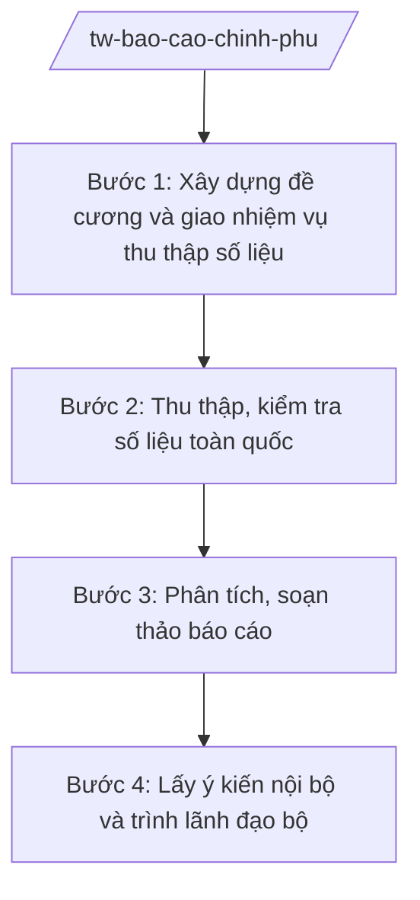

# Skill: Báo cáo Chính phủ, Thủ tướng (tổng hợp toàn quốc)

## 2. Khi nào dùng
- Skill chỉ áp dụng ở cấp trung ương (bộ, cơ quan ngang bộ, cơ quan thuộc Chính phủ).

Khi bộ phải báo cáo Chính phủ/Thủ tướng Chính phủ: báo cáo định kỳ (tháng/quý/năm) về tình hình
ngành, báo cáo chuyên đề, báo cáo đột xuất theo yêu cầu, hoặc báo cáo phục vụ phiên họp Chính phủ.

## 3. Đầu vào (Input)

| Trường | Mô tả | Bắt buộc |
|--------|-------|----------|
| `ten_bao_cao` | Tên báo cáo | Có |
| `loai_bao_cao` | Định kỳ / Chuyên đề / Đột xuất / Phục vụ phiên họp Chính phủ | Có |
| `ky_bao_cao` | Kỳ báo cáo (tháng/quý/năm/thời điểm) | Có |
| `noi_dung_yeu_cau` | Nội dung Chính phủ/Thủ tướng yêu cầu báo cáo | Có |
| `don_vi_dau_moi` | Vụ/cục đầu mối tổng hợp | Có |
| `han_trinh` | Thời hạn trình | Có |
| `so_lieu_don_vi` | Số liệu báo cáo của các đơn vị gửi về theo công văn đôn đốc (dùng ở Bước 2) | Không |

## 4. Quy trình

**Bước 1. Xây dựng đề cương và giao nhiệm vụ thu thập số liệu**

- Làm gì: Xây dựng đề cương báo cáo theo yêu cầu; gửi văn bản đề nghị các vụ/cục trong bộ, các bộ/ngành/địa phương liên quan cung cấp số liệu.
- Dùng input: `ten_bao_cao`, `noi_dung_yeu_cau`, `ky_bao_cao`, `han_trinh`, `loai_bao_cao`, `don_vi_dau_moi`.
- Vai trò: Vụ đầu mối (Văn phòng Bộ hoặc vụ chuyên môn) chủ trì, AI hỗ trợ dựng đề cương và mẫu biểu thu thập số liệu ⏱ ~0,5–1 ngày (ước tính).
- Lưu ý nghiệp vụ: Đề cương phải bám sát đúng nội dung được yêu cầu, không báo cáo lan man.
- → Kết quả bước: Đề cương báo cáo + công văn đề nghị cung cấp số liệu đã gửi.

**Bước 2. Thu thập, kiểm tra số liệu toàn quốc**

- Làm gì: Thu thập số liệu từ các đầu mối; kiểm tra tính đầy đủ, thống nhất, đối chiếu số liệu giữa các nguồn.
- Dùng input: `so_lieu_don_vi`.
- Vai trò: Chuyên viên vụ đầu mối, AI hỗ trợ tổng hợp vào bảng biểu, phát hiện số liệu bất thường/chênh lệch để xác minh lại ⏱ ~2–4 ngày (ước tính).
- Lưu ý nghiệp vụ: Số liệu tổng hợp phải thống nhất với số liệu thống kê nhà nước; số liệu chênh lệch phải được xác minh, giải trình.
- → Kết quả bước: Bộ số liệu tổng hợp toàn quốc đã được kiểm tra.

**Bước 3. Phân tích, soạn thảo báo cáo**

- Làm gì: Phân tích tình hình, đánh giá kết quả/hạn chế/nguyên nhân; soạn thảo báo cáo theo đề cương.
- Dùng input: Bộ số liệu tổng hợp, `noi_dung_yeu_cau`.
- Vai trò: Chuyên viên vụ đầu mối soạn thảo, AI hỗ trợ phân tích xu hướng, soạn dự thảo báo cáo đúng cấu trúc ⏱ ~2–3 ngày (ước tính).
- Lưu ý nghiệp vụ: Đánh giá phải khách quan, chỉ rõ hạn chế và nguyên nhân; kiến nghị phải cụ thể, khả thi, đúng thẩm quyền.
- → Kết quả bước: Dự thảo báo cáo.

**Bước 4. Lấy ý kiến nội bộ và trình lãnh đạo bộ**

- Làm gì: Xin ý kiến các vụ/cục liên quan trong bộ; hoàn thiện; trình Thứ trưởng, Bộ trưởng ký báo cáo gửi Chính phủ/Thủ tướng.
- Dùng input: Dự thảo báo cáo, `han_trinh`.
- Vai trò: Vụ trưởng vụ đầu mối (ông Hoàng Văn EE) duyệt, Thứ trưởng (bà Phạm Thị DD) cho ý kiến, **Bộ trưởng (ông Lê Văn CC) ký báo cáo**; AI hỗ trợ: rà soát thể thức và tính thống nhất số liệu lần cuối ⏱ ~1–2 ngày (ước tính).
- Lưu ý nghiệp vụ: Báo cáo Chính phủ phải gửi đúng hạn; số liệu trong báo cáo là số liệu chính thức của bộ.
- → Kết quả bước: Báo cáo của bộ đã ký, gửi Chính phủ/Thủ tướng Chính phủ đúng hạn.

## Luồng quy trình (Workflow)

## 5. Đầu ra (Output)

- Báo cáo của bộ gửi Chính phủ/Thủ tướng Chính phủ (Bộ trưởng ký).
- Phụ lục số liệu tổng hợp toàn quốc.

### Cấu trúc output chuẩn

**Báo cáo gửi Chính phủ** (thể thức NĐ 30/2020/NĐ-CP):
1. Quốc hiệu "CỘNG HÒA XÃ HỘI CHỦ NGHĨA VIỆT NAM" – Tiêu ngữ "Độc lập – Tự do – Hạnh phúc"; "BÁO CÁO ..."; số, ký hiệu; địa danh, ngày tháng năm.
2. Kính gửi: Chính phủ/Thủ tướng Chính phủ.
3. Tình hình thực hiện (kết quả đạt được với số liệu).
4. Hạn chế, khó khăn và nguyên nhân.
5. Nhiệm vụ, giải pháp thời gian tới.
6. Kiến nghị, đề xuất (phân rõ kiến nghị với Chính phủ/Thủ tướng/bộ ngành).
7. Nơi nhận; chữ ký Bộ trưởng, đóng dấu.

> **Checklist thể thức văn bản theo NĐ 30/2020/NĐ-CP** — đối chiếu trước khi trình ký:
> 1. Quốc hiệu và Tiêu ngữ.
> 2. Tên cơ quan, tổ chức ban hành văn bản.
> 3. Số, ký hiệu của văn bản.
> 4. Địa danh và thời gian ban hành văn bản.
> 5. Tên loại và trích yếu nội dung văn bản.
> 6. Nội dung văn bản.
> 7. Chức vụ, họ tên và chữ ký của người có thẩm quyền.
> 8. Dấu, chữ ký số của cơ quan, tổ chức.
> 9. Nơi nhận (kèm Phụ lục nếu có).

## 6. Checklist nghiệm thu

- [ ] Báo cáo đúng nội dung được yêu cầu, đúng kỳ, gửi đúng hạn.
- [ ] Số liệu đầy đủ, thống nhất, có nguồn rõ ràng; số liệu chênh lệch đã được xác minh.
- [ ] Đánh giá khách quan (cả kết quả và hạn chế), kiến nghị cụ thể, đúng thẩm quyền.
- [ ] Đã xin ý kiến các đơn vị liên quan trong bộ.
- [ ] Thể thức đúng NĐ 30/2020/NĐ-CP; Bộ trưởng ký.
- [ ] Không bịa số liệu, căn cứ.

## 7. Ví dụ mô phỏng

*Dữ liệu dưới đây là giả lập 100% phục vụ minh họa.*

**Input mẫu:** ten_bao_cao = "Báo cáo tình hình phát triển công nghiệp 9 tháng năm 2026";
loai_bao_cao = Định kỳ; don_vi_dau_moi = Vụ Kế hoạch – Tài chính (giả lập).

**Output mẫu (trích Báo cáo):**

> CỘNG HÒA XÃ HỘI CHỦ NGHĨA VIỆT NAM
> Độc lập – Tự do – Hạnh phúc
>
> Số: 4567/BC-BCT
> (Địa danh minh họa), ngày 05 tháng 10 năm 2026
>
> **BÁO CÁO**
> **Tình hình phát triển công nghiệp 9 tháng năm 2026**
>
> Kính gửi: Chính phủ
>
> **I. TÌNH HÌNH THỰC HIỆN**
> 1. Chỉ số sản xuất công nghiệp (IIP) 9 tháng tăng ...% (giả lập) so với cùng kỳ...
> 2. ... (các kết quả theo ngành, giả lập)
> **II. HẠN CHẾ, KHÓ KHĂN VÀ NGUYÊN NHÂN** ... (giả lập)
> **III. NHIỆM VỤ, GIẢI PHÁP 3 THÁNG CUỐI NĂM** ... (giả lập)
> **IV. KIẾN NGHỊ**
> 1. Kiến nghị Chính phủ: ... 2. Kiến nghị các bộ, ngành: ...
>
> Nơi nhận: ...
> **BỘ TRƯỞNG** (ký, đóng dấu — giả lập: ông Lê Văn CC)

## 8. Human gate

- Vụ trưởng vụ đầu mối duyệt dự thảo trước khi xin ý kiến nội bộ.
- Thứ trưởng phụ trách cho ý kiến.
- **Bộ trưởng ký báo cáo gửi Chính phủ/Thủ tướng.**

## 9. Giới hạn

- AI không tự quyết định nội dung đánh giá, kiến nghị thay lãnh đạo bộ.
- AI không tự ký, gửi báo cáo; không bịa số liệu tổng hợp.
- Số liệu trong báo cáo là số liệu chính thức do các đơn vị cung cấp và đã kiểm tra.

## 10. Căn cứ & lưu ý

- Nghị quyết 176/2025/QH15 ngày 18/02/2025 — cơ cấu tổ chức của Chính phủ.
- Nghị định 303/2025/NĐ-CP — khung chung chức năng bộ, cơ quan ngang bộ (trong đó có nhiệm vụ báo cáo Chính phủ).
- Nghị định 30/2020/NĐ-CP — thể thức văn bản (chỉ dùng cho thể thức).
- Lưu ý: báo cáo phục vụ phiên họp Chính phủ phải tuân thủ quy chế làm việc của Chính phủ về thời hạn và thành phần hồ sơ.
