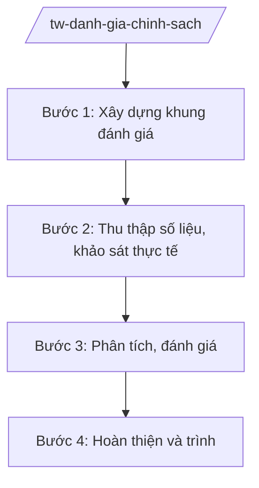

# Skill: Sơ kết, tổng kết, đánh giá chính sách

## 2. Khi nào dùng
- Skill chỉ áp dụng ở cấp trung ương (bộ, cơ quan ngang bộ, cơ quan thuộc Chính phủ).

Khi cần sơ kết giữa kỳ, tổng kết cuối kỳ hoặc đánh giá độc lập một chính sách, chương trình,
đề án do bộ chủ trì (vd: tổng kết 5 năm thực hiện chiến lược ngành, đánh giá chính sách sau
3 năm thi hành).

## 3. Đầu vào (Input)

| Trường | Mô tả | Bắt buộc |
|--------|-------|----------|
| `ten_chinh_sach` | Tên chính sách/chương trình/đề án cần đánh giá | Có |
| `loai_danh_gia` | Sơ kết / Tổng kết / Đánh giá giữa kỳ / Đánh giá cuối kỳ | Có |
| `thoi_gian_thuc_hien` | Giai đoạn thực hiện chính sách | Có |
| `muc_tieu_chinh_sach` | Mục tiêu, chỉ tiêu ban đầu của chính sách | Có |
| `don_vi_chu_tri` | Vụ/cục chủ trì đánh giá | Có |

## 4. Quy trình

**Bước 1. Xây dựng khung đánh giá**

- Làm gì: Xây dựng tiêu chí đánh giá (tính phù hợp, hiệu quả, hiệu lực, tác động, tính bền vững); thiết kế bộ công cụ (phiếu khảo sát, đề cương phỏng vấn, mẫu tổng hợp số liệu).
- Dùng input: `ten_chinh_sach`, `muc_tieu_chinh_sach`, `loai_danh_gia`, `don_vi_chu_tri`.
- Vai trò: Vụ chuyên môn chủ trì, AI hỗ trợ xây dựng khung tiêu chí và bộ công cụ đánh giá ⏱ ~2–3 ngày (ước tính).
- Lưu ý nghiệp vụ: Tiêu chí phải đo lường được mức độ đạt mục tiêu ban đầu; có thể tham khảo khung đánh giá của skill `danh-gia-tac-dong-cs`.
- → Kết quả bước: Khung đánh giá + bộ công cụ được phê duyệt.

**Bước 2. Thu thập số liệu, khảo sát thực tế**

- Làm gì: Thu thập số liệu thực hiện từ các bộ/ngành/địa phương; tổ chức khảo sát, phỏng vấn đối tượng thụ hưởng; kiểm tra thực tế tại một số địa phương (nếu cần).
- Dùng input: Bộ công cụ đánh giá, `thoi_gian_thuc_hien`.
- Vai trò: Tổ đánh giá (chuyên viên), AI hỗ trợ tổng hợp số liệu khảo sát, phát hiện điểm bất thường ⏱ ~5–10 ngày (ước tính).
- Lưu ý nghiệp vụ: Mẫu khảo sát phải đại diện; số liệu phải có nguồn rõ ràng.
- → Kết quả bước: Bộ dữ liệu đánh giá đã được kiểm tra.

**Bước 3. Phân tích, đánh giá**

- Làm gì: Đối chiếu kết quả với mục tiêu ban đầu; phân tích nguyên nhân đạt/chưa đạt; đánh giá tác động (kinh tế – xã hội – môi trường); rút ra bài học.
- Dùng input: Bộ dữ liệu đánh giá, `muc_tieu_chinh_sach`.
- Vai trò: Tổ đánh giá phân tích, AI hỗ trợ phân tích định lượng, soạn bảng đối chiếu mục tiêu–kết quả ⏱ ~3–5 ngày (ước tính).
- Lưu ý nghiệp vụ: Đánh giá phải khách quan, chỉ rõ cả thành công và hạn chế; không tô hồng kết quả.
- → Kết quả bước: Dự thảo báo cáo sơ kết/tổng kết/đánh giá.

**Bước 4. Hoàn thiện và trình**

- Làm gì: Lấy ý kiến các đơn vị liên quan; tổ chức hội thảo (nếu cần); hoàn thiện báo cáo; trình lãnh đạo bộ ký ban hành hoặc trình cấp có thẩm quyền.
- Dùng input: Dự thảo báo cáo.
- Vai trò: Vụ trưởng vụ chuyên môn duyệt, Thứ trưởng (bà Phạm Thị DD) cho ý kiến, Bộ trưởng (ông Lê Văn CC) ký ban hành (hoặc ký tờ trình cấp trên); AI hỗ trợ: rà soát thể thức ⏱ ~2–3 ngày (ước tính).
- Lưu ý nghiệp vụ: Kết luận đánh giá phải có đề xuất rõ: tiếp tục/giữ nguyên, điều chỉnh, hoặc chấm dứt chính sách.
- → Kết quả bước: Báo cáo sơ kết/tổng kết/đánh giá chính sách đã ban hành.

## Luồng quy trình (Workflow)

## 5. Đầu ra (Output)

- Báo cáo sơ kết/tổng kết/đánh giá chính sách (kèm phụ lục số liệu, kết quả khảo sát).
- Đề xuất tiếp tục/điều chỉnh/chấm dứt chính sách.

### Cấu trúc output chuẩn

**Báo cáo tổng kết chính sách** (thể thức NĐ 30/2020/NĐ-CP):
1. Quốc hiệu "CỘNG HÒA XÃ HỘI CHỦ NGHĨA VIỆT NAM" – Tiêu ngữ "Độc lập – Tự do – Hạnh phúc"; "BÁO CÁO Tổng kết ..."; số, ký hiệu; địa danh, ngày tháng năm.
2. Bối cảnh, mục tiêu chính sách khi ban hành.
3. Kết quả thực hiện (đối chiếu mục tiêu – kết quả, có số liệu).
4. Đánh giá chung (thành công, hạn chế, nguyên nhân, bài học kinh nghiệm).
5. Đề xuất, kiến nghị (tiếp tục/điều chỉnh/chấm dứt; nhiệm vụ thời gian tới).
6. Nơi nhận; chữ ký, đóng dấu.

> **Checklist thể thức văn bản theo NĐ 30/2020/NĐ-CP** — đối chiếu trước khi trình ký:
> 1. Quốc hiệu và Tiêu ngữ.
> 2. Tên cơ quan, tổ chức ban hành văn bản.
> 3. Số, ký hiệu của văn bản.
> 4. Địa danh và thời gian ban hành văn bản.
> 5. Tên loại và trích yếu nội dung văn bản.
> 6. Nội dung văn bản.
> 7. Chức vụ, họ tên và chữ ký của người có thẩm quyền.
> 8. Dấu, chữ ký số của cơ quan, tổ chức.
> 9. Nơi nhận (kèm Phụ lục nếu có).

## 6. Checklist nghiệm thu

- [ ] Khung tiêu chí đánh giá rõ ràng, đo lường được.
- [ ] Số liệu đầy đủ, có nguồn; mẫu khảo sát đại diện.
- [ ] Đối chiếu được kết quả với mục tiêu ban đầu.
- [ ] Đánh giá khách quan cả thành công và hạn chế.
- [ ] Có đề xuất rõ ràng: tiếp tục/điều chỉnh/chấm dứt.
- [ ] Thể thức đúng NĐ 30/2020/NĐ-CP; đúng thẩm quyền ký.
- [ ] Không bịa số liệu, căn cứ.

## 7. Ví dụ mô phỏng

*Dữ liệu dưới đây là giả lập 100% phục vụ minh họa.*

**Input mẫu:** ten_chinh_sach = "Chương trình hỗ trợ doanh nghiệp nhỏ và vừa chuyển đổi số";
loai_danh_gia = Tổng kết; thoi_gian_thuc_hien = 2021–2025 (giả lập).

**Output mẫu (trích Báo cáo):**

> CỘNG HÒA XÃ HỘI CHỦ NGHĨA VIỆT NAM
> Độc lập – Tự do – Hạnh phúc
>
> Số: 5678/BC-BCT
> (Địa danh minh họa), ngày 20 tháng 12 năm 2026
>
> **BÁO CÁO**
> **Tổng kết Chương trình hỗ trợ doanh nghiệp nhỏ và vừa chuyển đổi số giai đoạn 2021–2025**
>
> **I. BỐI CẢNH, MỤC TIÊU** ... (giả lập)
> **II. KẾT QUẢ THỰC HIỆN**
> - Hỗ trợ ... lượt doanh nghiệp (giả lập), đạt ...% mục tiêu...
> **III. ĐÁNH GIÁ CHUNG**
> 1. Thành công: ... 2. Hạn chế và nguyên nhân: ... (giả lập)
> **IV. ĐỀ XUẤT**
> 1. Tiếp tục chương trình giai đoạn 2026–2030 với 3 điều chỉnh: ... (giả lập)
>
> Nơi nhận: ...
> **BỘ TRƯỞNG** (ký, đóng dấu — giả lập: ông Lê Văn CC)

## 8. Human gate

- Vụ trưởng vụ chuyên môn duyệt khung đánh giá và dự thảo báo cáo.
- Thứ trưởng phụ trách cho ý kiến.
- **Bộ trưởng ký ban hành báo cáo** (hoặc ký tờ trình cấp có thẩm quyền).

## 9. Giới hạn

- AI không tự kết luận thành công/thất bại của chính sách thay tổ đánh giá và lãnh đạo.
- AI không bịa số liệu khảo sát, không tô hồng kết quả.
- AI không tự ký, phát hành báo cáo.

## 10. Căn cứ & lưu ý

- Nghị quyết 176/2025/QH15 ngày 18/02/2025 — cơ cấu tổ chức của Chính phủ.
- Nghị định 303/2025/NĐ-CP — khung chung chức năng bộ, cơ quan ngang bộ.
- Nghị định 30/2020/NĐ-CP — thể thức văn bản (chỉ dùng cho thể thức).
- Lưu ý: kết quả đánh giá là căn cứ để đề xuất tiếp tục, điều chỉnh hoặc chấm dứt chính sách trong kỳ hoạch định tiếp theo.
