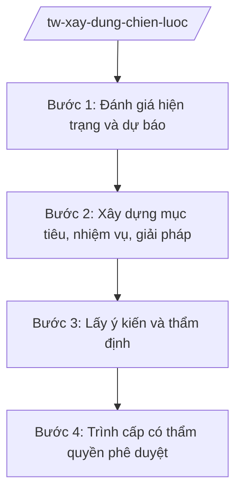

# Skill: Xây dựng chiến lược, quy hoạch, kế hoạch phát triển ngành

## 2. Khi nào dùng

Khi bộ được giao xây dựng chiến lược phát triển ngành, quy hoạch ngành quốc gia/quy hoạch có tính
chất kỹ thuật chuyên ngành, hoặc kế hoạch phát triển ngành 5 năm/hằng năm trình cấp có thẩm quyền
(Chính phủ, Thủ tướng Chính phủ) phê duyệt.

## 3. Đầu vào (Input)

| Trường | Mô tả | Bắt buộc |
|--------|-------|----------|
| `ten_chien_luoc` | Tên chiến lược/quy hoạch/kế hoạch | Có |
| `loai` | Chiến lược / Quy hoạch / Kế hoạch phát triển ngành | Có |
| `pham_vi_thoi_gian` | Giai đoạn thực hiện (vd: 2026–2030, tầm nhìn 2045) | Có |
| `yeu_cau_dinh_huong` | Định hướng, chủ trương của Đảng/Nhà nước liên quan | Có |
| `don_vi_chu_tri` | Vụ/cục chủ trì xây dựng | Có |
| `cap_phe_duyet` | Chính phủ / Thủ tướng Chính phủ | Có |

## 4. Quy trình

**Bước 1. Đánh giá hiện trạng và dự báo**

- Làm gì: Thu thập số liệu hiện trạng ngành toàn quốc; phân tích điểm mạnh/yếu, cơ hội/thách thức; dự báo xu hướng trong và ngoài nước.
- Dùng input: `ten_chien_luoc`, `loai`, `yeu_cau_dinh_huong`.
- Vai trò: Vụ chuyên môn chủ trì, AI hỗ trợ tổng hợp số liệu, dựng bảng phân tích SWOT và biểu đồ xu hướng ⏱ ~3–5 ngày (ước tính).
- Lưu ý nghiệp vụ: Số liệu phải có nguồn rõ ràng, thống nhất với số liệu thống kê nhà nước; không bịa số liệu dự báo.
- → Kết quả bước: Báo cáo đánh giá hiện trạng và dự báo phát triển ngành.

**Bước 2. Xây dựng mục tiêu, nhiệm vụ, giải pháp**

- Làm gì: Xác định quan điểm, mục tiêu tổng quát/mục tiêu cụ thể (có chỉ tiêu định lượng); đề xuất nhiệm vụ, giải pháp và phân công thực hiện; dự kiến nguồn lực.
- Dùng input: Báo cáo đánh giá hiện trạng, `pham_vi_thoi_gian`.
- Vai trò: Tổ xây dựng (chuyên viên vụ chuyên môn), AI hỗ trợ soạn khung mục tiêu–nhiệm vụ–giải pháp, kiểm tra tính logic giữa mục tiêu và giải pháp ⏱ ~3–5 ngày (ước tính).
- Lưu ý nghiệp vụ: Chỉ tiêu phải đo lường được, có cơ sở; giải pháp phải gắn với nguồn lực và lộ trình thực hiện.
- → Kết quả bước: Dự thảo chiến lược/quy hoạch/kế hoạch lần 1.

**Bước 3. Lấy ý kiến và thẩm định**

- Làm gì: Gửi lấy ý kiến bộ/ngành/địa phương, chuyên gia, đối tượng chịu tác động; tổ chức hội thảo; thẩm định nội bộ (Vụ Pháp chế, Vụ Kế hoạch – Tài chính).
- Dùng input: Dự thảo lần 1.
- Vai trò: Vụ chuyên môn tổng hợp, AI hỗ trợ phân loại ý kiến, lập bảng tiếp thu ⏱ ~3–5 ngày (ước tính).
- Lưu ý nghiệp vụ: Quy hoạch ngành quốc gia phải lấy ý kiến thẩm định theo quy định pháp luật về quy hoạch.
- → Kết quả bước: Dự thảo hoàn thiện + báo cáo tiếp thu ý kiến.

**Bước 4. Trình cấp có thẩm quyền phê duyệt**

- Làm gì: Hoàn thiện tờ trình; trình Bộ trưởng ký trình Chính phủ/Thủ tướng Chính phủ; chuẩn bị tài liệu phục vụ xem xét, phê duyệt.
- Dùng input: Dự thảo hoàn thiện, `cap_phe_duyet`.
- Vai trò: Thứ trưởng (bà Phạm Thị DD) chỉ đạo, Bộ trưởng (ông Lê Văn CC) ký tờ trình; AI hỗ trợ: rà soát tính đầy đủ của hồ sơ ⏱ ~2 ngày (ước tính).
- Lưu ý nghiệp vụ: Hồ sơ trình phải có tờ trình, dự thảo, báo cáo đánh giá hiện trạng, tổng hợp ý kiến, dự kiến nguồn lực.
- → Kết quả bước: Hồ sơ trình cấp có thẩm quyền phê duyệt chiến lược/quy hoạch/kế hoạch.

## Luồng quy trình (Workflow)

## 5. Đầu ra (Output)

- Hồ sơ trình phê duyệt chiến lược/quy hoạch/kế hoạch phát triển ngành.
- Tờ trình (Bộ trưởng ký) + dự thảo văn bản chiến lược/quy hoạch/kế hoạch.

### Cấu trúc output chuẩn

**Tờ trình về chiến lược phát triển ngành** (thể thức NĐ 30/2020/NĐ-CP):
1. Quốc hiệu "CỘNG HÒA XÃ HỘI CHỦ NGHĨA VIỆT NAM" – Tiêu ngữ "Độc lập – Tự do – Hạnh phúc"; "Tờ trình về Chiến lược ..."; số, ký hiệu; địa danh, ngày tháng năm.
2. Sự cần thiết xây dựng chiến lược.
3. Đánh giá khái quát hiện trạng ngành.
4. Quan điểm, mục tiêu, chỉ tiêu chủ yếu.
5. Nhiệm vụ, giải pháp chủ yếu.
6. Tổ chức thực hiện và nguồn lực.
7. Kiến nghị cấp có thẩm quyền phê duyệt.
8. Nơi nhận; chữ ký Bộ trưởng, đóng dấu.

## 6. Checklist nghiệm thu

- [ ] Có báo cáo đánh giá hiện trạng với số liệu có nguồn rõ ràng.
- [ ] Mục tiêu có chỉ tiêu định lượng, đo lường được.
- [ ] Nhiệm vụ, giải pháp gắn với nguồn lực và lộ trình, phân công rõ đơn vị thực hiện.
- [ ] Đã lấy ý kiến đầy đủ bộ/ngành/địa phương/chuyên gia.
- [ ] Thể thức đúng NĐ 30/2020/NĐ-CP; tờ trình do Bộ trưởng ký.
- [ ] Không bịa số liệu, căn cứ; không viện dẫn văn bản hết hiệu lực.

## 7. Ví dụ mô phỏng

*Dữ liệu dưới đây là giả lập 100% phục vụ minh họa.*

**Input mẫu:** ten_chien_luoc = "Chiến lược phát triển ngành logistics Việt Nam";
loai = Chiến lược; pham_vi_thoi_gian = 2026–2030, tầm nhìn 2045;
cap_phe_duyet = Thủ tướng Chính phủ.

**Output mẫu (trích Tờ trình):**

> CỘNG HÒA XÃ HỘI CHỦ NGHĨA VIỆT NAM
> Độc lập – Tự do – Hạnh phúc
>
> Số: 3456/TTr-BCT
> (Địa danh minh họa), ngày 10 tháng 12 năm 2026
>
> **TỜ TRÌNH**
> **Về Chiến lược phát triển ngành logistics Việt Nam giai đoạn 2026–2030, tầm nhìn đến năm 2045**
>
> Kính gửi: Thủ tướng Chính phủ
>
> **I. SỰ CẦN THIẾT** ... (3 lý do, số liệu giả lập: tỷ trọng chi phí logistics/GDP...)
> **II. ĐÁNH GIÁ HIỆN TRẠNG** ... (giả lập: 5 điểm mạnh, 4 hạn chế)
> **III. QUAN ĐIỂM, MỤC TIÊU**
> - Mục tiêu tổng quát: ... (giả lập)
> - Chỉ tiêu cụ thể đến 2030: ... (giả lập, 6 chỉ tiêu định lượng)
> **IV. NHIỆM VỤ, GIẢI PHÁP CHỦ YẾU** ... (5 nhóm giải pháp, giả lập)
> **V. TỔ CHỨC THỰC HIỆN** ...
>
> Bộ Công Thương (giả lập) kính trình Thủ tướng Chính phủ xem xét, phê duyệt.
>
> Nơi nhận: ...
> **BỘ TRƯỞNG** (ký, đóng dấu — giả lập: ông Lê Văn CC)

## 8. Human gate

- Vụ trưởng vụ chuyên môn duyệt dự thảo trước khi lấy ý kiến.
- Thứ trưởng phụ trách cho ý kiến trước khi trình Bộ trưởng.
- **Bộ trưởng ký tờ trình cấp có thẩm quyền.**

## 9. Giới hạn

- AI không quyết định mục tiêu, chỉ tiêu chính sách thay lãnh đạo bộ.
- AI không tự ký, phát hành văn bản; không bịa số liệu hiện trạng/dự báo.
- Mọi căn cứ pháp lý phải có thật.

## 10. Căn cứ & lưu ý

- Nghị quyết 176/2025/QH15 ngày 18/02/2025 — cơ cấu tổ chức của Chính phủ.
- Nghị định 303/2025/NĐ-CP — khung chung chức năng bộ, cơ quan ngang bộ.
- Luật Quy hoạch (tên luật, không ghi số hiệu) — đối với quy hoạch ngành quốc gia.
- Nghị định 30/2020/NĐ-CP — thể thức văn bản (chỉ dùng cho thể thức).
- Lưu ý: chiến lược/quy hoạch ngành phải phù hợp với chiến lược phát triển kinh tế – xã hội của đất nước và quy hoạch tổng thể quốc gia.
