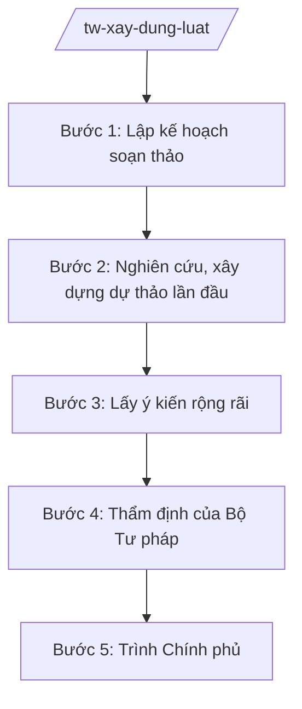

# Skill: Xây dựng luật, pháp lệnh, nghị quyết

## 2. Khi nào dùng
- Skill chỉ áp dụng ở cấp trung ương (bộ, cơ quan ngang bộ, cơ quan thuộc Chính phủ).

Khi bộ được giao chủ trì soạn thảo một dự án luật, pháp lệnh hoặc nghị quyết của Quốc hội/Ủy ban
Thường vụ Quốc hội (vd: xây dựng luật mới, sửa đổi luật hiện hành trong lĩnh vực bộ quản lý).

## 3. Đầu vào (Input)

| Trường | Mô tả | Bắt buộc |
|--------|-------|----------|
| `ten_van_ban` | Tên dự án luật/pháp lệnh/nghị quyết | Có |
| `loai_van_ban` | Luật / Pháp lệnh / Nghị quyết của Quốc hội / Nghị quyết của UBTVQH | Có |
| `yeu_cau_chinh_sach` | Yêu cầu, định hướng chính sách cần thể chế hóa | Có |
| `don_vi_chu_tri` | Vụ/cục được giao chủ trì soạn thảo | Có |
| `tien_do` | Mốc thời gian trình Chính phủ, trình Quốc hội | Có |
| `ho_so_chinh_sach` | Hồ sơ đề nghị xây dựng luật đã được phê duyệt (nếu có) | Không |

## 4. Quy trình

**Bước 1. Lập kế hoạch soạn thảo**

- Làm gì: Thành lập ban soạn thảo/tổ biên tập; xây dựng kế hoạch chi tiết (nội dung, phân công, tiến độ, kinh phí).
- Dùng input: `ten_van_ban`, `don_vi_chu_tri`, `tien_do`, `loai_van_ban`.
- Vai trò: Vụ trưởng Vụ Pháp chế (ông Hoàng Văn EE) chủ trì, AI hỗ trợ dựng khung kế hoạch và danh sách thành phần ban soạn thảo ⏱ ~0,5 ngày (ước tính).
- Lưu ý nghiệp vụ: Ban soạn thảo phải có đại diện Bộ Tư pháp, Văn phòng Chính phủ và các bộ/ngành liên quan.
- → Kết quả bước: Quyết định thành lập ban soạn thảo + kế hoạch soạn thảo được Thứ trưởng phê duyệt.

**Bước 2. Nghiên cứu, xây dựng dự thảo lần đầu**

- Làm gì: Tổng kết thi hành pháp luật hiện hành; nghiên cứu kinh nghiệm quốc tế; soạn dự thảo điều khoản và tờ trình.
- Dùng input: `yeu_cau_chinh_sach`, `ho_so_chinh_sach`.
- Vai trò: Tổ biên tập (chuyên viên vụ chuyên môn + Vụ Pháp chế) soạn thảo, AI hỗ trợ tổng hợp tài liệu, rà soát tính thống nhất của dự thảo ⏱ ~5–10 ngày (ước tính).
- Lưu ý nghiệp vụ: Mỗi chính sách phải có đánh giá tác động kèm theo; dự thảo phải bảo đảm tính hợp hiến, hợp pháp, thống nhất với hệ thống pháp luật.
- → Kết quả bước: Dự thảo lần 1 + tờ trình + báo cáo đánh giá tác động chính sách.

**Bước 3. Lấy ý kiến rộng rãi**

- Làm gì: Gửi lấy ý kiến các bộ/ngành, địa phương, đối tượng chịu tác động; đăng tải dự thảo trên Cổng thông tin điện tử của bộ và Chính phủ để lấy ý kiến nhân dân.
- Dùng input: Dự thảo lần 1.
- Vai trò: Vụ chuyên môn chủ trì, AI hỗ trợ tổng hợp, phân loại ý kiến góp ý theo điều khoản ⏱ ~3–5 ngày cho tổng hợp (ước tính).
- Lưu ý nghiệp vụ: Thời gian lấy ý kiến phải bảo đảm theo quy định; mọi ý kiến phải được nghiên cứu, tiếp thu/giải trình.
- → Kết quả bước: Báo cáo tổng hợp, tiếp thu, giải trình ý kiến + dự thảo hoàn thiện.

**Bước 4. Thẩm định của Bộ Tư pháp**

- Làm gì: Hoàn thiện hồ sơ gửi Bộ Tư pháp thẩm định; tiếp thu ý kiến thẩm định.
- Dùng input: Hồ sơ dự án luật hoàn chỉnh.
- Vai trò: Vụ Pháp chế đầu mối, AI hỗ trợ đối chiếu dự thảo với ý kiến thẩm định, lập bảng tiếp thu ⏱ ~2–3 ngày (ước tính).
- Lưu ý nghiệp vụ: Hồ sơ thẩm định phải đầy đủ thành phần; ý kiến thẩm định là căn cứ bắt buộc trước khi trình Chính phủ.
- → Kết quả bước: Báo cáo thẩm định của Bộ Tư pháp + dự thảo đã tiếp thu.

**Bước 5. Trình Chính phủ**

- Làm gì: Hoàn thiện tờ trình Chính phủ; chuẩn bị tài liệu phục vụ phiên họp Chính phủ; tiếp thu ý kiến thành viên Chính phủ, hoàn thiện hồ sơ trình Quốc hội.
- Dùng input: Toàn bộ hồ sơ sau thẩm định.
- Vai trò: Thứ trưởng (bà Phạm Thị DD) chỉ đạo, Bộ trưởng (ông Lê Văn CC) ký tờ trình Chính phủ; AI hỗ trợ rà soát lần cuối tính đầy đủ của hồ sơ ⏱ ~2 ngày (ước tính).
- Lưu ý nghiệp vụ: Hồ sơ trình Chính phủ phải có đầy đủ: tờ trình, dự thảo, báo cáo đánh giá tác động, tổng hợp ý kiến, báo cáo thẩm định.
- → Kết quả bước: Hồ sơ dự án luật trình Chính phủ (sẵn sàng trình Quốc hội sau khi Chính phủ cho ý kiến).

## Luồng quy trình (Workflow)

## 5. Đầu ra (Output)

- Hồ sơ dự án luật/pháp lệnh/nghị quyết trình Chính phủ.
- Tờ trình Chính phủ (Bộ trưởng ký).
- Dự thảo văn bản + báo cáo đánh giá tác động chính sách.
- Báo cáo tổng hợp, tiếp thu ý kiến; báo cáo thẩm định của Bộ Tư pháp.

### Cấu trúc output chuẩn

**Tờ trình Chính phủ về dự án luật** (thể thức NĐ 30/2020/NĐ-CP):
1. Quốc hiệu "CỘNG HÒA XÃ HỘI CHỦ NGHĨA VIỆT NAM" – Tiêu ngữ "Độc lập – Tự do – Hạnh phúc"; tên loại và trích yếu ("Tờ trình về dự án Luật ..."); số, ký hiệu; địa danh, ngày tháng năm.
2. Sự cần thiết ban hành.
3. Mục đích, quan điểm xây dựng.
4. Quá trình xây dựng dự thảo.
5. Bố cục và nội dung cơ bản của dự thảo.
6. Những vấn đề xin ý kiến Chính phủ.
7. Nơi nhận; chữ ký Bộ trưởng, đóng dấu.

## 6. Checklist nghiệm thu

- [ ] Hồ sơ có đủ: tờ trình, dự thảo, đánh giá tác động, tổng hợp ý kiến, báo cáo thẩm định.
- [ ] Dự thảo bảo đảm tính hợp hiến, hợp pháp, thống nhất với hệ thống pháp luật.
- [ ] Đã lấy ý kiến đầy đủ bộ/ngành/địa phương và đăng Cổng TTĐT lấy ý kiến nhân dân.
- [ ] Mọi ý kiến góp ý và ý kiến thẩm định đều được tiếp thu/giải trình.
- [ ] Thể thức văn bản đúng NĐ 30/2020/NĐ-CP.
- [ ] Tờ trình do Bộ trưởng ký, đúng thẩm quyền.
- [ ] Không bịa số liệu, căn cứ pháp lý; không viện dẫn văn bản hết hiệu lực.

## 7. Ví dụ mô phỏng

*Dữ liệu dưới đây là giả lập 100% phục vụ minh họa.*

**Input mẫu:** ten_van_ban = "Luật Quản lý ngành nghề kinh doanh có điều kiện (sửa đổi)";
loai_van_ban = Luật; don_vi_chu_tri = Vụ Pháp chế – Bộ Công Thương (giả lập);
tien_do = trình Chính phủ tháng 9/2026.

**Output mẫu (trích Tờ trình):**

> CỘNG HÒA XÃ HỘI CHỦ NGHĨA VIỆT NAM
> Độc lập – Tự do – Hạnh phúc
>
> Số: 1234/TTr-BCT
> (Địa danh minh họa), ngày 01 tháng 9 năm 2026
>
> **TỜ TRÌNH**
> **Về dự án Luật Quản lý ngành nghề kinh doanh có điều kiện (sửa đổi)**
>
> Kính gửi: Chính phủ
>
> Thực hiện Chương trình xây dựng luật, pháp lệnh năm 2026, Bộ Công Thương (giả lập)
> kính trình Chính phủ dự án Luật Quản lý ngành nghề kinh doanh có điều kiện (sửa đổi) như sau:
>
> **I. SỰ CẦN THIẾT BAN HÀNH**
> 1. ... (nêu 3 lý do chính sách, số liệu giả lập)
>
> **II. MỤC ĐÍCH, QUAN ĐIỂM XÂY DỰNG**
> ...
>
> **III. QUÁ TRÌNH XÂY DỰNG DỰ THẢO**
> Dự thảo đã được gửi lấy ý kiến 14 bộ, ngành và 34 tỉnh, thành phố (giả lập);
> đăng Cổng TTĐT Chính phủ lấy ý kiến nhân dân từ ngày...; đã được Bộ Tư pháp thẩm định.
>
> **IV. BỐ CỤC VÀ NỘI DUNG CƠ BẢN**
> Dự thảo Luật gồm 8 chương, 60 điều (giả lập)...
>
> **V. NHỮNG VẤN ĐỀ XIN Ý KIẾN CHÍNH PHỦ**
> 1. Về phạm vi điều chỉnh... 2. Về thẩm quyền cấp phép...
>
> Nơi nhận: ... 
> **BỘ TRƯỞNG** (ký, đóng dấu — giả lập: ông Lê Văn CC)

## 8. Human gate

- Vụ trưởng Vụ Pháp chế duyệt dự thảo trước khi lấy ý kiến.
- Thứ trưởng phụ trách cho ý kiến trước khi gửi thẩm định.
- **Bộ trưởng ký tờ trình Chính phủ** — AI không thay thế bất kỳ nấc duyệt nào.

## 9. Giới hạn

- AI không quyết định nội dung chính sách thay ban soạn thảo và lãnh đạo bộ.
- AI không tự ký, không tự phát hành văn bản.
- AI không bịa số liệu đánh giá tác động, không bịa ý kiến thẩm định.
- Mọi căn cứ pháp lý phải có thật; không viện dẫn văn bản hết hiệu lực.

## 10. Căn cứ & lưu ý

- Nghị quyết 176/2025/QH15 ngày 18/02/2025 của Quốc hội — cơ cấu tổ chức của Chính phủ (14 Bộ + 3 cơ quan ngang Bộ).
- Nghị định 303/2025/NĐ-CP của Chính phủ — khung chung chức năng bộ, cơ quan ngang bộ.
- Luật Ban hành văn bản quy phạm pháp luật (tên luật, không ghi số hiệu) — trình tự xây dựng luật, pháp lệnh.
- Nghị định 30/2020/NĐ-CP — thể thức văn bản hành chính (chỉ dùng cho thể thức).
- Lưu ý: dự án luật phải có trong Chương trình xây dựng luật, pháp lệnh của Quốc hội; ý kiến thẩm định của Bộ Tư pháp là điều kiện bắt buộc trước khi trình Chính phủ.
