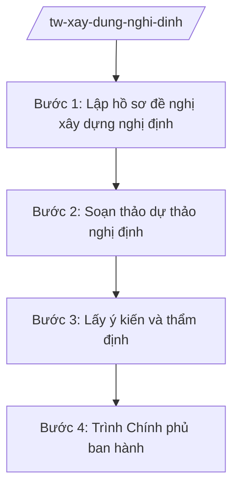

# Skill: Xây dựng nghị định của Chính phủ

## 2. Khi nào dùng
- Skill chỉ áp dụng ở cấp trung ương (bộ, cơ quan ngang bộ, cơ quan thuộc Chính phủ).

Khi bộ được giao chủ trì soạn thảo nghị định của Chính phủ (quy định chi tiết luật/pháp lệnh,
hoặc nghị định quy định chức năng, nhiệm vụ, chính sách thuộc thẩm quyền Chính phủ).

## 3. Đầu vào (Input)

| Trường | Mô tả | Bắt buộc |
|--------|-------|----------|
| `ten_nghi_dinh` | Tên nghị định cần xây dựng | Có |
| `can_cu_luat` | Luật/pháp lệnh cần quy định chi tiết (nếu có) | Không |
| `yeu_cau_chinh_sach` | Nội dung chính sách cần quy định | Có |
| `don_vi_chu_tri` | Vụ/cục chủ trì soạn thảo | Có |
| `tien_do` | Mốc trình Chính phủ | Có |

## 4. Quy trình

**Bước 1. Lập hồ sơ đề nghị xây dựng nghị định**

- Làm gì: Xây dựng hồ sơ đề nghị (tờ trình, dự thảo đề cương, báo cáo đánh giá tác động, dự kiến nguồn lực) trình Chính phủ quyết định chủ trương.
- Dùng input: `ten_nghi_dinh`, `can_cu_luat`, `yeu_cau_chinh_sach`, `don_vi_chu_tri`.
- Vai trò: Vụ chuyên môn chủ trì, Vụ Pháp chế phối hợp; AI hỗ trợ dựng khung hồ sơ và rà soát tính đầy đủ ⏱ ~1–2 ngày (ước tính).
- Lưu ý nghiệp vụ: Nghị định quy định chi tiết luật phải ban hành đồng thời hoặc kịp thời sau khi luật có hiệu lực.
- → Kết quả bước: Hồ sơ đề nghị xây dựng nghị định trình Chính phủ.

**Bước 2. Soạn thảo dự thảo nghị định**

- Làm gì: Soạn thảo điều khoản nghị định; xây dựng tờ trình Chính phủ.
- Dùng input: Hồ sơ đề nghị đã được chấp thuận, `yeu_cau_chinh_sach`.
- Vai trò: Tổ soạn thảo (chuyên viên vụ chuyên môn + Vụ Pháp chế), AI hỗ trợ soạn khung điều khoản, kiểm tra kỹ thuật lập pháp ⏱ ~3–7 ngày (ước tính).
- Lưu ý nghiệp vụ: Điều khoản phải cụ thể, khả thi; phân định rõ trách nhiệm bộ/ngành/địa phương.
- → Kết quả bước: Dự thảo nghị định lần 1 + tờ trình.

**Bước 3. Lấy ý kiến và thẩm định**

- Làm gì: Gửi lấy ý kiến bộ/ngành/địa phương, đối tượng chịu tác động; đăng Cổng TTĐT; gửi Bộ Tư pháp thẩm định; tiếp thu, giải trình.
- Dùng input: Dự thảo nghị định lần 1.
- Vai trò: Vụ chuyên môn tổng hợp ý kiến, AI hỗ trợ phân loại ý kiến theo điều khoản và lập bảng tiếp thu ⏱ ~3–5 ngày (ước tính).
- Lưu ý nghiệp vụ: Ý kiến thẩm định của Bộ Tư pháp là bắt buộc; các chính sách có tác động lớn cần đánh giá tác động kỹ.
- → Kết quả bước: Dự thảo hoàn thiện + báo cáo tiếp thu ý kiến + báo cáo thẩm định.

**Bước 4. Trình Chính phủ ban hành**

- Làm gì: Hoàn thiện hồ sơ trình Chính phủ; chuẩn bị tài liệu phiên họp Chính phủ; tiếp thu ý kiến thành viên Chính phủ; hoàn thiện dự thảo để Thủ tướng ký ban hành.
- Dùng input: Toàn bộ hồ sơ sau thẩm định, `tien_do`.
- Vai trò: Thứ trưởng (bà Phạm Thị DD) chỉ đạo, Bộ trưởng (ông Lê Văn CC) ký tờ trình; AI hỗ trợ: rà soát lần cuối thành phần hồ sơ ⏱ ~2 ngày (ước tính).
- Lưu ý nghiệp vụ: Hồ sơ trình phải đầy đủ, đúng thời hạn trong chương trình công tác của Chính phủ.
- → Kết quả bước: Hồ sơ trình Chính phủ ban hành nghị định.

## Luồng quy trình (Workflow)

## 5. Đầu ra (Output)

- Hồ sơ trình Chính phủ ban hành nghị định (tờ trình Bộ trưởng ký, dự thảo nghị định, đánh giá tác động, tổng hợp ý kiến, báo cáo thẩm định).

### Cấu trúc output chuẩn

**Tờ trình Chính phủ về dự thảo nghị định** (thể thức NĐ 30/2020/NĐ-CP):
1. Quốc hiệu "CỘNG HÒA XÃ HỘI CHỦ NGHĨA VIỆT NAM" – Tiêu ngữ "Độc lập – Tự do – Hạnh phúc"; "Tờ trình về dự thảo Nghị định ..."; số, ký hiệu; địa danh, ngày tháng năm.
2. Sự cần thiết ban hành nghị định.
3. Mục đích, quan điểm xây dựng.
4. Quá trình xây dựng, ý kiến tham gia.
5. Bố cục, nội dung cơ bản của dự thảo.
6. Dự kiến nguồn lực, điều kiện bảo đảm thi hành.
7. Nơi nhận; chữ ký Bộ trưởng, đóng dấu.

> **Checklist thể thức văn bản theo NĐ 30/2020/NĐ-CP** — đối chiếu trước khi trình ký:
> 1. Quốc hiệu và Tiêu ngữ.
> 2. Tên cơ quan, tổ chức ban hành văn bản.
> 3. Số, ký hiệu của văn bản.
> 4. Địa danh và thời gian ban hành văn bản.
> 5. Tên loại và trích yếu nội dung văn bản.
> 6. Nội dung văn bản.
> 7. Chức vụ, họ tên và chữ ký của người có thẩm quyền.
> 8. Dấu, chữ ký số của cơ quan, tổ chức.
> 9. Nơi nhận (kèm Phụ lục nếu có).

## 6. Checklist nghiệm thu

- [ ] Có chủ trương xây dựng nghị định của Chính phủ (đối với trường hợp phải có).
- [ ] Dự thảo cụ thể, khả thi, phân định rõ trách nhiệm các bên.
- [ ] Đã lấy ý kiến đầy đủ và có báo cáo thẩm định của Bộ Tư pháp.
- [ ] Mọi ý kiến được tiếp thu/giải trình có căn cứ.
- [ ] Thể thức đúng NĐ 30/2020/NĐ-CP; tờ trình do Bộ trưởng ký.
- [ ] Không bịa căn cứ pháp lý, không viện dẫn văn bản hết hiệu lực.

## 7. Ví dụ mô phỏng

*Dữ liệu dưới đây là giả lập 100% phục vụ minh họa.*

**Input mẫu:** ten_nghi_dinh = "Nghị định quy định chi tiết thi hành Luật Quản lý ngành nghề kinh doanh có điều kiện";
don_vi_chu_tri = Vụ Pháp chế – Bộ Công Thương (giả lập); tien_do = trình Chính phủ quý IV/2026.

**Output mẫu (trích Tờ trình):**

> CỘNG HÒA XÃ HỘI CHỦ NGHĨA VIỆT NAM
> Độc lập – Tự do – Hạnh phúc
>
> Số: 2345/TTr-BCT
> (Địa danh minh họa), ngày 15 tháng 10 năm 2026
>
> **TỜ TRÌNH**
> **Về dự thảo Nghị định quy định chi tiết thi hành Luật Quản lý ngành nghề kinh doanh có điều kiện**
>
> Kính gửi: Chính phủ
>
> **I. SỰ CẦN THIẾT BAN HÀNH**
> Luật Quản lý ngành nghề kinh doanh có điều kiện (giả lập) giao Chính phủ quy định chi tiết
> 12 nội dung (giả lập). Để luật đi vào cuộc sống kịp thời, việc ban hành nghị định là cần thiết...
>
> **II. MỤC ĐÍCH, QUAN ĐIỂM XÂY DỰNG** ...
> **III. QUÁ TRÌNH XÂY DỰNG** ... (đã lấy ý kiến 14 bộ, ngành; thẩm định của Bộ Tư pháp)
> **IV. BỐ CỤC, NỘI DUNG CƠ BẢN** ... Dự thảo gồm 6 chương, 40 điều (giả lập).
> **V. DỰ KIẾN NGUỒN LỰC BẢO ĐẢM THI HÀNH** ...
>
> Nơi nhận: ...
> **BỘ TRƯỞNG** (ký, đóng dấu — giả lập: ông Lê Văn CC)

## 8. Human gate

- Vụ trưởng Vụ Pháp chế duyệt trước khi gửi lấy ý kiến và gửi thẩm định.
- Thứ trưởng phụ trách cho ý kiến trước khi trình Bộ trưởng.
- **Bộ trưởng ký tờ trình Chính phủ.**

## 9. Giới hạn

- AI không quyết định nội dung chính sách thay lãnh đạo bộ.
- AI không tự ký, phát hành văn bản; không bịa ý kiến thẩm định hay số liệu đánh giá tác động.
- Mọi căn cứ pháp lý phải có thật.

## 10. Căn cứ & lưu ý

- Nghị quyết 176/2025/QH15 ngày 18/02/2025 — cơ cấu tổ chức của Chính phủ.
- Nghị định 303/2025/NĐ-CP — khung chung chức năng bộ, cơ quan ngang bộ.
- Luật Ban hành văn bản quy phạm pháp luật (tên luật, không ghi số hiệu) — trình tự xây dựng nghị định.
- Nghị định 30/2020/NĐ-CP — thể thức văn bản (chỉ dùng cho thể thức).
- Lưu ý: nghị định của Chính phủ do Thủ tướng Chính phủ ký ban hành; bộ chỉ chủ trì soạn thảo và trình.
